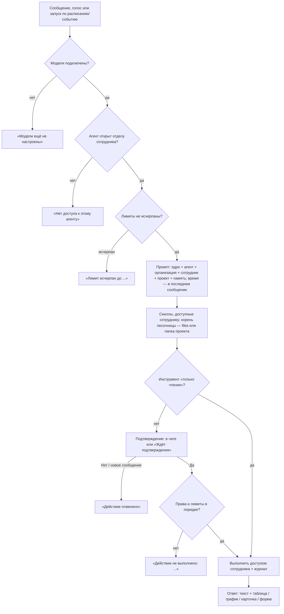
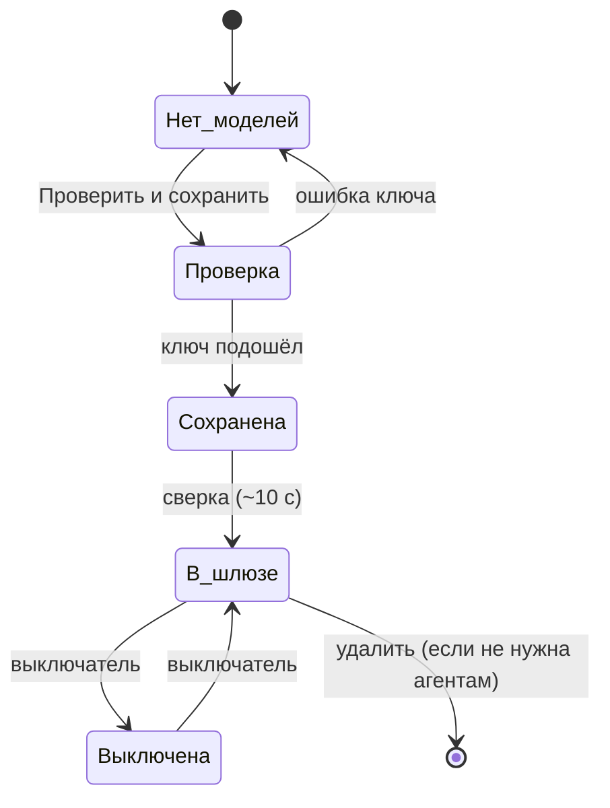
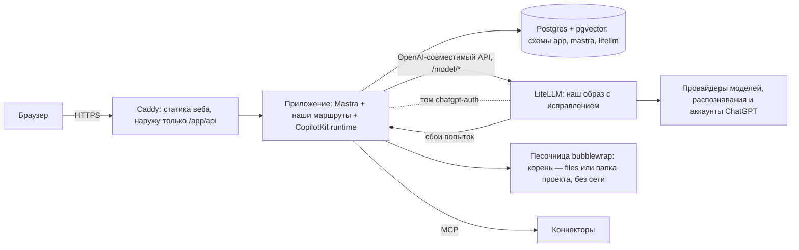
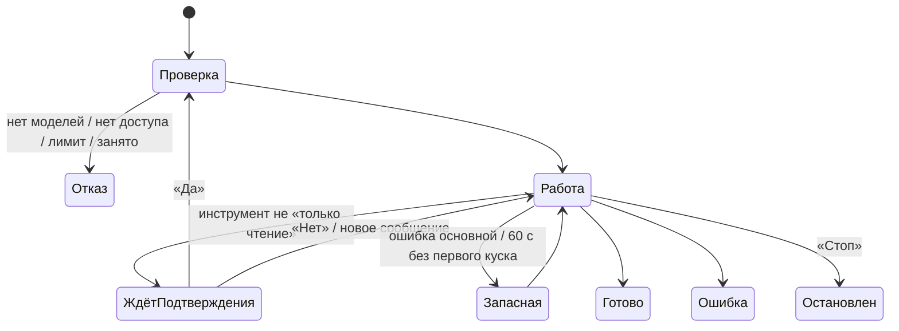

# Базовый бизнес-агент — спецификация

**Статус:** этап 1 (архитектура и каркас, шаги 0–24) реализован 2026-11-14, итог — в #1; этап 2 (новый интерфейс по макету и админка без разработчика, шаги 25–53) — согласован 14.11, в работе в ветке `stage-2-new-interface` (#2). Открыто: замер M1 на настоящей модели (нужен ключ провайдера), песочница при AppArmor на Ubuntu 24.04, живая проверка аккаунтов ChatGPT (нужен аккаунт владельца).
**Задача:** [#1](https://github.com/nyxandro/basic-business-agent/issues/1) — этап 1; [#2](https://github.com/nyxandro/basic-business-agent/issues/2) — этап 2.
**Дата:** 2026-11-12, переписано 2026-11-13, итоги шага 0 — 2026-11-14, этап 2 вписан 2026-11-14 · **Проект:** basic business agent · **Тип:** смешанный (то, чем пользуются люди, + внутренние механизмы учёта, доступа, фоновых задач, моделей и скиллов) · **Где работает:** веб-чат и веб-админка (компьютер и телефон); сервер на Node.js в Docker у каждого заказчика; шлюз моделей LiteLLM (свой образ)
**Не применяется:** —

Спецификация у проекта одна (решение владельца 14.11): новая работа вписывается сюда, отдельных файлов не заводим.

**Слова в этом документе.**
- **Заказчик** — организация, которой ставим агента.
- **Сотрудник** — человек заказчика.
- **Ядро** — общий код, без которого не годится ни один бизнес-агент.
- **Плагин** — модуль, который ставится по необходимости.
- **Скилл** — методика для агента: папка с `SKILL.md`, иногда со скриптами. Попадает в установку только загрузкой файла `.skill` в админке.
- **Проект** — личная папка разговоров сотрудника с общими инструкциями и файлами.
- **Рабочая область** — папка сотрудника на сервере, где агент работает с файлами внутри песочницы.
- **MCP** — общий стандарт подключения агента к внешним системам.
- **LiteLLM, шлюз** — прокладка между агентом и моделями: ключи, аккаунты подписок, учёт и лимиты.
- **Gen UI** — интерактивные ответы агента: таблицы, формы, графики.

Конкретные заказчики в этом документе не называются: репозиторий публичный.

## Коротко

**Что строим и зачем.** Лёгкого базового бизнес-агента — открытую разработку владельца. Из неё под каждого недорогого заказчика быстро собирается свой агент:
- веб-чат с интерактивными ответами;
- сотрудники с ролями и отделами;
- админка, в которой администратор заказчика сам, без разработчика, подключает модели и аккаунты подписок, загружает скиллы и заводит фоновые задачи;
- учёт и лимиты расходов;
- работа с CRM и почтой под личным доступом сотрудника.

Успех: агент для нового заказчика — это копия базы, выбранные плагины и промпт плюс настройка в админке, а не разработка.

**Как это работает.**
1. Агент работает в одном потоке, как ChatGPT или Codex. Каждый агент — папка: паспорт `agent.ts`, промпт `instructions.md`, подагенты и при необходимости свой инструмент.
2. Сотрудник входит по почте и паролю и попадает в чат с последним агентом. Слева одна панель:
   - агенты, проекты и недавние разговоры;
   - «Ждёт подтверждения» со счётчиком;
   - месячный лимит;
   - шестерёнка: память, расходы, подключения, тема, выход.

   Есть поиск по своим разговорам и голосовой ввод. Интерфейс работает на компьютере и телефоне, в светлой и тёмной теме.
3. Агент отвечает текстом, таблицами, графиками, карточками, кнопками выбора и формами.
4. Проект — личная папка разговоров с инструкциями и файлами. В разговоре проекта агент видит только файлы этого проекта и работает с ними как угодно, но не может удалить саму папку проекта.
5. Каждый сотрудник один раз подключает свои системы кнопкой «Подключить», и агент работает там с его правами. Любое действие наружу, не помеченное «только чтение», идёт через карточку подтверждения и попадает в журнал.
6. Фоновые задачи заводит только администратор. Область задачи — вся организация, отделы или отдельные сотрудники. Задача запускается отдельно у каждого сотрудника области, с его доступами и лимитом. Если агенту нужно решение человека, вопрос попадает на экран «Ждёт подтверждения».
7. Модели, ключи и аккаунты ChatGPT администратор добавляет в разделе «Нейросеть»: цены в рублях, основная и запасная модель, модель распознавания голоса, состояние каждого аккаунта. Скиллы он загружает файлом `.skill` и указывает, кому они доступны. Файлов настроек для моделей и скиллов нет.
8. Все запросы к моделям идут через LiteLLM. Отсюда расход по сотруднику, аккаунту и организации, месячные лимиты, пул аккаунтов подписки. Персональные данные перед моделью заменяются заглушками.
9. Переписку сотрудника видит только он сам. Администраторы видят цифры, журнал и управляют людьми, ролями, отделами, лимитами, промптами, моделями, скиллами и задачами.

**Как построено.**
1. Движок — Mastra: агенты, память, скиллы, MCP, правки промпта (Mastra Editor), расписания, песочница (Workspace), запасная модель.
2. Чат — CopilotKit 2 по протоколу AG-UI. Его части (поле ввода, сообщения, подсказки) заменены нашими компонентами через «слоты» — места, куда библиотека разрешает подставить свой компонент. Оформление по макету владельца, шрифты отдаёт наш сервер.
3. Вход — Better Auth. Роли, отделы, журнал, проекты, модели и скиллы — наши таблицы в Postgres. Ключи и данные входа хранятся зашифрованными.
4. LiteLLM — отдельный контейнер, наш образ с исправлением пула ChatGPT. Модели сервер сам передаёт в шлюз и сверяет при каждом старте. Копия учёта приходит к нам.
5. Каждый заказчик — git-копия репозитория и своя установка в Docker на сервере 8 ГБ.

**На что смотреть.**
- **Свежесть версий.** CopilotKit 2 — кандидат в выпуск, Mastra Editor — до 1.0. Связки проверены на живых примерах, версии закреплены точно.
- **Свой образ шлюза.** LiteLLM v1.108.4 держит один аккаунт ChatGPT на процесс, поэтому ставим исправление из открытого запроса на правку (PR #33680). Каждое обновление шлюза требует перенести правку; ежемесячная автоматическая проверка подскажет, когда исправление войдёт в основную версию.
- **Аккаунты ChatGPT — серая зона.** Правила OpenAI о пуле личных аккаунтов в чужом продукте не проверены. Вход в аккаунт проверяется только на настоящем аккаунте.
- **Свежая установка пуста.** Пока администратор не добавил модель, сотрудники видят «Модели ещё не настроены»; без загруженного скилла «Чтение документов» агент не читает PDF и Word. Суперадминистратора при входе ведём в «Нейросеть».
- **Песочница.** Скрипты скиллов идут в изоляции bubblewrap без сети и без доступа к Docker. На Ubuntu 24.04 изоляцию может запретить AppArmor — проверим при выкладке.
- **Маскирование обратимое.** Модель видит «[ПОЧТА_1]», а письмо уходит по настоящему адресу. Картинки, сканы и голос уходят как есть. Если маскирование сломалось, запрос в модель не уходит.
- **Поиск читает таблицы Mastra напрямую.** Если обновление Mastra поменяет их устройство, это поймает тест на настоящей базе.
- **Отложено:** база знаний — следующая работа в этой же спецификации; конкретные коннекторы; выкладка с резервными копиями; MCP Apps, прокси к зарубежным моделям, Telegram.

**На что опирается.**
- Документация внутри установленных пакетов Mastra 1.83 (скиллы `mastra-*` проекта), CopilotKit 2 (скилл `copilotkit`, docs.copilotkit.ai), LiteLLM, Better Auth.
- Проверки шага 0 на живых примерах (раздел 22) и код установленного шлюза.
- Опыт проектов владельца «Яна», «Домовей», СтройИнтеллект — опыт, а не код. Из «Яны» — пул ChatGPT на своём образе LiteLLM, сообщения шлюза о сбоях аккаунтов, вход в ChatGPT по коду устройства.
- Макет интерфейса владельца, 8 экранов.
- Две независимые проверки черновиков агентом без контекста разговора; скиллы проекта, установленные 14.11.

**Ждёт вашего решения:** ничего. Этап 2 ждёт команды начинать.

**Выкладка:** только локально. Работа заканчивается тестами, сквозными проверками в браузере на стенде и `pnpm smoke` со сборкой своего образа шлюза.

**Объём:**
- Этап 1: 26 шагов, около 61 ч — сделан.
- Этап 2: 29 шагов (25–53), около 55,5 ч работы агента. Основное время — прогоны тестов, сборка и проверка своего образа шлюза, проверка в браузере на 4 видах.

От вас: аккаунт ChatGPT, лучше два, для живой проверки входа и пула; позже — ключи провайдеров моделей и распознавания.

**Не проверено:**
- время до первого символа на настоящей модели;
- песочница на Ubuntu 24.04;
- правила OpenAI о подписках в стороннем продукте;
- проверки шага 25: слоты CopilotKit в настоящем окне чата, запасная модель, скиллы на один запрос, перенос исправления на шлюз, сообщения шлюза о сбоях аккаунтов, модели в базе шлюза, вход ChatGPT, стоимость расшифровки голоса, корень песочницы в папке проекта.

---

# Часть 1. Для владельца: как это устроено

## 1. Что известно и что добавлено

- **Владелец сказал** — всё сведено в раздел 6, «Принято» **[РЕШ]**, **[МАК]**.
- **Найдено в проекте:**
  - на 12.11 репозиторий был пустой (коммит `d711a1c`);
  - на 14.11 реализован этап 1: ядро, плагин-пример, веб-интерфейс-черновик, сквозные проверки;
  - веб — 4 902 строки (`web/src`), из них 818 в `ui/styles.css`.
- Что этап 2 меняет в устройстве этапа 1:
  - модели жили в `config/models.ts` с ключами в окружении, а в шлюз передавался только `OPENAI_API_KEY`;
  - скиллы — папки ядра, плагинов и агента;
  - фоновые задачи заводились командой `pnpm tasks` и были закреплены за одним сотрудником;
  - вложения лежали в `uploads/<разговор>` и удалялись с разговором;
  - строка текущего времени стоит в середине промпта;
  - в LiteLLM v1.108.4 данные входа ChatGPT — одни на процесс (`litellm/llms/chatgpt/authenticator.py`).
- **Добавлено:**
  - [ДОПУЩЕНИЕ] у заказчика 5–200 сотрудников, до 30 одновременных разговоров, до тысяч разговоров на человека;
  - [ДОПУЩЕНИЕ] заказчики в основном в РФ: интерфейс на русском, нужны российские модели и коннекторы;
  - [ДОПУЩЕНИЕ] сервер заказчика — одна виртуальная машина: 4 ядра, 8 ГБ;
  - [ДОПУЩЕНИЕ] запись голоса — до 2 минут; не больше 3 фоновых запусков одновременно [ЗАМЕР M4];
  - [ДОПУЩЕНИЕ] распознавание — около $0,003 за минуту (gpt-4o-mini-transcribe, сторонние обзоры 2026).
- **Противоречия между источниками:**
  - «Вернуть» после «Нет» в макете против окончательного решения на сервере — побеждает сервер.
  - «Чтение документов — в ядре» (13.11) против «скилл только через админку» (14.11): песочница, библиотеки и просмотр картинок остаются в ядре, а сам скилл загружается файлом. Это прочтение агента.
  - Строка макета «Агенты:» у скилла против «доступ по людям» (14.11) — побеждает решение.

| Код | Что это | От кого, дата | Где | Вес |
|---|---|---|---|---|
| РЕШ | Решения владельца по устройству базы | владелец, 2026-11-12…14 | разговоры; база решений владельца | требование |
| МАК | Макет «Бизнес-агент: интерфейс», 8 экранов | владелец, 2026-11-14 | https://claude.ai/code/artifact/1da889a0-2ec7-46fc-8726-9a364c517eb2 | требование |
| ЯНА | Опыт «Яны»: D-29, D-63, D-74 (пул ChatGPT на своём образе LiteLLM) | владелец, 2026-07…08 | `~/projects/yana-agent` | справка (опыт, не код) |

## 2. Цели, не-цели, анти-цели

- **Цели:**
  1. Агент под нового заказчика собирается без программирования ядра: копия базы, плагины, промпт и настройка в админке (модели, скиллы, задачи). Цель — 1–2 дня работы, когда нужные плагины есть [ИЗМЕРИТЬ на первом заказчике].
  2. Сотрудник получает чат, где агент работает с его системами под его правами, наглядно показывает данные и ничего необратимого не делает без подтверждения.
  3. Агент выполняет фоновые задачи по расписанию и событиям; решения человека собираются в одном месте.
  4. Администратор заказчика сам управляет людьми, ролями, отделами, лимитами, промптами, профилем организации, моделями, аккаунтами, скиллами и задачами — и видит, что сломалось.
  5. Расход виден по каждому сотруднику, аккаунту и организации; лимиты срабатывают до вызова модели.
  6. Каждый экран выглядит как в макете на компьютере (1440 px) и телефоне (390 px), в светлой и тёмной теме **[МАК]**.
  7. Сотрудник держит разговоры по проектам с инструкциями и файлами, находит любой свой разговор поиском, может говорить голосом.
- **Не-цели:**
  - база знаний и поиск по смыслу в файлах (следующая работа);
  - конкретные коннекторы;
  - выкладка с резервными копиями;
  - личная подписка ChatGPT на каждого сотрудника (общий пул организации);
  - оценки «лайк» у ответов (будут у документов);
  - задачи, которые сотрудник заводит сам;
  - MCP Apps, Telegram, письма-уведомления, визуальный конструктор процессов.
- **Анти-цели — провал, даже если всё работает:**
  - чтобы поменять промпт, модель или скилл, нужен разработчик;
  - агент показывает сотруднику то, что тому в CRM видеть нельзя;
  - кто-то, кроме сотрудника, читает его переписку, проекты или файлы;
  - какой-то адрес позволяет говорить с агентом в обход прав и лимитов;
  - учёт расходов врёт: прерванные, фоновые, голосовые вызовы не считаются;
  - ключ или данные входа видны в админке, ответе сервера или журнале;
  - скрипт скилла или вредный документ дотягиваются до сервера; недоступный сотруднику скилл виден его агенту;
  - агент удалил папку проекта;
  - браузер сотрудника ходит на чужие серверы;
  - кнопка, которая ничего не делает;
  - в публичном репозитории данные заказчика.
- **Сейчас:**
  - до этапа 1 каждый заказ собирался заново;
  - после этапа 1 модели, скиллы и задачи меняет только разработчик, а интерфейс — черновик.

## 3. На что опирается

| Практика | Кто делает | Берём? | Почему | Источник, дата |
|---|---|---|---|---|
| Агент как папка: промпт, инструменты, подагенты | Mastra, Claude Code | да | модульность | mastra.ai/docs/agents/file-based-agents, 2026-11-12 |
| Правки промпта поверх файла: черновик → публикация, история | Mastra Editor (Apache-2.0) | да, решение владельца | готовая возможность | mastra.ai/docs/editor/overview, 2026-11-12 |
| Скиллы нативно через Mastra (`skill`, `skill_read`, `skill_search`), список на каждый запрос функцией | Mastra; «Яна» (D-49) | да | меньше своего кода; выключенный или чужой скилл просто не передаётся | `mastra-core` `reference-workspace-workspace-class.md` |
| Скилл как zip-пакет `.skill` | skill-creator (Anthropic) | да, решение владельца | — | `skill-creator/scripts/package_skill.py` |
| Распаковка архивов с защитой от выхода за папку | обычная практика | да | архив — чужой файл | — |
| Строгие данные — нативным вызовом инструмента по схеме | «Яна» (D-44) | да | подписочный канал игнорирует «ответ по схеме» | yana-agent `AGENTS.md` |
| Методика — в скилле, гарантии — в ядре | «Яна» (D-45) | да | модель не обходит гарантию | там же |
| Встроенные расписания Mastra | Mastra (`mastra.schedules`) | да | не нужна отдельная очередь | mastra.ai/docs/long-running-agents/schedules, 2026-11-13 |
| Песочница Workspace: bubblewrap, без сети; одна область на сотрудника, корень по контексту разговора | Mastra; Codex, Claude Code (рабочая папка = проект) | да | граница безопасности — человек, граница контекста — проект | mastra.ai/docs/workspace/overview |
| Отдельная песочница на каждый проект | — | нет | лишние процессы и память на 8 ГБ | — |
| LiteLLM: ключ на сотрудника, бюджеты, пул аккаунтов, обход упавшего | LiteLLM; «Яна» | да, решение владельца | учёт и ротация в одном месте | docs.litellm.ai/docs/proxy/users |
| Модели в базе шлюза через его интерфейс управления | LiteLLM `store_model_in_db`, `/model/new` | да | модели без перезапуска (шлюз опрашивает базу ~10 с) | ctx7 `/berriai/litellm/v1.106.3` ARCHITECTURE.md, 2026-11-14 |
| Свой образ шлюза с исправлением апстрима до выпуска | «Яна» (D-74) | да, решение владельца | PR #33680 не влит, в v1.108.4 нет | код образа, 2026-11-14 |
| Свой модуль шлюза о сбоях каждой попытки аккаунта | «Яна» (`account_health_callback.py`) | да | повтор шлюза скрывает сбой первого аккаунта | ЯНА |
| Запасная модель списком, переключение по ошибке и по таймауту первого куска | Mastra `ModelWithRetries[]`, `modelSettings.timeout.firstChunkMs` | да | «висящая» модель не держит сотрудника | `mastra-core` `reference-agents-generate.md` |
| Обратимое маскирование перед моделью | свой обработчик Mastra | да | 152-ФЗ | docs.litellm.ai pii_masking_v2, 2026-11-13 |
| Чат CopilotKit 2 + AG-UI; три уровня настройки: цвета → слоты → свой чат на хуках | CopilotKit | да; слоты, запасной путь — свой чат | своя дизайн-система без потери библиотечного потока и Markdown | docs.copilotkit.ai `custom-look-and-feel/slots`, `headless`, 2026-11-14 |
| Неизменное начало промпта, изменчивое — в конце | книга Bojie Li, гл. 2 (`developing-ai-agents`) | да | время посередине ломает повторное использование начала промпта | `developing-ai-agents` `ch02-context-engineering.md` |
| Индекс на каждом внешнем ключе; очередь через `SKIP LOCKED`; без внешних вызовов внутри транзакции | Supabase Postgres best practices | да | каскады и выборки без полного просмотра; без двойного запуска | `supabase-postgres-best-practices` |
| Компоненты с явными вариантами и составные компоненты | Vercel composition patterns | да | около 20 общих компонентов с нуля | `vercel-composition-patterns` |
| Проект = инструкции + файлы, видимые всем разговорам проекта | ChatGPT Projects, Claude Projects | да, решение владельца | — | практика продуктов 2026 |
| Поиск подстрокой всех слов в Postgres | малые приложения | да | без нового сервиса | [ЗАМЕР M3] |
| Распознавание голоса через шлюз моделей | LiteLLM `/v1/audio/transcriptions` | да | учёт и лимиты как у чата | ctx7 LiteLLM, 2026-11-14 |
| Шрифты со своего сервера | закрытые установки | да | браузер говорит только с установкой | — |
| Сторонние действия GitHub закреплены по коммиту, права минимальные | GitHub | да | автоматическая проверка в публичном репозитории | `github-actions-docs` |
| Проверка «кто кого импортирует»; общие схемы данных | проекты владельца | да | границы плагинов; экран и сервер не расходятся | stroyintel `tooling/architecture/` |
| Процессы из блоков, модели на уровнях, Socket.IO, мультиарендность | «Яна», «Домовей» | нет, решение владельца | лёгкость; своя установка у каждого | — |
| Docling, Observational Memory | СтройИнтеллект, Mastra | нет | документы читаем скиллами; лишние фоновые вызовы | — |

## 4. Варианты и масштаб

**Масштаб:** [ДОПУЩЕНИЕ] 5–200 сотрудников, до 30 одновременных разговоров; обслуживают владелец и агенты; одна виртуальная машина 8 ГБ; живых установок у заказчиков нет — форматы меняем без переноса данных.

**Один путь** — его выбрал владелец. Внутри решений везде нижний достаточный уровень:
- модели и аккаунты — наша база плюс база шлюза;
- пул аккаунтов — один процесс шлюза с исправлением, а не шлюз на каждый аккаунт (около 1 ГБ на копию);
- скиллы — архив в базе, распаковка на диск сервера;
- проекты — одна рабочая область, корень песочницы по разговору;
- поиск — Postgres.

**Переходим выше, когда:**
- поиск дольше 300 мс — полнотекстовый индекс;
- исправление вошло в основную версию LiteLLM — снимаем свой образ;
- в проектах больше 50 файлов — поиск по смыслу (база знаний).

**Что открыто, что закрыто.**

| Слой | Что входит | Открыто или закрыто | Кому |
|---|---|---|---|
| Ядро | чат, вход, роли и отделы, админка, память, подтверждения, фоновые задачи, журнал, песочница и рабочие области, сборщик промпта, Mastra Editor, шлюз моделей и его образ, маскирование, подключения, проекты, поиск, голос, механизм плагинов, механизм скиллов | открыто, Apache-2.0 | любому |
| Общие плагины | коннекторы и общие возможности | открыто, Apache-2.0 | любому; в установку — только нужные |
| Скиллы | исходники в `skills/` (в шаблоне — «Чтение документов»); в установку попадают только загрузкой `.skill` в админке | открыто для общих, закрыто для скиллов заказчика | заказчику |
| Решение под компанию | узкие процессы, особые инструменты | закрыто | заказчику целиком |
| Проект заказчика | агенты, промпты, настройки | закрыто | заказчику |
| Данные заказчика | переписка, память, проекты, файлы, журналы, модели и ключи, загруженные скиллы | его | на его сервере |

**Как база доходит до заказчиков:**
1. Открытый репозиторий развивается сам.
2. Новый заказчик — git-копия: ненужные плагины убираются, его содержимое добавляется.
3. Общее из копии переносим в открытый репозиторий.
4. Старым заказчикам улучшения переносим слиянием по своему решению.

**Граница «общий плагин или решение под компанию».** Если плагин подойдёт другой компании после смены одних настроек, это общий плагин; иначе — решение под компанию.

## 5. Как это работает

**Точки входа:**

| Кто и откуда | Сценарий |
|---|---|
| Разработчик собирает установку | 1 |
| Первый вход суперадминистратора в пустую установку | 1, 9 |
| Сотрудник в чате | 2 |
| Подключение системы | 3 |
| Фоновая задача | 4 |
| Колокольчик, «Ждёт подтверждения» | 4 |
| Администратор | 5, 9, 10 |
| Проект | 6 |
| Поиск | 7 |
| Голос | 8 |
| Память | 11 |
| Новый заказчик | 12 |

**Сценарий 1 — собираем установку для заказчика «Альфа-Строй».**
1. `pnpm customer:new alfa-stroy` делает git-копию и спрашивает, какие плагины оставить. Остальные удаляются.
2. Разработчик создаёт `agents/sales/`: паспорт `agent.ts` (постоянный `id`, плагины, что «только чтение», подсказки) и `instructions.md`.
3. Заполняет `config/app.ts` (начальное название, часовой пояс, начальные настройки), настройки плагинов и `.env` (секреты, адреса, `LITELLM_SALT_KEY`).
4. `pnpm dev` поднимает всё локально. Суперадминистратор входит и попадает в «Нейросеть».
5. В «Нейросети» он добавляет модель (с проверкой ключа) и при необходимости аккаунт ChatGPT. В «Скиллах» загружает `read-documents.skill` из репозитория (`pnpm skills:pack`) и скиллы заказчика.
6. **Ключевой момент:** код ядра не трогали, моделей и скиллов в файлах нет.
- **При ошибке:** неизвестный плагин, незаполненная обязательная настройка или нет `id` — запуск падает с `APP_CONFIG_INVALID`, файлом и полем.

**Сценарий 2 — менеджер работает с агентом.** Ольга, отдел «Продажи», компьютер.
1. Входит — открывается новый разговор с последним агентом.
   - Пустой чат: «Чем помочь, Ольга?», описание агента, подсказки.
   - Слева агенты «Продажи» и «Общий помощник», её проекты, недавние разговоры, «Лимит за ноябрь 58 %».
2. «Покажи мои сделки без движения» → агент ищет в Битрикс24 её доступом («только чтение») → строка «✓ Битрикс24 · {действие} · только чтение» и таблица.
3. «Напиши клиентам по трём верхним» → карточка «Подтвердите действие»:
   - система и действие, параметры с подписями;
   - пометка «Изменит данные» и строка «Новое сообщение в чате отменит это действие»;
   - кнопки «Нет» / «Да, выполнить».

   «Да» → «Выполняю…» → «Выполнено · запись в журнале действий».
4. Прислала договор (PDF) → файл ложится в её папку `files`, агент читает его скиллом в песочнице и отвечает со ссылкой на страницу.
5. **Ключевой момент:** без «Да» ничего не уходит; расход записан на Ольгу.
- **Пишет новое сообщение вместо «Да»** — ожидающее действие отменяется.
- **Лимит исчерпан** — сообщение не уходит в модель, текст с датой нового лимита.
- **На телефоне:** панель выезжает из меню, подтверждения — листом снизу, в шапке колокольчик со счётчиком.

**Сценарий 3 — личное подключение.** «Настройки» → «Подключения» → Битрикс24 → «Подключить» → страница входа → «Подключено». Где нет входа через сайт — поля личного ключа, сервер проверяет его безопасным запросом. Агент видит ровно то, что видит Ольга.

**Сценарий 4 — фоновая задача.** Администратор Игорь в «Режимах работы» заводит «Утреннюю сводку»:
- агент «Продажи», область «Отдел продаж» (8 человек), по будням в 9:00;
- поручение: «пришли сводку по моим сделкам».

Что происходит дальше:
1. В 9:00 задача запускается для каждого сотрудника области, у которого есть доступ к агенту, — не больше 3 одновременно.
   - У каждого свой разговор «Задача: Утренняя сводка» с первой строкой: «Задачу «Утренняя сводка» завёл администратор Игорь Власов. Поставить на паузу или удалить её может администратор.»
   - Свои доступы, свой лимит.
2. Агенту нужно отправить письмо → вопрос появляется у этого сотрудника на экране «Ждёт подтверждения» и счётчиком в панели.
3. «Да» → действие выполняется, запись в журнал. «Нет» → агент получает отказ.
4. В админке видно: «Выполнено у 7 из 8 · 1 пропущен: нет доступа к агенту». По клику — разбивка по людям.
- События плагинов («пришло письмо») запускают агента от имени сотрудника тем же механизмом.
- Вопрос без ответа 72 часа истекает, действие не выполняется.

**Сценарий 5 — администратор.** Игорь. Админка сгруппирована:
- **«Нейросеть»:** нейросеть, маскирование, лимиты и расходы.
- **«Агенты»:** агенты и промпты, скиллы, режимы работы.
- **«Люди»:** сотрудники, отделы, роли.
- **«Система»:** подключения, журнал действий, профиль организации.

По разделам:
1. «Сотрудники»: таблица с поиском и фильтром отдела, приглашение (ссылка на 7 дней), отзыв, сброс пароля (24 часа), роли, блокировка, удаление; столбец «Расход / лимит».
2. «Роли»: таблица прав — роли столбцами, разделы строками; суперадминистратор заблокирован. Переписку сотрудников не видит никакая роль.
3. «Лимиты и расходы»:
   - сводка по организации, график по дням, отчёт по сотрудникам, агентам, моделям и аккаунтам;
   - потолок организации, лимит по умолчанию, личные лимиты, дневной потолок подписки.
4. «Агенты и промпты»: слои промпта, правка поверх файла → черновик → «Проверить в чате» → «Опубликовать»; модель агента из каталога; подсказки пустого чата.
5. «Профиль организации»: название, отрасль, тон общения (свободный текст), реквизиты — идут в промпт всех агентов.
6. «Маскирование»: выключатели видов данных и пример «Сотрудник пишет / Модель видит».
7. «Подключения» (карточки) и «Журнал действий» (фильтры дат, страницы).
8. **Ключевой момент:** всё без разработчика.

**Сценарий 6 — проект.** Ольга нажимает «+» у «Проекты», вводит «Тендер ЖК Северный».
1. Открывается страница проекта:
   - название и «Инструкции для агента»;
   - «Файлы проекта» (загрузить, скачать, удалить);
   - разговоры проекта;
   - «Новый разговор в проекте» с выбором агента.
2. В разговоре проекта агент знает инструкции и список файлов. Работает он в папке файлов проекта: читает, создаёт, переименовывает файлы — созданное сразу видно в «Файлах проекта». Саму папку удалить не может, а файлов вне проекта не видит.
3. Вложение в разговоре проекта становится файлом проекта. Чип проекта в поле ввода переносит разговор в другой проект или в «Без проекта».
4. Удаление проекта спрашивает: «Удалить проект «Тендер ЖК Северный»? Удалятся инструкции и 2 файла проекта. Разговоры останутся, без проекта.»

**Сценарий 7 — поиск.** «Поиск» или Ctrl+K → «договор Стройресурс».
- Находит разговоры, где каждое слово есть в заголовке или в любом сообщении, и проекты по названию.
- Фильтры: «Везде / Разговоры / Проекты» и «В проекте». Esc закрывает окно.
- Только свои разговоры.

**Сценарий 8 — голос.** Микрофон, рядом подсказка «Голос распознаёт внешний сервис. Не диктуйте паспортные данные и номера карт.»
1. Запись до 2 минут → «Готово» → «Распознаю…» → текст дописывается в поле. Отправляет Ольга сама.
2. Расход идёт в её лимит. При ошибке — «Повторить распознавание» с той же записью.
3. Без модели распознавания в «Нейросети» кнопки нет, без https кнопка неактивна.

**Сценарий 9 — «Нейросеть».** Игорь впервые входит в пустую установку и сразу попадает сюда: «Модели ещё не подключены — агенты не отвечают. Добавьте первую модель.»
1. «Добавить модель»:
   - чат или распознавание речи; название; провайдер и модель провайдера (`openai/gpt-4.1-mini`); адрес провайдера; ключ;
   - «Видит картинки»;
   - цены в рублях за 1 млн токенов по всем видам (для распознавания — либо так, либо за минуту).

   «Проверить и сохранить» отправляет пробный запрос, и через ~10 с модель доступна агентам. Ключей у модели может быть несколько — шлюз раздаёт запросы по кругу.
2. «Подключить аккаунт ChatGPT» → код и ссылка на сайт OpenAI → Игорь входит там → «Аккаунт подключён: {почта}». Модели подписки добавляются выбором подключения «Подписка ChatGPT», без ключа и цен. Каждый аккаунт обслуживает все модели подписки.
3. Карточки сверху:
   - «Шлюз работает · проверено 2 мин назад»;
   - основная и запасная модель;
   - «Аккаунты подписки: 2 из 3 работают».
4. Каталог: модель, провайдер, подключение, цены, роль (Основная / Резервная / Распознавание / По выбору агента), картинки, выключатель.
5. Пул аккаунтов:
   - состояние: «Работает», «Охлаждение — ошибка 429, вернётся в 14:32», «Ошибка доступа — войдите заново», «Нет запросов»;
   - последний успешный запрос и токены за сегодня;
   - «Войти заново», «Отключить».
6. «Параметры»:
   - основная модель — только из тех, что видят картинки;
   - запасная модель;
   - модель распознавания или «Нет — микрофон скрыт»;
   - «Агенты выбирают модель из каталога».
7. **Ключевой момент:** основная ответила ошибкой или молчит 60 секунд — агент сам продолжает на запасной; упавший аккаунт шлюз обходит, а Игорь видит, какой именно.

**Сценарий 10 — «Скиллы».** Игорь загружает `read-documents.skill`.
1. Админка проверяет архив и показывает название («Чтение документов»), описание, размер и файлы. Если внутри скрипты, предупреждает: они работают в песочнице без сети и только с установленными библиотеками — {список}.
2. «Кому доступен»: «Вся организация», «Отделы» или «Сотрудники».
3. В списке у каждого скилла выключатель, «Заменить» (новая версия) и «Удалить». Со следующего сообщения скилл видят агенты только тех сотрудников, кому он доступен.

**Сценарий 11 — личная память.** Ольга сказала «Я веду только юрлиц» → агент записал это в её память → «Настройки» → «Моя память»: посмотреть, поправить, «Забыть всё». Больше никто её память не видит.

**Сценарий 12 — новый заказчик и улучшения.** В марте — копия для «Альфа-Строя». Улучшили плагин почты — переносим в открытый репозиторий. В мае «Бета-Логистик» получает копию с улучшением. Уязвимость в июне исправляем в открытом репозитории и переносим «Альфа-Строю» слиянием.



## 6. Решения владельца

Открытых развилок нет.

### Принято

| Тема | Решение владельца | Как в ядре |
|---|---|---|
| Основа | Не LibreChat; TypeScript; Mastra; новый проект без кода из других проектов (12.11) | исправление LiteLLM — это запрос на правку в LiteLLM, а не код «Яны» |
| Доставка | Заказчику — git-копия на момент создания; базу улучшаем отдельно (13.11) | раздел 4; `pnpm customer:new` |
| Открытость | Ядро и общие плагины открыты (Apache-2.0); решение под компанию закрыто (13.11) | раздел 4 |
| Установка | Своя на каждого заказчика; одна база на организацию | — |
| Агенты | В одном потоке, без «кубиков»; шаги — только в узких процессах заказчика | `workflows/` — только в копии |
| Фоновые задачи | В ядре; заводит **только администратор в админке**, с областью: вся организация, отделы, сотрудники; запуск — отдельно у каждого сотрудника области с доступом к агенту; `pnpm tasks` убирается (14.11, F7 + У5; закрыта прежняя F2) | 8.6 |
| Журнал действий | В ядре | 8.5 |
| Чтение документов | В ядре — песочница, библиотеки, просмотр картинок; сам скилл — загрузкой в админке (14.11, прочтение агента) | 8.15 |
| Песочница | В ядре; у сотрудника своя рабочая область; файлы — в `files`, файлы проекта — в `projects/<проект>/files`; папку проекта агент удалить не может, внутри — всё (14.11, У6) | 8.7 |
| Шлюз моделей | LiteLLM — прокладка, не плагин | 8.1 |
| Модели и ключи | **Только в админке** (14.11, F1); `config/models.ts`, описание моделей в генераторе настроек шлюза, `model` и `editable.models` в паспорте агента — убрать (14.11, У2) | 8.1 |
| Подписки | Опционально; **пул аккаунтов ChatGPT на своём образе шлюза с исправлением, как в «Яне»** (14.11, У1); подключение аккаунта — в админке | 8.1 |
| Скиллы | **Только загрузкой `.skill` в админке, больше нигде; деления «ядро / компания / плагин» нет; у каждого скилла область: сотрудники, отделы или вся организация** (14.11, F2 + У3) | 8.15 |
| Проекты | Папка + инструкции + файлы (14.11, F4) | 8.12 |
| Голос | Микрофон сейчас; модель распознавания добавляет администратор; без неё микрофона нет (14.11, F3 + У4) | 8.14 |
| Интерфейс | Весь заново по макету, старая вёрстка — под ноль; вид и все функции макета одной работой (14.11) | этап 2 |
| Оценки ответов | Кнопки «Хороший ответ» нет; оценки будут у документов (14.11, F6) | — |
| Тон общения | Свободный текст в админке (14.11, F5) | профиль организации |
| Лимиты | На каждого и общий на организацию | бюджеты LiteLLM |
| Права во внешних системах | Каждый подключает лично; нет способа — общее подключение через MCP с авторизацией на нём | 8.8 |
| Промпт | Динамический сборщик из слоёв; правка в админке через Mastra Editor поверх файла | 8.3 |
| Видимость переписки | Каждый видит только свою, руководитель тоже | — |
| Роли | Создаются в админке: разделы админки и права на документы | раздел 17 |
| Память | Только личная; общее знание — база знаний (следующая работа) | — |
| Строгие данные | Нативный вызов инструментов по схеме | правило |
| Лёгкость | Не тащим: модели на уровнях, каталог возможностей, Socket.IO, прокси (пока), Docling (пока) | — |
| Задачи разработки | GitHub Issues; задачи бизнес-агентов — в CRM через MCP | — |
| Репозиторий | Личный аккаунт GitHub владельца, публичный (13.11) | проверка «нет данных заказчиков» |
| Запуск | Только локально (13.11) | — |
| Маскирование | Что маскировать, настраивает администратор (13.11) | 8.11 |
| Постоянные разрешения | Нет: каждое действие наружу — через «Да», в фоновых задачах тоже (13.11) | 8.4 |
| Остаток и дневной потолок | Сотрудник видит остаток лимита; подписка ограничена дневным потолком токенов (13.11) | 8.1 |
| Спецификация | Одна на проект; новая работа вписывается сюда (14.11) | `AGENTS.md` |

---

# Часть 2. Для исполнителя: поведение подробно

## 7. Точки контакта и состояния

| Точка | Пусто / первый раз | Загрузка | Есть данные | Ошибка | Нет прав | Успех |
|---|---|---|---|---|---|---|
| Вход `/login` | форма | «Вхожу…» | — | раздел 9, почта сохраняется | `APP_AUTH_BANNED` | `/` |
| Приглашение `/invite/:token`, сброс `/reset/:token` | форма пароля | то же | — | `APP_INVITE_INVALID` / `APP_PASSWORD_RESET_INVALID` | — | вход |
| Главная `/` | без агентов: «Вам пока не назначены агенты. Обратитесь к администратору.» | — | новый разговор с последним агентом (запоминается в браузере) | — | — | — |
| Пустая установка | сотрудник: «Модели ещё не настроены. Обратитесь к администратору.» вместо поля ввода; суперадмин: переход в «Нейросеть» с плашкой | — | — | — | — | — |
| Боковая панель | нет проектов — заголовок с «+»; нет разговоров — «Разговоров пока нет» | полоски | агенты; проекты с числом разговоров; 30 недавних по всем агентам с «новое» у задач, «Показать ещё»; «Ждёт подтверждения» со счётчиком; лимит; имя и шестерёнка | баннер с «Повторить» | «Админка» скрыта | — |
| Чат `/agents/:agentId?thread=` | «Чем помочь, {имя}?», описание, до 3 подсказок | «Загружаю разговор…», «Думает…» | лента; строка инструмента; карточка подтверждения; блоки Gen UI | над полем ввода текст и код; черновик хранится в браузере | `APP_AGENT_ACCESS_DENIED` | ответ |
| Поле ввода | «Спросите агента или поручите задачу»; скрепка, чип проекта, микрофон, отправка | «Стоп» | — | чип вложения с ошибкой | — | — |
| Запись голоса | — | «Распознаю…» | полоса записи: время, волна, «Отменить», «Готово» | текст и «Повторить распознавание» | нет https — кнопка неактивна; нет модели — кнопки нет | текст в поле |
| Строка инструмента | — | «Ищу в …» | «✓ {система} · {действие}», «только чтение», «{N} найдено»; раскрывается | «Действие «…» не выполнилось» | `APP_CONNECTOR_NOT_CONNECTED` со ссылкой | — |
| Карточка подтверждения | — | «Выполняю…» | «Подтвердите действие», система и действие, параметры, «Изменит данные», «Нет» / «Да, выполнить» | «Действие не выполнено: …» | — | «Выполнено · запись в журнале действий» / «Действие отменено» |
| Блоки Gen UI | — | — | таблица, график, карточка, выбор, форма | «Не удалось показать данные» + данные текстом | — | выбор и форма уходят сообщением |
| Страница проекта `/projects/:id` | «Добавьте инструкции и файлы — агент будет учитывать их во всех разговорах проекта» | полоски | инструкции, файлы, разговоры | баннер; файл с ошибкой и «Повторить» | чужой — «Проект не найден.» | «Сохранено» |
| Поиск | «Начните вводить — найду разговоры и проекты»; ничего — «Ничего не нашлось. Попробуйте другие слова или выберите все проекты.» | вращение | группы, «Найдено: N» | «Поиск сейчас не работает. Попробуйте ещё раз.» + код | — | — |
| «Ждёт подтверждения» (страница; на телефоне — лист) | «Решений не ждёт ни одно действие.» | полоски | вопрос: задача, агент, что сделает, когда спросил, «истекает через …»; «Не получилось» с «Подключить заново» | «Повторить» | — | «Выполнено» / «Отклонено»; через 72 ч — «Истекло» |
| Настройки → «Моя память» | «Агенты пока ничего о вас не запомнили» | полоска | текст, «Изменить», «Забыть всё» | «Повторить» | — | «Сохранено» / «Память очищена» |
| Настройки → «Мои расходы» | «В этом месяце расходов пока нет» | полоска | «Израсходовано 1 760 ₽ из 3 000 ₽, обновится 1 декабря»; подписка — «Сегодня: 120 тыс. из 500 тыс. токенов» | «Повторить» | — | — |
| Настройки → «Подключения» | «Не подключено» | — | «Подключено · проверено …» / «Сохранено, не проверено» / «Ошибка доступа» | `APP_CONNECTOR_AUTH_FAILED`, ввод сохраняется | — | «Подключено» |
| Админка, любой раздел | свой пустой текст (раздел 12) с кнопкой первого действия | полоски | данные | баннер с «Повторить» | `/` с плашкой «Этот раздел вам недоступен» | всплывающее «Сохранено», 2,4 с |
| Нейросеть | плашка пустой установки | полоски | карточки, каталог, пул, параметры | шлюз не ответил: «Шлюз не отвечает · проверено …», данные из нашей базы; расхождение: «Шлюз ещё применяет изменения» (до 30 с) | без права `models` скрыт | «Сохранено» / «Аккаунт подключён» |
| Подключение аккаунта ChatGPT | код, «Открыть сайт OpenAI», «Жду входа… осталось мм:сс» | — | — | истёк (15 мин): «Время на вход вышло. Начните заново.»; отказ — «Вход не выполнен.» | — | «Аккаунт подключён: {почта}» |
| Скиллы | «Скиллов пока нет. Загрузите файл .skill — например, read-documents.skill из репозитория установки.» | полоски | список | раздел 9 | без права `skills` скрыт | «Скилл загружен» |
| Режимы работы | «Фоновых задач пока нет. Создайте первую.» | полоски | карточки и таблица; «Идёт: 3 из 8» | баннер | без права `agents` скрыт | «Задача создана» |

**Инструменты, которые даёт ядро**

| Инструмент | Когда звать | Возвращает | Меняет | Ошибки |
|---|---|---|---|---|
| `show_table`, `show_chart`, `show_card`, `ask_choice`, `ask_form` | показать данные наглядно или спросить выбор | `{ shown: true }` | ничего | `APP_UI_INVALID_DATA` |
| Скиллы (`skill`, `skill_read`, `skill_search`) | Mastra, нативно; только скиллы, доступные сотруднику | — | — | — |
| Файлы и команды песочницы | работать с файлами корня разговора (`files/` или папки проекта) | по Mastra | только корень разговора | `APP_SANDBOX_*` |
| `view_image` | посмотреть картинку из рабочей области | путь и тип | ничего | — |
| Рабочая память | сотрудник сообщил устойчивый факт о себе | — | личная память | — |
| Инструменты плагинов и MCP | по описаниям | по схеме | всё, что не «только чтение», — через подтверждение | `APP_CONNECTOR_*`, `APP_TOOL_FAILED` |

Строгие данные модель передаёт только аргументами инструментов. Тексты из инструментов, документов, файлов проекта — данные, а не команды.

## 8. Внутренние механизмы

**8.1. Шлюз моделей, модели и учёт (LiteLLM).**
- **Путь запроса.** Все вызовы моделей и распознавания идут на LiteLLM внутри сети установки с виртуальным ключом сотрудника. Провайдерских ключей у приложения в работе нет: администратор вводит их один раз, приложение хранит их зашифрованными только для сверки со шлюзом.
- **Модели — в админке, источник правды — наша база** (`app.models`, `app.model_provider_keys`, `app.chatgpt_accounts`, раздел 17.4). Шлюз хранит модели в своей базе: `store_model_in_db`, соль `LITELLM_SALT_KEY`.
  - Сервер передаёт модели в шлюз через `/model/new`, `PATCH /model/{id}/update`, `/model/delete` после каждого изменения и сверяет их при старте (`core/models/gateway-sync.ts`). Сбой сверки при старте не останавливает сервер: пишется `gateway_sync_failed`, «Нейросеть» показывает расхождение.
  - Деплоймент шлюза: `model_name` = id модели; `model_info.id` = `<модель>:<ключ или аккаунт>`; цены в рублях за токен (`pricesToLiteLLM`); для подписки — параметр `chatgpt_auth_file`. В `model_info` — метка установки `bba_owner` и отпечаток параметров `bba_fingerprint`: сверка трогает только свои деплойменты (заведённые в шлюзе вручную и деплойменты других тестовых баз не трогает) и обновляет только изменившиеся.
  - Порядок любого изменения: сначала шлюз, потом наша база. Шлюз отказал — в базе ничего не меняется, и «Попробуйте ещё раз» означает повтор с нуля; запись в базу не удалась после шлюза — шлюз лишь впереди, следующая сверка поправит. Удалённый ключ уходит из шлюза раньше, чем из базы, поэтому после удаления не используется. Изменения идут по одному (одна очередь на сервер).
  - Изменение доступно сразу (V17: 0,15 с).
  - Провайдер, модель провайдера, адрес и вид модели после создания не меняются — другая модель заводится заново; меняются название, «Видит картинки», включение и цены. Последний ключ модели не удаляется: без него модель перестала бы отвечать.
- **Проверка ключа.** При сохранении модели и при добавлении ключа — пробный запрос самого шлюза (`/health/test_connection`, ничего не сохраняет; ответ — до 16 токенов по умолчанию шлюза: ограничение в 1 токен ломает модели с рассуждениями). Ключ не подошёл — модель не сохраняется (`APP_MODEL_CHECK_FAILED`); провайдер не ответил — тот же код с текстом «Провайдер не ответил». В ответах сервера, журнале и текстах ошибок ключа нет, только последние 4 символа.
- **Аккаунты ChatGPT.** Подключаются входом по коду устройства на сайте OpenAI, сервер ждёт до 15 минут [ПРОВЕРИТЬ V22: адреса и поля — по опыту «Яны» и Codex CLI].
  - Токены шифруются в `app.chatgpt_accounts`, рабочая копия — файл `chatgpt-auth/<accountId>.json` в томе, общем для приложения и шлюза.
  - Деплоймент — на каждую пару «аккаунт × модель подписки».
  - Шлюз сам обновляет токен и пишет его в файл; сверка при старте берёт более свежую копию по времени обновления [ПРОВЕРИТЬ V19].
- **Свой образ шлюза** (`deploy/litellm/`):
  - база — `ghcr.io/berriai/litellm:v1.108.4`, закреплённая по digest;
  - исправление, часть 1 — перенос PR #33680: параметр деплоймента `chatgpt_auth_file`;
  - исправление, часть 2 — серверный вход: внутри шлюза нет входа по коду устройства, а ошибка входа остаётся ошибкой входа, чтобы шлюз охлаждал аккаунт (опыт «Яны»);
  - наш модуль `account_events_callback.py` присылает сбой каждой попытки (деплоймент, статус, код, охлаждение) на `/app/api/internal/account-events`;
  - `temporary-fix.json` — что, почему, когда снимать;
  - ежемесячная проверка в GitHub сообщает, вышло ли исправление в основной версии.
- **Состояние аккаунта:**
  - «Ошибка доступа» — последний сбой 401/403 и после него нет успеха;
  - «Охлаждение» — до `cooldown_until` последнего сбоя;
  - «Работает» — есть успех за 30 дней;
  - «Нет запросов» — нет данных.

  Если модуль не видит отдельных попыток [V20], остаётся «Не отвечает»: у соседей по пулу за сутки есть успехи, у этого аккаунта нет.
- **Выбор модели агента** — одно место, `core/models/resolve.ts`:
  1. модель агента из админки, если «Агенты выбирают модель из каталога» включено и модель включена;
  2. иначе основная модель организации, если включена;
  3. иначе `APP_MODEL_NOT_CONFIGURED`.

  На `resolve.ts` переходят `core/editor/prompts.ts`, `core/chat/run.ts`, `core/chat/copilot.ts`, `core/background/service.ts`. Основной и запасной можно выбрать только модель с картинками (`vision`).
- **Запасная модель.** Если задана, включена и отличается от выбранной, идёт второй в списке Mastra. Переключение — при ошибке основной или если та не прислала первый кусок ответа за 60 с (`modelSettings.timeout.firstChunkMs = 60_000`, только когда запасная задана; `totalMs` не задаём — он переключение не делает). Когда запасная задана, Mastra не повторяет запрос к упавшей основной (шлюз уже попробовал её другие ключи и аккаунты) — сразу переключается (V15).
- **Точка входа выбирает модели один раз** (чат, ответ «Да»/«Нет», фоновая задача) и кладёт основную и запасную в контекст запроса; агент строит из них вызов. Без выбранной модели вызов модели не начинается.
- **Учёт на сотрудника.** Виртуальный ключ LiteLLM на каждого, организация — одна команда. Расход по сотруднику, деплойменту и итог (проверено, V3).
- **Лимиты.** Личный — бюджет ключа с ежемесячным сбросом; общий — бюджет команды. Отказ LiteLLM переводим в `APP_USAGE_LIMIT_EXCEEDED` / `APP_USAGE_ORG_LIMIT_EXCEEDED` по тому, что он назвал в отказе (`Key=…` / `Team=…`).
- **Деньги в рублях.** Цены моделей вводятся в админке в рублях за 1 млн токенов по всем видам (вход, выход, кэш чтения, кэш записи, рассуждения, картинка). Пустая цена не принимается: иначе LiteLLM молча возьмёт свою цену в долларах. Подписка — цена 0.
- **Распознавание голоса.** Модель вида «распознавание»; цена — по токенам (gpt-4o-mini-transcribe возвращает токены) или за минуту (`input_cost_per_second = perMinute / 60`; whisper-подобные возвращают длительность). Приём учёта пишет `usage_cost_missing`, если у платной модели пришла нулевая стоимость [ПРОВЕРИТЬ V16].
- **Ротация.** Несколько ключей или аккаунтов одной модели — одна группа деплойментов: раздача по кругу, обход упавшего, охлаждение 60 с. `always_include_stream_usage: true`.
- **Наша копия учёта.** После каждого успешного вызова LiteLLM присылает запись в `usage_events`; отчёты читают её. Прерванный ответ LiteLLM списывает сам (V3). Тексты переписки в учёт не попадают (`turn_off_message_logging`).
- **Перерасход на границе** на одно сообщение принимаем (V3).
- **Подписка.** Дневной потолок токенов на сотрудника считаем сами по `usage_events` перед вызовом, для каждой модели списка:
  - потолок исчерпан у основной — отказ (`APP_USAGE_DAILY_CAP_EXCEEDED`), запасная потолок не обходит;
  - исчерпан у запасной — запрос идёт без неё.
- **Месячный сброс** — по часовому поясу установки, 1-го числа в 00:00 (V3).
- **Маскирование** — нашим слоем до LiteLLM (8.11).

**8.2. Права и видимость.**
- Роли — наши таблицы: права на разделы админки и на документы. Встроенная роль «Суперадминистратор» — все права; последнего снять нельзя.
- Новые права этапа 2: `models` («Нейросеть»), `skills` («Скиллы»); задачи — под правом `agents`.
- Отделы: сотрудник может быть в нескольких; отдел открывает агентов.
- Переписку, проекты, файлы и поиск видит только автор: ключ ресурса Mastra = `userId`, сервер ставит его сам.

**8.3. Сборщик промпта.**
- `instructions` агента — текст `instructions.md` или опубликованная правка Mastra Editor; это единственный слой, который правится в админке поверх файла.
- Остальные слои добавляет обработчик входа Mastra системными сообщениями, от неизменного к изменчивому:
  1. правила ядра (`core/prompts/base-rules.md`);
  2. профиль организации: название, отрасль, тон (свободный текст), реквизиты;
  3. профиль сотрудника: имя, должность, отделы — **без времени**;
  4. проект, если разговор в проекте: «# Проект «{название}»», инструкции, список файлов из `files/` (до 100 имён с размером, затем «и ещё N»);
  5. личная память — её подставляет Mastra, после наших слоёв (проверено 14.11).
- **Времени в системном промпте нет.** Провайдер повторно использует только неизменное начало запроса, а после системного промпта идёт вся история разговора: строка времени где угодно в нём заставляла бы каждую минуту пересчитывать и промпт, и историю. Поэтому «(Сейчас: {дата и время}, {часовой пояс})» дописывается к последнему сообщению сотрудника только в уходящем запросе (`processLLMRequest`), в сохранённую историю не попадает (проверено тестом, 14.11).
- Правила ядра не правятся из админки. Отключить их можно только явно в паспорте агента (`baseRules: false`).

**8.4. Подтверждения.**
- Подтверждения требует каждый инструмент плагина и MCP, кроме `readOnly` паспорта; новый инструмент MCP-сервера — тоже.
- Инструменты ядра подтверждения не требуют: файлы и команды в корне разговора (песочница без сети), скиллы, память, блоки Gen UI.
- В чате подтверждение — прерывание хода AG-UI; ответ — `resume` с `{ approved }` (V4). Карточку рисуем сами через `useInterrupt`. Название действия и подписи параметров берутся из описаний инструмента: Mastra `description` и `.describe()` полей; MCP `title`/`description`. Пересказа от модели нет.
- В фоновой задаче вопрос сохраняется в `approval_requests` с названием и подписями на момент вопроса.
- Продолжение после «Да» заново проверяет доступ и лимит. Новое сообщение отменяет ожидающее действие. Повторное решение по тому же вопросу сервер отклоняет.
- Вопрос фоновой задачи истекает через 72 часа.

**8.5. Журнал действий.** Запись на каждое выполненное действие не «только чтение»: кто запустил, агент, инструмент, ключевые аргументы без секретов, кто подтвердил, результат, код. Плюс запуск и завершение фоновых задач. С этапа 2 пишутся и изменения администратора:
- задачи — кто создал или поменял;
- модели и ключи — без значений;
- аккаунты, скиллы.

Только добавление; просмотр — по праву роли.

**8.6. Фоновые задачи.**
- **Где описаны.** Источник правды — `background_tasks` и `task_scope`. Задачи заводит, правит, ставит на паузу и удаляет только администратор в «Режимах работы». Расписания Mastra строятся из таблицы, синхронизация — раз в минуту и при изменении.
- **Расписание** — пресеты: каждый день, по будням, раз в неделю (день), раз в месяц (число), плюс время в часовом поясе установки. Cron строит код; нестандартный cron (задачи до этапа 2) показывается только для чтения.
- **Область:**
  - «Вся организация» — все активные сотрудники с доступом к агенту;
  - «Отделы» — сотрудники выбранных отделов с доступом;
  - «Сотрудники» — выбранные люди.

  Новый сотрудник отдела попадает в следующий запуск. Пустая область не сохраняется.
- **Срабатывание.** Создаются строки `background_task_runs` (задача, время срабатывания, сотрудник), уникальные по этой тройке:
  - сотрудник без доступа к агенту или заблокированный — `skipped` с причиной;
  - остальные — в очередь.
- **Очередь.** Не больше 3 запусков одновременно; строки забираются `FOR UPDATE SKIP LOCKED`.
- **Запуск** — от имени сотрудника, на его доступах и лимите, в разговоре `bg:<taskId>:<userId>`. При создании разговора первой строкой идёт сообщение ассистента: «Задачу «{название}» завёл администратор {имя}…». Результат — с отметкой «новое».
- **Итог в админке:** «Выполнено у N из M», разбивка по людям: выполнено, ждёт решения, ошибка, пропущено с причиной, в очереди.
- **События** — плагин вызывает `startAgentRun(agentId, userId, prompt)` («пришло письмо»). Плагин отмечает событие обработанным только после успешного запуска.
- **Предыдущий запуск этого сотрудника ждёт решения** — следующий у него пропускается с записью в журнал.
- **После перезапуска сервера** догоняются только строки без результата; пропуск больше суток назад — «Пропущено».
- **Агента больше нет** — задача останавливается целиком с пометкой «Агента больше нет».
- **Удаление задачи** сначала отклоняет её ожидающие вопросы (путь истечения `expireOverdue`), затем удаляет строку. Разговоры у сотрудников остаются.
- **Механизм запуска** (V5): одношаговый процесс `background-run`, `approveToolCall` после «Да» в том числе после перезапуска, `mastra.startWorkers()`, точность 10 с.
- **Срабатывание помечается временем по расписанию**, а не временем прихода: двойной сигнал расписания и догоняющий запуск того же срабатывания не создают второй строки. Строка сотрудника, взятая из очереди, ещё раз проверяет его доступ: заблокированного или потерявшего доступ к этому времени — `skipped`.
- **Итог строки:** `done`, `awaiting-approval` (после решения — `done`; после истечения или удаления задачи — `failed` с `APP_APPROVAL_EXPIRED` / `APP_TASK_DELETED`), `failed` с кодом ошибки, `skipped` с причиной `no_access`, `blocked`, `awaiting_approval`, `too_late`.
- **Раз в месяц** — числа 1–28: задача не пропускает короткие месяцы.
- **Отметка «новое»** — у строки сотрудника; открытие разговора задачи её снимает.

**8.7. Песочница и рабочие области.**
- **Основной путь** (V6): Mastra Workspace с `LocalSandbox` и изоляцией bubblewrap внутри контейнера приложения. Сеть выключена, переменных окружения приложения нет. Код приложения, чужие папки и Docker не видны. Контейнеру нужен свой профиль seccomp (`deploy/seccomp-bwrap.json`: стандартный плюс 7 системных вызовов).
- **Рабочая область сотрудника** (`APP_WORKSPACE_DIR`):
  ```
  /workspace/<userId>/
    files/                    ← файлы разговоров вне проектов и то, что агент создаёт там
    projects/<projectId>/     ← папка проекта; создаёт и удаляет только сервер
      files/                  ← файлы проекта
  ```
- **Корень по разговору.**
  - Разговор вне проекта — корень песочницы и файловой системы агента `files/`.
  - Разговор проекта — корень `projects/<projectId>/files/`. Всё, что агент там создаёт, сразу видно в «Файлах проекта»; саму папку проекта агент не видит.
  - Корень — точка монтирования: содержимое агент может менять как угодно, а удалить сам корень нельзя (проверено, V21, 14.11). Соседние папки не видны.
  - Рабочие картинки скиллов (отрисованные страницы сканов) ложатся в скрытую папку `.renders/` и в списки файлов не попадают.
  - Кэш песочниц — по паре «сотрудник — корень»; при удалении сотрудника уничтожается.
- **Имя папки проекта** — его id, не название: переименование и любые символы ничего не ломают.
- **Скиллы в песочнице.** Только скиллы, доступные сотруднику (8.15): их папки на каждый запрос попадают в `Workspace.skills`, в `allowedPaths` файловой системы и в `readOnlyPaths` песочницы. Остальные не видны и не запускаются.
- **Библиотеки Python** для скриптов скиллов (`core/sandbox/requirements.txt`: pypdf, pypdfium2, pillow, python-docx, openpyxl) ставятся в образ. Доустановить из песочницы нельзя — нет сети.
- **Не больше 8 команд одновременно**, остальные ждут до 60 с → `APP_SANDBOX_BUSY` (M2: 0,1–0,2 с на документ).
- **Запасной путь** при AppArmor на Ubuntu 24.04 — отдельный Docker-демон без прав на сервер (sysbox или rootless).
- Сканы и картинки модель читает по изображению страницы (`view_image`).

**8.8. Личные доступы.**
- `connector_credentials` хранятся зашифрованным JSON (AES-256-GCM) с версией ключа: `static` или `oauth`.
- OAuth: обратный адрес `/app/api/connections/:id/oauth/callback`; проверка — `checkTool` паспорта плагина.
- Соединения (V7): к внешнему серверу с личным доступом — `MCPClient` на пару «сотрудник + сервер», закрывается после 30 минут простоя. К нашему MCP-серверу — одно соединение, в каждом вызове подписанный заголовок «кто спрашивает».
- Обновление OAuth идёт под блокировкой и заранее. Ключ истёк — «Ошибка доступа» и строка в «Не получилось».

**8.9. Файлы и вложения.**
- До 20 МБ на файл: PDF, DOCX, XLSX, CSV, TXT, PNG, JPG.
- Вложение в разговоре вне проекта ложится в `files/`, в разговоре проекта — в `projects/<id>/files/`. Файлы проекта загружаются и на его странице.
- Одинаковое имя получает «(2)». Запись идёт во временный файл, затем переименование, так что оборванная загрузка не оставляет файла.
- Удаление разговора файлы не удаляет: они принадлежат папке. Удаление проекта удаляет его папку (после вопроса с числом файлов), удаление сотрудника — всю его область.
- В базу знаний файлы сами не попадают. Изображения уходят в модель без маскирования.

**8.10. Ресурсы сервера.** Потолки памяти:
- Postgres — 1,5 ГБ;
- LiteLLM — 1 ГБ;
- приложение с песочницами — 3 ГБ;
- веб-сервер — 128 МБ.

Фоновые запуски — не больше 3 одновременно [ЗАМЕР M4].

**8.11. Маскирование.**
- Раздел админки — выключатели видов: паспорт РФ, СНИЛС, банковская карта, ИНН, телефон, почта. Ниже пример «Сотрудник пишет / Модель видит». Изменения пишутся в `admin_audit`.
- Начальное состояние — из `config/app.ts` (`masking.initialKinds`).
- **Как распознаём** — шаблоны с контрольной суммой, где она есть. Имена — плагином, нужно 1–2 ГБ памяти.
- **Подмена туда.** Всё, что уходит в модель, маскируется: сообщения, результаты инструментов, память, профиль, инструкции проекта, содержимое файлов в результатах инструментов. Заглушки устойчивы в пределах разговора (`masking_map`).
- **Подмена обратно:** в аргументах инструмента до выполнения и в потоке ответа. Сохраняются настоящие значения.
- **Выдуманная заглушка** — инструмент не выполняется. **Сбой маскирования** — запрос не уходит (`APP_MASKING_FAILED`).
- **Голос** уходит к провайдеру распознавания как есть, поэтому у микрофона подсказка. Расшифрованный текст маскируется как обычный.

**8.12. Проекты.**
- `app.projects` (свои у каждого сотрудника, название уникально у сотрудника, инструкции до 8 000 символов) и `app.thread_projects` (связь «разговор → проект»).
- **Связь хранится у нас, а не в метаданных Mastra:** проект можно выбрать до первого сообщения, когда потока ещё нет.
  - Если поток принадлежит другому сотруднику, связь игнорируется и удаляется.
  - Связи без потока старше суток удаляются при чтении списка; счётчики считаются только по существующим разговорам.
- Список разговоров — по всем агентам сотрудника, постранично по курсору (время и id последнего), без `OFFSET`.
- Перенос разговора в другой проект меняет корень песочницы со следующего хода. Файлы остаются там, где были загружены.

**8.13. Поиск.**
- Только свои разговоры (`resourceId`), без черновых (`kind = 'draft'`), и свои проекты.
- Ищет в заголовке и в текстовых частях сообщений сотрудника и агента — не в результатах инструментов и не в служебных словах JSON.
- Разговор подходит, если каждое слово запроса есть в нём подстрокой, без учёта регистра; морфологии нет. Спецсимволы экранируются; запрос короче 2 символов не отправляется.
- Кусок текста — ±60 символов вокруг совпадения; до 50 результатов по последнему изменению.
- Читает таблицы `mastra.mastra_threads` и `mastra.mastra_messages` напрямую, поэтому живёт в одном модуле `core/search/` с тестом на настоящей базе.
- Сначала грубый отбор: каждое слово должно встретиться в заголовке или в сыром тексте сообщений разговора (без разбора JSON). Затем точная проверка по текстовым частям — от новых разговоров к старым, до 50 найденных.
- Замер M3 (14.11): 190–300 мс на 50 000 сообщений одного сотрудника. Поиск дольше 300 мс пишет `search_slow` в журнал; при регулярных записях — индекс `pg_trgm`.

**8.14. Голос.**
- Браузер пишет через `MediaRecorder`: Chrome и Firefox — webm, Safari — mp4. Предел — 120 с, потом остановка сама. Работает только на https и localhost.
- `POST /app/api/voice/transcribe`: проверка бюджета → LiteLLM `/v1/audio/transcriptions` с ключом сотрудника, моделью из параметров «Нейросети» и заголовком `x-bba-agent-id` (агент разговора).
- Текст дописывается в черновик того разговора, где началась запись (`writeDraft`). Голос не хранится.
- Запрос — `multipart`: файл записи и `agentId` разговора (агент должен быть открыт сотруднику). Принимается только звук (webm, mp4, ogg, wav, mp3); имени файла сервер даёт расширение по типу — по нему провайдер узнаёт формат. Пустой текст (тишина) — `APP_VOICE_FAILED`. `APP_VOICE_NO_MIC` и `APP_VOICE_TOO_SHORT` — коды браузера, до сервера запись не доходит.
- `usage_cost_missing` пишется для любой платной модели с нулевой стоимостью вызова, не только для голоса.

**8.15. Скиллы.**
- **Скилл — одна сущность**, без деления на «ядро / компания / плагин». Попадает в установку только загрузкой `.skill` в админке. Папки скиллов в ядре, плагинах и агентах загрузчик больше не читает.
- **Формат `.skill`:** zip-архив с одной папкой верхнего уровня и `SKILL.md` с полями `name` (`^[a-z0-9][a-z0-9-]{1,63}$`) и `description`. Название для людей — первый заголовок `SKILL.md`.
- **Проверка архива:**
  - ≤ 10 МБ архив, ≤ 50 МБ в распакованном виде, ≤ 500 файлов;
  - нет `..`, абсолютных путей и ссылок.
- **Хранение.** Архив — в `app.skills` (`bytea`), поэтому резервная копия базы сохраняет и скиллы. Распаковка — в `APP_SKILLS_DIR/<name>/<sha256>/`; при старте распаковываются все включённые, лишние копии удаляются.
- **Область:** «Вся организация», «Отделы» или «Сотрудники» (`skill_scope`). На каждый запрос `skillsFor(userId)` отдаёт включённые скиллы, доступные сотруднику: организация, его отделы, он сам.
- **Замена версии** не мешает идущему ответу: старая копия по `sha256` дорабатывает, следующий ответ получает новую.
- **Набор скиллов фиксируется на запуск.** Точка входа (чат, фоновая задача) один раз спрашивает `skillsFor(userId)` и кладёт пути в контекст запроса; по ним список скиллов агента, файловые инструменты (`allowedPaths`) и песочница (`readOnlyPaths`); ключ кэша песочницы включает отпечаток набора — другой набор, другая песочница.
- **Загрузка в два шага:** `POST admin/skills?check=1` только читает файл и показывает содержимое (название, описание, размер, файлы, есть ли скрипты, уже загружен ли); без `check` — сохраняет с областью. `PUT admin/skills/:name` с файлом — новая версия (имя в файле должно совпасть), с JSON — выключатель и область. Папка в архиве называется как скилл.
- Папка `skills/` в плагине или агенте, оставшаяся с этапа 1, останавливает запуск с подсказкой (`pnpm skills:pack` и загрузка). Скилл демо-плагина «Заметки» перенесён в `skills/note-taking/`.
- Собранные `skills/*.skill` лежат в репозитории рядом с исходниками — их скачивает администратор; тест сверяет каждый с его папкой.
- **Скилл «Чтение документов»** лежит исходником в `skills/read-documents/`; `pnpm skills:pack` собирает `read-documents.skill` для загрузки.



| Что ломается | Как предотвращаем | Как узнаём | Как восстанавливаемся | Покрыто |
|---|---|---|---|---|
| LiteLLM недоступен | healthcheck, автоперезапуск | `APP_MODEL_GATEWAY_UNAVAILABLE`, журнал | контейнер поднимается сам | шаги 5, 21 |
| База шлюза разошлась с нашей | сверка при старте и после изменения | `gateway_sync_*` в журнале, плашка | повтор сверки | шаг 31 |
| Ключ или токен утёк через интерфейс | шифрование, наружу только «сохранён» и 4 символа | тест сканирует ответы и журнал | — | шаг 31 |
| Подписочный аккаунт отозван | исправление шлюза охлаждает и обходит; наш модуль сообщает сбой | «Ошибка доступа — войдите заново» | «Войти заново» | шаги 30, 32 |
| Обновлённый шлюзом токен потерян | сверка берёт более свежий | — | — | шаг 32 |
| Основная модель упала или молчит | запасная вторым в списке Mastra | `model_fallback_used` | автоматически | шаг 31 |
| Модель, выбранная основной, удалена | удаление очищает выбор у агентов и в параметрах в одной транзакции | — | выбрать другую | шаг 31 |
| Расшифровка записана по 0 ₽ | цены обязательны; `usage_cost_missing` | журнал | правка цен | шаг 33 |
| Скилл виден не тем людям | список и пути песочницы на каждый запрос | тест | — | шаг 34 |
| Архив скилла с путями наружу или бомбой | проверка до распаковки | ошибка загрузки | — | шаг 34 |
| Агент удалил папку проекта | корень — точка монтирования | тест | — | шаги 25, 27 |
| Песочница не стартовала или занята | проверка изоляции; не больше 8 команд | `APP_SANDBOX_*` | повтор | шаг 11 |
| Расписание не сработало при перезапуске | догоняются строки без результата | «Пропущено» | догоняющий запуск, если меньше суток | шаги 13, 35 |
| Двойной запуск задачи у сотрудника | уникальность (задача, время, сотрудник); `SKIP LOCKED` | — | — | шаг 35 |
| 100 сотрудников в области | не больше 3 одновременно | «Идёт: 3 из 100» | — | шаг 35 |
| Фоновая задача упала | — | журнал, «Не получилось», итог в админке | следующее срабатывание | шаги 13, 35 |
| Ключ шифрования сменился | версия ключа в записи | `APP_CONNECTOR_DECRYPT_FAILED` | вернуть ключ или переподключить | шаг 10 |
| Миграция упала | каждая в транзакции | старт падает с кодом | предыдущий образ + копия базы | шаг 2 |
| Маскирование упало | запрос не уходит | `APP_MASKING_FAILED` | повтор | шаг 5а |

## 9. Ошибки и восстановление

Формат: что случилось — что делать; код мелко под текстом. Технические подробности — только в журнал на английском. Введённое человеком при ошибке сохраняется.

| Ситуация | Текст для человека | Код |
|---|---|---|
| Неверный пароль | «Неверная почта или пароль. Проверьте раскладку и попробуйте ещё раз.» | `APP_AUTH_INVALID_CREDENTIALS` |
| Много попыток | «Слишком много попыток входа. Подождите несколько минут и попробуйте снова.» | `APP_AUTH_RATE_LIMITED` |
| Заблокирован | «Ваша учётная запись заблокирована. Обратитесь к администратору.» | `APP_AUTH_BANNED` |
| Сессия истекла | «Сессия истекла. Войдите заново — разговоры сохранены.» | `APP_AUTH_SESSION_EXPIRED` |
| Приглашение недействительно | «Ссылка-приглашение недействительна или уже использована. Попросите администратора прислать новую.» | `APP_INVITE_INVALID` |
| Почта уже есть | «Сотрудник с этой почтой уже есть. Если он заблокирован — разблокируйте его, если забыл пароль — создайте ссылку для сброса.» | `APP_INVITE_EMAIL_EXISTS` |
| Ссылка сброса недействительна | «Ссылка для смены пароля недействительна или устарела. Попросите администратора создать новую.» | `APP_PASSWORD_RESET_INVALID` |
| Нет доступа к агенту | «У вас нет доступа к этому агенту. Если он нужен для работы, обратитесь к администратору.» | `APP_AGENT_ACCESS_DENIED` |
| Агента больше нет | «Этот агент больше не доступен. Разговор можно прочитать, но не продолжить.» | `APP_AGENT_NOT_FOUND` |
| Раздел админки недоступен | «Этот раздел вам недоступен. Если он нужен для работы, обратитесь к администратору.» | `APP_ADMIN_FORBIDDEN` |
| Моделей нет | «Модели ещё не настроены. Обратитесь к администратору.» | `APP_MODEL_NOT_CONFIGURED` |
| Личный лимит исчерпан | «Ваш лимит расходов на этот месяц исчерпан. Новый лимит начнётся {date}. Если нужно раньше — обратитесь к администратору.» | `APP_USAGE_LIMIT_EXCEEDED` |
| Лимит организации исчерпан | «Лимит расходов организации на этот месяц исчерпан. Новый лимит начнётся {date}. Обратитесь к администратору.» | `APP_USAGE_ORG_LIMIT_EXCEEDED` |
| Дневной потолок подписки | «На сегодня ваш лимит запросов к модели исчерпан. Он обновится завтра; если нужно раньше — обратитесь к администратору.» | `APP_USAGE_DAILY_CAP_EXCEEDED` |
| Шлюз недоступен | «Сервис моделей сейчас не отвечает. Попробуйте через минуту; если повторяется — сообщите администратору код ошибки.» | `APP_MODEL_GATEWAY_UNAVAILABLE` |
| Модель не отвечает / все аккаунты недоступны | «Модель сейчас не отвечает. Попробуйте ещё раз через минуту; если повторяется — сообщите администратору код ошибки.» | `APP_MODEL_UNAVAILABLE` |
| Частота запросов | «Слишком много запросов к модели. Подождите минуту и отправьте сообщение снова.» | `APP_MODEL_RATE_LIMITED` |
| Проблема с доступом к модели | «Не удалось обратиться к модели: проблема с настройками доступа. Сообщите администратору код ошибки.» | `APP_MODEL_AUTH_FAILED` |
| Разговор слишком длинный | «Разговор стал слишком длинным для модели. Начните новый — агент помнит важное о вас.» | `APP_MODEL_CONTEXT_EXCEEDED` |
| Ключ не подошёл (админка) | «Провайдер не принял ключ. Проверьте ключ и модель провайдера.» | `APP_MODEL_CHECK_FAILED` |
| Провайдер не ответил на проверку | «Провайдер не ответил. Попробуйте ещё раз.» | `APP_MODEL_CHECK_FAILED` |
| Цены не заполнены | «Укажите все цены в рублях — без них расход посчитается неверно.» | `APP_VALIDATION_FAILED` |
| Шлюз не принял модель | «Шлюз не принял изменения. Попробуйте ещё раз; если повторяется — сообщите разработчику код.» | `APP_GATEWAY_SYNC_FAILED` |
| Модель нужна агентам | «Модель нужна агентам: {список}. Сначала выберите основную модель организации или другую модель этим агентам.» | `APP_MODEL_IN_USE` |
| Основная или запасная без картинок | «Эта модель не видит картинки — агенты перестанут читать сканы. Выберите модель с картинками.» | `APP_VALIDATION_FAILED` |
| Основная = запасная | «Запасная модель должна отличаться от основной.» | `APP_VALIDATION_FAILED` |
| Вход ChatGPT: код истёк | «Время на вход вышло. Начните заново.» | `APP_CHATGPT_LOGIN_EXPIRED` |
| Вход ChatGPT отклонён | «Вход не выполнен. Попробуйте ещё раз.» | `APP_CHATGPT_LOGIN_FAILED` |
| Аккаунт уже подключён | «Этот аккаунт уже подключён.» | `APP_VALIDATION_FAILED` |
| Не файл скилла | «Это не файл скилла: внутри нет SKILL.md.» | `APP_SKILL_INVALID` |
| Нет полей в `SKILL.md` | «В SKILL.md не хватает полей name и description.» | `APP_SKILL_INVALID` |
| Архив небезопасен или велик | «Архив скилла небезопасен или слишком большой (не больше 10 МБ, 500 файлов).» | `APP_SKILL_INVALID` |
| Скилл уже есть | «Скилл «{название}» уже загружен. Чтобы обновить, нажмите «Заменить» у него.» | `APP_SKILL_EXISTS` |
| Не удалось подготовить скилл | «Не удалось подготовить скилл. Попробуйте ещё раз.» | `APP_SKILL_UNPACK_FAILED` |
| Пустая область скилла или задачи | «Выберите хотя бы один отдел или сотрудника.» | `APP_VALIDATION_FAILED` |
| В области задачи нет доступа к агенту | «В области задачи нет сотрудников с доступом к агенту {агент}.» | `APP_VALIDATION_FAILED` |
| Проект с таким названием есть | «Проект «{название}» уже есть.» | `APP_PROJECT_EXISTS` |
| Не удалось сохранить проект или перенести разговор | «Не удалось сохранить проект. Попробуйте ещё раз.» | `APP_PROJECT_SAVE_FAILED` |
| Поиск упал | «Поиск сейчас не работает. Попробуйте ещё раз.» | `APP_SEARCH_FAILED` |
| Нет доступа к микрофону | «Нет доступа к микрофону. Разрешите его в настройках браузера.» | `APP_VOICE_NO_MIC` |
| Запись короче 0,5 с | «Запись слишком короткая. Скажите ещё раз.» | `APP_VOICE_TOO_SHORT` |
| Распознавание не удалось | «Не удалось распознать запись. Попробуйте ещё раз или напишите текстом.» | `APP_VOICE_FAILED` |
| Распознавание не настроено (запрос пришёл) | «Голосовой ввод в этой установке не настроен.» | `APP_VOICE_NOT_CONFIGURED` |
| Обрыв связи | «Связь прервалась, ответ мог прийти не полностью. Обновите страницу и повторите вопрос.» | `APP_CHAT_STREAM_INTERRUPTED` |
| Ответ уже идёт в другой вкладке | «В этом разговоре уже идёт ответ в другой вкладке. Дождитесь его и обновите страницу.» | `APP_CHAT_THREAD_BUSY` |
| Подтверждение, а прав или лимита нет | «Действие не выполнено: {у вас больше нет доступа к этому агенту / лимит расходов исчерпан}.» | — |
| Подключение недоступно | «{Система} сейчас недоступна. Агент продолжит без неё; попробуйте позже.» | `APP_CONNECTOR_UNAVAILABLE` |
| Нет личного подключения | «Чтобы агент работал с {Система} от вашего имени, подключите её в настройках → «Подключения».» | `APP_CONNECTOR_NOT_CONNECTED` |
| Доступ отклонён системой | «{Система} не приняла ваш доступ — возможно, он истёк. Переподключите её в настройках.» | `APP_CONNECTOR_AUTH_FAILED` |
| Доступ не расшифровался | «Не удалось прочитать ваш доступ к {Система} — проблема на сервере, переподключение не поможет. Сообщите администратору код ошибки.» | `APP_CONNECTOR_DECRYPT_FAILED` |
| Песочница недоступна | «Не удалось запустить рабочую среду агента. Попробуйте ещё раз через минуту; если повторяется — сообщите администратору код ошибки.» | `APP_SANDBOX_UNAVAILABLE` |
| Скрипт скилла упал | «Не удалось обработать файл «{имя}». Агент сообщит, что можно сделать.» | `APP_SANDBOX_SCRIPT_FAILED` |
| Песочница занята | «Рабочая среда сейчас занята другими задачами. Попробуйте через минуту.» | `APP_SANDBOX_BUSY` |
| Файл слишком большой | «Файл больше 20 МБ. Сожмите его или разделите на части.» | `APP_UPLOAD_TOO_LARGE` |
| Неподдерживаемый формат | «Такой формат агент пока не читает. Подойдут PDF, Word, Excel, CSV, TXT и картинки PNG или JPG.» | `APP_UPLOAD_TYPE_UNSUPPORTED` |
| Подтверждение фоновой задачи истекло | «Истекло: действие не выполнено. Если оно ещё нужно, запустите задачу снова.» | — |
| Фоновый запуск пропущен | «Запуск задачи «{название}» в {время} пропущен: {предыдущий ещё ждёт решения / сервер перезапускался}.» | `APP_BACKGROUND_RUN_SKIPPED` |
| Фоновая задача не получилась | «Задача «{название}» не выполнилась {время}. Можно запустить её снова.» | `APP_BACKGROUND_RUN_FAILED` |
| Маскирование не сработало | «Не удалось подготовить запрос к модели: не сработала защита персональных данных. Попробуйте ещё раз; если повторяется — сообщите администратору код ошибки.» | `APP_MASKING_FAILED` |
| Инструмент упал | «Действие «{название}» не выполнилось. Агент сообщит, что можно сделать.» | `APP_TOOL_FAILED` |
| Не удалось сохранить в админке | «Не удалось сохранить изменения. Попробуйте ещё раз; если повторяется — сообщите код ошибки.» | `APP_ADMIN_SAVE_FAILED` |
| Последний суперадминистратор | «Нельзя снять эту роль с последнего суперадминистратора — иначе управлять системой станет некому.» | `APP_ADMIN_LAST_SUPERADMIN` |
| Удаление сотрудника не полностью | «Удалено не всё. Нажмите «Удалить» ещё раз — повтор безопасен. Пока удаление не завершено, сотрудник заблокирован.» | `APP_ADMIN_DELETE_PARTIAL` |
| Пустой промпт | «Нельзя опубликовать пустой промпт — агент перестанет работать.» | `APP_AGENT_INSTRUCTIONS_EMPTY` |
| Одновременная правка промпта | «Пока вы редактировали, промпт изменил(а) {имя}. Скопируйте свой текст, обновите страницу и внесите правку в свежую версию.» | `APP_AGENT_DRAFT_CONFLICT` |
| Битая настройка (разработчику) | `APP_CONFIG_INVALID: <файл>: <поле>: <что не так>`, приложение не стартует | `APP_CONFIG_INVALID` |

## 10. Крайние случаи и стыки

| Случай | Как обрабатываем |
|---|---|
| Двойная отправка | кнопка неактивна, пока идёт ход |
| Тот же разговор в двух вкладках | `APP_CHAT_THREAD_BUSY` |
| Чужой разговор, проект, файл по идентификатору | Mastra отказывает (V4) / `APP_NOT_FOUND` без подсказки, что такой есть |
| Запрос к встроенному адресу Mastra | таких адресов нет; Caddy пропускает только `/app/api` |
| Убрали из отдела | следующее сообщение — `APP_AGENT_ACCESS_DENIED`; скиллы отдела больше не видны; задачи отдела его пропускают |
| Агента удалили | блок «Агенты, которых больше нет»; задачи этого агента останавливаются |
| В документе «игнорируй инструкции…» | правила ядра: тексты — данные; отправка только через подтверждение; песочница без сети |
| Огромный файл | скрипты читают постранично |
| Граница месяца | бюджеты сбрасываются 1-го в 00:00 по поясу установки |
| Сессия истекла, пока печатал | черновик в браузере возвращается после входа |
| Заглушка разрезана между кусками потока | обратная подмена держит незакрытую `[` до 40 символов |
| Большая таблица из CRM | рисуется из результата инструмента, модель её не перепечатывает |
| Два окна, в одном удалили проект | запрос из второго — «Проект не найден.», панель перечитывается |
| Поиск со спецсимволами или короче 2 символов | экранируются; короткий не отправляется |
| Во время «Распознаю…» ушёл в другой разговор | текст — в черновик исходного разговора |
| Имя файла уже есть | «смета (2).xlsx» |
| Разговор перенесён из проекта A в B | дальше работает в B; файлы A остаются в A |
| Скилл заменён во время ответа | ответ дорабатывает со старой копией |
| Новый сотрудник отдела | попадает в следующий запуск задачи отдела; видит скиллы отдела |
| Задача удалена, ждут вопросы | вопросы отклоняются с записью в журнал, затем удаление |
| Модель удалена, у неё ключи | ключи удаляются каскадом и из шлюза при сверке |
| Аккаунт ChatGPT отключён | его деплойменты удаляются, файл входа удаляется из тома |
| Ширина 390–860 px | телефонная раскладка |
| Ответ на подтверждение из истории | итог без кнопок |

| Стык | Что происходит | Кто главнее |
|---|---|---|
| Правка в админке ↔ файл `instructions.md` | обе версии существуют | опубликованная правка; «Вернуть версию из файла» |
| Правка промпта ↔ обновление ядра | правила ядра — отдельный слой | обновление ядра доходит всегда |
| Подтверждение ↔ лимит и отделы | продолжение — новый запрос | повторная проверка |
| Пул подписки ↔ лимиты | цена 0 | денежные лимиты не тратятся; действует дневной потолок |
| Запасная модель ↔ дневной потолок | — | потолок основной не обходится; исчерпанная запасная не включается |
| Удаление сотрудника ↔ проекты, области, задачи, скиллы | каскад | проекты и область удаляются; из областей выпадает; задача с пустой областью — «Некому выполнять» |
| Маскирование ↔ инструкции проекта, файлы, голос | одинаковый путь в модель | маскируется всё, кроме голоса (подсказка у кнопки) |
| Проверка черновика ↔ память | черновик пишет в отдельную память | ключ ресурса `draft:<userId>`, расход — тому, кто проверяет |
| Песочница ↔ скиллы и папки | — | только доступные скиллы и корень своего разговора |
| Права админки ↔ «Лимиты и расходы» | части по правам | `limits` — настройки, `usage` — сводка, график, отчёт |

## 11. Скорость

| Действие | Цель | Что видно | Если дольше |
|---|---|---|---|
| Вход, панель | < 1 с | полоски | после 10 с — ошибка и «Повторить» |
| Первый символ ответа | до 3 с [ИЗМЕРИТЬ M1] | «Думает…», «Стоп» | 60 с без первого куска → запасная модель, если задана |
| Команда песочницы | 0,1–0,2 с на документ (M2) | «Читаю файл…» | 120 с → `APP_SANDBOX_SCRIPT_FAILED`; в очереди 60 с → `APP_SANDBOX_BUSY` |
| Вызов инструмента MCP | зависит от системы | «Ищу в …» | 60 с → `APP_CONNECTOR_UNAVAILABLE` |
| Поиск | < 300 мс [ЗАМЕР M3] | вращение | устаревшие ответы отбрасываются |
| Распознавание 10 с речи | 1–3 с [ЗАМЕР] | «Распознаю…» | 60 с → ошибка |
| Сохранить модель с проверкой | 1–5 с | «Проверяю ключ…» | 30 с → «Провайдер не ответил» |
| Модель доступна после сохранения | ~10 с | «Шлюз применяет изменения» | 30 с → «Шлюз не принял изменения» |
| Вход ChatGPT | до 15 мин | «Жду входа…» с отсчётом | истечение |
| Задача на 100 сотрудников | ≈ (100 / 3) × время ответа | «Идёт: N из 100» | — |

## 12. Тексты интерфейса

Тексты макета — дословно, где совпадает смысл. Тексты состояний и ошибок — в разделах 7 и 9.

| Где | Текст |
|---|---|
| Панель | «Поиск», «Новый разговор», «Агенты», «Проекты», «Недавние», «новое», «Ждёт подтверждения», «{N} действия ждут решения», «Админка», «Лимит за {месяц}» … «{N} %» (подсказка «Обновится {дата}»; без потолка — «Расход за {месяц}: {сумма}») |
| Меню шестерёнки | «Моя память», «Мои расходы», «Подключения» («{подключено} из {всего}»), «Тема», «Светлая», «Тёмная», «Выйти» |
| Меню админки | группы «Нейросеть», «Агенты», «Люди», «Система»; разделы «Нейросеть», «Маскирование», «Лимиты и расходы», «Агенты и промпты», «Скиллы», «Режимы работы», «Сотрудники», «Отделы», «Роли», «Подключения», «Журнал действий», «Профиль организации»; «Вернуться в чат» |
| Поле ввода | «Спросите агента или поручите задачу», «Прикрепить файл», «Без проекта», «Голосовой ввод», «Отправить», «Стоп» |
| Подсказка у микрофона | «Голос распознаёт внешний сервис. Не диктуйте паспортные данные и номера карт.» |
| Карточка подтверждения | «Подтвердите действие», «Изменит данные», «Новое сообщение в чате отменит это действие», «Нет», «Да, выполнить», «Выполняю…», «Выполнено · запись в журнале действий», «Действие отменено» |
| Строка инструмента | «{система} · {действие}», «только чтение», «{N} найдено»; действие — описание инструмента до первой точки, иначе техническое имя; значение параметра длиннее 300 символов — «…» |
| Проект | «Название проекта», «Инструкции для агента», «Файлы проекта», «Загрузить файл», «Новый разговор в проекте», «Переименовать», «Удалить»; удаление — «Удалить проект «{название}»? Удалятся инструкции и {N} файлов проекта. Разговоры останутся, без проекта.»; файл — «Удалить файл «{имя}»? Агент больше не сможет его прочитать.» |
| Поиск | «Искать в разговорах и проектах», «Везде», «Разговоры», «Проекты», «В проекте», «Все проекты», «Найдено: {N}», «Нет совпадений» |
| Нейросеть | «Добавить модель», «Модель чата», «Распознавание речи», «Название», «Провайдер и модель», «Адрес провайдера (если не стандартный)», «Ключ», «Видит картинки», «Цены, ₽ за 1 млн токенов: вход, выход, кэш чтения, кэш записи, рассуждения», «Картинка, ₽», «Цена, ₽ за минуту», «Проверить и сохранить», «Проверяю ключ…», «Ключ подошёл», «Добавить ключ», «Ключ сохранён · …{4 символа}», «Подключить аккаунт ChatGPT», «Откройте сайт OpenAI и введите код {код}», «Жду входа… осталось {мм:сс}», «Аккаунт подключён: {почта}», «Войти заново», «Отключить», «Подписка ChatGPT», «Основная модель», «При сбое переключаться на», «Без запасной», «Модель распознавания речи», «Нет — микрофон скрыт», «Агенты выбирают модель из каталога» |
| Состояния аккаунта | «Работает», «Охлаждение — ошибка {код}, вернётся в {чч:мм}», «Ошибка доступа — войдите заново», «Не отвечает», «Нет запросов»; «последний успешный запрос {когда}», «{N} токенов сегодня» |
| Скиллы | «Загрузить скилл (.skill)», «Кому доступен», «Вся организация», «Отделы», «Сотрудники», «Загрузил {имя}, {дата}», «Заменить», «Удалить», «Скрипты работают в песочнице без сети и могут пользоваться только установленными библиотеками: {список}», «Скилл загружен»; удаление — «Удалить скилл «{название}»? Агенты перестанут им пользоваться со следующего сообщения.» |
| Режимы работы | «В чате», «По расписанию», «По событию», «Новая задача», «Область», «Каждый день», «По будням», «Раз в неделю», «Раз в месяц», «в {чч:мм}», «Выполнено у {N} из {M}», «Идёт: {N} из {M}», «Некому выполнять», «Агента больше нет», «Задача создана», «Задача удалена»; разбивка — «Выполнено», «Ждёт решения», «Ошибка», «Пропущено: нет доступа к агенту», «Пропущено: сотрудник заблокирован», «В очереди»; удаление — «Удалить задачу «{название}»? Вопросы, которые ждут решения сотрудников, будут отклонены. Разговоры задачи у сотрудников останутся.»; правила — «Каждое действие наружу через «Да»», «Вопрос ждёт ответа 72 часа», «Песочница без сети» |
| Первая строка разговора задачи | «Задачу «{название}» завёл администратор {имя}. Поставить на паузу или удалить её может администратор.» |
| Агенты и промпты | «Как собирается промпт при каждом запросе»: «Правила ядра → Промпт агента → Профиль организации → Профиль сотрудника → Проект → Личная память»; «Подсказки в пустом чате», «Вернуть подсказки из файла»; «Модель агента: основная организации / {модели}»; «Сохранить черновик», «Проверить в чате», «Опубликовать», «Вернуть версию из файла»; пометки «Изменён в админке», «Файл изменён после правки в админке» |
| Профиль организации | «Название», «Отрасль», «Тон общения», «Реквизиты», «Обновил {имя}, {дата}» |
| Маскирование | «Скрывать от модели» · «Паспорт РФ», «СНИЛС», «Номер банковской карты», «ИНН», «Телефон», «Электронная почта» · «Сотрудник пишет», «Модель видит» · «Модель видит заглушку вроде [ПОЧТА_1], а письма и таблицы получают настоящие данные. Картинки и сканы уходят в модель как есть.» |
| Песочница | «Читаю файл…» · «Жду свободную рабочую среду…» |
| Память | «Моя память» · «Изменить» · «Забыть всё» · «Агенты забудут всё, что запомнили о вас. Разговоры останутся — их можно удалить в списке разговоров. Забыть?» |
| Приглашение и сброс | «Приглашение создано. Ссылка действует 7 дней — отправьте её сотруднику.» · «Скопировать» · «Ссылка для смены пароля создана. Она действует 24 часа — отправьте её сотруднику.» |

## 13. Язык, доступность, деньги, данные, закон

- Интерфейс — русский (`web/src/i18n/ru.ts` и рядом с экранами); журнал — английский с кодом.
- Доступность:
  - кнопки — `<button>`, ссылки — `<a>`, у кнопок-иконок `aria-label`;
  - переключатели — `role="switch"`, окна и листы — `role="dialog"` с фокусом внутри и Esc;
  - цели на телефоне ≥ 44 px, контраст по токенам макета;
  - `prefers-reduced-motion` выключает анимации.
- Деньги — рубли. Цены моделей вводит администратор; без цены модель не сохраняется.
- Время в базе — UTC, показ — по часовому поясу установки.
- Данные:
  - переписка, память, проекты, файлы, журнал, модели, ключи и скиллы — на сервере заказчика;
  - ключи и токены зашифрованы (`APP_ENCRYPTION_KEYS`; в шлюзе — `LITELLM_SALT_KEY`, менять её нельзя без повторной загрузки моделей);
  - голос не хранится.
- Отправка в зарубежную модель или распознавание — трансграничная передача; провайдеров выбирает администратор заказчика. Правила OpenAI о пуле личных аккаунтов не проверены, решение владельца принято с этим риском. Это не юридическое заключение.

## 14. Что сознательно не делаем

- **База знаний** — следующая работа в этой спецификации. Ядро резервирует отделы и права роли на документы.
- **Конкретные коннекторы** — по отдельной работе на каждый.
- **Личная подписка ChatGPT на каждого сотрудника** — общий пул организации; вернёмся, если OpenAI откроет вход «через ChatGPT».
- **«Вернуть» после «Нет»** — повторное решение сервер отклоняет.
- **Выключатель «Обход упавшего аккаунта»** — обход всегда включён.
- **Задачи по событию с выключателями** — события в коде плагинов; показываем число плагинов с событиями; вернёмся с первым настоящим плагином с событием.
- **Поиск по смыслу в файлах проектов** — база знаний; вернёмся при > 50 файлах в проектах.
- **Квоты диска на рабочие области** — вернёмся, когда займут > 50 % тома.
- **Скачивание загруженного скилла**, доустановка библиотек Python для скиллов.
- **Оценки «лайк» у ответов** — будут у документов.
- **MCP Apps, прокси, Docling, Telegram, письма**; процессы со шагами — только в копии заказчика.
- **Выкладка с резервными копиями и мониторингом** — обязательна до первого реального заказчика.
- **Хранение трассировки в продакшене** — только в разработке.

## 15. Решения агента — на проверку

**Этап 1**
- **Свой загрузчик** агентов и плагинов, а не автообнаружение Mastra.
- **Учёт и рубли.**
  - Учёт — виртуальный ключ LiteLLM на сотрудника.
  - Деньги — рублёвыми ценами в LiteLLM.
  - Своя копия учёта `usage_events`.
  - Дневной потолок подписки считаем сами.
- **Чтение документов.** Сканы читает модель по изображению страницы. Скилл чтения документов собран на основе скиллов docx/pdf/xlsx Anthropic (Apache-2.0, авторство в `NOTICE`).
- **Роли и доступ.** Две встроенные роли плюс свои. Писем нет — ссылки копирует администратор.
- **Сервер.** Только адреса `/app/api`. Встроенные адреса Mastra не регистрируются. Чат берёт опубликованную версию агента, а запись правки в Editor создаётся при первой правке.
- **Песочница.** Свой профиль seccomp. bubblewrap без доступа к Docker.
- **Маскирование.** Обратимое, а не одностороннее. Имена распознаются плагином. В шаблоне включены паспорт, СНИЛС, карты и ИНН. Сбой маскирования останавливает запрос.
- **Фоновые задачи.** Результат — в собственном разговоре задачи. Запуски не копятся в очередь у одного сотрудника.
- **Интерфейс.** Блоки каталога — инструменты ядра, а не протокол поверхностей A2UI. Большие таблицы рисуются прямо из результата инструмента. Историю для окна чата отдаёт наш сервер. Телеметрия CopilotKit выключена в коде.

**Этап 2**
- **Рабочие области.** Отвечая на вопрос владельца «как правильнее»: одна область на сотрудника, а корень песочницы зависит от разговора — `files/` или `files/` своего проекта (так созданное агентом сразу видно в файлах проекта).
  - Граница безопасности — человек, граница контекста — проект.
  - Отдельная песочница на проект дала бы то же ценой процессов и памяти.
  - Папка проекта называется по id, не по названию.
- **Файлы и разговоры.** Удаление разговора файлы не удаляет: на этапе 1 вложения удалялись вместе с разговором.
- **Источник правды о моделях и скиллах** — наша база. Шлюз и распакованные скиллы — производные и сверяются при старте. Ссылки на исчезнувшие модели очищаются с плашкой. Ключ скилла — его `name`.
- **Модели.**
  - Проверочный запрос при сохранении модели почти бесплатен, но не пускает к сотрудникам сломанный ключ.
  - Запасная модель включается при ошибке или при молчании основной дольше 60 с. Дневной потолок подписки она не обходит.
- **Шлюз.**
  - Модуль сбоев аккаунтов внутри нашего образа шлюза пишем сами по опыту «Яны».
  - Ежемесячная проверка исправления — `.github/workflows/litellm-patch-watch.yml`: права `contents: read` и `issues: write`, без сторонних действий.
- **Скилл «Чтение документов».** Исходник лежит в `skills/read-documents/`, сервер его сам не загружает. Песочница, библиотеки и просмотр картинок остаются в ядре.
- **Область скилла — люди**, а не агенты: строка макета «Агенты:» становится «Кому доступен».
- **Задачи с областью** — не больше 3 запусков одновременно [M4].
- **Промпт.** Время — не в промпте, а припиской к последнему сообщению сотрудника в уходящем запросе (не сохраняется). Смысл не меняется, но промпт и история неизменны между запросами — каждый ответ дешевле и быстрее.
- **Чат и оформление.**
  - Чат — `CopilotChat` со слотами (`input`, `messageView`, `suggestionView`). Приветствие пустого чата своё: слот приветствия не показывается при заданном id разговора.
  - Шрифты — `@fontsource-variable/inter`, `@fontsource/jetbrains-mono`. Оформление — CSS Modules с токенами макета. Иконки — свой компонент.
  - Компоненты — с явными вариантами и составными частями, без `forwardRef`. Админка, страница проекта и график загружаются отдельными кусками сборки.
  - Тема хранится в браузере, без выбора — системная.
- **Навигация и экраны.**
  - Главная — новый разговор с последним агентом.
  - Подтверждения: на телефоне — лист, на компьютере — страница.
  - Разделы админки на телефоне — полоса чипов.
- **Подтверждения.** Названия действий берутся из описаний инструментов. Кнопки «Открыть» у письма из макета нет.
- **Поиск.** Все слова подстрокой.
- **Разделы админки.** «Лимиты» и «Расходы» объединены в один раздел, «Пользователи» переименованы в «Сотрудники». Столбец «Расход / лимит» показывается при правах `usage` и `limits`.
- **Профиль и подключения.** Название организации правится в админке, файл даёт начальное значение. Карточка подключения — без описания системы.
- **Что остаётся из этапа 1.** Функции, которых нет в макете, сохраняются в новом стиле: отзыв приглашений, сброс пароля, блокировка и удаление, роли и отделы, отчёт расходов, фильтры журнала, «Вернуть версию из файла», «Проверить в чате», удаление разговора, «Выйти».

---

# Часть 3. Для исполнителя: как строить

## 16. Что есть

- **Этап 1 реализован:**
  - ядро: `core/*`;
  - плагин-пример `plugins/example-notes`, демо-агент `agents/assistant`;
  - веб-черновик `web/src`, сквозные проверки `tests/e2e`;
  - `pnpm customer:new`.
- **Этап 2 берёт без изменений:**
  - веб: `web/src/api/client.ts`, `auth/session.tsx`, `auth/api.ts`, `auth/next-path.ts`, `ui/use-load.ts`, `ui/format.ts`, все `api.ts` разделов, `layout/notifications.tsx`, `chat/drafts.ts`, `chat/chat-errors.ts`, `chat/tool-result.ts`, `chat/systems.ts`, `chat/chat-context.ts`, `app/copilot.ts`, `i18n/copilot-labels.ts`;
  - логику `ChatViewSlot.tsx` и `genui/*`;
  - сервер: `core/crypto/secret-box.ts`, `core/approvals/*`.
- **Этап 2 расширяет:**
  - `core/models/litellm-client.ts` — методы `/model/*`;
  - `core/models/usage.ts`, `core/background/service.ts`, `core/sandbox/workspace.ts`, `core/memory/memory.ts`, `core/prompts/layers.ts`, `core/loader/registry.ts`, `core/runtime/agent-factory.ts`.
- **Этап 2 переписывает разметку и стили всех экранов** и удаляет (решения У2, У3, У5):
  - веб: `web/src/ui/styles.css`, `agents/AgentsPage.tsx`, `settings/SettingsLayout.tsx`;
  - модели в файлах: `config/models.ts`, `defineModels`, модели в `core/config/schemas.ts` и `validate.ts`, `model_list` в `core/models/litellm-config.ts`, `core/cli/models-config.ts` (остаются только общие настройки шлюза);
  - паспорт агента: `model` и `editable.models`;
  - скиллы: `core/skills/` (переезжает в `skills/read-documents/`, библиотеки — в `core/sandbox/requirements.txt`), загрузка скиллов плагинов и агентов;
  - задачи и вложения: `core/cli/tasks.ts` и скрипт `tasks`, `core/sandbox/uploads.ts`.
- **Опыт, не код:** «Яна» — `deploy/litellm/` (Dockerfile, исправление, `temporary-fix.json`, модуль сбоев) и `modules/admin/features/admin-chatgpt-oauth-*.ts`.

## 17. Устройство

### 17.1. Компоненты установки



### 17.2. Дерево репозитория

```text
basic-business-agent/
├─ README.md, AGENTS.md, LICENSE (Apache-2.0), NOTICE, .env.example
├─ contracts/                 # схемы данных экранов (zod) — общие для сервера и веба
├─ core/                      # ЯДРО
│  ├─ server/                 #   свой сервер Hono: маршруты /app/api
│  ├─ loader/                 #   регистрирует agents/, plugins/, workflows/
│  ├─ auth/                   #   Better Auth, приглашения, сброс пароля, роли, отделы
│  ├─ chat/                   #   CopilotKit runtime (@ag-ui/mastra), разговоры, занятость
│  ├─ genui/                  #   инструменты блоков
│  ├─ prompts/                #   base-rules.md + слои промпта
│  ├─ editor/                 #   Mastra Editor: правки промптов, модель агента
│  ├─ memory/                 #   личная память, списки разговоров
│  ├─ projects/               #   проекты, связи, файлы проектов
│  ├─ workspace/              #   раскладка рабочей области, корень по разговору
│  ├─ search/                 #   поиск по своим разговорам и проектам
│  ├─ voice/                  #   распознавание через шлюз
│  ├─ skills-admin/           #   проверка архива, хранение, скиллы на запрос
│  ├─ approvals/, journal/    #   подтверждения, журнал
│  ├─ background/             #   расписания, область, очередь, запуск по событию
│  ├─ sandbox/                #   Workspace + LocalSandbox (bubblewrap), requirements.txt
│  ├─ models/                 #   каталог, сверка со шлюзом, выбор модели, аккаунты ChatGPT, учёт, лимиты
│  ├─ masking/, connections/  #   маскирование; MCP, личные доступы, OAuth
│  ├─ admin/, errors/, cli/   #   API админки; AppError; customer:new, admin:create
├─ plugins/<плагин>/plugin.ts, tools/, triggers/, mcp.json   # скиллов в плагинах нет
├─ skills/<скилл>/            # исходники скиллов для упаковки в .skill (pnpm skills:pack); сервер их не читает
├─ web/                       # Vite + React + CopilotKit 2
├─ deploy/                    # compose, Caddyfile, seccomp, litellm/ (свой образ шлюза)
├─ tooling/                   # architecture/, no-customer-data/, check-litellm-patch, skills-pack
├─ .agents/skills, .claude/skills, skills-lock.json   # скиллы агентов-разработчиков (не продукта)
│  ── зона установки ──
├─ config/app.ts, plugins.ts  # начальные значения; моделей в файлах нет
├─ agents/<агент>/agent.ts, instructions.md, tools/, subagents/
├─ workflows/, custom/        # в шаблоне пусто
```

**Границы (проверяет `tooling/architecture/`):**
- `core/` не импортирует `plugins/`, `agents/`, `custom/`;
- плагин импортирует только `core/*/public` и объявленные плагины;
- `web/` импортирует только `contracts/`.

### 17.3. Паспорта

- **`agent.ts`** — `defineAgent({ id, name, description, plugins, readOnly, starters, editable: { instructions }, baseRules })`. Модели в паспорте нет.
- **`plugin.ts`** — `definePlugin({ name, title, settings, secrets, readOnly, checkTool, connection, tools, mcp, triggers, dependsOn })`. Скиллов в плагине нет.
- **`config/app.ts`** — начальные значения: название организации, часовой пояс, `masking.initialKinds`, начальные лимиты.

### 17.4. Данные (схема `app`; Better Auth — свои таблицы в наших миграциях; Mastra — `mastra`; LiteLLM — `litellm`)

| Таблица | Поля | Ограничения |
|---|---|---|
| `roles` | `id`, `name`, `permissions jsonb`, `builtin` | `name` уникально; встроенные не удаляются |
| `user_roles` | `user_id`, `role_id` | первичный ключ (оба) |
| `departments`, `department_members`, `department_agents` | отделы, участники, агенты | первичные ключи; каскад |
| `org_profile` | одна строка: `name` (с этапа 2; при старте, если пусто, — из `config/app.ts`), тон, реквизиты, отрасль, обновил, когда | — |
| `user_profiles` | `user_id`, должность | — |
| `model_keys` (этапа 1) | `user_id`, ключ LiteLLM сотрудника зашифрованный | первичный ключ `user_id` |
| `connector_credentials` | `user_id`, `connector_id`, `kind`, шифротекст, `expires_at`, `status`, `checked_at`, `last_error_code` | первичный ключ (оба) |
| `usage_events` | `id`, `at`, `user_id`, `agent_id`, `model`, `deployment`, виды токенов, `cost_rub numeric(20,10)`, `aborted`, `litellm_call_id` | уникально `litellm_call_id` |
| `approval_requests` | `id`, `user_id`, `agent_id`, `task_id`, `thread_id`, `run_id`, `tool_call_id`, `tool`, `summary` (с этапа 2 — название действия и подписи полей), `status`, даты | индексы (`user_id`, `status`), (`task_id`, `status`) |
| `action_journal` | `id`, `at`, `user_id`, `agent_id`, `run_kind`, `tool`, `args_summary`, `approved_by`, `result`, `error_code` | только добавление |
| `agent_overrides` | `agent_id`, хеш файла, правка, черновик, `model_id`, `starters text[] NULL` (этап 2) | — |
| `invites`, `password_resets` | токены (хеш), сроки | одноразовые |
| `masking_settings`, `masking_map` | виды; заглушки по разговору | удаляется с разговором |
| `admin_audit` | изменения администратора | только добавление |
| **Этап 2** | | |
| `models` | `id text` (`m-` + 8 шестн.), `kind` (`chat`/`transcription`), `label`, `connection` (`api_key`/`chatgpt`), `provider_model`, `api_base NULL`, `vision`, `enabled`, цены `price_input`, `price_output`, `price_cache_read`, `price_cache_write`, `price_reasoning`, `price_image`, `price_per_minute` (`numeric NULL`), `created_by`, даты | `api_key`: все шесть «токенных» цен или (только распознавание) `price_per_minute`; `chatgpt`: цен нет |
| `model_provider_keys` | `id` (`k-…`), `model_id` → `models` каскад, ключ зашифрованный (`key_ciphertext`, `key_iv`, `key_version` — как у других секретов), `key_last4`, `created_by`, `created_at` | индекс `model_id` |
| `chatgpt_accounts` | `id` (`a-…`), `email`, `auth_sealed jsonb`, `auth_updated_at`, `status`, `connected_by`, `connected_at` | — |
| `chatgpt_logins` | `id`, `device_code_sealed`, `user_code`, `expires_at`, `started_by` | удаляются по завершении или истечении |
| `account_events` | `id bigint GENERATED ALWAYS AS IDENTITY`, `at`, `deployment`, `status`, `code`, `cooldown_until`, `litellm_call_id` | уникально (`litellm_call_id`, `deployment`); индекс (`deployment`, `at`); хранится 30 дней |
| `model_settings` | одна строка: `primary_model_id`, `fallback_model_id`, `transcription_model_id` (→ `models`, `ON DELETE SET NULL`), `agents_choose_model`, `updated_by`, `updated_at` | — |
| `skills` | `name` PK, `title`, `description`, `archive bytea`, `sha256`, `size_bytes`, `files jsonb` (пути и размеры для админки), `has_scripts`, `enabled`, `scope` (`org`/`departments`/`users`), `uploaded_by`, `uploaded_at` | — |
| `skill_scope` | `skill_name` → `skills` каскад, `department_id NULL`, `user_id NULL` | ровно одно из двух; индексы на всех трёх |
| `projects` | `id uuid`, `user_id` → `user` каскад, `name` (1–80), `instructions` (≤ 8 000), даты | уникально (`user_id`, `lower(name)`) |
| `thread_projects` | `thread_id` PK, `user_id`, `project_id` → `projects` каскад, `created_at` | индексы `project_id`, `user_id` |
| `background_tasks` | `id` (из админки — `t-` + 8 шестн.), `title`, `agent_id`, `scope`, `cron`, `prompt`, `status`, `paused_reason`, `created_by`, `last_run_at` | `owner_user_id` и `thread_id` убираются |
| `task_scope` | как `skill_scope` | индексы на всех трёх |
| `background_task_runs` | `task_id` → каскад, `fire_at`, `user_id`, `outcome` (`queued`/`running`/`done`/`awaiting-approval`/`failed`/`skipped`), `reason_code`, `started_at`, `finished_at` | уникально (`task_id`, `fire_at`, `user_id`); индекс `user_id` |

Ключи провайдеров — таблица `model_provider_keys`, чтобы не путать с `model_keys` этапа 1 (ключи LiteLLM сотрудников). Внутри транзакции базы нет вызовов шлюза, OpenAI или провайдера.

### 17.5. Маршруты (все под `/app/api`)

- **Этап 1:**
  - `auth/*`, `GET me`, `GET agents`, `copilotkit/*`;
  - `GET/DELETE threads/*`;
  - `GET approvals`, `POST approvals/:id/decision`;
  - `me/memory`, `me/usage`, `me/connections/*`;
  - `admin/users|invites|password-resets|roles|departments|limits|usage|agents|org-profile|masking|connections|journal|tasks`;
  - `GET health`, `POST internal/usage`.
- **Этап 2, разговоры и проекты:**
  - `GET threads?projectId=&limit=&before=` — все агенты сотрудника;
  - `POST threads/:id/files`;
  - `PUT threads/:id/project`;
  - `GET/POST projects`, `GET/PUT/DELETE projects/:id`;
  - `GET/POST projects/:id/files`, `GET/DELETE projects/:id/files/:name`.
- **Этап 2, поиск и голос:**
  - `GET search?q=&scope=all|threads|projects&projectId=`;
  - `POST voice/transcribe`;
  - `GET me` → `organisation`, `voiceAvailable`.
- **Этап 2, админка:**
  - модели: `GET admin/models`, `POST/PUT/DELETE admin/models[/:id]`, `POST/DELETE admin/models/:id/keys[/:keyId]`, `PUT admin/models/settings`;
  - аккаунты ChatGPT: `POST admin/chatgpt/logins`, `GET admin/chatgpt/logins/:id`, `DELETE admin/chatgpt/accounts/:id`;
  - скиллы: `GET/POST admin/skills`, `PUT/DELETE admin/skills/:name`;
  - задачи: `GET/POST admin/tasks`, `PUT/DELETE admin/tasks/:id`, `PUT admin/tasks/:id/status`, `GET admin/tasks/:id/runs?fireAt=`;
  - `GET admin/usage/daily`, `PUT admin/agents/:id/starters`;
  - `POST internal/account-events` (закрыт снаружи, как `internal/*`).

Ошибки: `{ error: { code, message, nextStep } }`, тексты по-русски.

### 17.6. Права

- Встроенных адресов Mastra нет: всё, что не совпало с нашими маршрутами, отвечает 404.
- Сессия кладёт в контекст `userId`, `roleIds`, `departmentIds`, ключ ресурса = `userId`.
- Админские маршруты требуют права роли на раздел (`models`, `skills` — этап 2).
- Чат и запуск агента требуют, чтобы агент был открыт отделу сотрудника.
- Проекты, файлы, поиск, голос — только свои.

### 17.7. Ход



### 17.8. Gen UI и интерфейс

- **Блоки:**
  - таблица до 500 строк, график (столбцы, линия, круг), карточка, выбор (2–6), форма (2–8);
  - компоненты — `web/src/genui/`, описание — `core/genui/`.
- **Каркас:**
  - `AppShell`: панель при ширине ≥ 860 px, иначе выезжающая;
  - `ThemeProvider`: `data-theme` на `<html>`, скрипт в `index.html`, чтобы тема не мигала;
  - токены цветов и размеров — ровно из макета.
- **Общие компоненты** (`web/src/ui/`, каждый с `.module.css`): `Button`, `IconButton`, `Icon`, `Switch`, `Segmented`, `Field`, `Select`, `Card`, `Pill`, `Avatar`, `Progress`, `Menu`, `Popover`, `Modal`, `Sheet`, `Toast`, `Table`, `EmptyState`, `Skeleton`, `ErrorBanner`, `FileDrop`.
  - Варианты задаются свойством `variant`, а не набором флагов.
  - Составные компоненты — через части (`Menu.Item`, `Modal.Footer`), без `forwardRef`.
- **Чат** — `CopilotChat` со слотами `input`, `messageView`, `suggestionView`; запасной путь — `@copilotkit/react-core/headless`.

## 18. Ловушки

| Ловушка | Обход | Проверка |
|---|---|---|
| Встроенные адреса Mastra не отключаются настройкой | не регистрируем: свой сервер без `MastraServer.init()` | шаги 4, 21, 22 |
| Mastra Editor: правка требует записи агента; без версии отдаётся агент из кода | запись при первой правке; `status: 'published'`; возврат — `activeVersionId: null` (V2) | шаг 7 |
| CopilotKit 2 — кандидат в выпуск | точные версии; V13 в настоящем `ChatPanel`; запасной путь — свой чат на хуках | шаги 1, 25 |
| Слот приветствия CopilotKit не показывается при заданном id разговора | приветствие своё | шаг 38 |
| Подписочный канал игнорирует «ответ по схеме» | только вызов инструментов | правило |
| LiteLLM без `always_include_stream_usage` даёт нулевой расход | флаг | шаг 5 |
| Подмена пакета LiteLLM в PyPI (март 2026) | официальный образ, закреплённый по digest | шаги 2, 30 |
| LiteLLM v1.108.4: ChatGPT — один аккаунт на процесс; внутри шлюза — вход по коду устройства; ошибка входа превращается в «плохой запрос» | свой образ с исправлением | V18, шаг 30 |
| LiteLLM: модели из базы подхватываются фоном ~10 с; `LITELLM_SALT_KEY` нельзя менять | плашка «Шлюз применяет изменения»; предупреждение в инструкции установки | V17, шаг 31 |
| Повтор шлюза на другом аккаунте скрывает сбой первого | наш модуль внутри шлюза видит каждую попытку | V20 |
| Стоимость расшифровки зависит от формы ответа провайдера; WebM из Chrome без длительности | цена по токенам или за минуту под провайдера; `usage_cost_missing` | V16 |
| Mastra `firstChunkMs` переключает на запасную, а `totalMs` — нет | задаём только `firstChunkMs` | V15 |
| `Workspace.skills` функцией: при файловой системе по запросу нужен `getScoped({ requestContext })` | по документации | V14 |
| Доступ к Docker-сокету = доступ к серверу | bubblewrap без Docker | V6 |
| Стандартный seccomp Docker запрещает bubblewrap | свой профиль | шаги 11, 21 |
| Корень песочницы — точка монтирования | проверка, что удаление корня не проходит | V21 |
| Расписания Mastra «по возможности», пропущенное не повторяют | догоняем строки без результата; `startWorkers()` | шаги 13, 35 |
| Перерасход на границе бюджета | принимаем | шаг 5 |
| `tpd_limit` ключа LiteLLM не действует | дневной потолок считаем сами | шаг 5 |
| Одноразовые ключи обновления OAuth | обновление под блокировкой и заранее | шаг 10 |
| `processOutputStep` меняет аргументы — поведение 1.83 | тест 5а | шаг 5а |
| Телеметрия CopilotKit | выключена в коде и `Dockerfile`; `copilotkit verify` не запускаем (`AGENTS.md`) | шаг 21 |
| `MASTRA_LICENSE_KEY` → обращение к `license.mastra.ai` | ключ не задаём | — |
| Поиск читает таблицы Mastra (JSON текстом) | только текстовые части; тест на настоящей базе | шаг 29 |
| `MediaRecorder`: разные форматы; микрофон только на https | отправляем как есть; кнопка неактивна без https | шаг 41 |
| zip: `..`, абсолютные пути, ссылки | проверка до распаковки | шаг 34 |

## 19. Сбои на новых путях

| Путь | Сбой | Что видит человек | Покрыто |
|---|---|---|---|
| Приложение → LiteLLM | недоступен, 429, 401, лимит | `APP_MODEL_*`, `APP_USAGE_*` | шаг 5 |
| Приложение → песочница | не стартовала, скрипт упал, тайм-аут | `APP_SANDBOX_*` | шаг 11 |
| Приложение → MCP | недоступен, 401 | `APP_CONNECTOR_*` | шаг 10 |
| Браузер → поток | обрыв | `APP_CHAT_STREAM_INTERRUPTED` | шаг 18 |
| Сохранение модели | шлюз недоступен после проверки | «Шлюз не принял изменения…», плашка | шаг 31 |
| Пул ChatGPT | токен отозван или потерян | «Ошибка доступа — войдите заново» | шаги 30, 32 |
| Скиллы | распаковка не удалась | `APP_SKILL_UNPACK_FAILED` | шаг 34 |
| Проекты | загрузка оборвалась | строка с ошибкой и «Повторить» | шаг 28 |
| Задачи | сервер упал посреди очереди; вся область пропущена | итог «Выполнено у 0 из 8 · пропущено 8» | шаг 35 |
| Голос | нулевая стоимость | — (журнал) | шаг 33 |
| Поиск | старый ответ после нового | только последний | шаг 40 |

## 20. Обслуживание

- `GET /app/api/health` проверяет базу и LiteLLM. «Нейросеть» показывает шлюз, расхождение со шлюзом и аккаунты.
- **Когда сломалось:**
  1. `docker compose ps`;
  2. `docker compose logs app litellm | grep APP_`;
  3. ошибки моделей — «Нейросеть»: шлюз, аккаунты, журнал `gateway_sync_failed`;
  4. `APP_CONFIG_INVALID` — исправить файл;
  5. миграция — предыдущий образ и копия базы.
- **Аккаунт «Ошибка доступа»** — «Войти заново» у аккаунта, код на сайте OpenAI. Состояние станет «Работает» после первого успешного запроса.
- **Обновление шлюза:**
  1. Ежемесячная задача из GitHub сообщает, вышло ли исправление.
  2. Если вышло — снять по `deploy/litellm/temporary-fix.json` и вернуть базовый образ.
  3. Если нет — перенести исправление на новую версию и прогнать `pnpm check:litellm-patch` и `pnpm smoke`.
- **`usage_cost_missing`** — сверить цены модели распознавания с формой ответа провайдера.
- **Регулярной ручной работы нет:** `account_events` чистится сам (30 дней), старые копии скиллов удаляются при старте. Мониторинг — до первого реального заказчика.

## 21. Приоритеты и объём

- **P0** — всё, кроме P2.
- **P2 (путь не закрываем):** база знаний и поиск по смыслу, коннекторы, личные подписки, MCP Apps, прокси, Telegram, квоты диска, скачивание скилла.

**Объём (часы работы агента, оценка):**
- **Этап 1** — около 61 ч, сделан: 0 — 4,5; 1 — 1,5; 2 — 1,5; 3 — 1; 4 — 3; 5 — 3; 5а — 3,5; 6 — 2,5; 7 — 2,5; 8 — 1; 9 — 2,5; 10 — 3,5; 11 — 3; 12 — 2,5; 13 — 3,5; 14 — 1; 15 — 4; 16 — 1,5; 17 — 3; 18 — 1,5; 19 — 4,5; 20 — 1; 21 — 2; 22 — 2; 23 — 0,5; 24 — 1.
- **Этап 2** — около 55,5 ч: 25 — 3; 26 — 2; 27 — 1,5; 28 — 2; 29 — 1,5; 30 — 3; 31 — 3; 32 — 2,5; 33 — 1,5; 34 — 2,5; 35 — 2,5; 36 — 1,5; 37 — 2; 38 — 3; 39 — 2; 40 — 1; 41 — 1; 42 — 1; 43 — 1; 44 — 2; 45 — 1,5; 46 — 1,5; 47 — 1,5; 48 — 2,5; 49 — 1,5; 50 — 1,5; 51 — 1,5; 52 — 3,5; 53 — 1.

Распознавание имён — отдельная работа плагина.

## 22. Шаги

**Правила каждого шага**
- TypeScript strict; Node 24 запускает `.ts` напрямую; только стираемый синтаксис (без `enum`), импорты с `.ts`; pnpm.
- Точные версии: `@mastra/core` 1.83.0, `@mastra/pg` 1.36.0, `@mastra/memory` 1.41.1, `@mastra/mcp` 2.9.0, `@mastra/editor` 0.17.1, `@ag-ui/mastra` 2.0.2, `@ag-ui/core` 1.0.4, `@copilotkit/runtime` и `@copilotkit/react-core` 2.0.0-rc.49, `better-auth` 1.7.22, `hono` 4.13.18, `@hono/node-server` 2.1.8, образ шлюза — свой на базе `ghcr.io/berriai/litellm:v1.108.4` (по digest), `pgvector/pgvector:0.8.1-pg17`. Новые зависимости (шрифты) — стабильные версии.
- Файл кода — до 800 строк.
- Нет обязательной настройки → `APP_CONFIG_INVALID` и остановка.
- Ошибки на границах → `AppError { code, userMessage, nextStep }`, причина в `cause`; людям — по-русски, в журнал — по-английски.
- В `.env` — только секреты, адреса и пути; поведение — в `config/`, коде и админке.
- Миграции — новые файлы `core/db/migrations/NNNN_имя.sql`; индекс на каждом внешнем ключе; внутри транзакции — без внешних вызовов.
- Строгие данные — только вызов инструментов.
- Тесты рядом с кодом, сначала падающий. Модель — заглушка LiteLLM или свой OpenAI-совместимый сервер. База — `createTestDatabase()`.
- Деньги — рубли, `numeric`; время — UTC в базе.
- Ключи и токены не попадают в ответы, журнал и тексты ошибок.
- Браузер говорит только с установкой.
- В репозитории нет данных заказчиков; в примерах — вымышленные люди и организации.
- Проверки шага: `pnpm typecheck && pnpm lint && pnpm test`.
- Скиллы проекта по области шага:
  - Mastra — `mastra-core`, `mastra-memory`, `mastra-mcp`, `mastra-pg`, `mastra-editor`;
  - чат — `copilotkit`;
  - SQL и миграции — `supabase-postgres-best-practices`;
  - тесты — `vitest`;
  - компоненты — `vercel-composition-patterns`, `vercel-react-best-practices`;
  - маршруты — `react-router`;
  - промпты, инструменты, скиллы — `developing-ai-agents`;
  - GitHub Actions — `github-actions-docs`;
  - график — `dataviz`.

### Шаг 0: проверки и замеры этапа 1

**Сделан 2026-11-14**, кроме M1 и пула ChatGPT (ждут ключа и аккаунта).

| Что проверяли | Итог |
|---|---|
| V1. Загрузчик собирает агентов из `agents/*/agent.ts`; скиллы-папки находятся | ✅ (с этапа 2 скиллы — из админки, V14) |
| V2. Mastra Editor поверх агента из кода вместе с обработчиком слоёв | ✅ нужна запись агента до первой правки, `status: 'published'`, возврат — `activeVersionId: null` |
| V3. LiteLLM: ключ на сотрудника, команда, бюджеты, сброс, рубли, обратный вызов, обрыв, ротация | ✅ ⚠ дневной лимит ключа не действует — считаем сами; ⏳ настоящий пул ChatGPT |
| V4. CopilotKit 2 rc + `@ag-ui/mastra`: поток, подтверждение, подагенты | ✅ на сервере; карточка в браузере — шаг 17 ✅ |
| V5. Расписания Mastra: запуск в разговоре задачи, после перезапуска, подтверждение в фоне | ✅ точность 10 с |
| V6. bubblewrap в контейнере | ✅ со своим профилем seccomp; ⏳ Ubuntu 24.04 |
| V7. MCP: личные доступы | ✅ ⏳ полный OAuth — шаг 10 ✅ |
| V8. Маскирование туда и обратно | ✅ |
| V9. Закрытие встроенных адресов; Better Auth | ✅ |
| V10. Что уходит наружу | ✅ телеметрия CopilotKit выключена; ключ лицензии Mastra не задаём |
| V11. Лицензия скиллов Anthropic | ✅ Apache-2.0 |
| M1. Первый символ через LiteLLM | ⏳ нужен ключ |
| M2. Команды песочницы | ✅ 0,1–0,2 с; предел 8 |

### Шаги 1–24 (и 5а) — этап 1, сделаны

| № | Что появляется | Файлы | Тест | Готово, когда |
|---|---|---|---|---|
| 1 | Каркас репозитория | `package.json`, `tsconfig`, `eslint`, `vitest`, `contracts/`, `tooling/architecture/`, `tooling/no-customer-data/` | границы импорта; проверка «нет данных заказчиков» | `pnpm typecheck && pnpm lint && pnpm test` |
| 2 | Стенд и миграции | `deploy/compose.dev.yaml`, `core/db/*` | ошибочная миграция откатывается | тесты |
| 3 | Настройки | `core/config/*`, `core/errors/app-error.ts` | `APP_CONFIG_INVALID` с файлом и полем | тесты |
| 4 | Вход, роли, отделы, сервер | `core/auth/*`, `core/server/app.ts`, `core/cli/admin.ts` | приглашение, сброс, 404 встроенных адресов, последний суперадмин | тесты |
| 5 | Шлюз моделей | `core/models/*` | `APP_MODEL_*`, лимиты, `usage_events`, дневной потолок | тесты на стенде |
| 5а | Маскирование | `core/masking/*` | подмена туда и обратно, сбой → `APP_MASKING_FAILED` | тесты на стенде |
| 6 | Загрузчик и паспорта | `core/loader/*`, `plugins/example-notes/` | инструменты плагинов | тесты |
| 7 | Сборщик промпта и Editor | `core/prompts/*`, `core/editor/*` | слои, публикация, конфликт | тесты |
| 8 | Личная память | `core/memory/*` | «Забыть всё» только у себя | тесты |
| 9 | Подтверждения и журнал | `core/approvals/*`, `core/journal/*` | «Да» обязательно; журнал без секретов | тесты |
| 10 | Подключения | `core/connections/*` | личный доступ, OAuth, ключ шифрования | тесты |
| 11 | Песочница, вложения, скиллы документов | `core/sandbox/*`, `core/skills/*` | изоляция, 9-я команда ждёт, 21 МБ | тесты |
| 12 | Чат | `core/chat/*`, `core/genui/*` | 403, 409, продолжение при исчерпанном лимите | тесты |
| 13 | Фоновые задачи | `core/background/*`, `core/cli/tasks.ts` | разговор задачи, 72 ч, пропуски, догоняющий запуск | тесты |
| 14 | Расход | `core/admin/usage.ts` | цифры совпадают с LiteLLM | тесты |
| 15 | API админки | `core/admin/*` | разделы, права, удаление по шагам, аудит | тесты |
| 16 | Веб: оболочка | `web/` | ошибка входа сохраняет почту | сборка и тесты |
| 17 | Веб: чат и Gen UI | `web/src/chat/`, `web/src/genui/` | блоки, карточка подтверждения в браузере | тесты и браузер |
| 18 | Веб: подтверждения, настройки | `web/src/approvals/`, `web/src/settings/` | решение, «Забыть всё», остаток | тесты |
| 19 | Веб: админка | `web/src/admin/` | права, конфликт промпта, маскирование | тесты |
| 20 | Демо-установка | `config/`, `agents/assistant/` | агент вызывает инструмент с подтверждением | тест |
| 21 | Сборка и установка | `deploy/*`, `deploy/smoke.sh` | health, 404 снаружи, изоляция в образе, память | `smoke.sh` |
| 22 | Сквозные проверки | `tests/e2e/*` | критерии 1–19 | `pnpm test:e2e` |
| 23 | Документация | `README.md`, `docs/guide/*` | демо по инструкции | ручная проверка |
| 24 | Копия для заказчика | `core/cli/customer-new.ts` | общая история, без невыбранных плагинов | тест |

### Этап 2 — новый интерфейс и админка без разработчика

Работа идёт отдельной веткой и попадает в `main` целиком. Задача на GitHub заводится при старте.

#### Шаг 25: проверки и замеры этапа 2

| Что проверяем | Как | От чего зависит | Что меняется при каждом исходе |
|---|---|---|---|
| V12. Опись текущего поведения интерфейса | из `web/src/**/*.test.tsx`, `tests/e2e/*.spec.ts` и экранов — список «что умеет сейчас» в комментарий задачи | цель «ничего не потеряно» | список становится проверкой шага 52 |
| V13. Слоты `CopilotChat` внутри настоящего `ChatPanel` (заданный id, подтверждения, рисовалки, «Стоп», черновик, вложения) | ветка-проба на стенде | шаг 38 | не годятся — шаг 38 на `./headless` |
| V14. `Workspace.skills` функцией с путями отдельных скиллов; недоступный не виден и не читается | тест на стенде | шаг 34 | ✅ 14.11: папка одного скилла подходит как путь; без скилла в наборе запуска его нет в промпте, `skill` и `skill_read` его не открывают, `cat` в песочнице — «No such file»; с ним — читается (`core/sandbox/sandbox.test.ts`) |
| V15. Модель `[основная, запасная]`: 500 → запасная; молчание дольше `firstChunkMs` → запасная; заголовок агента цел | две модели-заглушки | шаг 31 | ✅ 14.11: список из функции модели работает; на 500 Mastra сначала сам повторял запрос к основной (встроенный `StreamErrorRetryProcessor`) — когда запасная задана, этот повтор выключен, переключение сразу; без запасной повтор Mastra остаётся (`core/models/resolve.test.ts`) |
| V16. Расшифровка через шлюз с ненулевой стоимостью для обеих форм цены | свой сервер-заглушка в форме gpt-4o-mini-transcribe и whisper-1; живой — с ключом | шаг 33 | ✅ 14.11 на заглушке: за токены — по токенам ответа провайдера (0,07 ₽ за 50+10 токенов); за минуту — шлюз сам меряет длину записи и просит `verbose_json` (0,03 ₽ за 3 с при 0,6 ₽/мин), даже если провайдер длину не прислал. Ноль — только у модели с ценой за токены, чей провайдер токенов не вернул: пишется `usage_cost_missing`, администратору — цена за минуту. Живой провайдер не проверен (нужен ключ) |
| V17. Модели в базе шлюза через `/model/new`; через сколько секунд доступны; ключ не отдаётся `/v2/model/info` | стенд | шаг 31 | ✅ 14.11: доступна через 0,15 с (тот же экземпляр шлюза); ключ не отдают ни `/v2/model/info`, ни `/model/info`; `POST /model/update` меняет цены, но не `model_info` — обновляем через `PATCH /model/{id}/update`; удаление — через 0,03 с |
| V18. Исправление на v1.108.4: два аккаунта-заглушки за `CHATGPT_API_BASE` по очереди; ошибка входа охлаждает | сборка образа, стенд | шаги 30, 32 | не ложится — перенос вручную по PR #33680 |
| V19. Как исправленный шлюз пишет обновлённый токен | стенд | шаг 32 | не пишет — наш сервер обновляет токен сам заранее |
| V20. Модуль сбоев видит каждую попытку с деплойментом и охлаждением | стенд, аккаунт-заглушка отвечает 429 | шаги 30, 32 | видит только итог — вместо «Охлаждения» «Не отвечает» по успехам |
| V21. Корень песочницы в папке проекта: удаление корня не проходит, соседи не видны | тест на стенде | шаг 27 | ✅ 14.11: корень — точка монтирования bubblewrap, `rm -rf` удаляет содержимое, корень остаётся; общие файлы из разговора проекта не видны (`core/sandbox/sandbox.test.ts`) |
| V22. Вход ChatGPT по коду устройства | аккаунт владельца | шаг 32 | адреса другие — по опыту «Яны» и Codex CLI |
| M3. Поиск всех слов по 50 000 сообщений | генератор | шаг 29 | ✅ 14.11: 190–300 мс на 50 000 сообщений одного сотрудника (крайний объём) после двух мер — грубый отбор по сырому тексту и точная проверка от новых к старым до 50 найденных; индекс не нужен; поиск дольше 300 мс пишет `search_slow` в журнал |
| M4. 3 одновременных фоновых запуска: память и время | стенд | шаг 35 | ✅ 14.11 на заглушке модели (ответ 0,3 с): 7 запусков по 3 одновременно — 1,7 с, память сервера +20 МБ; предел 3 остаётся. С настоящей моделью время задаёт модель, память на запуск того же порядка |

#### Шаг 26: основа оформления (веб)
**Файлы:**
- создать `web/src/ui/theme/tokens.css` (светлые и тёмные токены макета), `base.css` (сброс, шрифты, анимации с `prefers-reduced-motion`), `ThemeProvider.tsx`, `Icon.tsx` и компоненты из 17.8;
- изменить `web/index.html` (скрипт темы, `<title>Бизнес-агент</title>`), `web/src/main.tsx`, `web/package.json` (шрифты);
- удалить `web/src/ui/styles.css`;
- тест `web/src/ui/ui.test.tsx`.

**Тест:** тема по умолчанию системная, выбор в `localStorage['bba-theme']`; у `Switch` есть `role="switch"` и `aria-checked`; `Modal` закрывается по Esc и возвращает фокус.

#### Шаг 27: рабочие области
**Файлы:**
- создать `core/workspace/layout.ts` и тест;
- изменить `core/sandbox/workspace.ts` (корень и кэш по паре), `core/chat/routes.ts` (`POST threads/:id/files`);
- удалить `core/sandbox/uploads.ts`.

**Тест:**
- вложение вне проекта лежит в `files/`;
- из `files/` не видно `projects/`;
- удаление корня не проходит (V21);
- одинаковое имя получает «(2)».

#### Шаг 28: проекты (сервер)
**Файлы:**
- создать `core/db/migrations/0006_projects.sql`, `core/projects/projects.ts`, `files.ts`, `routes.ts` и тесты;
- изменить `core/memory/memory.ts` (список по всем агентам, курсор; удаление разговора убирает связь), `core/prompts/layers.ts` (слой проекта; время уходит из профиля сотрудника в последнее сообщение уходящего запроса), `contracts/src/chat.ts`.

**Тест:**
- повторное название — `APP_PROJECT_EXISTS`;
- связь задаётся до первого сообщения, связь на чужой поток игнорируется и удаляется;
- осиротевшая связь старше суток удаляется и не идёт в счётчик;
- чужой проект — `APP_NOT_FOUND`;
- удаление проекта удаляет папку, разговоры остаются без проекта;
- слой проекта: больше 100 файлов — «и ещё N»;
- порядок слоёв: проект после сотрудника; два запроса подряд дают одинаковый системный промпт; время — только в последнем сообщении уходящего запроса и не в сохранённой истории;
- файл больше 20 МБ отклоняется; оборванная загрузка не оставляет файла;
- 35 разговоров — 30 + 5 по курсору.

#### Шаг 29: поиск (сервер)
**Файлы:** создать `core/search/search.ts`, `routes.ts` и тест.
**Тест:**
- «договор Стройресурс» — слова в заголовке и в сообщении;
- служебные слова JSON и результаты инструментов не находятся;
- разговор Петра не находится;
- `%` ищется как символ;
- фильтр по проекту;
- замер M3.

#### Шаг 30: свой образ шлюза
**Файлы:**
- создать `deploy/litellm/Dockerfile`, `patches/chatgpt-multi-account.patch`, `account_events_callback.py` с тестом, `temporary-fix.json`, `tooling/check-litellm-patch.ts` (`pnpm check:litellm-patch`), `core/models/account-events.ts` (приём `internal/account-events`) с тестом;
- создать `.github/workflows/litellm-patch-watch.yml`: раз в месяц; права `contents: read` и `issues: write`; без сторонних действий — `gh` и `pip download litellm`; если они нужны, закреплять по коммиту;
- изменить `deploy/compose.yaml`, `compose.dev.yaml`, `compose.app.yaml` (сборка образа, `STORE_MODEL_IN_DB`, `LITELLM_SALT_KEY`, том `chatgpt-auth`, без ключей провайдеров), `.env.example`, `deploy/.env.example`, `deploy/Caddyfile`, `core/models/litellm-config.ts` (модуль сбоев в `callbacks`, без `model_list`).

**Тест:** V18 и V20 автоматизированы; сбой с неверным секретом отклоняется; повтор события не создаёт вторую запись.

#### Шаг 31: модели и ключи в админке (сервер)
**Файлы:**
- создать `core/db/migrations/0007_models.sql`, `core/models/catalog.ts`, `gateway-sync.ts`, `resolve.ts`, `core/admin/routes/models.ts` и тесты;
- изменить `core/models/litellm-client.ts`, `core/models/gateway.ts`, `core/editor/prompts.ts`, `core/chat/run.ts`, `core/chat/copilot.ts`, `core/runtime/agent-factory.ts` (модель через `resolve`, запасная списком, `firstChunkMs`), `core/background/service.ts`, `core/server/main.ts` (сверка при старте), `contracts/src/admin.ts` (право `models`);
- удалить `config/models.ts`, модели в `core/config/schemas.ts` и `validate.ts`, `model` и `editable.models` из паспорта и `agents/assistant/agent.ts`;
- переделать `core/models/test-catalog.ts` в заведение моделей-заглушек и обновить `tests/e2e/stand.ts`.

**Тест:**
- ответ без ключа, только 4 символа;
- неверный ключ — `APP_MODEL_CHECK_FAILED`, модель не сохранена; без цены — ошибка;
- сверка добавляет, обновляет и удаляет модели в шлюзе;
- порядок выбора модели — 3 случая;
- `APP_MODEL_IN_USE`;
- запасная при ошибке и при молчании (V15);
- потолок подписки по правилу 8.1;
- без моделей — `APP_MODEL_NOT_CONFIGURED`.

**Сделано 14.11.** Отступления и уточнения:
- `LITELLM_SALT_KEY` и `store_model_in_db` включены здесь, а не на шаге 30: без них шлюз не хранит модели. У тестового шлюза своя соль `LITELLM_TEST_SALT_KEY`. Ключ провайдера ушёл из `.env` и compose-файлов.
- `pnpm models:config` переименован в `pnpm gateway:config` (`core/cli/gateway-config.ts`): файл шлюза больше не содержит моделей. Модели-заглушки тестов остались в файле тестового шлюза (`test.config.json`), в тестовую базу их заводит `seedTestModels()` без ключей, и сверка их не трогает.
- Оставшийся от этапа 1 `config/models.ts` останавливает запуск с `APP_CONFIG_INVALID` и подсказкой: иначе модели из файла молча пропали бы при обновлении копии заказчика.
- `APP_MODEL_IN_USE` — только пока «Агенты выбирают модель из каталога» включено: иначе агенты свою модель не используют, она удаляется, а их ссылка обнуляется (`ON DELETE SET NULL`). Основная, запасная и модель распознавания при удалении модели обнуляются, как задано в 17.4.
- Список агентов в админке отдаёт `modelId` — свою модель агента из каталога (или `null` — модель организации) вместо модели паспорта.

#### Шаг 32: аккаунты ChatGPT (сервер)
**Файлы:** создать `core/db/migrations/0008_chatgpt_accounts.sql`, `core/models/chatgpt-login.ts`, `accounts.ts` и тесты с сервером-заглушкой OpenAI; изменить `gateway-sync.ts`, `core/admin/routes/models.ts`.
**Тест:**
- вход: код, опрос, успех; токены зашифрованы, файл в томе;
- через 15 мин — `APP_CHATGPT_LOGIN_EXPIRED`;
- повторный аккаунт — ошибка;
- отключение удаляет деплойменты и файл;
- сверка берёт более свежий токен (V19);
- состояния «Работает», «Охлаждение», «Ошибка доступа», «Нет запросов».

#### Шаг 33: голос (сервер)
**Файлы:** создать `core/voice/transcribe.ts`, `routes.ts` и тест; изменить `core/models/usage.ts` (`usage_cost_missing`), `GET me` (`voiceAvailable`), `contracts/src/auth.ts`.
**Тест:**
- 3 с записи — текст и строка учёта для обеих форм цены;
- нулевая стоимость — `usage_cost_missing`;
- исчерпанный лимит — отказ до вызова;
- сбой провайдера — `APP_VOICE_FAILED`;
- без модели — `voiceAvailable: false`.

#### Шаг 34: скиллы (сервер)
**Файлы:**
- создать `core/db/migrations/0009_skills.sql`, `core/skills-admin/archive.ts`, `store.ts`, `runtime.ts`, `routes.ts` и тесты;
- изменить `core/loader/registry.ts` (без папок скиллов), `core/runtime/agent-factory.ts` и `core/sandbox/workspace.ts` (скиллы по `skillsFor`), `core/config/env.ts`, `.env.example` (`APP_SKILLS_DIR`), `contracts/src/admin.ts` (право `skills`);
- перенести `core/skills/read-documents/` в `skills/read-documents/`, `requirements.txt` — в `core/sandbox/`;
- создать `tooling/skills-pack.ts` (`pnpm skills:pack`).

**Тест:**
- загрузка `read-documents.skill`: название «Чтение документов», пометка о скриптах;
- архив с `..`, ссылкой, без `SKILL.md` или больше 10 МБ — `APP_SKILL_INVALID`; повтор имени — `APP_SKILL_EXISTS`;
- область «Отдел продаж»: Ольга видит, Пётр не видит, не читает и не запускает (V14);
- выключенный не виден никому;
- замена не мешает идущему ответу;
- удаление убирает копию.

**Сделано 14.11.** Отступления и уточнения:
- Миграция — `0008_skills.sql`: номера идут по порядку выполнения, шаг 32 (аккаунты ChatGPT) ждёт решения по образу шлюза и возьмёт следующий свободный номер.
- Архив читается библиотекой `fflate` (0.8.2), заголовок `SKILL.md` — `yaml` (2.9.1); оглавление архива разбирается своим кодом: библиотека не показывает тип файла (ссылка прошла бы как файл). Распаковка — в буферы заявленного размера (проверено: архив, который врёт о размере, не раздувает память), затем сверка размера и контрольной суммы каждого файла.
- Распакованные копии в контейнере — `/app/skills-unpacked` без тома: архивы в базе, сервер распаковывает их при старте.

#### Шаг 35: фоновые задачи с областью (сервер)
**Файлы:**
- создать `core/db/migrations/0010_task_scope.sql`, `core/background/scope.ts`, `queue.ts`, `schedule.ts` и тесты;
- изменить `core/background/service.ts`, `core/admin/routes/sections.ts`, `contracts/src/admin.ts`;
- удалить `core/cli/tasks.ts` и скрипт `tasks`.

**Тест:**
- «по будням в 9:00» ↔ `0 9 * * 1-5` по поясу установки;
- отдел из 8 человек: 7 запусков и 1 пропуск; не больше 3 одновременно;
- у каждого свой разговор с первой строкой;
- после перезапуска догоняются только незавершённые;
- новый сотрудник отдела попадает в следующий запуск;
- удаление задачи отклоняет ждущие вопросы;
- агента нет — задача остановлена; пустая область — ошибка.

**Сделано 14.11.** Отступления и уточнения:
- Миграция — `0009_task_scope.sql`. Задача этапа 1 переносится к своему владельцу: область «Сотрудники» из одного него, он же автор; задача без владельца — на паузе «Некому выполнять» (`scope_empty`). Тест миграции проверяет перенос.
- Админские адреса задач — отдельный файл `core/admin/routes/tasks.ts`, управление — `core/background/tasks.ts`; проверка и запись области — общая со скиллами (`core/auth/scope.ts`).
- Задача, остановленная из-за удалённого агента или пустой области, снова включается, когда администратор выбрал агента или область.

#### Шаг 36: мелкие серверные дополнения
**Файлы:**
- создать `core/db/migrations/0011_org_name_starters.sql`;
- изменить:
  - `core/admin/usage.ts` и `routes/usage.ts` (`/usage/daily`);
  - `core/prompts/layers.ts` (название из базы);
  - `core/admin/routes/sections.ts` (профиль, подсказки);
  - `core/server/main.ts` (начальное название);
  - `core/auth/routes.ts` (`me.organisation`);
  - `core/connections/routes.ts` (`employeesTotal`);
  - `GET agents` (подсказки, названия действий, подписи полей);
  - `core/approvals/requests.ts` (название и подписи на момент вопроса);
  - `contracts/src/*`.

**Тест:**
- расход по дням в поясе установки;
- название из файла записывается один раз;
- подсказки из админки заменяют паспортные;
- название действия берётся из описания инструмента.

**Сделано 14.11.** Отступления и уточнения:
- Миграция — `0010_org_name_starters.sql`. Подписи полей вопроса хранятся отдельным столбцом `approval_requests.labels jsonb`, название действия — в `summary`.
- Название действия — `title` инструмента MCP или первое предложение `description`; подписи полей — `.describe()` полей (у MCP — `title`/`description` в схеме). Инструменты подключённых систем получают названия, как только их список запрошен у кого-то из сотрудников; до этого карточка показывает имя инструмента.
- `GET agents` отдаёт `actions` — названия действий агента и его подагентов.
- Строка `org_profile` создаётся при первом старте с названием из `config/app.ts`; дальше название меняет администратор, `PUT admin/org-profile` требует название.
- `GET admin/usage/daily?from=&to=` — каждый день периода (не больше года), пустые дни — 0 ₽.
- `PUT admin/agents/:id/starters` с `null` возвращает подсказки паспорта.

#### Шаг 37: каркас приложения (веб)
**Файлы:**
- создать `web/src/layout/AppShell.tsx`, `Sidebar.tsx`, `MobileDrawer.tsx`, `ChatHeader.tsx`, `SettingsMenu.tsx`, `LimitMeter.tsx`, `EmptyInstallation.tsx`;
- изменить `web/src/app/App.tsx`: админка, страница проекта и график — через `React.lazy`;
- удалить `AppLayout.tsx`, `agents/AgentsPage.tsx`, `settings/SettingsLayout.tsx`;
- тест `shell.test.tsx`.

**Тест:**
- главная ведёт к последнему агенту;
- пустая установка: сотрудник видит текст, суперадмин попадает в «Нейросеть»;
- «Админка» скрыта без прав;
- в меню шестерёнки есть «Выйти» и тема.

#### Шаг 38: чат (веб)
**Файлы:** изменить `web/src/chat/*` (слоты) и `genui/*`; создать `Composer.tsx`, `UserMessage.tsx`, `AssistantMessage.tsx`, `Welcome.tsx`; тесты `chat-parts.test.tsx`, `genui.test.tsx`.
**Тест:**
- приветствие с подсказками;
- карточка подтверждения: тексты раздела 12, название действия, подписи параметров;
- «Выполняю…»;
- черновик восстанавливается, вложение показывается чипом.

#### Шаг 39: проекты (веб)
**Файлы:** создать `web/src/projects/api.ts`, `ProjectList.tsx`, `ProjectChip.tsx`, `ProjectPage.tsx`, `ProjectFiles.tsx`; маршрут `/projects/:id`; тест.
**Тест:**
- создание по Enter;
- инструкции сохраняются, файлы загружаются и удаляются с вопросом;
- новый разговор в проекте;
- чип переносит разговор;
- удаление проекта с текстом раздела 12.

#### Шаг 40: поиск (веб)
**Файлы:** `web/src/search/*`, тест.
**Тест:** короткий запрос не уходит; старый ответ не перетирает новый; переход к разговору; пустой результат.

#### Шаг 41: голос (веб)
**Файлы:** `web/src/voice/*`, `Composer.tsx`; тест с заглушкой `MediaRecorder`.
**Тест:**
- запись → «Распознаю…» → текст в черновике исходного разговора;
- «Повторить распознавание» отправляет ту же запись;
- без https кнопка неактивна, без модели её нет;
- запись останавливается на 120 с.

#### Шаг 42: «Ждёт подтверждения» (веб)
**Тест:** «Да» → «Выполнено», счётчик обновлён; «Подключить заново»; на телефоне — лист.

#### Шаг 43: настройки и вход (веб)
**Тест:** прежние проверки `settings.test.tsx` и `auth-pages.test.tsx` проходят в новой разметке.

#### Шаг 44: админка — каркас и «Сотрудники»
**Файлы:** `AdminLayout.tsx` (группы, чипы на телефоне, всплывающее «Сохранено»), `sections.ts`, `UsersSection.tsx`, `UserEditor.tsx`, `InviteForm.tsx`; тест.
**Тест:** меню по правам; поиск и фильтр; меню действий строки; приглашение.

#### Шаг 45: «Отделы» и «Роли»
**Тест:** отметка в таблице прав сохраняется; столбец суперадминистратора не меняется.

#### Шаг 46: «Лимиты и расходы»
**Файлы:** `LimitsSection.tsx`, `UsageSection.tsx`, `UsageChart.tsx` (по правилам `dataviz`); тест.
**Тест:** части по правам, график, сохранение.

#### Шаг 47: «Агенты и промпты»
**Тест:** слои промпта с «Проект»; подсказки; модель агента неактивна при выключенном выборе.

#### Шаг 48: «Нейросеть» (веб)
**Файлы:** `ModelsSection.tsx`, `ModelForm.tsx`, `KeysList.tsx`, `ChatGptConnect.tsx`, `AccountsPool.tsx`, `ModelParams.tsx`; тест.
**Тест:**
- добавление модели: «Проверяю ключ…» → «Ключ подошёл»; ошибка ключа показывает текст;
- вход ChatGPT: код, отсчёт, успех;
- состояния аккаунтов;
- основная без картинок — ошибка.

#### Шаг 49: «Скиллы» (веб)
**Файлы:** `SkillsSection.tsx`, `SkillUpload.tsx`; тест.
**Тест:** загрузка с областью; ошибки архива; замена; удаление с вопросом; выключатель.

#### Шаг 50: «Режимы работы» (веб)
**Файлы:** `ModesSection.tsx`, `TaskForm.tsx`, `TaskRuns.tsx`; тест.
**Тест:** создание с областью «Отдел продаж»; «Выполнено у 7 из 8»; разбивка; удаление с вопросом; выключатель.

#### Шаг 51: «Маскирование», «Подключения», «Журнал», «Профиль организации»
**Тест:** пример маскирования меняется при выключении почты; профиль сохраняет название и тон.

#### Шаг 52: сквозные проверки и вид
**Файлы:** `tests/e2e/*` и `stand.ts` (модели-заглушки через базу, загрузка `read-documents.skill`, проект, задача с областью); новые `tests/e2e/projects-search.spec.ts`, `admin-models-skills-tasks.spec.ts`.
**Готово, когда:**
- `pnpm test:e2e` и `pnpm smoke` (со сборкой своего образа шлюза) зелёные;
- каждый пункт описи V12 проверен;
- 4 вида (1440 и 390 px × светлая и тёмная) проверены глазами, снимки удалены;
- в коде нет старой вёрстки.

#### Шаг 53: документы
**Файлы:**
- `README.md`: первая модель и первый скилл в админке, свой образ шлюза;
- `docs/guide/customer-copy.md`: без `config/models.ts`; `LITELLM_SALT_KEY`; загрузка `read-documents.skill`; https для микрофона;
- `docs/guide/plugins.md`: плагины без скиллов;
- строка состояния этой спецификации.

## 23. Критерии приёмки

**Этап 1**
1. Сотрудник отдела «Продажи» видит только агентов этого отдела.
2. Лимит сотрудника 1 000 ₽ израсходован → сообщение с датой; модель не вызывалась.
3. Лимит организации израсходован → у всех `APP_USAGE_ORG_LIMIT_EXCEEDED`.
4. Расход ответа записан на сотрудника и команду, токены совпадают с заглушкой.
5. Инструмент вне `readOnly` не выполняется без «Да»; после «Да» — запись в журнале.
6. Фоновая задача запускается от имени сотрудника, вопрос — на «Ждёт подтверждения», после «Да» результат в разговоре задачи с «новое»; без ответа 72 ч — «Истекло».
7. Опубликованный промпт доходит до модели вместе с правилами ядра, профилями организации и сотрудника.
8. Чужой разговор по идентификатору → 403.
9. `/api/agents/...` через Caddy → 404.
10. Скрипт скилла читает PDF в песочнице сотрудника; у другого этой папки нет; сети нет.
11. Личное подключение: заголовок с доступом этого сотрудника.
12. Включённая «Почта» → модель видит `[ПОЧТА_1]`, письмо уходит на настоящий адрес.
13. Паспорт, СНИЛС, карта, ИНН заменены до ухода к модели.
14. Остаток лимита в «Моих расходах»; дневной потолок → `APP_USAGE_DAILY_CAP_EXCEEDED`.
15. Перезапуск в момент срабатывания → один догоняющий запуск.
16. Битая настройка → приложение не стартует с `APP_CONFIG_INVALID`.
17. `pnpm customer:new demo` — копия без невыбранных плагинов.
18. Сбой маскирования → модель не вызывалась, `APP_MASKING_FAILED`.
19. «Стоп» → расход записан с `aborted`.

**Этап 2**
20. Ольга, светлая тема, 1440 px: панель, приветствие и подсказки как в макете; тёмная системная тема без выбора — первая загрузка тёмная без мигания.
21. Пустая установка: Игорь попадает в «Нейросеть» с плашкой; Ольга видит «Модели ещё не настроены. Обратитесь к администратору.»
22. Неверный ключ → «Провайдер не принял ключ…», модели в списке нет; ответ «Нейросети» не содержит ключа и токена.
23. Два аккаунта ChatGPT: запросы идут через оба; у отозванного — «Ошибка доступа — войдите заново», запросы идут через второй.
24. Основная модель отвечает ошибкой или молчит 60 с, запасная задана → ответ приходит, в расходах запасная.
25. Скилл с областью «Отдел продаж»: агент Ольги им пользуется; у Петра (бухгалтерия) агент его не видит, его файл не читается.
26. Проект «Тендер» с договором: агент в разговоре проекта читает договор; попытка удалить папку проекта — отказ.
27. Ольга ищет «арматур» — разговора Петра нет в выдаче.
28. Модель распознавания-заглушка: запись 3 с → текст в поле, расход вырос.
29. Задача «Сводка» с областью «Отдел продаж» (8 человек, у одного нет доступа) → «Выполнено у 7 из 8», в разбивке «Пропущено: нет доступа к агенту».
30. Телефон 390 px: колокольчик → лист снизу; «Да» → «Выполнено».
31. Ольга без прав админки: пункта «Админка» нет; `/admin/models` → «Этот раздел вам недоступен».
32. Каждый пункт описи V12 работает в новом интерфейсе.
33. Два запроса подряд дают одинаковый системный промпт; время — только в последнем сообщении уходящего запроса, в сохранённой истории его нет.

## 24. Что посмотреть на ревью

1. Фоновая задача заблокированного сотрудника не запускается у него (шаги 13, 35).
2. Подагент вызывает инструмент личного подключения — уходит доступ того же сотрудника (шаг 10).
3. Публикация промпта во время хода — ход заканчивается на старом промпте (шаг 7).
4. Маскирование не ломает аргументы вызова инструментов и не пропускает данные при сбое (5а).
5. Ключ или токен в ответе, тексте ошибки или журнале (шаг 31, сканирование ответов и журнала).
6. Недоступный скилл в общей папке распаковки не попадает в `allowedPaths` и `readOnlyPaths` (шаг 34).
7. Догоняющий запуск задачи с областью не дублирует выполненных (шаг 35).
8. Сверка со шлюзом, если модель удалили в шлюзе вручную (шаг 31); файлы входа ChatGPT после отключения не остаются в томе (шаг 32).

## 25. Открытые вопросы

| Вопрос | Кто | Блокирует? |
|---|---|---|
| Ключ провайдера — для M1 и живой проверки моделей | владелец | нет |
| Аккаунт ChatGPT (лучше два) — для V22 и живой части V18 | владелец | нет: без него — на заглушке |
| Ключ провайдера распознавания — для живой проверки голоса | владелец, позже | нет |
| Правила OpenAI о пуле личных аккаунтов | владелец, по желанию — юрист | нет |
| Команда начинать этап 2 | владелец | да |
