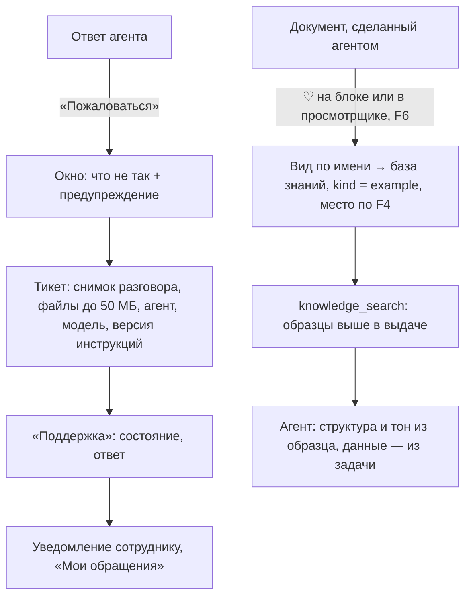
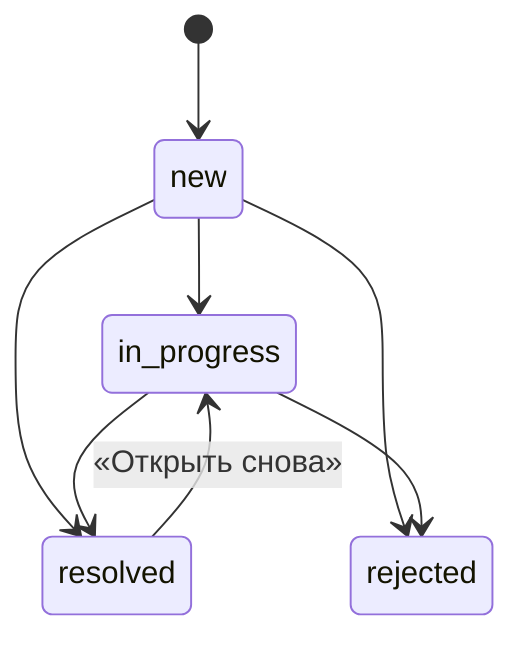

# Жалобы на ответы, образцы документов и отчёт о пользе — спецификация

**Статус:** построено 22.11 ночью без владельца (шаги 1–9; замер M17 прошёл — раздел 15): жалобы и «Поддержка», «Мои обращения», образцы в базе знаний и их поиск, факты работы, «Польза от агентов», F3; тесты сервера и интерфейса проходят, сценарий e2e `tests/e2e/feedback.spec.ts` написан, не прогонялся. Как резать образцы и где они лежат — по устройству базы знаний (план №3), решение агента на проверку — раздел 15. Задача GitHub не заводилась. 24.11 — образцы переделаны по решениям владельца F6 (сердечко на блоке и в просмотрщике, выключатель в «Интерфейсе»): сделано, задача #36 закрыта; сценарий e2e переписан, не прогонялся. 24.11 — обращение в поддержку напрямую из «Моих обращений» (F7), задача #37
**Дата:** 2026-11-20, перестроено по ответу 2026-11-21 · **Проект:** basic business agent · **Тип фичи:** смешанный (жалоба и образец в чате, «Поддержка» и «Польза» в админке + запись фактов работы) · **Где работает:** чат, админка, база знаний
**Не применяется:** 20 — механизм простой: строки фактов и тикетов пишутся там, где дело происходит

## Для новой сессии: как начать

**Где этот план.** Один из семи планов (было восемь; «Итоги совещаний» владелец исключил 21.11: «у меня для этого и так есть скилл, я сам сделаю»), составленных 20.11.2026 по просьбе владельца: «составь пачку планов на каждую из фичей, все хорошенько поресерчи, изучи лучшие плагины на рынке». Порядок постройки по зависимостям — рекомендация агента, владелец его не подтверждал:
1. `[20.11.2026]-mcp-connections.md` — свои подключения MCP
2. `[20.11.2026]-notifications.md` — уведомления в браузере
3. `[20.11.2026]-knowledge-base.md` — база знаний организации
4. `[20.11.2026]-org-letterhead.md` — бланк организации, печать и подпись
5. `[20.11.2026]-event-tasks.md` — фоновые задачи по событию
6. `[20.11.2026]-multi-step-approvals.md` — согласования в несколько шагов
7. `[20.11.2026]-feedback-and-value.md` — жалобы, образцы документов и отчёт о пользе ← этот план

Этот план — №7. Образцы живут в «Базе знаний» (план №3), ответы на жалобы приходят через «Уведомления» (план №2). Жалобы и отчёт о пользе можно строить и без них; образцы — после базы знаний.

**Состояние на 21.11.2026.** Черновик. Исследование сделано (опоры — раздел 3: Microsoft Copilot Analytics («часы с помощью ИИ» — оценка, не измерение), книга «AI-агенты изнутри» гл. 7). Независимая проверка свежим агентом проведена 20.11 и учтена — что она поменяла, ниже. Ответ владельца 21.11 на F1 перестроил фичу: каждый ответ не оценивается; плохой ответ — жалоба тикетом в «Поддержку» с разговором и файлами; хороший документ — образец в базе знаний. План переписан. F2 (21.11): часы по нормам. F4 (21.11): образец — в базу знаний сразу, режется на фрагменты и служит референсом, оригинал хранится; как резать и как работает поиск — обсудить с владельцем позже (общий вопрос с планом №3). F5 (21.11): жалобы разбирает администратор агентов (право «Агенты»). F3 (21.11): границы месяца в «Лимитах и расходах» исправить — везде часовой пояс установки. Задача GitHub не заведена: по правилу скилла `feature-blueprint` её заводят после ответов. Код не писался.

**Как стартовать в новой сессии.**
1. Прочитать `AGENTS.md`, этот план целиком и разделы спецификации базы `docs/specs/[12.11.2026]-agent-base-architecture.md`: 8.1 (учёт расходов), 8.5 (журнал), 8.28 (прошлые разговоры: видимый текст, `transcript.ts`), 9.1, 14 (оценки «будут у документов»).
2. Загрузить скиллы: `feature-blueprint` (работа продолжается с его шага 13 — «после ответов владельца»), `owner-decisions` (сверить вопросы с базой решений владельца и записать его ответы, если они годятся и для других проектов), `developing-ai-agents` (гл. 7 — оценка, версии промпта и модели у результата, проверочный набор), `supabase-postgres-best-practices` (до миграции), `property-testing` (арифметика часов и границы месяца в часовом поясе).
3. Если владелец ещё не ответил — задать вопросы раздела 6 одним сообщением в формате раздела 6 (ситуация, почему решать ему, варианты, рекомендация; в чате каждый вопрос — строкой с ❓). Молчание и «ок» — не согласие: рекомендованный вариант без слова владельца не строится. Ответы — в «Принято» с датой; обновить все задетые разделы и «Коротко»; статус — «согласовано».
4. Завести задачу GitHub (`gh`, правило проекта): что и зачем со ссылкой на этот файл, решения владельца с датами, шаги раздела 22 чек-листом, критерии готовности, зависимости. Ссылку вписать строкой «**Задача:**» в шапку этого файла.
5. Шаг 0 раздела 22 — проверки и замеры. Если они меняют решения владельца или устройство — показать владельцу, что изменилось, и ждать.
6. Дальше шаги по порядку: сначала падающий тест, потом код; после шага — `pnpm typecheck && pnpm lint` и тесты затронутого; коммит; итог шага — комментарием в задаче. В конце сессии — самопроверка и независимая проверка изменений отдельным агентом (глобальные правила владельца).

**Где смотреть код.** `core/admin/usage.ts`, `core/admin/routes/usage.ts:35,38` (сутки по UTC), `web/src/admin/UsageSection.tsx`, `core/models/usage.ts:58`, `core/models/gateway-sync.ts:99` (`ZERO_PRICES` подписки), `core/approvals/policy.ts:39-44`, `core/background/service.ts:172-209`, `core/mail/tools.ts:335`, `core/sandbox/show-file.ts`, `core/web/research.ts`, `core/history/transcript.ts`, `core/masking/detect.ts`, `core/admin/deletion.ts:63-70`, `web/src/chat/AssistantMessage.tsx:42`, `web/src/chat/ChatView.tsx:54`, `core/chat/history.ts:62`, `app.agent_overrides` (версия инструкций).

**Правила, которые легко нарушить** (из `AGENTS.md`, памяти агента и базы решений владельца `~/.agents/decisions/`):
- Правила проекта (`AGENTS.md`, правила работы в спецификации базы) не править без прямого слова владельца — даже чтобы записать его же указание.
- В спецификации — устройство и решения, без журнала работ: ход и итоги — комментариями в задаче GitHub.
- На http://localhost:8080 работает `pnpm dev` владельца: не останавливать и не перезапускать; `git stash` не использовать (ломает слежение за файлами); `pnpm test:e2e` и `pnpm stand` — во временной копии на портах 3100/8180 (раздел 22 спецификации базы).
- После шага — только `pnpm typecheck && pnpm lint` и тесты затронутого; полный `pnpm test`, `pnpm test:e2e`, `pnpm smoke` — один раз перед слиянием (решение владельца 20.11).
- Влить в `main`, создать PR, удалить тома и данные, подключить внешний сервис, который получит данные проекта, отправить что-либо за пределы машины — только с разрешения владельца.
- Сбой поведения модели чинить сначала тем, что советует документация фреймворка, а не своими ограничениями в цикле агента; число шагов агента кодом не ограничивать (решения владельца 15.11).
- Prettier не запускать; файл кода — до 800 строк; только стираемый синтаксис TypeScript.
- Владельцу — по-русски: сначала последствие, потом механизм; термины объяснять при первом упоминании.
- Поведение Mastra, LiteLLM, MCP-библиотек проверять по установленным исходникам и скиллам `mastra-*`, не по памяти.

**Открыто для всех семи планов** (спросить владельца при первом случае):
- В правилах проекта записано «спецификация одна, отдельных файлов не заводить» (`AGENTS.md`, «Источники правды»). Эти файлы сделаны по прямому слову владельца 20.11 («планируй фичу в общем в отдельном файле только»), правила не правились. Не решено: после сдачи фичи переносить ли её устройство в разделы 8–17 спецификации базы (как требует её правило) или оставлять здесь, и вписать ли исключение в `AGENTS.md`.
- Формат сообщений коммитов: правило проекта — «Шаг N: что сделано», а шаги здесь нумеруются внутри плана. Предложение агента (не подтверждено): «{Фича}, шаг N: что сделано».
- Чек-лист шагов в задаче #2 — для этапа 2; для этих фич чек-лист — в своей задаче GitHub.
- На 21.11 файлы планов не закоммичены (ветка `stage-2-new-interface`, `main` с ней совпадает после слияния 20.11).

**Что поменяла независимая проверка 20.11** (не возвращать прежние решения):
- Факты работы пишутся строкой в момент дела, а не вычитываются из сообщений Mastra: формат Mastra может поменяться, а удаление разговора или сотрудника уменьшало бы прошлые месяцы.
- Письмо — факт `email`, не `action`; `background_finished` действием не считается; документ — только созданный или изменённый агентом в этом ходе.
- Отделы меньше 3 человек — в «Других отделах»; «работали с агентами» — те, кто сам написал агенту.
- Нормы скромнее (вклад агента, не полное время задачи); изменение норм — в аудит; подписка ChatGPT — числом обращений отдельно.
- Отчёт считает с выпуска фичи; прошлые месяцы — только расход.
- 21.11 по ответу владельца убраны: 👍/👎 на каждый ответ, экран «Качество ответов», галочка «показать текст администратору». Вместо них — жалобы в «Поддержку» и образцы в базе знаний. Не возвращать без его слова.
- Жалоба привязывается к ходу по номеру сообщения сотрудника, с которого ход начался (номера ответов в живом потоке и после перезагрузки разные) — шаг 0.

## Коротко

**Что строим и зачем.** Три вещи вокруг качества работы агента и его пользы.
1. **Жалоба на плохой ответ** (решение владельца 21.11). Под ответом агента — «Пожаловаться». Сотрудник пишет в небольшом окне, что было не так. К жалобе сами прикладываются весь разговор, его файлы и комментарий, и она уходит тикетом в раздел админки «Поддержка». Там её разбирают, отвечают и закрывают. Сотрудник получает ответ уведомлением.
2. **Образец из хорошего документа** (решение владельца 21.11). Агент сделал удачное КП, и сотрудник отмечает его сердечком (с 24.11, F6; было 👍 «Хороший образец»). Документ попадает в базу знаний как образец с приоритетом. Когда агента в следующий раз попросят сделать такой же документ, он сначала найдёт образцы и будет опираться на их структуру и тон.
3. **Отчёт о пользе для руководства:** что агенты сделали за месяц (документы, действия в системах, письма, фоновые запуски, поиск в интернете) и сколько часов работы это примерно заменило (F2), рядом с расходом на модели.

Каждый ответ не оценивается: нет звёздочек и процентов «хороших ответов» (владелец: «не надо оценивать каждый ответ»). Успех:
- жалоба доходит до того, кто может починить, с полным контекстом, и человек узнаёт итог;
- через месяц у отделов есть образцы типовых документов, и агент делает новые по ним;
- руководство видит работу агентов в цифрах и понимает, как они посчитаны.

**Как будет работать.**
1. У каждого законченного ответа агента в меню — «Пожаловаться». Окно «Что было не так?»: поле (обязательное) и строка «К жалобе приложится весь этот разговор и его файлы — их увидит поддержка». «Отправить в поддержку» → «Жалоба №14 отправлена. Ответ придёт в уведомления».
2. В «Поддержке» — список тикетов: номер, кто, агент, дата, состояние («Новая», «В работе», «Решена», «Отклонена»). Внутри:
   - комментарий человека;
   - разговор целиком в виде чата на момент жалобы, ответ с жалобой выделен;
   - файлы с «Открыть» и «Скачать»;
   - агент, модель и версия его инструкций;
   - поле ответа.

   Ответ и смена состояния уходят сотруднику уведомлением, а у него в «Настройках → Мои обращения» видна история.
3. На блоке документа в чате (Word, Excel, PowerPoint, PDF, который сделал агент) и в панели его просмотрщика — сердечко (F6, пока в «Интерфейсе» включено «Добавление документов в референсы»). Вид документа («Коммерческое предложение») сервер берёт из имени файла. Документ сразу уходит в базу знаний: режется на фрагменты и служит референсом для будущих документов, а оригинал файла хранится рядом (решение владельца 21.11, F4).
4. Агент, делая документ, сначала ищет образцы такого вида (`knowledge_search` с видом «образец»). Образцы стоят в выдаче выше обычных документов. Структуру, разделы и тон агент берёт из образца, а клиента, цены и реквизиты — только из текущей задачи. Это правило ядра и описание инструмента.
5. «Польза от агентов» (право «Расходы»): за месяц по организации, отделам и агентам — сотрудники, которые сами работали с агентами, разговоры, документы, действия, письма, фоновые запуски, поиск в интернете, ответы по базе знаний; оценка часов по нормам (F2) и расход. «Скачать отчёт» — файл для Excel.

**Как построим.**
1. Тикет — новые таблицы и снимок разговора на момент жалобы: видимый текст всех сообщений и названия шагов агента (`core/history/transcript.ts`), без служебного. Файлы разговора копируются в отдельную область хранилища `support/<номер>`, до 50 МБ на тикет; что не вошло — перечислено с размером. Снимок не зависит от того, что потом сделают с разговором.
2. Образец — документ базы знаний вида «образец» (`kind = 'example'`, поле «вид документа»). Разбор, поиск и права — те же, что у базы знаний. Поиск даёт образцам прибавку в объединении выдачи и умеет искать только их.
3. Факты работы пишутся строкой в момент, когда работа сделана. Отчёт — запросы к ним и к `app.usage_events` по месяцам в часовом поясе установки.
4. Уведомления о тикетах — новые виды в фиче «Уведомления»: «Новая жалоба» для поддержки и «Ответ на обращение» для сотрудника.

**На что смотреть.**
- **В жалобе — чужие данные.** Разговор может содержать телефоны клиентов, договоры, цены. Сотрудник отправляет его сам и видит предупреждение. Разбирают жалобы администраторы агентов — люди с правом «Агенты» (решение владельца 21.11, F5). Маскирования в тикете нет: чтобы починить, нужно видеть, как было на самом деле.
- **Образец с данными клиента.** КП для «Вектора» с ценами и контактами становится образцом. Агент может перенести чужие цифры в новый документ. Защита: правило «из образца — структура и тон, данные — из задачи», а ведущий базы видит образцы и может убрать неудачный.
- **Оценка часов — не измерение.** Отчёт говорит «оценка эквивалентной работы», нормы видны и меняются (F2).
- **Отчёт начинает считать с выпуска фичи.**
- **Порядок постройки:** после «Базы знаний» (образцы живут в ней) и «Уведомлений» (ответы на жалобы). Жалобы и отчёт можно строить и раньше.

**На что опирается.**
- Решения владельца 21.11 (жалоба с логом разговора в тикет-систему админки; хороший документ — образец в базе знаний с приоритетом).
- Книга «AI-агенты изнутри» (гл. 7 и 9): разбор реальных неудач с полным следом (версия инструкций, модель, шаги); удачные результаты — во внешнюю базу как примеры, а не правка модели.
- Microsoft Copilot Analytics: «часы с помощью ИИ» — оценка, не измерение; ставка в час настраивается.
- Правило базы: переписку видит только сотрудник; жалоба — его собственное действие с предупреждением.

**Найдено по пути.**
- «Лимиты и расходы» считают таблицу по суткам UTC (`core/admin/routes/usage.ts:35,38`), а график и месячный лимит — по часовому поясу установки (`core/admin/usage.ts`). На краях месяца суммы расходятся на 3 часа. Владелец 21.11: исправить (F3) — делается в шаге 7 этого плана.

**Ждёт вашего решения.**
1. ~~Показывать ли администратору текст плохого ответа?~~ Решено 21.11 по-другому: каждый ответ не оценивается; жалоба с разговором, файлами и комментарием уходит тикетом в «Поддержку» (F1, «Принято»).
2. ~~Часы и деньги по нормам?~~ Решено 21.11: да, вариант Б (F2, «Принято»).
3. ~~Исправить ли границы суток в «Лимитах и расходах»?~~ Решено 21.11: исправить (F3, «Принято»).
4. ~~Куда попадает образец?~~ Решено 21.11: сразу в базу знаний как референс, с оригиналом; устройство поиска обсудить позже (F4, «Принято»).
5. ~~Кто разбирает жалобы?~~ Решено 21.11: администратор агентов, право «Агенты»; в окне жалобы — предупреждение, что разговор приложится (F5, «Принято»).

**Выкладка:** выкладки нет. Работа заканчивается `pnpm typecheck && pnpm lint`, тестами затронутого и сценарием e2e; полный прогон — перед слиянием.

**Объём:** 10 шагов, около 8 ч работы агента. От вас — ничего.

**Не проверено:** как агент на живой модели опирается на образцы и не переносит чужие данные — замер M17 (шаг 9).

---

# Часть 1. Для владельца: как это устроено

## 1. Что известно и что добавлено

- **Владелец сказал (20.11):** «8 — тоже планируй» о пункте «Обратная связь и отчёт о пользе: оценка ответов сотрудниками; экран для администратора, где агент ошибается; отчёт за месяц».
- **Владелец сказал (21.11):** «не надо оценивать каждый ответ. Предполагалось, что плохой ответ будет вызывать небольшую модалку, где люди сами заполнят инфу, что было плохо, и при этой жалобе прикрепится лог сессии с общением, файлами и комментарием человека и уйдёт администратору в поддержку в админке — где-то тикет-система должна быть. А если лайкнет, то такой документ должен получать приоритет какой-то в базе знаний как референс для будущих генераций, например, чтобы агент мог на них опираться при выборе».
- **Найдено в проекте:**
  - «Лимиты и расходы» — `core/admin/usage.ts`, `core/admin/routes/usage.ts`, право `usage`;
  - журнал действий: `ok` означает «инструмент не бросил ошибку» (`core/approvals/policy.ts:39-44`); туда же пишется `background_finished` (`core/background/service.ts:209`); `mailbox_send` — обычная строка `tool_call` (`core/mail/tools.ts:335`);
  - подписка ChatGPT учитывается по нулевой цене (`ZERO_PRICES`, `core/models/gateway-sync.ts:99`); поиск в интернете в учёт не пишется (`core/models/usage.ts:58`);
  - удаление сотрудника стирает его разговоры (`core/admin/deletion.ts:63-70`);
  - ход на экране — несколько сообщений Mastra (`web/src/chat/ChatView.tsx:54`); номера в живом потоке и после перезагрузки разные (`core/chat/history.ts:62`);
  - видимый текст разговора и названия шагов — `core/history/transcript.ts`;
  - блок файла в чате со «Скачать» и «Открыть» — `show_file` (`core/sandbox/show-file.ts`), он показывает любой файл папки, в том числе вложения сотрудника;
  - области хранилища — только `user` и `project` (`core/storage/areas.ts`);
  - версии инструкций агента — `app.agent_overrides.published_at` и аудит.
- **Добавлено:** [ДОПУЩЕНИЕ] жалоб — единицы–десятки в месяц, образцов — десятки за первые месяцы.

## 2. Цели, не-цели, анти-цели

- **Цели:**
  1. Плохой ответ превращается в тикет с полным контекстом (разговор, файлы, комментарий, агент, модель, версия инструкций), который разбирают и закрывают, а сотрудник узнаёт итог.
  2. Удачные документы становятся образцами в базе знаний, и агент опирается на них при похожих задачах.
  3. Руководство видит объём сделанной работы и её оценку в часах рядом с расходом, с понятным расчётом.
- **Не-цели:** оценка каждого ответа и проценты «хороших ответов» (владелец 21.11); автоматическая оценка моделью; рейтинг сотрудников; дообучение модели на образцах.
- **Анти-цели:**
  - разговор уходит в поддержку без ведома сотрудника;
  - тикет видят люди без права на него;
  - агент переносит клиента и цены из образца в документ для другого клиента;
  - отчёт выдаёт оценку за измерение, считает одно дело дважды или показывает, кто «мало работает с агентом»;
  - цифры прошлого месяца меняются после удаления разговора.
- **Сейчас:** о плохих ответах узнают устно; удачные документы теряются в разговорах; пользу никто не считает.

## 3. На что опирается

| Практика | Кто делает | Масштаб | Берём? | Почему | Источник, дата |
|---|---|---|---|---|---|
| Жалоба с полным следом в тикет поддержки | владелец (21.11); книга, гл. 7 | любой | да | чинить можно только то, что видно целиком | ответ владельца; `.agents/skills/developing-ai-agents/references/chapters/ch07-evaluation.md` |
| Удачные результаты — во внешнюю базу как примеры, а не в веса модели | книга, гл. 9 (внешнее обучение) | любой | да | безопасно, обратимо, видно людям | `.agents/skills/developing-ai-agents/references/chapters/ch09-continual-evolution.md` |
| Оценка часов по нормам с оговоркой «оценка» | Microsoft Copilot Analytics | любой | да (F2) | честно и понятно руководителю | learn.microsoft.com/a365-business-analytics/reference/ai-value, 2026 |
| 👍/👎 на каждый ответ со статистикой | ChatGPT, Claude | — | нет | владелец 21.11: «не надо оценивать каждый ответ» | — |
| Подсчёт по сохранённым сообщениям Mastra | — | — | нет | зависит от формата Mastra и теряется при удалениях | проверка 20.11 |

## 4. Варианты и масштаб

Путь задан владельцем 21.11: жалоба → тикет, 👍 на документе → образец. Развилки — куда попадают образцы (F4), кто разбирает жалобы (F5), часы в отчёте (F2), границы месяца (F3).

## 5. Как это работает

**Точки входа:** меню ответа «Пожаловаться» → 1; «Поддержка» в админке → 2; «Мои обращения» и уведомление → 2; 👍 у документа → 3; агент делает документ → 4; «Польза от агентов» → 5.

**Сценарий 1 — жалоба.** Ольга получила КП с ценой из старого прайса.
1. Меню ответа → «Пожаловаться» → окно «Что было не так?»: «Цена на С21 из прошлогоднего прайса, сейчас 495 ₽». Ниже: «К жалобе приложится весь этот разговор и его файлы — их увидит поддержка». «Отправить в поддержку».
2. «Жалоба №14 отправлена. Ответ придёт в уведомления». В «Мои обращения» — «№14 · Новая».
3. Повторно пожаловаться на тот же ответ: окно показывает «Вы уже отправили жалобу №14 на этот ответ» и даёт дописать к ней.

**Сценарий 2 — поддержка разбирает.** Игорь, администратор агентов — право «Агенты» (F5).
1. Уведомление «Новая жалоба №14 · агент «Продажи»». «Поддержка» → №14:
   - комментарий Ольги;
   - разговор как чат с выделенным ответом и шагами («База знаний · Прайс 2025.xlsx»);
   - файлы;
   - «Агент «Продажи» · qwen3.8-flash · инструкции от 18.11».
2. «В работе». Игорь заменяет прайс в базе знаний. Ответ: «Обновили прайс в базе знаний, теперь цены свежие» → «Решена».
3. Ольге — уведомление «Ответ на обращение №14», в «Мои обращения» — ответ.

**Сценарий 3 — образец.** Агент сделал Ольге КП, которое ей нравится.
1. ♡ на блоке файла «КП-Вектор.docx» перед «Открыть» (или в панели просмотрщика, открытого из этого блока) → сердечко закрашено, внизу «Добавлено в референсы: база «Продажи»». Вид документа («Коммерческое предложение») сервер угадывает по имени, база — отдел Ольги; если баз несколько — меню «Куда добавить» (F6).
2. В базе знаний у «Продаж» — раздел «Образцы», документ с пометкой «Образец · отметила Ольга Смирнова». Ведущий базы может убрать образец; Ольга — снять своё сердечко, документ уходит из базы.
3. Сердечка нет на файле, который приложила сама Ольга (не сделанном агентом), и нигде, пока в «Интерфейсе» выключено «Добавление документов в референсы».

**Сценарий 4 — агент опирается на образцы.** Пётр из «Продаж»: «Сделай КП для «Альфа-Строя» на профнастил».
1. Агент вызывает `knowledge_search` с видом «образец» и запросом «коммерческое предложение» и находит КП-Вектор.
2. Берёт копию (`knowledge_open`), повторяет разделы, порядок и тон, подставляет «Альфа-Строй», цены — из прайса, реквизиты — из профиля.
3. Ни одного упоминания «Вектора» в новом документе: это проверяет замер M17.

**Сценарий 5 — отчёт для руководства.** Директор, право «Расходы». «Польза от агентов» → «Ноябрь»: сводка, «Оценка: около 190 часов работы» с «Как посчитано», «Расход на модели: 4 830 ₽, через подписку ChatGPT — 1 920 обращений (в рублях не считаются)», разбивка по отделам (меньше 3 человек — «Другие отделы») и агентам, «Скачать отчёт».

## 6. Решения владельца

### Принято
- **F1 — каждый ответ не оцениваем; плохой ответ → жалоба тикетом в «Поддержку» с разговором, файлами и комментарием; хороший документ (👍) → образец в базе знаний с приоритетом** (владелец 21.11, слова — раздел 1). Было на выбор (показывать ли администратору текст плохого ответа): только оценка; текст по галочке (рекомендация агента); текст всегда. Владелец задал свою схему. Прочтение агента, на проверку:
  - «Пожаловаться» — в меню каждого законченного ответа, а 👍 «Хороший образец» — только у блоков документов, сделанных агентом (у текстовых ответов 👍 нет: «не надо оценивать каждый ответ»);
  - в тикете нет маскирования: сотрудник отправляет разговор сам и видит предупреждение;
  - тикет — состояние и ответ сотруднику, без переписки туда-обратно (её можно добавить, если попросят).

- **F2 — часы и деньги по скромным нормам, с пометкой «оценка» и расчётом** (владелец 21.11: «вариант Б»). Начальные нормы — раздел 12; администратор меняет их, изменения — в аудит.
- **F4 — образец сразу уходит в базу знаний (RAG): режется на фрагменты и служит референсом для будущих генераций; оригинал файла хранится** (владелец 21.11: «в раг, разбирается на чанки и уходит как референс; как чанковать и как будет работать раг обсудим в будущем, щас неактуально ещё; думаю, дополнительно ещё где-то должен будет оригинал храниться»). Без подтверждения ведущим. Оригинал лежит в области хранилища базы (`knowledge/<docId>/v<версия>/<имя>`, как у всех документов базы) и открывается из раздела «Образцы». Не решено владельцем, прочтение агента: образец попадает в базу отдела того, кто отметил (у сотрудника в нескольких отделах — выбор в окне); проверить при старте. Как резать на фрагменты и как устроен поиск — обсудить с владельцем перед постройкой (общий вопрос с планом №3).
- **F5 — жалобы разбирает администратор агентов — люди с правом «Агенты»** (владелец 21.11: «администратор агента разбирает, в чём проблема переписки сотрудников, если мы их в окне заполнения замечаний будем там где-то предупреждать юзера о том, что переписка будет прикреплена из текущего диалога»). Нового права нет; предупреждение в окне жалобы — раздел 12.
- **F3 — границы суток в «Лимитах и расходах» исправить: везде часовой пояс установки** (владелец 21.11: «а, исправь»). Данные в базе не меняются, меняется подсчёт: таблица и плашка «Организация» считают сутки и месяц так же, как график и месячный лимит; в прошлых месяцах сдвинутся крайние 3 часа.
- **F6 — образец ставится сердечком; показ сердечка — выключатель всей платформы, по умолчанию выключен** (владелец 24.11, задача #36). Вместо кнопки «Хороший образец» — сердечко: только иконка, без обводки, на блоке документа перед «Открыть» и в верхней панели просмотрщика; подсказка при наведении — документ добавится в референсы, и агент будет опираться на него, делая похожие. Решения по развилкам 24.11: нажатие добавляет сразу, без окна (вид — по имени файла, база — отдел; при нескольких базах — меню «куда»); нажатие на закрашенное сердечко убирает документ из референсов; в просмотрщике сердечко только у документов, сделанных агентом и открытых из блока файла в чате (не в «Файлах проекта» и «Поиске»). Выключатель — в общих настройках платформы, не агента; выключен — сердечка нет нигде. Окно «Сохранить как образец» с правкой вида документа убрано.
- **F7 — обращение в поддержку напрямую** (владелец 24.11, задача #37): написать в поддержку можно не только жалобой на ответ — в «Моих обращениях» кнопка «Новое обращение»: тема, описание, файлы, «Отправить». Приходит в «Поддержку»; никакого лога разговора — только файлы, которые сотрудник приложил сам. Ответ поддержки — уведомлением в колокольчик в реальном времени (проверить, есть ли в коде; нет — сделать).
---

# Часть 2. Для исполнителя: поведение подробно

## 7. Точки контакта и состояния

| Точка | Пусто | Загрузка | Есть данные | Ошибка | Нет прав | Успех |
|---|---|---|---|---|---|---|
| «Пожаловаться» в меню ответа | — | — | окно; на ответ уже есть жалоба — «Вы уже отправили жалобу №N» и «Дописать» | «Жалоба не отправилась. Попробуйте ещё раз. Код: APP_SUPPORT_FAILED», текст остаётся | — | «Жалоба №N отправлена. Ответ придёт в уведомления» |
| ♡ на блоке документа и в панели просмотрщика (F6) | пустое сердечко | сердечко неактивно | закрашено — документ в референсах; при нескольких базах — меню «Куда добавить» | всплывающее сообщение с кодом | у вложений сотрудника и при выключенном «Добавлении документов в референсы» сердечка нет | «Добавлено в референсы: база «{база}»» / «Убрано из референсов» |
| «Поддержка» (админка) | «Обращений пока нет» | `DelayedBar` | список с фильтром состояния и агента | `ErrorBanner` | право `agents` (F5) | — |
| Тикет | — | `DelayedBar` | жалоба: комментарий, разговор, файлы, агент, модель, версия инструкций; обращение (F7): тема, описание, файлы сотрудника; у обоих — «Ответить», смена состояния | «Не удалось сохранить ответ…» | — | «Ответ отправлен» |
| «Мои обращения» (настройки) | «Обращений пока нет», «Новое обращение» | `DelayedBar` | номер, дата, тема или агент, состояние, ответ; «Новое обращение» — окно: тема, описание, файлы | `ErrorBanner`; в окне — текст с кодом, введённое остаётся | только свои | «Обращение №N отправлено. Ответ придёт в уведомления» |
| «Польза от агентов» | «За этот период агенты ещё не работали» / «Факты работы считаются с {дата выпуска}» | `DelayedBar` | сводка, «Как посчитано», разбивка | `ErrorBanner` | право `usage` | «Отчёт скачан» |

«Пожаловаться» нет: у печатающегося, оборванного, ждущего «Да» ответа и у служебной строки разговора задачи.

| Инструмент | Изменение | Как |
|---|---|---|
| `knowledge_search` (фича «База знаний») | параметр `kind` (`any` \| `example`); у образцов прибавка в RRF | описание: «Делая документ (КП, письмо, договор), сначала найди образцы такого вида: `kind: 'example'`. Из образца бери структуру, разделы и тон; клиента, цифры и реквизиты — только из текущей задачи» |

## 8. Механизм: данные, факты

**Данные:**
- `app.support_tickets`: `id` (номер), `user_id`, `agent_id`, `thread_id`, `turn_key` (номер сообщения сотрудника, с которого начался ход), `comment`, `snapshot` (jsonb: видимые сообщения и шаги), `files` (jsonb: имя, размер, путь в области `support`, скопирован ли), `model`, `instructions_version`, `status` (`new`, `in_progress`, `resolved`, `rejected`), `reply`, `handled_by`, `created_at`, `updated_at`.
- Область хранилища `support` (`core/storage/areas.ts`): `support/<id>/<имя>`; до 50 МБ на тикет.
- `app.kb_documents` (фича «База знаний»): `kind` (`document` | `example`), `doc_type` (вид документа), `liked_by`, `source_thread_id`. Оригинал — в области `knowledge`, как у всех документов базы; фрагменты — по правилам базы знаний (их устройство владелец обсудит позже).
- `app.work_facts`: `kind`, `at`, `user_id` (только для подсчёта «работали с агентами»), `agent_id`, `department_ids`, `minutes`.
- `app.value_norms`, `app.value_settings` (ставка).

**Факты работы:**

| Вид | Где пишется | Условие |
|---|---|---|
| `document` | `show_file` | файл Office или PDF изменён или создан в этом ходе |
| `action` | `applyApprovalPolicy` после выполнения | `result = ok`, кроме `mailbox_send` |
| `email` | `mailbox_send` | отправлено |
| `background_run` | `finishRun` / `closeRun` | итог `done` |
| `web_research` | `web_research` | результат с источниками |
| `knowledge_answer` | `knowledge_search` | найдено ≥ 1 фрагмент (фича «База знаний») |

Запись факта не ломает само дело: сбой — `work_fact_failed` в журнал сервера.

## 9. Ошибки и восстановление

| Ситуация | Что видит человек |
|---|---|
| Жалоба не сохранилась | «Жалоба не отправилась. Попробуйте ещё раз. Код: APP_SUPPORT_FAILED» — текст в окне остаётся |
| Пустой комментарий | «Напишите, что было не так — это поможет поддержке» |
| Файлы разговора больше 50 МБ | жалоба уходит; в тикете файлы сверх предела перечислены: «не приложен: больше 50 МБ на жалобу» |
| Образец: документ не прочитался базой (скан) | «Образец сохранён, но текст не найден — агент не сможет на него опираться. Код: APP_KNOWLEDGE_NO_TEXT» |
| Период больше 12 месяцев | «Выберите период не больше 12 месяцев» |

## 10. Крайние случаи и стыки

| Случай | Что происходит |
|---|---|
| Разговор удалён после жалобы | тикет цел: снимок и копии файлов независимы |
| Сотрудник удалён | тикеты остаются, автор — «бывший сотрудник» |
| Жалоба на ответ фоновой задачи | можно; агент и задача в тикете |
| Один документ отмечен дважды (сердечко блока и просмотрщика разом) | один образец; второму нажатию — «Этот документ уже в референсах», его копия сразу убирается из базы |
| Образец удалил ведущий | агенты перестают его находить; сердечко снова пустое, документ можно добавить заново |
| Агент переписал файл под тем же именем | сердечко остаётся закрашенным; новую версию добавляют, сняв и поставив сердечко |
| Сотрудник в нескольких отделах | меню «Куда добавить» под сердечком |

| Соседняя функция | Где встречаются | Что происходит |
|---|---|---|
| База знаний (план №3) | образцы | `kind = 'example'`, раздел «Образцы», права и поиск — оттуда |
| Уведомления (план №2) | новые жалобы, ответы | виды `support_new` (поддержке), `support_reply` (сотруднику) |
| Бланк (план №4) | новый документ по образцу | бланк — из профиля, образец даёт содержание |
| «Лимиты и расходы» | расход | границы месяца — F3 |

## 11. Скорость

Жалоба — до 5 с вместе с копией файлов (до 50 МБ) [ИЗМЕРИТЬ]. Отчёт за месяц — до 2 с [ИЗМЕРИТЬ].

## 12. Тексты интерфейса

| Где | Текст |
|---|---|
| Меню ответа | «Пожаловаться» |
| Окно жалобы | «Что было не так?», «К жалобе приложится весь этот разговор и его файлы — их увидит поддержка», «Отправить в поддержку» |
| ♡ у документа (F6) | подсказка «Добавить в референсы: агент будет опираться на этот документ, когда будет делать похожие» / «В референсах. Нажмите, чтобы убрать»; меню «Куда добавить» |
| «Интерфейс» (F6) | «Добавление документов в референсы»; включено — «У документов, которые сделал агент, есть сердечко…», выключено — «Сердечка нет. Уже добавленные документы остаются в базе знаний…» |
| «Поддержка» | «Поддержка», «Новая», «В работе», «Решена», «Отклонена», «Ответить» |
| Настройки | «Мои обращения»; «Новое обращение»: «Тема», «Описание», «Прикрепить файлы», «Отправить» (F7) |
| Начальные нормы (F2) | документ — 20 мин; действие в системе — 3 мин; письмо — 5 мин; фоновый запуск — 5 мин; поиск в интернете — 10 мин; ответ по базе знаний — 5 мин |
| Оговорка | «Оценка эквивалентной работы по нормам ниже, а не измеренное сэкономленное время. Нормы — вклад агента, их можно изменить. Часы посчитаны по текущим нормам.» |

## 13. Данные

- Тикет — копия разговора и файлов, отправленная сотрудником с предупреждением; видят только люди с правом «Агенты» (F5). Без маскирования.
- Образец — документ базы знаний (F4) с теми же правами, что у документов базы.
- Отчёт — без людей; отделы меньше 3 человек объединены.

## 14. Что сознательно не делаем

- **Оценка каждого ответа и проценты «хороших»** — владелец 21.11.
- **Переписка в тикете туда-обратно** — ответ и состояние; вернёмся, если поддержке понадобится переспрашивать.
- **Проверочный набор из жалоб и прогон при смене промпта или модели** (книга, гл. 7) — вернёмся, когда наберётся 30 жалоб.
- **Образцы из текстовых ответов** (не документов) — вернёмся, если попросят.
- **Разбивка отчёта по сотрудникам** — анти-цель.

## 15. Решения агента — на проверку

- «Пожаловаться» — в меню каждого ответа, 👍 — только у документов, сделанных агентом.
- Снимок разговора и копии файлов в тикете — чтобы жалоба не зависела от удаления разговора.
- 50 МБ файлов на жалобу.
- Вид документа у образца — по имени файла (`guessDocType`); с 24.11 (F6) его не правят: окна нет.
- Начальные нормы часов — допущение агента; «Польза» — под правом «Расходы».
- Файл отчёта — CSV с «;» и BOM: библиотеки Excel в сервере нет.
- F6 (24.11): выключатель — в «Интерфейсе» (единственный раздел настроек всей платформы), поле `document_samples` в `app.interface_settings`. Выключен — сервер тоже отказывает в добавлении и снятии (`APP_EXAMPLES_OFF`); уже добавленные образцы остаются в базе, агенты опираются на них, убирает их ведущий базы. Сердечко закрашено, пока файл по этому пути отмечен и документ в базе: переписанный агентом файл с тем же именем остаётся отмеченным, новую версию добавляют, сняв и поставив сердечко снова — так открытие чата не читает файлы (с хранилищем S3 это скачивание папки разговоров). Снимает сердечко только тот, кто его поставил; снятие удаляет документ из базы и пишется в аудит как удаление документа.
- F7 (24.11): обращение — та же запись «Поддержки» другого вида (`kind = 'request'`, тема `subject`), у него нет агента, разговора, хода, снимка и моделей; общий список, состояния, ответ и уведомления с жалобами; разбирают люди с «Агентами» (F5), им — «Новое обращение №N». Окно — как у жалобы; до 10 файлов, вместе до 50 МБ (предел жалобы), тип любой, файлы хранятся в базе (`app.support_files`, без пути); тема до 200 знаков, описание до 4000. Дописать к обращению нельзя — новое обращение. Ответ в колокольчик в реальном времени в коде уже был: ответ → уведомление `support_reply` → триггер `notifications_signal_live` → открытые страницы через `GET /app/api/me/events`; добавлен тест на всю цепочку.

**Сделано 22.11 (ночью, без владельца) — отличия от плана и решения по ходу:**
- Образцы режутся и ищутся так же, как документы базы знаний (план №3): по заголовкам, страницам, слайдам и строкам таблиц, поиск по словам (без поиска по смыслу — F4 плана №3). Оригинал хранится в базе данных вместе с версиями документа (`kb_versions.content`), как все файлы базы знаний, а не в области хранилища `knowledge/…`. Вопрос раздела 25 «как режутся образцы» этим закрыт до слова владельца.
- Образец попадает в базу отдела того, кто отметил (прочтение агента в F4); в нескольких отделах — меню «Куда добавить» под сердечком (до 24.11 — выбор в окне); ведущий базы организации может положить его и в базу организации. Без отдела и без права «Документы организации» — «Образец некуда сохранить» (`APP_EXAMPLE_NO_BASE`).
- «Сделан агентом в этом ходе» — по времени файла: `show_file` сравнивает время изменения файла с началом хода (`REQUEST_KEYS.runStartedAt`, запас 50 мс) и пишет в результат `made`. Вложение сотрудника приходит до начала хода — у него `made: false`, кнопки нет. У ответов до 22.11 поля нет — кнопки тоже нет. Ход, продолженный после «Да», считает началом момент «Да»: файл, сделанный до вопроса и показанный после, не получит кнопку.
- Прибавка образцу в выдаче — 0,0002 к сумме мест RRF: меньше разницы соседних мест, поэтому образец выигрывает только при равном совпадении (план: «образцы выше обычных документов»). Поиск только образцов — `kind: 'example'`. В промпте — строка «Образцы документов: вид — число», правило ядра и описание инструмента: «из образца — структура, разделы и тон; клиент, цифры, реквизиты — только из задачи».
- Файлы жалобы хранятся в базе данных (`app.support_files`), а не в области хранилища `support/<номер>`: как файлы базы знаний — тикет переживает разговор и его папку, копируется вместе с резервной копией базы, а новая область хранилища была бы новым механизмом.
- Ключ хода жалобы — номер сообщения сотрудника среди его сообщений разговора (шаг 0 плана — сразу ключ по номеру, без проверки на стенде: номера ответов в живом потоке и после перезагрузки разные, а сообщения сотрудника — одни и те же).
- «Пожаловаться» — значок в строке под ответом (рядом с «Копировать»), а не пункт меню: меню у ответа нет. Нет его у печатающегося, оборванного, ждущего «Да» ответа и у первой служебной строки разговора задачи.
- Дописанная жалоба к решённой или отклонённой — снова «Новая», поддержка получает уведомление «Жалоба №N дополнена».
- Переходы состояний: «Новая» → любое; «В работе» → «Решена», «Отклонена»; «Решена» и «Отклонена» → «В работе» («Открыть снова»). Ответ сохраняется вместе с состоянием; два администратора не затирают друг друга (меняется только та версия тикета, что видела страница).
- Модель в тикете — модели из учёта расходов (`app.usage_events`) сотрудника и агента за время этого хода; версия инструкций — дата публикации промпта (`app.agent_overrides.published_at`), без неё — «инструкции из файла агента».
- Факты «сообщение» и «разговор» пишутся, когда сотрудник сам пишет агенту: из них «Работали с агентами» (разные сотрудники с сообщением) и «Разговоры» (новые). Нормы — только у шести видов работы. Документ считается один раз на файл в ходе, даже если агент показал его дважды; письмо — только `email`, не `action`; ответ инструмента с `error: true` — не действие.
- Отдел в отчёте — отделы сотрудника на момент факта; отдел меньше 3 человек считается по нынешнему составу; удалённый отдел — в «Других отделах». Сотрудник в двух отделах учитывается в обоих: сумма по отделам может быть больше итога.
- Период отчёта — месяцы (с … по …, до 12); «Скачать отчёт» — CSV для того же периода. Стоимость часа необязательна: без неё — только часы.
- Таблица «Лимитов и расходов» считает сутки в часовом поясе установки (F3) — шаг 7 сделан первым, отдельным коммитом.

**По независимой проверке 22.11 (исправлено):**
- Файлы жалобы и образца читаются из проверенного дескриптора (`readFileInside`, `core/workspace/layout.ts`): канал (FIFO) на месте файла не вешает сервер, ярлык наружу папки не читается — в тикете «файл удалили до жалобы».
- Вид документа образца — одна строка слов (`cleanDocType`): без переводов строк и знаков разметки, в схеме запроса и ещё раз в слое промпта — его текст писал сотрудник, а читает промпт каждого агента его отдела.
- Ответ поддержки сохраняется только поверх той версии тикета, что видела страница (`seen` — время последнего изменения): ответ коллеги, данный тем временем, не затирается (`APP_SUPPORT_STALE`); список состояний на странице — только возможные переходы.
- В проверке черновика промпта (админка) нет «Пожаловаться» и сердечка образцов, а её ходы не пишут фактов работы (`runKind = draft`).
- Итог согласования, который сервер пишет в разговор от имени сотрудника, — служебное сообщение (`core/chat/service-turns.ts`): история чата его не показывает (раньше после перезагрузки он был виден как реплика сотрудника), номер хода жалобы его не считает — номера в браузере и на сервере совпадают.
- Модели в тикете — только за время хода (до его последнего сообщения и минуты после), а не все модели с тех пор.
- Группы отчёта, где работали меньше 3 человек, не показываются: «Другие отделы» из 1–2 людей и агенты одного-двух человек (такие агенты — вместе в «Другие агенты», и те — только от 3 человек); под таблицами — строка, что такие группы не показаны. Ячейки CSV, начинающиеся с `= + - @`, получают апостроф (Excel не исполнит формулу).
- Фоновый запуск с двумя «Да» считается один раз; поиск образцов перед документом — не «ответ по базе знаний»; «Сделан агентом» после «Да» и после ответа браузера считается от сообщения сотрудника, с которого начался ход, а копии с компьютера (`.computer/`) — никогда не «сделаны агентом»; сообщение сотрудника считается фактом только при новом сообщении (не при продолжении после браузера) и после проверки, что разговор свободен.
- Прибавка образцу — 0,00005: меньше разницы соседних мест на всей длине списка (30 мест), а не только в начале.

**Известные ограничения (не исправлялись):** копии файлов в жалобах не делятся между тикетами — 100 жалоб на разговор с файлом в 40 МБ займут 4 ГБ базы; модели хода берутся из учёта сотрудника и агента без номера разговора — параллельный разговор с тем же агентом в то же время добавит свои модели; образцом через API можно отметить любой файл, который читает база знаний (текст, Markdown), интерфейс предлагает кнопку только у документов Office и PDF.

**Замер M17 (22.11, установка разработки, `qwen3.8-flash`, агент «Общий помощник»):** агент сам сделал 3 КП в Word для разных клиентов (49–74 с каждое), они отмечены образцами в базе организации и прочитаны; затем 10 просьб «Сделай КП в Word для {новый клиент}: товар, цена, количество, контакт». Итог: образцы искал (`knowledge_search` с `kind: 'example'`) в 10 из 10, документ сделал в 10 из 10 (46–101 с), ни в одном нет имени клиента, контакта, телефона, почты и цены из образцов (сверка текста `word/document.xml` по точным строкам). Документ целиком (`knowledge_open`) агент не брал — хватало фрагментов. Разговоры и образцы замера удалены; файлы КП остались в папке Игоря на установке разработки.

**Не сделано:** письмо «Образец сохранён, но текст не найден» сразу после сохранения (разбор идёт в фоне — статус виден в «Базе знаний» → «Образцы»); «Открыть» у файлов тикета (только «Скачать»); фильтр «Поддержки» по агенту (есть по состоянию).

---

# Часть 3. Для исполнителя: как строить

## 16. Что есть и что берём

- **Берём:** `AssistantMessage.tsx` (меню ответа) и `ChatView.tsx` (ход), блок файла (`show_file`, `web/src/chat/*`), `core/history/transcript.ts`, `core/storage` (новая область `support`), фичу «База знаний» (`kb_documents`, поиск, права), фичу «Уведомления» (виды), `core/admin/usage.ts`, `writeAudit`, места фактов из раздела 8.
- **Меняем (по F3):** границы суток в `core/admin/routes/usage.ts`.

## 17. Устройство

- **Модуль:** `core/support/` — `tickets.ts`, `snapshot.ts`, `routes.ts`; `core/knowledge/examples.ts` (образец из документа разговора); `core/work-facts/facts.ts`; `core/admin/value-report.ts`; `web/src/feedback/ComplainDialog.tsx`, сердечко `web/src/feedback/SampleHeart.tsx` (F6), обращение напрямую `core/support/requests.ts` и `web/src/feedback/RequestDialog.tsx` (F7); `web/src/admin/SupportSection.tsx`, `TicketPage.tsx`; `web/src/settings/MyRequestsPage.tsx`; `web/src/admin/ValueSection.tsx`.
- **Маршруты:** `POST /app/api/me/support` (жалоба), `POST /app/api/me/support/requests` (обращение напрямую: форма с `subject`, `text`, `files`; F7), `PATCH /app/api/me/support/:id` (дописать), `GET /app/api/me/support`; админка `GET /app/api/admin/support`, `GET …/:id`, `PATCH …/:id` (состояние, ответ), `GET …/:id/files/:name`; `GET /app/api/me/examples?threadId=` (отмеченные файлы разговора и базы), `POST /app/api/me/examples` (`{ threadId, path, base }`, вид — по имени файла), `DELETE /app/api/me/examples?threadId=&path=` (F6); `GET /app/api/admin/value`, `GET …/value.csv`, `PUT /app/api/admin/value-norms`.
- **Право:** `agents` (F5) — нового права нет.

- **Наблюдение:** `support_ticket_created`, `support_ticket_resolved`, `example_saved`, `work_fact_failed`; аудит — ответы поддержки, нормы.

## 18. Ловушки платформы

- Ключ хода: номера ответов в живом потоке и после перезагрузки разные — жалоба привязывается к номеру сообщения сотрудника, с которого начался ход [ПРОВЕРИТЬ в шаге 0].
- `show_file` показывает и вложения сотрудника — 👍 только у файлов, изменённых или созданных в ходе агента.
- Файлы разговора с S3 — копирование через `storage.hold`/`release`.

## 19. Сбои на новых путях

| Путь | Сбой | Чем закрыто |
|---|---|---|
| Копия файлов в тикет | файл удалён между показом и жалобой | в тикете «файл уже удалён»; шаг 2 |
| Образец | агент переносит клиента из образца | правило в описании инструмента; замер M17 |

## 21. Приоритеты и объём

- **P0:** жалобы и «Поддержка», «Мои обращения», образцы и их поиск, факты, «Польза от агентов», F2–F5.
- **P1:** проверочный набор из жалоб, переписка в тикете.
- **P2:** образцы из текстовых ответов.

**Объём:** шаг 0 — 0,5 ч; шаги 1–9 — около 7,5 ч; итого около 8 ч работы агента.

## 22. Шаги

**Правила каждого шага:** TypeScript только стираемый, импорты `.ts`, до 800 строк; `AppError` из `core/errors/catalog.ts`; тексты — `web/src/i18n/ru.ts`; миграция `NNNN_support_examples_facts.sql`; файлы — `storage.hold`/`release`; сначала падающий тест.

### Шаг 0: ключ хода
| Что | Как | Что меняется |
|---|---|---|
| [ПРОВЕРИТЬ] Номер сообщения сотрудника в браузере совпадает с сохранённым — сразу и после перезагрузки | тест на стенде | нет — ключ `(thread_id, порядковый номер хода)` |

### Шаг 1: тикеты и право
**Тест:** жалоба создаёт тикет со снимком; чужой разговор → 404; без права «Агенты» — 403; повторная жалоба на тот же ход — дописывает
**Готово, когда:** `core/support/tickets.test.ts` проходит

### Шаг 2: снимок и файлы
**Тест:** снимок без служебного, с названиями шагов; файлы до 50 МБ скопированы, сверх — перечислены; удаление разговора тикет не трогает
**Готово, когда:** `snapshot.test.ts` проходит

### Шаг 3: «Поддержка», «Мои обращения», уведомления
**Файлы:** `SupportSection.tsx`, `TicketPage.tsx`, `MyRequestsPage.tsx`, виды уведомлений; тесты
**Тест:** ответ меняет состояние и уходит уведомлением; сотрудник видит только свои
**Готово, когда:** тесты проходят

### Шаг 4: окно жалобы
**Файлы:** `ComplainDialog.tsx`, меню `AssistantMessage.tsx`; тест
**Тест:** нет пункта у печатающегося, оборванного, ждущего «Да», служебного; текст остаётся при ошибке
**Готово, когда:** тест проходит

### Шаг 5: образцы
**Файлы:** `core/knowledge/examples.ts`, `ExampleButton.tsx` (с 24.11 — `SampleHeart.tsx`, F6), правка `knowledge_search` (`kind`, прибавка), раздел «Образцы» в «Базе знаний»; тесты
**Тест:** 👍 только у файла, созданного агентом в ходе; образец сразу в базе знаний (F4), оригинал открывается из «Образцов»; поиск с `kind: 'example'` — только образцы; образец выше обычного документа при равном совпадении; ведущий удаляет образец
**Готово, когда:** тесты проходят

### Шаг 6: факты работы
**Тест:** `mailbox_send` — только `email`; `background_finished` не даёт `action`; вложение сотрудника не даёт `document`; удаление разговора факты не трогает
**Готово, когда:** `facts.test.ts` проходит

### Шаг 7: отчёт и CSV
**Тест:** часы = Σ норма × количество; отдел из 2 человек — в «Других»; расход совпадает с месячным лимитом; подписка — числом
**Готово, когда:** `value-report.test.ts` проходит

### Шаг 8: e2e
**Готово, когда:** жалоба → тикет в «Поддержке» → ответ → уведомление; 👍 на документе → образец в «Базе знаний»

### Шаг 9: замер M17 на `qwen3.8-flash`
**Как:** 3 образца КП разных клиентов; 10 просьб «сделай КП для {новый клиент}».
**Готово, когда:** агент искал образцы не меньше чем в 9 из 10; ни в одном документе нет имени, цен и контактов клиента из образца; итог записан в задачу. Не прошло — правка описания инструмента и правила ядра, повтор.

## 23. Критерии приёмки

1. Дано: Ольга пожаловалась на ответ. То: тикет с её комментарием, разговором, файлами, агентом, моделью и версией инструкций; в «Мои обращения» — «Новая».
2. Дано: Игорь ответил и закрыл. То: Ольге уведомление, ответ виден в «Мои обращения».
3. Дано: сотрудник без права «Агенты». То: раздела «Поддержка» нет, маршруты — 403.
4. Дано: 👍 на КП. То: образец сразу в базе знаний, оригинал хранится; при просьбе «сделай КП» агент находит его первым.
5. Дано: новое КП по образцу. То: в нём нет клиента и цен из образца.
6. Дано: за ноябрь 186 документов, созданных агентом, и 412 успешных действий. То: отчёт показывает их и часы по нормам с оговоркой.

## 24. Что посмотреть на ревью

1. Тикет не виден без права «Агенты» (шаг 1).
2. Снимок и файлы не зависят от удаления разговора (шаг 2).
3. 👍 не появляется у вложений сотрудника (шаг 5).
4. Отчёт и месячный лимит считают месяц одинаково (шаг 7).
5. CSV без имён сотрудников (шаг 7).

## 25. Открытые вопросы

| Вопрос | Кто | Блокирует? |
|---|---|---|
| Как образцы режутся на фрагменты и как устроен поиск (RAG) — обсудить | владелец | нет: построено по устройству базы знаний (раздел 15), ждёт проверки владельца |
| В базу какого уровня попадает образец (прочтение агента: отдел того, кто отметил) | владелец | нет: построено по прочтению агента (раздел 15), ждёт проверки владельца |
