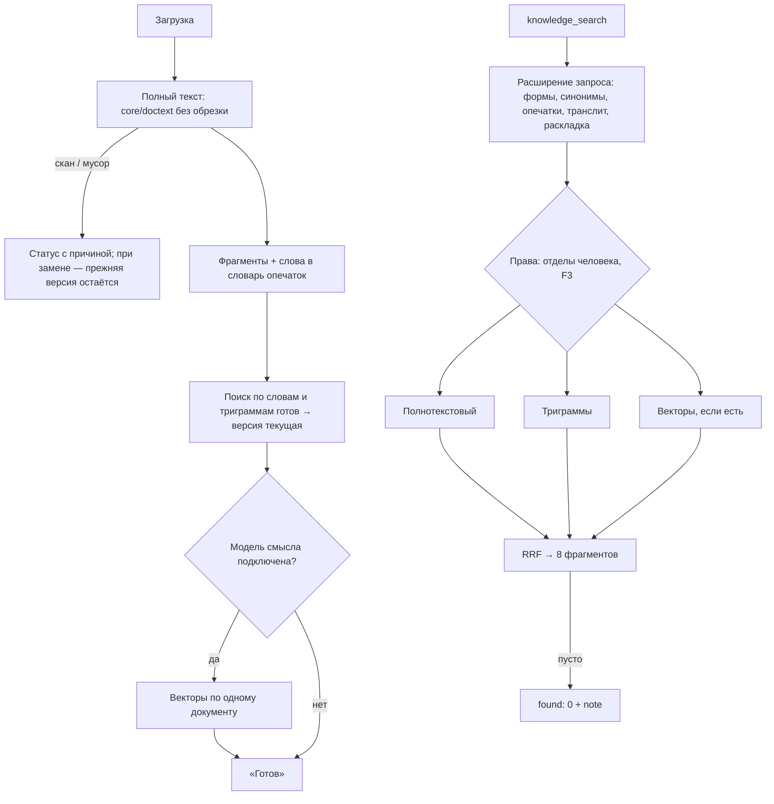

# База знаний организации — спецификация

**Статус:** построено 22.11 ночью без владельца — без поиска по смыслу (F4): разбор, фрагменты, поиск по словам в полную силу, права, инструменты агента, раздел «База знаний» (вкладки «Документы», «Образцы», «Синонимы»); независимая проверка проведена, находки исправлены. Тесты сервера `core/knowledge/*.test.ts` и интерфейса проходят. Не сделано: блок «База знаний» с «Открыть» под ответом (в чате — строка «База знаний · Нашёл фрагментов: N»), замеры M14/M14a, сценарий e2e. Задача GitHub не заводилась; решения агента — раздел 15. Коммиты `9db6091`, `903f2bf`, `f062bd6`
**Дата:** 2026-11-20, переписано по ответам 2026-11-21 · **Проект:** basic business agent · **Тип фичи:** смешанный (раздел для тех, кто ведёт документы, и инструменты агента + механизм разбора и поиска + контейнер модели смысла) · **Где работает:** админка (раздел «База знаний»), ход агента в чате и в фоновой задаче, фоновый разбор, контейнер `embeddings`
**Не применяется:** —

## Для новой сессии: как начать

**Где этот план.** Один из семи планов (было восемь; «Итоги совещаний» владелец исключил 21.11: «у меня для этого и так есть скилл, я сам сделаю»), составленных 20.11.2026 по просьбе владельца: «составь пачку планов на каждую из фичей, все хорошенько поресерчи, изучи лучшие плагины на рынке». Порядок постройки по зависимостям — рекомендация агента, владелец его не подтверждал:
1. `[20.11.2026]-mcp-connections.md` — свои подключения MCP
2. `[20.11.2026]-notifications.md` — уведомления в браузере
3. `[20.11.2026]-knowledge-base.md` — база знаний организации ← этот план
4. `[20.11.2026]-org-letterhead.md` — бланк организации, печать и подпись
5. `[20.11.2026]-event-tasks.md` — фоновые задачи по событию
6. `[20.11.2026]-multi-step-approvals.md` — согласования в несколько шагов
7. `[20.11.2026]-feedback-and-value.md` — жалобы, образцы документов и отчёт о пользе

Этот план — №3. Ни от чего не зависит. Поиск по смыслу — своя модель на сервере (F1, 21.11); выбор модели — по замеру M14a, без неё база ищет по словам. Нужен плану №7 «Жалобы, образцы и отчёт о пользе»: образцы документов (👍 «Хороший образец») живут в этой базе как документы вида «образец», а «ответ по базе знаний» — факт для отчёта о пользе.

**Состояние на 21.11.2026.** Черновик. Исследование сделано (опоры — раздел 3: книга «AI-агенты изнутри» (гл. 3), Claude — RAG в проектах, ChatGPT Enterprise — знания компании, практика pgvector + полнотекстовый поиск + RRF, обзоры эмбеддингов для русского 2026 (Qwen3-Embedding, GigaEmbeddings, bge-m3)). Независимая проверка свежим агентом проведена 20.11 и учтена — что она поменяла, ниже. Ответы владельца 21.11: поиск по смыслу — на своей лёгкой модели на сервере, модель выбрать замером позже; без неё — поиск по словам в полную силу с синонимами, триграммами, опечатками (F1); вопрос «кто платит» снят (F2). F3 (21.11): в общем проекте агент ищет по доступу того, кто спрашивает. План переписан по ответам. **Перед стартом — обсуждение с владельцем:** 21.11, отвечая про образцы документов, он сказал «как чанковать и как будет работать раг обсудим в будущем, щас неактуально ещё». Разбиение на фрагменты (раздел 8) и устройство поиска (раздел 17) — черновик агента до этого обсуждения. Задача GitHub не заведена: по правилу скилла `feature-blueprint` её заводят после ответов. Код не писался.

**Как стартовать в новой сессии.**
1. Прочитать `AGENTS.md`, этот план целиком и разделы спецификации базы `docs/specs/[12.11.2026]-agent-base-architecture.md`: 8.2 (права), 8.3 (сборщик промпта), 8.7 (песочница), 8.9 (файлы), 8.13 и 8.21 (поиск), 8.20 (общий проект), 8.23 (хранилище S3), 8.29 (быстрое чтение вложений), 8.33 (порядок в файлах, «взять файл»), 14 (отложенное: база знаний).
2. Загрузить скиллы: `feature-blueprint` (работа продолжается с его шага 13 — «после ответов владельца»), `owner-decisions` (сверить вопросы с базой решений владельца и записать его ответы, если они годятся и для других проектов), `developing-ai-agents` (обязательно по просьбе владельца: `references/playbooks/memory-design.md`, `references/chapters/ch03-memory-and-knowledge.md`, паттерн 13 «Grounded Retrieval Layer» в `references/patterns.md`, гл. 7 об оценке), `mastra-pg` (`integrations-vectors-pg.md` — почему не `PgVector`), `supabase-postgres-best-practices` (обязательно до миграций: pgvector, полнотекстовый поиск, индексы), `property-testing` (RRF и разбиение — арифметика и нормализация).
3. Если владелец ещё не ответил — задать вопросы раздела 6 одним сообщением в формате раздела 6 (ситуация, почему решать ему, варианты, рекомендация; в чате каждый вопрос — строкой с ❓). Молчание и «ок» — не согласие: рекомендованный вариант без слова владельца не строится. Ответы — в «Принято» с датой; обновить все задетые разделы и «Коротко»; статус — «согласовано».
4. Завести задачу GitHub (`gh`, правило проекта): что и зачем со ссылкой на этот файл, решения владельца с датами, шаги раздела 22 чек-листом, критерии готовности, зависимости. Ссылку вписать строкой «**Задача:**» в шапку этого файла.
5. Шаг 0 раздела 22 — проверки и замеры. Если они меняют решения владельца или устройство — показать владельцу, что изменилось, и ждать.
6. Дальше шаги по порядку: сначала падающий тест, потом код; после шага — `pnpm typecheck && pnpm lint` и тесты затронутого; коммит; итог шага — комментарием в задаче. В конце сессии — самопроверка и независимая проверка изменений отдельным агентом (глобальные правила владельца).

**Где смотреть код.** `core/doctext/` (`extract.ts`, `service.ts`: обрезка 64 000 знаков, кэш отказов 7 дней), `core/search/` (как устроен поиск Ctrl+K), `core/masking/detect.ts`, `core/masking/masker.ts`, `core/storage/` (`areas.ts`, `engine.ts`), `core/history/tool.ts` (приём «взять файл» — образец `knowledge_open`), `core/sandbox/workspace.ts`, `core/prompts/layers.ts`, `core/auth/departments.ts`, `core/models/` (виды моделей, сверка со шлюзом), `web/src/chat/WebSearch.tsx` (образец блока источников), `contracts/src/auth.ts` (права `documents.*`).

**Правила, которые легко нарушить** (из `AGENTS.md`, памяти агента и базы решений владельца `~/.agents/decisions/`):
- Правила проекта (`AGENTS.md`, правила работы в спецификации базы) не править без прямого слова владельца — даже чтобы записать его же указание.
- В спецификации — устройство и решения, без журнала работ: ход и итоги — комментариями в задаче GitHub.
- На http://localhost:8080 работает `pnpm dev` владельца: не останавливать и не перезапускать; `git stash` не использовать (ломает слежение за файлами); `pnpm test:e2e` и `pnpm stand` — во временной копии на портах 3100/8180 (раздел 22 спецификации базы).
- После шага — только `pnpm typecheck && pnpm lint` и тесты затронутого; полный `pnpm test`, `pnpm test:e2e`, `pnpm smoke` — один раз перед слиянием (решение владельца 20.11).
- Влить в `main`, создать PR, удалить тома и данные, подключить внешний сервис, который получит данные проекта, отправить что-либо за пределы машины — только с разрешения владельца.
- Сбой поведения модели чинить сначала тем, что советует документация фреймворка, а не своими ограничениями в цикле агента; число шагов агента кодом не ограничивать (решения владельца 15.11).
- Prettier не запускать; файл кода — до 800 строк; только стираемый синтаксис TypeScript.
- Владельцу — по-русски: сначала последствие, потом механизм; термины объяснять при первом упоминании.
- Поведение Mastra, LiteLLM, MCP-библиотек проверять по установленным исходникам и скиллам `mastra-*`, не по памяти.

**Открыто для всех семи планов** (спросить владельца при первом случае):
- В правилах проекта записано «спецификация одна, отдельных файлов не заводить» (`AGENTS.md`, «Источники правды»). Эти файлы сделаны по прямому слову владельца 20.11 («планируй фичу в общем в отдельном файле только»), правила не правились. Не решено: после сдачи фичи переносить ли её устройство в разделы 8–17 спецификации базы (как требует её правило) или оставлять здесь, и вписать ли исключение в `AGENTS.md`.
- Формат сообщений коммитов: правило проекта — «Шаг N: что сделано», а шаги здесь нумеруются внутри плана. Предложение агента (не подтверждено): «{Фича}, шаг N: что сделано».
- Чек-лист шагов в задаче #2 — для этапа 2; для этих фич чек-лист — в своей задаче GitHub.
- На 21.11 файлы планов не закоммичены (ветка `stage-2-new-interface`, `main` с ней совпадает после слияния 20.11).

**Что поменяла независимая проверка 20.11** (не возвращать прежние решения):
- Базу не подключать к песочнице: файловые инструменты Mastra получили бы её на запись, а песочница живёт 2 часа по ключу «папка + скиллы» и пережила бы перевод сотрудника. Документ целиком — копией через `knowledge_open` в `.work/knowledge/` (как «взять файл»).
- Поиск по словам — «любое из слов» (`|`): `websearch_to_tsquery` требует всех слов, и «возврат товара срок» не находил «Возврат возможен в течение 14 дней» (проверено на базе разработки).
- Без индекса HNSW по векторам, пока точный перебор быстрее 300 мс: с фильтром по отделам индекс теряет документы маленьких отделов.
- Текст документа — полностью, без обрезки 64 000 знаков; «Повторить» идёт мимо кэша отказов.
- Версии документа: текущей становится прочитанная; неудачная новая версия не заменяет прежнюю.
- Дата в ссылке — «Редакция от» (заполняет ведущий), иначе дата загрузки.
- `pandoc` теряет автонумерацию Word (проверено) — шаг 0 проверяет LibreOffice; иначе ссылки по заголовкам.
- 21.11 по ответу владельца: внешний провайдер векторов не используется; своя модель на сервере — без маскирования (данные не уходят). Поиск по словам расширен синонимами, опечатками по словарю базы, транслитом, раскладкой и триграммами.
- Документы отдела в общем проекте — поиск по доступу спрашивающего (F3-А, решение владельца 21.11; рекомендация агента «только общие базы участников» отклонена); удаление отдела с документами запрещено.
- Живой замер M14 проверяет и поиск, и поведение агента (вызывает ли поиск, честное «нет в базе»); замер M14a выбирает модель смысла — модель выбирает владелец.
- Заглушка векторов LiteLLM бесполезна (один нулевой вектор) — в тестах только `core/models/fake-openai.ts`.

## Коротко

**Что строим и зачем.** Сейчас агент не знает внутренних правил компании: регламентов, прайсов, условий договоров. Сотрудник спрашивает «какой у нас срок оплаты в договоре поставки?», и агент либо не знает, либо придумывает. Строим общую базу документов организации и отделов. Агент сам ищет в ней ответ и отвечает со ссылкой на документ, раздел и редакцию. Не нашёл — честно говорит «в базе знаний этого нет». Успех: на проверочном наборе нужный фрагмент находится в 9 случаях из 10, если вопрос задан теми же словами, с опечатками, в другой форме или синонимами; с подключённой моделью смысла — и когда задан совсем другими словами. Агент ищет в базе на вопросы о компании и не выдаёт свои знания за правила компании.

**Как будет работать.**
1. Документы ведут сотрудники с правом «Документы организации» (база для всех) или «Документы отдела» (база своих отделов). Права уже заведены и ждут эту фичу.
2. Загрузили документ — он «Готов». Сервер достаёт полный текст, режет его на фрагменты по заголовкам, страницам и строкам таблиц и готовит поиск. У документа можно указать «Редакция от» — эту дату агент называет в ссылке.
3. **Поиск по словам работает всегда и в полную силу:**
   - формы слова («возврата» = «возврат»);
   - синонимы («рекламация» = «возврат», «контракт» = «договор») — из общего словаря и словаря, который пополняют ведущие базу;
   - опечатки («вазврат») — по словарю слов самой базы;
   - транслит и другая раскладка («vozvrat», «djpdhfn»);
   - похожие куски слов (триграммы — тройки букв) — для артикулов и кодов вроде «С21» и «C-21».
4. **Поиск по смыслу** (решение владельца 21.11) — своя лёгкая модель «векторов» прямо на сервере установки: тексты никуда не уходят, денег не стоит. Какая модель лучше для бизнес-документов — лёгкие BERT-подобные, `multilingual-e5-small` и подобные, — выбираем замером на проверочном наборе. Пока модель не подключена, база ищет только по словам, и это не ошибка, а обычная работа.
5. Агент знает, какие документы есть в базе, и на вопросы о компании сначала ищет там. Ответ ссылается на источник: «По «Регламенту возвратов» (раздел «Сроки возврата», редакция от 12.03.2026) — 14 дней». Под ответом — блок «База знаний» с документами и кнопкой «Открыть» (просмотрщик).
6. Документ целиком агент берёт копией в свою рабочую папку и дочитывает скиллами — так он уже работает с файлами прошлых разговоров.
7. Документ отдела видят только сотрудники отдела и их агенты; это проверяет код при каждом поиске и копии. В общем проекте агент ищет так же — по доступу того, кто спрашивает (решение владельца 21.11): кадровик находит документы своего отдела, но не бухгалтерии.
8. Документ заменили — поиск переходит на новую версию, когда она прочитана. Если новая версия не прочиталась (скан, ошибка), агенты отвечают по прежней, а ведущий видит почему.

**Как построим.**
1. Текст достаёт уже готовый разбор `core/doctext` в песочнице, но полностью: для чата он режет текст до 64 000 знаков.
2. Поиск — в Postgres, который уже стоит. Несколько списков кандидатов объединяются по месту в выдаче (RRF):
   - полнотекстовый поиск `russian` с расширенным запросом: формы, синонимы, исправленные опечатки, транслит, раскладка — «любое из слов»;
   - триграммы (`pg_trgm`, уже включено в проекте);
   - векторы (pgvector) — если модель смысла подключена.
3. Расширение запроса берёт уже написанное для Ctrl+K: формы, транслит и раскладку (`core/search/variants.ts`), исправление опечаток по словарю (как `app.search_words`). Словарь опечаток базы знаний — свой: слова её фрагментов.
4. Модель смысла — отдельный контейнер `embeddings` на сервере установки с совместимым адресом `/v1/embeddings`. Он включается профилем `docker compose`, только если нужен. В «Нейросети» администратор заводит её как модель вида «Поиск по смыслу (векторы)» с адресом этого контейнера. Вызовы идут через шлюз LiteLLM, как и все вызовы моделей (правило проекта), цена — ноль.
5. Агенту — два инструмента:
   - `knowledge_search` — поиск;
   - `knowledge_open` — копия документа в рабочую папку разговора.

   Своего инструмента чтения нет: читают скиллы (ваше решение 19.11).
6. Файлы базы — в хранилище установки, отдельной областью (диск или S3).

**На что смотреть.**
- **Память сервера.** Модель смысла — около 0,3–1 ГБ памяти в зависимости от модели [ИЗМЕРИТЬ]. На сервере 8 ГБ вместе с контейнером программ MCP (≈1 ГБ) запас небольшой — это один из критериев выбора модели.
- **Модель выбираем замером, а не по памяти.** Замер M14a сравнивает 3–4 лёгкие модели на проверочном наборе бизнес-документов: качество, время на фрагмент, память. Итог — рекомендация владельцу.
- **Смена модели — пересчёт всех векторов.** Пока он идёт, база ищет по словам.
- **Номера разделов.** Word хранит номера заголовков («4.2») как автоматическую нумерацию, а `pandoc` её теряет (проверено). Шаг 0 проверяет выгрузку через LibreOffice; не выйдет — ссылка называет раздел по заголовку.
- **Сканы и плохой текст** не находятся по тексту. Документ показывает причину. Распознавание сканов отложено по правилу «механизм не строим, пока проблема не измерена».
- **Будет ли агент искать.** Живая модель может не вызвать поиск и ответить из головы. Это проверяет живой замер M14 (шаг 11).
- Отложено: распознавание сканов, подтягивание документов с дисков и порталов, поиск по смыслу в файлах проектов.

**На что опирается.**
- Книга «AI-агенты изнутри» (скилл `developing-ai-agents`, гл. 3): поиск по словам и по смыслу вместе; поиск — инструмент агента, который можно повторить; у фрагмента — происхождение; пустая выдача — явное «нет данных».
- Claude, режим RAG в проектах: поиск по знаниям — инструмент модели.
- ChatGPT Enterprise, «знания компании»: ответ со ссылками, видно только то, что видно пользователю.
- Практика Postgres 2026: полнотекстовый поиск + `pg_trgm` + pgvector, объединение RRF.
- Обзоры эмбеддингов для русского 2026: Qwen3-Embedding и GigaEmbeddings — тяжёлые; среди лёгких — `multilingual-e5-small`, `rubert-tiny2` и семейство BERT. Сравнивать на своих данных.

**Найдено по пути.**
- Права `documents.org.manage` и `documents.department.manage` уже есть, но ничего не открывают — эта фича даёт им смысл.
- Отдел удаляется одной кнопкой с правом «Отделы» (`core/auth/departments.ts:55`). Удаление отдела с документами базы запрещаем, пока документы не перенесены или не удалены.

**Ждёт вашего решения.**
1. ~~Какой поиск и у какого провайдера векторы?~~ Решено 21.11: поиск по смыслу — на своей лёгкой модели на сервере; модель выбрать замером позже; без неё — поиск по словам в полную силу (F1, «Принято»).
2. ~~Чей ключ платит за разбор?~~ Снят: своя модель денег не стоит (F2, «Принято»).
3. ~~Документы отдела в общем проекте?~~ Решено 21.11: искать по доступу того, кто спрашивает (F3, «Принято»).

**Выкладка:** выкладки нет. Работа заканчивается `pnpm typecheck && pnpm lint`, тестами затронутого, замерами M14a и M14 и сценарием e2e; полный прогон и `pnpm smoke` (контейнер модели смысла) — перед слиянием.

**Объём:** 13 шагов, около 11 ч работы агента. Дольше всего — сравнение моделей смысла, сильный поиск по словам и живой замер поведения агента. От вас — 10–20 настоящих документов без секретов для замеров, если есть; выбор модели по итогам M14a.

**Не проверено:** какой сервер моделей запустит выбранные модели на процессоре и сколько памяти они займут; сохраняет ли LibreOffice нумерацию Word (шаг 0).

---

# Часть 1. Для владельца: как это устроено

## 1. Что известно и что добавлено

- **Владелец сказал (20.11):** «поресерчи и изучи, как строятся подобные базы знаний по лучшим практикам, скилл мастры, скилл по аи агентам заодно изучи; в отдельном файле накидывай план».
- **Владелец сказал (21.11):** «поиск по смыслу на локальных эмбеддингах, надо будет уже позже потестить, какая модель лучше подойдёт под задачи бизнеса — лёгкие модели типа берта или е5 мультилангуал смолл обычно подходят; а пока если не подключено, то ищется по словам, но с полной прокачкой такого поиска — всякие там синонимы, триграммы, опечатки и т. д. должно учитываться».
- **Найдено в проекте:**
  - база знаний отложена спецификацией базы, права зарезервированы (`contracts/src/auth.ts`, `web/src/admin/sections.ts:48`);
  - `core/doctext/service.ts` режет текст до 64 000 знаков (`DOC_TEXT_KEPT_CHARS`) и запоминает отказ на 7 дней; порог скана — 100 букв на страницу в среднем (`extract.ts:67`); разбор — 90 с (`extract.ts:63`);
  - песочница: 8 команд и 2 запуска LibreOffice на установку, общие с агентами и просмотрщиком (`core/server/main.ts:101`);
  - файловые инструменты Mastra работают внутри сервера, «только чтение» включается лишь на весь диск сразу, песочница переиспользуется 2 ч по ключу «папка + скиллы» (`core/sandbox/workspace.ts:112,118`) — поэтому базу в песочницу не подключаем, а копируем нужный документ;
  - поиск Ctrl+K уже умеет формы, транслит (пакет `iuliia`), раскладку (`core/search/variants.ts`), опечатки по словарю `app.search_words` с `pg_trgm` и `fuzzystrmatch` (`core/search/match-sql.ts`, миграции `0021`, `0022`) — но не ранжирует;
  - `websearch_to_tsquery` требует всех слов сразу (проверено на базе разработки);
  - pgvector в образе базы есть (`pgvector/pgvector:0.8.1-pg17`), расширение `vector` не включено; в «Нейросети» виды моделей — `chat` и `transcription`;
  - строка инструмента в чате раскрывается в сырой JSON (`ToolRow`) — для источников нужен свой блок, как `WebSearch.tsx`;
  - заглушка векторов LiteLLM (`mock_embedding`) возвращает один нулевой вектор на пакет — для тестов годится только `core/models/fake-openai.ts`.
- **Добавлено:** [ДОПУЩЕНИЕ] до 2 000 документов и до 100 000 фрагментов на организацию; документ до 20 МБ.

| Код | Что это | Где | Вес |
|---|---|---|---|
| ВЛ | Просьба и ответы владельца | этот разговор, 20–21.11 | требование |
| КН | «AI-агенты изнутри», гл. 3, паттерн 13 | `.agents/skills/developing-ai-agents/references/chapters/ch03-memory-and-knowledge.md` | справка |

## 2. Цели, не-цели, анти-цели

- **Цели:**
  1. Ответ на вопрос о правилах компании — из её документов, с документом, разделом и редакцией.
  2. Поиск по словам находит фрагмент при опечатке, другой форме слова, синониме, транслите, другой раскладке и неточном коде.
  3. С подключённой моделью смысла находится и перефраз без общих слов; тексты при этом не покидают сервер.
  4. Документ отдела не находит никто вне отдела: ни человек, ни его агент, в том числе в общем проекте. Выдержку, которую сотрудник отдела сам положил в файлы общего проекта, видят участники проекта — так решил владелец 21.11 (F3).
  5. Ведущий видит, ищется ли каждый документ и что с ним не так; нет в базе — агент так и говорит.
- **Не-цели:** распознавание сканов; внешние диски; поиск по смыслу в проектах и разговорах; правка документов базы агентом; внешний провайдер векторов.
- **Анти-цели:**
  - агент цитирует документ отдела человеку из другого отдела;
  - агент уверенно отвечает «по регламенту…», ничего не найдя;
  - «Готов», но документ не находится, и никто не знает;
  - агент цитирует отменённую редакцию с датой новой;
  - модель смысла съедает память сервера и роняет другие службы.
- **Сейчас:** люди ищут в папках или спрашивают коллег; агент отвечает общими знаниями.

## 3. На что опирается

| Практика | Кто делает | Масштаб | Берём? | Почему | Источник, дата |
|---|---|---|---|---|---|
| Слова + смысл, RRF | книга; практика Postgres | от первых документов | да | у каждого своя слепая зона | КН; dev.to «hybrid search pgvector RRF», 2026 |
| Расширение запроса: формы, синонимы, опечатки, транслит, раскладка; триграммы | поисковики; этот проект (Ctrl+K) | любой | да | решение владельца 21.11; код Ctrl+K уже есть | `core/search/` |
| Своя лёгкая модель векторов на сервере | практика on-premise RAG | от первых документов | да (решение владельца) | тексты не уходят наружу, бесплатно | ответ владельца 21.11 |
| Поиск — инструмент агента | книга; Claude-проекты | любой | да | несколько заходов | support.claude.com/articles/11473015 |
| Ссылки на источник | ChatGPT «знания компании» | любой | да | без источника не верят | openai.com/index/introducing-company-knowledge |
| Пояснение-приставка к фрагменту | книга, Anthropic | фрагменты без контекста | позже | обращение к модели чата на фрагмент | КН |
| Индекс HNSW для векторов | pgvector | сотни тысяч фрагментов | нет, пока поиск быстрее 300 мс | с фильтром по отделам теряет документы маленьких отделов | документация pgvector 0.8 |
| Внешний провайдер векторов | многие | — | нет | решение владельца 21.11 | — |

## 4. Варианты и масштаб

**Масштаб:** до 2 000 документов, до 100 000 фрагментов; Postgres — 1,5 ГБ памяти; сервер 8 ГБ.

Путь выбран владельцем 21.11: слова в полную силу всегда + своя модель смысла, когда подключена. Развилка внутри — какая модель (замер M14a) и где её запускать:

| | А. Отдельный контейнер `embeddings` (выбрано агентом) | Б. Модель внутри приложения (ONNX в Node) |
|---|---|---|
| Как работает | сервер моделей с адресом `/v1/embeddings`, заводится в «Нейросети», вызовы через шлюз | библиотека в процессе приложения |
| Даёт | правило «все модели через шлюз» соблюдено; модель меняется без пересборки приложения; свой потолок памяти | меньше частей |
| Цена | ещё один контейнер (включается профилем) | память и процессор отнимаются у ходов агентов; мимо шлюза и учёта |

**Выбрано А**, раздел 15.

## 5. Как это работает

**Точки входа:** «База знаний» → 1, 4, 6; вопрос → 2; «Открыть» → 2; фоновая задача → 2; подключение или смена модели смысла → 5.

**Сценарий 1 — HR загружает регламенты.** Мария, руководитель отдела кадров.
1. «База знаний» → «Для всей организации» → 12 файлов → «Разбираю…» → «Готов · 34 фрагмента». Разбор — по одному документу, не мешая чатам коллег.
2. Один PDF — «Скан — текст не найден…», другой — «Готов, но 3 страницы — сканы без текста».
3. У «Регламента отпусков» Мария ставит «Редакция от 01.02.2026».

**Сценарий 2 — вопрос.** Ольга, «Продажи»: «Клиент хочет сделать рекламацию через 20 дней после покупки — можно?»
1. Агент вызывает `knowledge_search` («рекламация срок дней»). Синоним «рекламация» → «возврат»; найдено «Возврат возможен в течение 14 дней». Блок «База знаний · Нашёл 4 фрагмента».
2. Ответ: «Нет: по «Регламенту возвратов» (раздел «Сроки возврата», редакция от 12.03.2026) — 14 дней. Исключение — брак, 30 дней».
3. «Открыть» — документ в просмотрщике; если заменили — «Документ обновлён — открыть текущую редакцию».
4. Дочитать весь регламент — `knowledge_open`, копия, скилл.
- **С опечаткой** («вазврат товара») — исправляется по словарю базы, находится то же.
- **Совсем другими словами** («клиент передумал через месяц») — без модели смысла не находится; агент пробует ещё раз своими словами («возврат товара срок»), находит. С моделью — находит сразу.
- **Не нашёл:** «В базе знаний этого нет. Уточните у руководителя или попросите добавить правило в базу». Свои знания — с пометкой «общая практика, не правило компании».

**Сценарий 3 — документ отдела.** Пётр из бухгалтерии спрашивает о премиях; «Положение о премировании» — в базе «Отдела кадров». Поиск Петра его не находит, копию взять нельзя.

**Сценарий 4 — замена.** Новая редакция через «Заменить»: пока разбирается — ищется прежняя; прочитана — новая; оказалась сканом — «Новая версия не принята: скан без текста. Агенты отвечают по прежней редакции».

**Сценарий 5 — модель смысла.**
1. Администратор включает контейнер `embeddings` (профиль `docker compose`), в «Нейросети» → «Добавить модель» → вид «Поиск по смыслу (векторы)» → «Своя модель на сервере», адрес `http://embeddings:80/v1`, модель из списка проверенных (после M14a) → «Проверить и сохранить» → «Параметры» → «Модель для поиска по смыслу».
2. «База знаний» показывает «Считаю поиск по смыслу: 120 из 412 документов». Пока идёт — поиск по словам, агент знает, что поиск неполный.
3. Смена модели — то же: пересчёт; векторы старой модели в поиске не участвуют.

**Сценарий 6 — синонимы.** Мария видит, что сотрудники пишут «отгул», а в регламенте «день отдыха». «База знаний» → «Синонимы» → «Добавить группу»: «отгул, день отдыха, выходной за свой счёт» → поиск сразу находит.

## 6. Решения владельца

### Принято
- **F1 — поиск по смыслу на своей лёгкой модели на сервере; без неё — поиск по словам в полную силу** (владелец 21.11: «поиск по смыслу на локальных эмбеддингах, надо будет уже позже потестить, какая модель лучше подойдёт под задачи бизнеса — лёгкие модели типа берта или е5 мультилангуал смолл обычно подходят; а пока если не подключено, то ищется по словам, но с полной прокачкой такого поиска — всякие там синонимы, триграммы, опечатки и т. д. должно учитываться»). Было на выбор: только слова; слова и смысл у внешнего провайдера (рекомендация агента); то же с пояснениями к фрагментам. Модель выбирается замером M14a — итог показать владельцу.
- **F2 — кто платит за разбор** — снят: своя модель денег не стоит; вызовы идут через шлюз с нулевой ценой.
- **F4 — строим без поиска по смыслу** (владелец 22.11: «базу знаний можешь реализовать но пока что без включенных эмбеддингов, пока что не до них, пока их нет»). Сейчас база ищет только по словам в полную силу (F1, вторая половина). Шаги 7, 8, 10 и векторная часть шагов 9 и 12 (контейнер `embeddings`, вид модели «Поиск по смыслу», векторы, пересчёт, замер M14a) не делаются; путь к ним не закрывается: таблица фрагментов и поиск устроены так, чтобы третий список кандидатов (векторы) добавлялся в RRF без переделки. Обсуждение нарезки и поиска (RAG) — на готовом.
- **F3 — в общем проекте агент ищет по доступу того, кто спрашивает** (владелец 21.11: «наверное, кадровик должен видеть только то, что касается его отдела, и то, что лежит в общем проекте; по базе бухгалтерии искать не надо»). Это вариант А; рекомендация агента «в общем проекте — только базы, общие для всех участников» отклонена. Следствие, принятое владельцем: выдержку из документа своего отдела, которую сотрудник попросил положить в файлы общего проекта, видят все участники проекта.

---

# Часть 2. Для исполнителя: поведение подробно

## 7. Точки контакта и состояния

| Точка | Пусто | Загрузка | Есть данные | Частично | Ошибка | Нет прав | Успех |
|---|---|---|---|---|---|---|---|
| «База знаний» | «В базе пока нет документов. Загрузите регламенты, прайсы, условия — агенты будут отвечать по ним со ссылкой на документ.» | `DelayedBar` | вкладки «Для всей организации», отделов с правом и «Синонимы»; таблица документов | строки «Разбираю…», «В очереди» | `ErrorBanner` | раздела нет | «Готов» |
| Строка документа | — | «Разбираю…», «В очереди» | «Готов · N фрагментов» | «Готов по словам; по смыслу — в очереди», «Готов, но N страниц — сканы» | «Скан — текст не найден…», «Текст не читается…», «Разбор не уложился во время…», «Новая версия не принята: …», «Ошибка разбора…» с «Повторить» | — | — |
| Полоса модели смысла | «Поиск по смыслу не подключён — база ищет по словам» (без модели; не ошибка) | «Считаю поиск по смыслу: N из M» | — | — | «Модель смысла не отвечает — база ищет по словам» | — | полоса исчезает |
| «Синонимы» | «Свои синонимы пока не добавлены. Общий словарь уже работает.» | — | группы слов, «Добавить группу», «Изменить», «Удалить» | — | текст ошибки, набранное остаётся | права `documents.*` | «Сохранено» |
| Блок в чате | — | «База знаний · Ищу…» | «База знаний · Нашёл N фрагментов» с документами и «Открыть» | «…· только по словам» (модель не подключена или не отвечает) | «База знаний · Поиск не удался» | — | — |

| Инструмент | Когда | Параметры | Возвращает | Ошибки |
|---|---|---|---|---|
| `knowledge_search` | вопросы о правилах, ценах, условиях, процессах, документах компании; не для общих знаний и не для файлов проекта | `query` (2–300 знаков), `document` (необязательно) | `{ found, mode: 'words' \| 'words+meaning', fragments: [{ ref, docId, version, document, section, page, edition, text }], note }`; до 8 фрагментов по 1 500 знаков; при `mode = 'words'` в `note` — «поиск только по словам: если не нашёл, повтори другими словами — синонимами и ключевыми терминами» | `{ error, code, message }`: `APP_KNOWLEDGE_UNAVAILABLE` |
| `knowledge_open` | нужен документ целиком | `ref` или `docId` | `{ path }` — копия в `.work/knowledge/<имя>`; `note`: «читай скиллами документов» | `APP_NOT_FOUND` (нет доступа — так же), `APP_KNOWLEDGE_REPLACED` |

Слой промпта «# База знаний организации»: до 100 названий документов, доступных в этом разговоре, «и ещё N». Правило ядра: «Вопросы о правилах, ценах, условиях и процессах компании — сначала `knowledge_search`. Не нашёл — попробуй ещё раз другими словами. В ответе называй документ, раздел и редакцию. Не нашёл — так и скажи; свои знания помечай как общую практику». То же — в описании инструмента.

## 8. Внутренний механизм: гарантии, данные, сбои

**Гарантии:**
- права — в том же запросе, что ищет: фрагмент чужого отдела не может попасть в выдачу;
- удалённый документ не находится сразу после «Удалено»;
- текущая версия меняется одной транзакцией;
- без модели смысла поиск работает полностью (по словам), а не «с ошибкой».

| Что ломается | Как предотвращаем | Как узнаём | Как восстанавливаемся | Чем закрыто |
|---|---|---|---|---|
| Модель смысла не отвечает при разборе | 3 попытки: 10 с, 1 мин, 10 мин | «Готов по словам; по смыслу — в очереди», `knowledge_embed_failed` | очередь сама | шаг 8 |
| Модель не отвечает при поиске | поиск по словам и `mode: 'words'` | блок «только по словам», полоса в разделе | — | шаг 9 |
| Контейнер модели съел память | потолок памяти контейнера в compose | контейнер перезапускается Docker | — | шаг 7 |
| Перезапуск во время разбора | состояние в базе | — | при старте берутся незаконченные | шаг 6 |
| Отказ разбора закэширован | «Повторить» идёт мимо кэша | — | — | шаг 3 |
| Массовая загрузка | по одному документу, ниже чата в очереди | «В очереди» | — | шаг 6 |
| Сменили модель смысла | номер модели у вектора | полоса пересчёта | пересчёт | шаг 10 |

**Данные:**
- `app.kb_documents`: `id`, `scope`, `department_id`, `folder`, `title`, `edition_date`, `current_version`, `uploaded_by`, `updated_at`, `created_at`.
- `app.kb_versions`: `document_id`, `version`, `storage_path`, `size`, `sha256`, `status`, `warning`, `error_code`, `created_at`.
- `app.kb_chunks`: `document_id`, `version`, `ord`, `section`, `page`, `text`, `norm_text` (нижний регистр, «ё» → «е» — для триграмм), `tsv` (`russian`, GIN `fastupdate = off`), индекс триграмм по `norm_text` (GIN `gin_trgm_ops`), `embedding` (`vector`, без индекса до замера), `embedding_model`.
- `app.kb_words`: слово, число фрагментов с ним — словарь опечаток базы (ведётся при разборе и удалении, как `app.search_words`).
- `app.kb_synonyms`: `group_id`, `word` (нормализованное), `scope` (`org` или отдел — у групп ведущих), `created_by`. Общий словарь — в коде (`core/knowledge/synonyms.ts`), в базе только добавленное людьми.
- Файлы: область хранилища `knowledge`: `knowledge/<docId>/v<version>/<имя>`.
- Повторы: одинаковый файл (`sha256`) в той же базе — «уже есть».

**Запрос по словам (одна функция `expandQuery`):** для каждого слова запроса — формы (`russian`) + варианты Ctrl+K (транслит, раскладка — `core/search/variants.ts`) + исправление опечатки по `app.kb_words` (правило Ctrl+K: одна правка для 4–7 букв, две — для 8+) + синонимы (общий словарь и группы людей). Всё собирается в `to_tsquery('russian', …)` через «|». Отдельно триграммы — `word_similarity` запроса к `norm_text` с порогом [ИЗМЕРИТЬ, начать с 0,3 как у Ctrl+K].

**Разбиение:** Word и текст — по заголовкам, длинное — по абзацам до ~1 000 знаков с перекрытием в 1 абзац; PDF — по страницам; Excel и CSV — по 40 строк с шапкой и листом; PowerPoint — по слайду.

## 9. Ошибки и восстановление

| Ситуация | Что видит человек |
|---|---|
| Формат не тот | «Этот формат база знаний не читает. Подойдут Word, Excel, PowerPoint, PDF, текст. Код: APP_KNOWLEDGE_FORMAT» |
| Больше 20 МБ | «Файл больше 20 МБ. Разделите его на части. Код: APP_UPLOAD_TOO_LARGE» |
| Пароль | «Документ защищён паролем — сохраните его без пароля и загрузите снова. Код: APP_KNOWLEDGE_PASSWORD» |
| Скан | «Скан — текст не найден. Агент не найдёт его поиском; загрузите версию с текстом. Код: APP_KNOWLEDGE_NO_TEXT» |
| Мусорный текст | «Текст документа не читается (повреждены шрифты). Пересохраните документ из исходной программы. Код: APP_KNOWLEDGE_BAD_TEXT» |
| Разбор не уложился | «Разбор не уложился во время — сервер был занят. Нажмите «Повторить». Код: APP_KNOWLEDGE_SLOW» |
| Удаление отдела с документами | «В базе отдела {N} документов. Перенесите их в базу организации или удалите, затем удаляйте отдел. Код: APP_DEPARTMENT_HAS_KNOWLEDGE» |
| Группа синонимов из одного слова | «В группе нужно хотя бы два слова. Код: APP_VALIDATION_FAILED» |
| Модель смысла не принята при добавлении | «Модель не ответила векторами по этому адресу. Проверьте, что контейнер модели запущен. Код: APP_MODEL_CHECK_FAILED» |

## 10. Крайние случаи и стыки

| Случай | Что происходит |
|---|---|
| Сотрудник в двух отделах | видит базы обоих |
| Перевели в другой отдел | доступ меняется со следующего поиска; копии, взятые раньше, остаются в его разговорах |
| Синоним совпал со словом другого смысла («лист» — бумага и Excel) | группа влияет только на расширение запроса; в выдаче решает ранжирование; ведущий может удалить группу |
| Опечатка исправляется в не то слово | исходное слово тоже остаётся в запросе («любое из»), неверное исправление добавляет кандидатов, но не убирает верных |
| Код «С21» латиницей «C21» | триграммы и раскладка |
| Персональные данные в документе | своя модель на сервере — без маскирования (данные не уходят); внешний провайдер не допускается (F1) |

| Соседняя функция | Где встречаются | Что происходит |
|---|---|---|
| Общий проект (8.20) | поиск и копии | по доступу спрашивающего (F3); копия документа отдела в `.work` проекта видна участникам — это следствие F3, принятое владельцем |
| Ctrl+K | код вариантов слов и опечаток | общий код в `core/search/`, словари разные; база в Ctrl+K не ищется (P1) |
| «Нейросеть» | модель смысла | вид модели «Поиск по смыслу (векторы)», провайдер «Своя модель на сервере» |
| Хранилище S3 (8.23) | файлы базы | область `knowledge`, копируется только нужный документ |
| «Взять файл» (8.33) | копии | тот же приём, `.work/knowledge/` |
| Образцы (план №7) | 👍 «Хороший образец» на документе агента | документ вида «образец» (`kind = 'example'`, «вид документа») в базе отдела, раздел «Образцы», прибавка в выдаче и фильтр `kind` у `knowledge_search`; поля и логика — в плане №7, таблица `app.kb_documents` строится так, чтобы их можно было добавить |
| Программы MCP (`mcp-runner`) | память сервера | оба контейнера с потолками; суммарно — в замере памяти шага 0 |

## 11. Скорость

| Действие | Ожидаемо |
|---|---|
| Разбор 20 страниц по словам | до 30 с [ИЗМЕРИТЬ] |
| Векторы 20 страниц своей моделью | [ИЗМЕРИТЬ в M14a] |
| Поиск | до 300 мс в базе [ИЗМЕРИТЬ] + вектор запроса своей моделью (десятки мс) |

## 12. Тексты интерфейса

| Где | Текст |
|---|---|
| Меню | «База знаний» |
| Подсказка | «Документы, по которым агенты отвечают сотрудникам. Документы отдела видят только его сотрудники.» |
| Кнопки | «Загрузить документы», «Новый раздел», «Заменить», «Переименовать», «Редакция от», «Скачать», «Открыть», «Удалить» |
| «Синонимы» | «Слова, которые в вашей компании значат одно и то же. Агент найдёт документ, даже если сотрудник спросил другим словом.», «Добавить группу», «Слова через запятую» |
| «Нейросеть» | вид «Поиск по смыслу (векторы)», провайдер «Своя модель на сервере», «Модель для поиска по смыслу», «Нет — только поиск по словам» |

## 13. Данные

- Тексты документов и запросы не покидают сервер: модель смысла — своя.
- Синонимы, добавленные людьми, видны и действуют в базе своего уровня (организация или отдел).

## 14. Что сознательно не делаем

- **Внешний провайдер векторов** — решение владельца 21.11.
- **Распознавание сканов** — если сканов больше 20 % документов базы.
- **Диски и порталы** — если регламенты живут на диске и меняются чаще раза в месяц.
- **Переупорядочивание отдельной моделью** — если нужное часто в первых 30, но не в первых 8.
- **База в Ctrl+K** — по просьбе.
- **«Действует до»** — если начнут копиться отменённые документы.
- **Пояснения к фрагментам моделью чата** — если M14 покажет промахи на фрагментах без контекста.

## 15. Решения агента — на проверку

**Сделано 22.11 (ночью, без владельца) — отличия от плана и решения по ходу:**
- Файлы базы хранятся в Postgres (`kb_versions.content`, до 20 МБ), а не в хранилище файлов (диск или S3): база копируется вместе с резервной копией базы данных, а у хранилища файлов области — папки сотрудников и проектов с рабочими копиями, отдельная область для базы стала бы новым механизмом. Вернуться к хранилищу — если база вырастет за несколько гигабайт.
- Поиск по смыслу не построен (F4): нет колонки векторов, контейнера `embeddings`, вида модели и замера M14a; новый список кандидатов добавляется в RRF `core/knowledge/search.ts` и колонкой новой миграцией.
- Заголовок раздела входит в текст каждого фрагмента: вопрос «срок возврата» находит раздел «Сроки возврата», даже если в абзаце этих слов нет.
- Порядок вариантов слова при пределе 8: само слово, синонимы, слова базы, опечаткой которых оно может быть, потом транслит и другая раскладка (иначе транслит вытеснял синонимы).
- Словарь опечаток общий для всей базы (`app.kb_words`): исправленное слово только добавляет кандидатов, а выдача всегда проверяется по доступу — содержимое чужого отдела не открывается.
- Общий словарь синонимов — 12 групп деловых слов в коде (`core/knowledge/synonyms.ts`); свои группы ведущие добавляют на вкладке «Синонимы» своей базы.
- Раздел «База знаний» открывается правами «Документы организации» и «Документы отдела» (разделы админки теперь принимают и эти права).
- В чате — строка «База знаний · Нашёл фрагментов: N»; блок с документами и «Открыть» (просмотрщик) под ответом не сделан.
- Обнаружение «мусорного» текста (повреждённые шрифты) не сделано: такой документ читается как есть.

**По независимой проверке 22.11 (исправлено, `f062bd6`):**
- Файл, на котором разбор падает или песочница занята, больше не держит очередь: 3 сбоя или 5 раз «занят» — отказ с кодом (`APP_KNOWLEDGE_BAD_TEXT`, `APP_KNOWLEDGE_SLOW`), остальные читаются; «Повторить» обнуляет счёт (миграция `0044`, `kb_versions.attempts`).
- Фрагмент не длиннее того, что видит агент (1 500 знаков): длинный абзац режется по строкам, предложениям и словам; широкие строки таблицы — по объёму; CSV и TSV режутся как таблица (по строкам с заголовком); презентация — по слайдам (номер слайда — страница, заголовок — раздел, заметки внутри). Слова длиннее 64 знаков (ключи, хэши) в словарь опечаток не попадают.
- Коды в обоих алфавитах: «C21» (латиница) находит «С21», «С-21» — тоже; триграммы сравнивают коды в кириллице. Знаки препинания у слова («рекламация?», «djpdhfn,») больше не выключают синонимы, опечатки и раскладку. Слово запроса не выпадает при пределе 60 вариантов.
- Прежние версии файла (`?version=N`) скачивает только ведущий базы; суперадмин скачивает файл базы отдела, даже не состоя в нём.
- Словарь опечаток: удаление документа блокирует его строку, счётчики проходят через ноль, а не ниже (ограничение `count >= 0`).
- Синонимы: группа меняется одной транзакцией, чужая группа не найдена (404), изменения — в аудите.
- Неверный адрес отдела, группы, версии, даты редакции — понятный код, а не ошибка сервера; сбой сервера в инструменте агента пишется в журнал.
- После «Заменить» «Редакция от» сбрасывается: ссылка агента не называет старую дату с новым текстом.
- Правило ядра «сначала `knowledge_search`» действует, только когда в промпте есть раздел «База знаний организации» (у сотрудника есть документы); сами инструменты по-прежнему выдаются всегда.
- Тексты раздела — в `web/src/i18n/knowledge.ts`; тексты согласований вынесены в `web/src/i18n/chains.ts` — `ru.ts` был больше 800 строк.

**Решения из плана, сохранённые как есть:**

- Модель смысла — отдельный контейнер `embeddings`, включаемый профилем, а не библиотека в приложении: так все модели идут через шлюз, а память модели не отнимается у ходов агентов.
- Без маскирования для своей модели: данные не покидают сервер, а заглушки вместо имён ухудшают поиск по смыслу.
- Синонимы: общий словарь в коде + группы, которые добавляют ведущие базу (вкладка «Синонимы»). Владелец просил синонимы; редактирование людьми — моё решение, чтобы компания могла добавить свои слова («отгул» = «день отдыха»).
- Опечатки — по словарю слов самой базы, а не общему словарю переписки (как в Ctrl+K, но отдельно): так исправление ведёт к словам, которые в базе есть.
- Документ целиком — копией в рабочую папку, а не подключением базы к песочнице.
- Без индекса по векторам, пока поиск быстрее 300 мс.
- Текущая версия меняется, когда прочитан текст, а не когда готовы векторы.

---

# Часть 3. Для исполнителя: как строить

## 16. Что есть и что берём

- **Берём:** `core/doctext/extract.ts` (разбор без обрезки и кэша), `core/search/variants.ts` (формы, транслит, раскладка), правила опечаток `core/search/match-sql.ts` (`allowedEdits`, `TYPO_CANDIDATE_THRESHOLD`) и устройство словаря `app.search_words` (миграции `0022`, `0024`), `pg_trgm` и `fuzzystrmatch` (уже включены), `core/storage`, очередь по образцу `core/background/queue.ts`, приём копии из `core/history/tool.ts`, блок по образцу `web/src/chat/WebSearch.tsx`, просмотрщик, права `documents.*`, «Нейросеть».
- **Расширяем:** вид модели `embedding` и сверку со шлюзом (`/v1/embeddings`, провайдер — совместимый с OpenAI адрес), `app.model_settings.embedding_model_id`; слои промпта; `core/auth/departments.ts` (запрет удаления); `deploy/compose.yaml` (сервис `embeddings` под профилем).
- **Не берём:** `PgVector` и `@mastra/rag`; внешних провайдеров векторов.

## 17. Устройство

- **Модуль:** `core/knowledge/` — `store.ts` (документы, версии, права `canManage`, `canRead(user)` — только по отделам того, кто спрашивает; проект хода на доступ не влияет, F3), `chunk.ts`, `words.ts` (словарь опечаток базы), `synonyms.ts` (общий словарь и группы людей), `expand.ts` (`expandQuery`), `index-queue.ts`, `search.ts`, `tools.ts`, `prompt.ts`, `routes.ts`; `web/src/knowledge/*` (документы, «Синонимы»), `web/src/chat/KnowledgeSources.tsx`; `deploy/embeddings/` (сервис модели; образ и модель закрепляются после M14a).
- **Маршруты:** управление — `…/knowledge/documents`, `…/knowledge/synonyms` (права `documents.*`); чтение для просмотра — `GET /app/api/knowledge/documents/:id/versions/:v/file`.
- **Поиск (один SQL):** три списка по 30 — полнотекстовый (`tsv @@ to_tsquery('russian', расширенный запрос)`, `ts_rank_cd`), триграммы (`word_similarity` к `norm_text`), векторы (`embedding <=> $v` при `embedding_model = $m`, если модель есть); права и текущая версия — в каждом; полное соединение, RRF = Σ 1/(60 + место); 8 лучших.
- **Приставки моделей:** у e5 запрос — `query: …`, фрагмент — `passage: …`; у BERT-подобных — без приставок. Приставки — в описании известных моделей в коде (`EMBEDDING_PRESETS`), для незнакомой — поля «Приставка запроса» и «Приставка фрагмента» у модели в «Нейросети».

```mermaid
stateDiagram-v2
  [*] --> pending: загружена версия
  pending --> text_ready: текст, фрагменты, слова; поиск по словам; становится текущей
  pending --> rejected: скан / мусор / пароль / ошибка (текущей остаётся прежняя)
  text_ready --> ready: векторы (если модель есть) или сразу без модели
  rejected --> pending: «Повторить» (мимо кэша)
```

- **Наблюдение:** `knowledge_indexed`, `knowledge_embed_failed`, `knowledge_search` (найдено, мс, `mode`; без текста запроса); аудит — загрузка, замена, удаление, синонимы.

## 18. Ловушки платформы

- `websearch_to_tsquery` — все слова сразу; нужен `to_tsquery` с «|».
- `pandoc` теряет автонумерацию Word — шаг 0.
- Векторы разной длины у разных моделей (e5-small — 384, `rubert-tiny2` — 312): столбец без длины, сравнение только внутри одной модели.
- Модели семейства e5 требуют приставок `query:`/`passage:` — без них качество заметно падает.
- Предел входа лёгких моделей — 512 токенов (у `rubert-tiny2` — 2048): фрагмент ~1 000 знаков укладывается.
- Отказ разбора кэшируется на 7 дней — «Повторить» в обход.
- `word_similarity` на длинном тексте медленнее — индекс триграмм по `norm_text` и замер.

## 19. Сбои на новых путях

| Путь | Сбой | Чем закрыто |
|---|---|---|
| Права в общем проекте | ход идёт от имени спрашивающего | `canRead(user)` по отделам спрашивающего; шаг 9 |
| Копия документа | версия заменена | текущая + `APP_KNOWLEDGE_REPLACED`; шаг 9 |
| Расширение запроса | слишком много вариантов (длинный вопрос) | не больше 8 вариантов на слово, не больше 60 на запрос; шаг 5 |
| Слой промпта | 2 000 документов | 100 названий; шаг 11 |

## 20. Обслуживание

- Сигналы: строки с ошибками, полоса модели смысла, `knowledge_embed_failed` три раза подряд.
- Когда ломается: «Повторить»; «модель не отвечает» — контейнер `embeddings` (`docker compose ps`) и «Нейросеть»; документ не находится — вкладка, редакция, синонимы.

## 21. Приоритеты и объём

- **P0:** сценарии 1–6, поиск по словам в полную силу, модель смысла (контейнер, «Нейросеть», пересчёт), права и F3, версии, ссылки, ошибки, замеры M14a и M14.
- **P1:** пояснения к фрагментам, база в Ctrl+K.
- **P2:** сканы, диски, переупорядочивание.

**Объём:** шаг 0 — 1,5 ч; шаги 1–12 — около 9,5 ч; итого около 11 ч работы агента.

## 22. Шаги

**Правила каждого шага:** TypeScript только стираемый, импорты `.ts`, до 800 строк; `AppError` из `core/errors/catalog.ts`; тексты — `web/src/i18n/ru.ts`; миграция `NNNN_knowledge.sql`; `web/` — только `@bba/contracts`; файлы — `storage.hold`/`release`; векторы в тестах — `core/models/fake-openai.ts`; сначала падающий тест; до миграции — скилл `supabase-postgres-best-practices`.

### Шаг 0: проверки
| Что | Как | Что меняется |
|---|---|---|
| [ПРОВЕРИТЬ] Сервер моделей на процессоре с адресом `/v1/embeddings` для BERT и XLM-R (e5): Text Embeddings Inference, Infinity или подобный; память и образ | документация и пробный запуск в отдельном проекте Docker | выбор образа для `deploy/embeddings` |
| [ПРОВЕРИТЬ] LiteLLM v1.109.1 передаёт вызов векторов на совместимый адрес (`openai/<модель>` с `api_base`) | исходники шлюза в образе | нет — вызов в обход шлюза, сказать владельцу |
| [ПРОВЕРИТЬ] LibreOffice сохраняет номера заголовков и пунктов Word | образец с автонумерацией | нет — ссылки по заголовкам |
| [ИЗМЕРИТЬ] Точный перебор векторов на 100 тыс. фрагментов с фильтром | тестовая база | дольше 300 мс — HNSW с `iterative_scan` |

### Шаг 1: таблицы и права
**Тест:** «Документы отдела» без членства — 403; удаление убирает фрагменты и слова; удаление отдела с документами — `APP_DEPARTMENT_HAS_KNOWLEDGE`
**Готово, когда:** `core/knowledge/store.test.ts` проходит

### Шаг 2: разбиение
**Тест:** Word с заголовками — цепочка; Excel 100 строк — 3 фрагмента с шапкой; скрытый лист — нет; 200 000 знаков — весь
**Готово, когда:** `chunk.test.ts` проходит

### Шаг 3: разбор без обрезки, статусы
**Тест:** частичный скан — предупреждение; мусор — `APP_KNOWLEDGE_BAD_TEXT`; «Повторить» мимо кэша
**Готово, когда:** тест проходит

### Шаг 4: словарь опечаток и синонимы
**Тест:** слова фрагментов попадают в `app.kb_words`, удаление документа их убирает; группа из одного слова — ошибка; группа отдела действует только в базе отдела
**Готово, когда:** `words.test.ts`, `synonyms.test.ts` проходят

### Шаг 5: расширение запроса
**Тест (и property-тест):** «вазврат» → «возврат»; «рекламация» → и «возврат»; «vozvrat» и «djpdhfn» → «возврат»; не больше 8 вариантов на слово и 60 на запрос; исходное слово всегда остаётся
**Готово, когда:** `expand.test.ts` проходит

### Шаг 6: очередь разбора
**Тест:** по одному документу; без модели — сразу «Готов»; перезапуск подхватывает
**Готово, когда:** тест проходит

### Шаг 7: модель смысла — контейнер и «Нейросеть»
**Файлы:** `deploy/embeddings/`, `deploy/compose.yaml` (профиль, потолок памяти), `deploy/smoke.sh`, `core/models/*` (вид `embedding`, «Своя модель на сервере», приставки), `web/src/admin/ModelForm.tsx`, `ModelParams.tsx`
**Тест:** модель вида `embedding` уходит в шлюз с нулевой ценой; приставки e5 добавляются; `pnpm smoke` с профилем отвечает векторами
**Готово, когда:** тесты и `pnpm smoke` проходят

### Шаг 8: векторы в очереди
**Тест:** с моделью — «Готов» после векторов; сбой модели — «Готов по словам», повтор
**Готово, когда:** тест проходит

### Шаг 9: версии, права, поиск, инструменты
**Тест:** новая версия — текущая после текста; неудачная — прежняя остаётся; F3: кадровик в проекте с бухгалтерией находит документ отдела кадров, бухгалтер в том же проекте — нет; «рекламация срок» находит «Возврат возможен в течение 14 дней» без модели; «С21» находит «C-21» триграммами; перефраз — с моделью (заглушка с заданной близостью); чужой отдел — никогда; модель не отвечает — `mode: 'words'`; `knowledge_open` — копия, чужой — `APP_NOT_FOUND`
**Готово, когда:** тест проходит

### Шаг 10: пересчёт при подключении и смене модели
**Готово, когда:** векторы старой модели не участвуют; пересчёт виден

### Шаг 11: слой промпта, правило ядра, экраны, блок в чате
**Файлы:** `prompt.ts`, `core/prompts/base-rules.md`, `web/src/knowledge/*`, `KnowledgeSources.tsx`, `web/src/admin/sections.ts`, `ru.ts`
**Готово, когда:** тесты проходят; вид в обеих темах и на телефоне — в браузере

### Шаг 12: замеры и e2e
**Файлы:** `tooling/knowledge-eval.ts`, `tests/e2e/knowledge.spec.ts`
- **M14a — выбор модели смысла.** Кандидаты: `intfloat/multilingual-e5-small`, `cointegrated/rubert-tiny2`, ещё 1–2 лёгкие BERT-подобные для русского (по итогам шага 0). Набор: 15 документов с автонумерацией Word (регламент, прайс, договор, положение), 30 вопросов, которые пишет не автор документов: 10 — теми же словами, 10 — с опечатками, другими формами и синонимами, 10 — совсем другими словами. Для каждой модели — доля, где нужный фрагмент в первых 8 (отдельно по группам и вместе с поиском по словам), время на фрагмент, память контейнера. Итог — таблица и рекомендация владельцу; модель выбирает он.
- **M14 — поведение агента на `qwen3.8-flash`.** Без модели смысла: первые две группы — нужный фрагмент в первых 8 не меньше 18 из 20. С выбранной моделью — не меньше 27 из 30. 20 вопросов о компании — агент вызвал поиск не меньше 18 раз; 10 вопросов без ответа в базе — честное «нет в базе» не меньше 9.
**Готово, когда:** e2e проходит; M14a и M14 записаны в задачу

## 23. Критерии приёмки

1. Дано: «Регламент возвратов» (редакция от 12.03.2026), модель не подключена. Когда: вопрос «рекламация через 20 дней». То: найдено по синониму; «нет», документ, раздел, редакция.
2. Дано: опечатка «вазврат», транслит «vozvrat», раскладка «djpdhfn». То: тот же фрагмент.
3. Дано: модель смысла подключена. Когда: «клиент передумал через месяц». То: найдено с первого поиска.
4. Дано: документ отдела кадров. Когда: спрашивает Пётр из бухгалтерии — в любом разговоре. То: не найден. Когда: спрашивает кадровик в проекте, открытом бухгалтерии. То: найден (F3).
5. Дано: контейнер модели остановлен. То: поиск по словам, блок «только по словам», ошибок у агента нет.
6. Дано: Мария добавила группу «отгул, день отдыха». То: вопрос про отгул находит «день отдыха».

## 24. Что посмотреть на ревью

1. Права — в каждом из трёх списков (шаг 9).
2. Расширение запроса не взрывается на длинных вопросах (шаг 5).
3. Неудачная новая версия не заменяет текущую (шаг 9).
4. Копия — только при доступе (шаг 9).
5. Потолок памяти контейнера модели задан (шаг 7).

## 25. Открытые вопросы

| Вопрос | Кто | Блокирует? |
|---|---|---|
| Выбор модели смысла по итогам M14a | владелец | шаг 12 (поиск по словам работает и без него) |
| Как резать документы на фрагменты и как устроен поиск (RAG) — обсудить до постройки (владелец 21.11) | владелец | да, шаги 2 и 9 |
| Документы для замеров | владелец, по желанию | нет |
