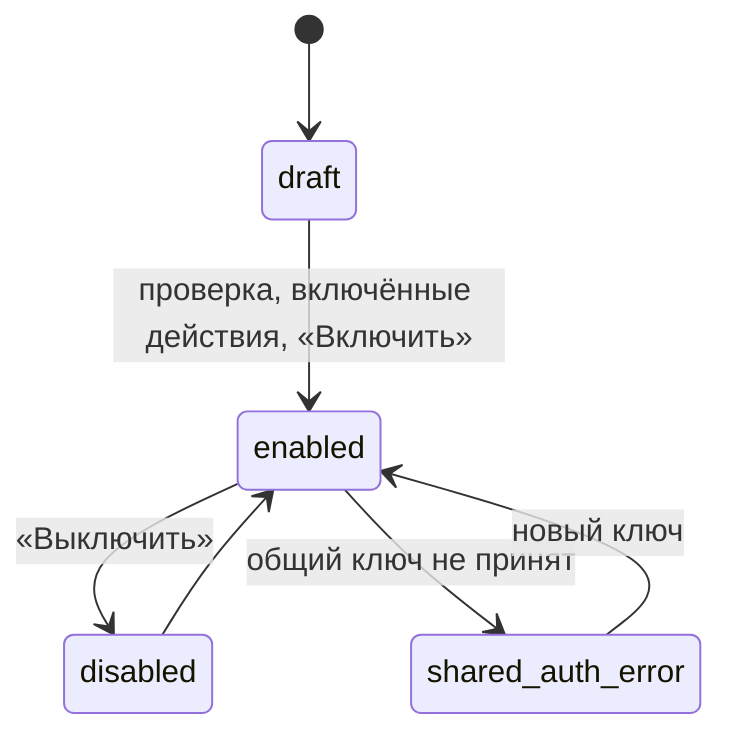

# Свои подключения MCP — спецификация

**Статус:** в работе с 21.11 (согласовано: ответы на F1–F4, контейнер `mcp-runner` подтверждён); ход шагов — в задаче
**Задача:** [#27](https://github.com/nyxandro/basic-business-agent/issues/27)
**Дата:** 2026-11-20 · **Проект:** basic business agent · **Тип фичи:** смешанный (админка и настройки сотрудника + механизм входа и соединений) · **Где работает:** веб-админка («Подключения»), «Настройки → Подключения» сотрудника, ход агента в чате и в фоновой задаче
**Не применяется:** —

## Для новой сессии: как начать

**Где этот план.** Один из семи планов (было восемь; «Итоги совещаний» владелец исключил 21.11: «у меня для этого и так есть скилл, я сам сделаю»), составленных 20.11.2026 по просьбе владельца: «составь пачку планов на каждую из фичей, все хорошенько поресерчи, изучи лучшие плагины на рынке». Порядок постройки по зависимостям — рекомендация агента, владелец его не подтверждал:
1. `[20.11.2026]-mcp-connections.md` — свои подключения MCP ← этот план
2. `[20.11.2026]-notifications.md` — уведомления в браузере
3. `[20.11.2026]-knowledge-base.md` — база знаний организации
4. `[20.11.2026]-org-letterhead.md` — бланк организации, печать и подпись
5. `[20.11.2026]-event-tasks.md` — фоновые задачи по событию
6. `[20.11.2026]-multi-step-approvals.md` — согласования в несколько шагов
7. `[20.11.2026]-feedback-and-value.md` — жалобы, образцы документов и отчёт о пользе

Этот план — №1. Ни от чего не зависит. Нужен фичам «Задачи по событию» (агент открывает сделку в Битрикс24 по номеру из события) и «Согласования» (список действий для правил — из снимка действий этого плана).

**Состояние на 21.11.2026.** Черновик. Исследование сделано (опоры — раздел 3: Claude (пользовательские подключения), LibreChat (`customUserVars`), стандарт MCP 2026-07-28, справка Битрикс24 о MCP, МойСклад MCP, обзоры MCP для amoCRM и 1С). Независимая проверка свежим агентом проведена 20.11 и учтена — что она поменяла, ниже. Ответы владельца на F1–F4 получены 21.11 (раздел 6, «Принято»). Часть о программах-серверах дописана по ответу на F1; отдельный контейнер-песочницу `mcp-runner` владелец подтвердил 21.11 («вариант А»). Задача GitHub — #27 (заведена 21.11, ветка `mcp-connections`); ход шагов — в её комментариях.

**Как стартовать в новой сессии.**
1. Прочитать `AGENTS.md`, этот план целиком и разделы спецификации базы `docs/specs/[12.11.2026]-agent-base-architecture.md`: 8.4 (подтверждения), 8.8 (личные доступы), сценарий 3, 8.24 (почта: свой вход через сайт сервиса — образец), 17.5 (маршруты).
2. Загрузить скиллы: `feature-blueprint` (работа продолжается с его шага 13 — «после ответов владельца»), `owner-decisions` (сверить вопросы с базой решений владельца и записать его ответы, если они годятся и для других проектов), `mastra-mcp` (обязательно: `reference-tools-mcp-client.md` — `toolsFromDefinitions`, `listToolsWithErrors`, `connectTimeout`, OAuth; `docs-guides-mcp-authentication-authorization.md`), `mastra-core`, `developing-ai-agents` (контракт инструмента, недоверенный контент), `supabase-postgres-best-practices` (до миграции).
3. Если владелец ещё не ответил — задать вопросы раздела 6 одним сообщением в формате раздела 6 (ситуация, почему решать ему, варианты, рекомендация; в чате каждый вопрос — строкой с ❓). Молчание и «ок» — не согласие: рекомендованный вариант без слова владельца не строится. Ответы — в «Принято» с датой; обновить все задетые разделы и «Коротко»; статус — «согласовано».
4. Завести задачу GitHub (`gh`, правило проекта): что и зачем со ссылкой на этот файл, решения владельца с датами, шаги раздела 22 чек-листом, критерии готовности, зависимости. Ссылку вписать строкой «**Задача:**» в шапку этого файла.
5. Шаг 0 раздела 22 — проверки и замеры. Если они меняют решения владельца или устройство — показать владельцу, что изменилось, и ждать.
6. Дальше шаги по порядку: сначала падающий тест, потом код; после шага — `pnpm typecheck && pnpm lint` и тесты затронутого; коммит; итог шага — комментарием в задаче. В конце сессии — самопроверка и независимая проверка изменений отдельным агентом (глобальные правила владельца).

**Где смотреть код.** `core/connections/` (весь модуль: `manager.ts`, `oauth.ts`, `credentials.ts`, `routes.ts`, `test/servers.ts`), `core/plugins/public/index.ts` (`McpDefinition`), `core/loader/registry.ts:145-167`, `core/approvals/policy.ts`, `core/approvals/describe.ts`, `web/src/admin/ConnectionsSection.tsx`, `web/src/settings/ConnectionsPage.tsx`, `core/admin/routes/sections.ts:161-176`; библиотека входа — `node_modules/.pnpm/@modelcontextprotocol+client@2.4.0/node_modules/@modelcontextprotocol/client/dist/index.d.mts` (`auth`, `registerClient`, `discoverOAuthProtectedResourceMetadata`).

**Правила, которые легко нарушить** (из `AGENTS.md`, памяти агента и базы решений владельца `~/.agents/decisions/`):
- Правила проекта (`AGENTS.md`, правила работы в спецификации базы) не править без прямого слова владельца — даже чтобы записать его же указание.
- В спецификации — устройство и решения, без журнала работ: ход и итоги — комментариями в задаче GitHub.
- На http://localhost:8080 работает `pnpm dev` владельца: не останавливать и не перезапускать; `git stash` не использовать (ломает слежение за файлами); `pnpm test:e2e` и `pnpm stand` — во временной копии на портах 3100/8180 (раздел 22 спецификации базы).
- После шага — только `pnpm typecheck && pnpm lint` и тесты затронутого; полный `pnpm test`, `pnpm test:e2e`, `pnpm smoke` — один раз перед слиянием (решение владельца 20.11).
- Влить в `main`, создать PR, удалить тома и данные, подключить внешний сервис, который получит данные проекта, отправить что-либо за пределы машины — только с разрешения владельца.
- Сбой поведения модели чинить сначала тем, что советует документация фреймворка, а не своими ограничениями в цикле агента; число шагов агента кодом не ограничивать (решения владельца 15.11).
- Prettier не запускать; файл кода — до 800 строк; только стираемый синтаксис TypeScript.
- Владельцу — по-русски: сначала последствие, потом механизм; термины объяснять при первом упоминании.
- Поведение Mastra, LiteLLM, MCP-библиотек проверять по установленным исходникам и скиллам `mastra-*`, не по памяти.

**Открыто для всех семи планов** (спросить владельца при первом случае):
- В правилах проекта записано «спецификация одна, отдельных файлов не заводить» (`AGENTS.md`, «Источники правды»). Эти файлы сделаны по прямому слову владельца 20.11 («планируй фичу в общем в отдельном файле только»), правила не правились. Не решено: после сдачи фичи переносить ли её устройство в разделы 8–17 спецификации базы (как требует её правило) или оставлять здесь, и вписать ли исключение в `AGENTS.md`.
- Формат сообщений коммитов: правило проекта — «Шаг N: что сделано», а шаги здесь нумеруются внутри плана. Предложение агента (не подтверждено): «{Фича}, шаг N: что сделано».
- Чек-лист шагов в задаче #2 — для этапа 2; для этих фич чек-лист — в своей задаче GitHub.
- На 21.11 файлы планов не закоммичены (ветка `stage-2-new-interface`, `main` с ней совпадает после слияния 20.11).

**Что поменяла независимая проверка 20.11** (не возвращать прежние решения):
- Агент получает действия только из снимка, проверенного администратором (`toolsFromDefinitions`), а не с сервера на каждом ходе; новые действия выключены, пока администратор их не включит.
- Регистрация клиента на сайте системы — одна на сервер, токены — свои у каждого сотрудника; документ клиента — только на публичном https.
- Имена действий приводятся к `^[a-zA-Z0-9_-]{1,64}$` (точка в `crm.deal.list` уронила бы весь запрос к модели); префикс — короткий `slug`, не `mcp:<uuid>`.
- «Ошибка доступа» — только по HTTP 401 и отказу обновления токена; 403 по отдельной записи подключение не ломает (сейчас ломает регулярным выражением в `manager.ts:70-73`).
- Общий ключ организации — новый код: режим `shared` в проекте означает другое (наш сервер с подписью «кто спрашивает»).
- Сервер до успешной проверки — черновик, сотрудники его не видят; карточки у сотрудника — только для подключений его агентов.
- Обновление токена заранее и под блокировкой делает наш провайдер (`auth()` 2.4.0 обновляет только после 401 и без блокировки); `discoveryState` хранится в `app.oauth_states`.
- Вход через сайт на http — только для `localhost`; в журнал — только схема и хост адреса (в пути бывает ключ).
- Сервер Битрикс24 `https://mcp.bitrix24.tech/mcp/` под вопросом: проверить в шаге 0, что он отдаёт данные портала, а не только документацию REST.

## Коротко

**Что строим и зачем.** Сейчас подключить агента к Битрикс24, amoCRM, МойСкладу или 1С можно только разработчику, плагином в коде. Строим так, чтобы администратор заказчика сам добавил любой сервер MCP: адрес, способ входа, какие действия доступны агентам и каким агентам. Дальше каждый сотрудник подключается своим доступом. Успех: сервер с входом через сайт системы подключается за несколько минут без разработчика, агент работает в системе с правами сотрудника, и ни одно действие, которого администратор не видел, агенту не доступно.

**Как будет работать.**
1. Администратор в «Подключениях» нажимает «Добавить сервер MCP» и вводит название и адрес. Сервер сам определяет способ входа. Если в адрес нужно подставить ключ (как у МойСклада), администратор сначала описывает поля, а проверка идёт с его значениями.
2. Способов входа четыре:
   - без входа;
   - вход через сайт системы — каждый сотрудник входит своим аккаунтом;
   - личный ключ сотрудника — поля задаёт администратор, ключ можно подставить в заголовок или в адрес;
   - общий ключ организации (F3).
3. Администратор проверяет подключение своим доступом и получает список действий системы. Дальше:
   - включает нужные — по умолчанию все выключены;
   - отмечает действия «только чтение» — они пойдут без «Да»;
   - может дать действию русское название;
   - выбирает агентов, которым подключение доступно, и нажимает «Включить».

   До этого сотрудники сервера не видят. Под списком — сколько текста включённые действия добавляют к каждому запросу агента.
4. Агент видит только включённые действия и в том описании, которое проверил администратор. Новые действия, которые система добавит позже, не появляются у агента сами. Администратор видит «Новых действий: N» и решает.
5. Сотрудник видит в «Настройках → Подключения» серверы, которые администратор разрешил для его агентов, и сам включает нужные (решение владельца 21.11): со входом или личным ключом — «Подключить» своим доступом, без входа и с общим ключом — выключатель «Использовать». Агент получает действия только включённых сотрудником серверов и видит в системе ровно то, что видит этот сотрудник.
6. Каждое действие, не отмеченное «только чтение», идёт через «Да» и пишется в журнал.
7. Доступ отозван — агент говорит «Войдите в {система} заново», карточка показывает «Ошибка доступа». Отказ по одной записи («нет прав на эту сделку») подключение не ломает: агент просто говорит, что прав нет.

**Как построим.**
1. Серверы администратора — новые строки в базе (`app.mcp_servers`) со снимком проверенных действий. Агент получает инструменты из этого снимка (в Mastra MCP 2.9 есть `toolsFromDefinitions`), а соединение с сервером открывается только при вызове. Это быстрее и не пускает к агенту то, чего администратор не видел. Ход агента, «Да», журнал и статусы работают по-прежнему.
2. Вход через сайт системы — по стандарту MCP (2026-07-28) через `auth()` из `@modelcontextprotocol/client` 2.4.0, которую ставит Mastra. Клиента у системы регистрируем один раз на сервер, токены — свои у каждого сотрудника. Порядок регистрации:
   - данные клиента от администратора;
   - регистрация на лету;
   - документ клиента — только если установка открыта по публичному https и система это поддерживает.
3. Своё поверх библиотеки:
   - хранение токенов зашифрованными;
   - обновление токена заранее, под блокировкой (как сейчас у плагинов);
   - запрет начинать вход посреди хода агента: там некому нажать «войти».
4. Имена действий приводятся к виду, который принимают провайдеры моделей: латиница, цифры, `_` и `-`, до 64 знаков. Точку в `crm.deal.list` модель не примет, и без перевода отклонялся бы весь запрос агента.
5. Сервер, который распространяется программой (`npx …`, `uvx …`), запускается в песочнице (решение владельца 21.11: «безопасность в корп прежде всего»). Это отдельный контейнер `mcp-runner`: интернет и сеть офиса заказчика у него есть, а базы, шлюза моделей и файлов приложения нет. Каждая программа внутри ещё и в bubblewrap. Версия пакета закреплена. Один процесс на сервер, до 512 МБ, выключается после 30 минут простоя. Только «без входа» и общий ключ: процесс на каждого сотрудника не поместится в память.

**На что смотреть.**
- **Что умеет сервер Битрикс24.** Есть адрес `https://mcp.bitrix24.tech/mcp/` со входом через сайт, по справке Битрикс24. Отдаёт ли он данные портала с правами сотрудника, а не только документацию REST, не проверено. Это шаг 0, до остальной работы.
- **Регистрация клиента.** Если система не умеет ни регистрацию на лету, ни документ клиента, администратор заводит приложение в системе и вводит Client ID и Secret.
- **Https.** Вход через сайт системы на установке, открытой по http, работает только с адресом `localhost` (разработка). Документ клиента — только на публичном https.
- **Общий ключ.** С ним агент видит всё, что видит ключ, а не то, что видит сотрудник (F3).
- **Чужой сервер может «уговаривать» агента** текстом своих ответов. Защиты: правило ядра «результаты инструментов — данные», «Да» на каждом изменении, выбор сервера и действий администратором.
- Отложено: серверы, которые добавляет сотрудник (F2), события от серверов MCP, каталог готовых систем.

**На что опирается.**
- Claude, пользовательские подключения: владелец организации добавляет адрес, каждый участник входит своим аккаунтом; Client ID и Secret — в «Дополнительно».
- LibreChat: администратор задаёт поля, каждый пользователь вводит в них своё значение; серверы, заведённые через интерфейс, — только по адресу.
- Стандарт MCP 2026-07-28 и документация Mastra MCP 2.9: порядок регистрации, привязка токенов к издателю, токены — отдельно у каждого пользователя, `toolsFromDefinitions`, `listToolsWithErrors` с HTTP-статусом.

**Найдено по пути.**
- `core/connections/oauth.ts` — свой вход через сайт для плагинов: только заранее заведённый клиент, без поиска адресов. Новый общий вход его заменяет. Удалять ли — F4.
- Сейчас «Настройки → Подключения» показывает каждому сотруднику все личные подключения, даже не нужные его агентам. «Подключили N из M» в админке считает M по всем сотрудникам. Чиним в этой работе.
- Сейчас любой текст «403», «forbidden» или «unauthorized» в ошибке действия ставит всему подключению «Ошибку доступа» (`core/connections/manager.ts:70-73`). Отказ по одной сделке ломал бы подключение. Чиним: «Ошибка доступа» — только по HTTP 401 и отказу обновления токена.

**Ждёт вашего решения.**
1. ~~Можно ли запускать программы серверов MCP?~~ Решено 21.11: можно, в песочнице (F1-Б, «Принято»).
2. ~~Может ли сотрудник сам добавить себе сервер?~~ Решено 21.11: добавляет только администратор, сотрудник включает себе из разрешённых (F2, «Принято»).
3. ~~Разрешать ли общий ключ организации?~~ Решено 21.11: разрешать (F3, «Принято»).
4. ~~Заменить ли старый вход плагинов новым общим?~~ Решено 21.11: заменить (F4-А, «Принято»).

**Выкладка:** выкладки нет. Работа заканчивается `pnpm typecheck && pnpm lint`, тестами затронутого и сценарием e2e; полный прогон — перед слиянием.

**Объём:** 11 шагов, около 10,5 ч работы агента. Дольше всего — шаг 0 на настоящем Битрикс24, контейнер для программ-серверов (`pnpm smoke`) и e2e. От вас — портал Битрикс24 (можно бесплатный), около 10 минут.

**Не проверено:** сервер Битрикс24 и его способы регистрации (шаг 0).

---

# Часть 1. Для владельца: как это устроено

## 1. Что известно и что добавлено

- **Владелец сказал (20.11):** «в админке я что-то не видел возможности добавить подключение у сотрудника что-то кроме почты. значит надо добавить возможность свободного подключения mcp; я не знаю конфиг там вставлять или поля заполнять какие-то; учесть, что mcp бывают с авторизацией и т. д.»
- **Найдено в проекте:**
  - подключения задаются только плагинами: `McpDefinition` (`core/plugins/public/index.ts`), `ConnectorRuntime` (`core/connections/manager.ts`); агенту их даёт паспорт (`plugins` в `agents/<id>/agent.ts`, `connectorIds` в `core/loader/registry.ts:166`);
  - режим `shared` — это наш собственный сервер с подписью «кто спрашивает» (`sharedClient`, `manager.ts:108-125`), передать общий ключ стороннему сервису он не умеет;
  - сейчас список действий берётся с сервера на каждом ходе (`listTools()`, `manager.ts:190-196`), а пустой список (Mastra так возвращает и отказ входа) превращается в «система недоступна»;
  - `serverKey` заменяет только `-` (`manager.ts:52`);
  - проверка ключа — вызов действия `checkTool` (`manager.ts:240-249`);
  - журнал сервера пишет `message`, `stack` и `cause` ошибки (`core/server/log.ts`);
  - в установке нет плагина с подключением.
- **Добавлено:**
  - [ДОПУЩЕНИЕ] у заказчика 1–5 своих серверов, до 100 действий на сервер;
  - [ДОПУЩЕНИЕ] настоящая установка открыта по https.
- **Противоречия:** прежнее решение владельца (13.11, Bitrix7KL) — доступ агента к внешней системе делать скиллом с CLI. Сейчас владелец прямо просит MCP; к тому же в этом продукте у скиллов нет сети. Берём MCP, как сказано.

## 2. Цели, не-цели, анти-цели

- **Цели:**
  1. Администратор без разработчика добавляет сервер MCP с любым из способов входа и решает, какие действия доступны и каким агентам.
  2. Сотрудник подключается сам за один шаг; агент работает с его правами.
  3. Изменения во внешней системе — только после «Да» и с записью в журнал, кроме действий, которые администратор отметил как чтение.
  4. Сломанный доступ виден сотруднику и администратору и чинится повторным входом или новым ключом без разработчика.
- **Не-цели:** каталог систем; серверы, которые добавляет сотрудник (F2); события MCP; программы-серверы без песочницы или с личными ключами сотрудников (F1).
- **Анти-цели:**
  - агент показывает то, что сотруднику в системе видеть нельзя;
  - ключ или токен в админке, ответе сервера, журнале или тексте ошибки;
  - агенту доступно действие, которого администратор не видел;
  - одно действие с неудобным именем роняет все ответы агента;
  - токен одного сотрудника использован для другого.
- **Сейчас:** заказчику с Битрикс24 нужен разработчик и плагин.

## 3. На что опирается

| Практика | Кто делает | Масштаб | Берём? | Почему | Источник, дата |
|---|---|---|---|---|---|
| Адрес сервера; вход у каждого участника; Client ID и Secret в «Дополнительно» | Claude | любой | да | та же модель | claude.com/docs/connectors/custom/remote-mcp, 2026 |
| Поля, которые каждый пользователь заполняет своим значением | LibreChat (`customUserVars`) | от одного сервера с личными ключами | да, и в адрес | у МойСклада личный адрес | librechat.ai/docs/…/mcp_servers, 2026 |
| Серверы из интерфейса — только по адресу | LibreChat | любой | да (F1) | программа на сервере — доступ ко всему | там же |
| Инструменты из сохранённого снимка, соединение при вызове | Mastra MCP 2.9 `toolsFromDefinitions` | от одного сервера | да | список разрешённых; нет ожидания сервера на каждом ходе | `.claude/skills/mastra-mcp/references/reference-tools-mcp-client.md` |
| Регистрация: заранее заведённый → документ клиента → на лету | стандарт MCP 2026-07-28 | любой | да, документ — только на публичном https | без регистрации на лету часть серверов не подключить | modelcontextprotocol.io/specification/2026-07-28/basic/authorization |
| `MCPOAuthClientProvider` Mastra | Mastra | — | нет | без регистрации на лету, вход рассчитан на программу на компьютере | `docs-guides-mcp-authentication-authorization.md` |

## 4. Варианты и масштаб

| | А. Вставить файл настроек (JSON) | Б. Форма с полями (выбрано) |
|---|---|---|
| Что делает администратор | вставляет текст из инструкции | вводит адрес, система подсказывает способ входа |
| Даёт | быстро скопировать | понятно без разработки; ошибки у конкретного поля |
| Цена | администратор заказчика не умеет такие файлы; секреты в тексте; почти всё — запуск программ (F1) | форма |

**Выбрано Б.** Перейти к А — если заказчики массово попросят вставку; тогда она будет заполнять ту же форму.

| | А. Действия с сервера на каждом ходе | Б. Действия из снимка, проверенного администратором (выбрано) |
|---|---|---|
| Новые действия | появляются у агента сами | только после решения администратора |
| Скорость хода | ожидание сервера каждый ход | без ожидания: соединение — при вызове |
| Описания | могут поменяться после проверки | те, что видел администратор |

## 5. Как это работает

**Точки входа:** «Подключения» в админке → 1, 5; «Настройки → Подключения» → 2; ход агента → 3; сломанный доступ → 4; фоновая задача → 3.

**Сценарий 1 — администратор добавляет систему со входом через сайт.** Игорь, суперадминистратор.
1. «Добавить сервер MCP» → название, адрес → «Далее». Сервер отвечает, что нужен вход (по заголовку ответа или по служебному адресу `/.well-known/oauth-protected-resource`). Форма: «Вход через сайт системы — каждый сотрудник войдёт своим аккаунтом». «Дополнительно» свёрнуто: Client ID, Client Secret, адрес возврата и «Скопировать».
2. «Проверить своим доступом» → вход на сайте системы → возврат. Если вход не завершён, сервер остаётся черновиком.
3. **Ключевой момент:** «38 действий». Все выключены. Игорь включает 14 нужных и отмечает чтение у 9 (подсказка «сервер называет его чтением»). Действию `crm.deal.list` даёт название «Список сделок». Внизу: «Включённые действия добавляют к каждому запросу агента около 4 200 токенов». «Каким агентам доступно»: «Продажи». «Включить».
- **Ошибки** — раздел 9.

**Сценарий 1а — МойСклад с ключом в адресе.** Адрес `https://…/{{ключ}}/mcp`. Форма сразу просит описать поле «ключ» (подпись, подсказка, секретное), затем значение Игоря для проверки → проверка → действия.

**Сценарий 2 — сотрудник подключается.** Ольга, «Продажи».
1. «Настройки → Подключения»: карточка «Битрикс24 · не подключено · нужно агенту «Продажи»» → «Подключить» → сайт системы → «Подключено».
2. Для личного ключа — поля администратора → «Подключить». Если администратор назначил проверочное действие чтения, сервер вызывает его; если нет — «Сохранено, проверится при первом действии».

**Сценарий 3 — агент работает.** «Покажи мои сделки без движения» → `Список сделок` (чтение) без «Да» → строка «✓ Битрикс24 · Список сделок · только чтение». «Поставь задачи менеджерам» → «Подтвердите действие · Битрикс24 · Добавить задачу» → «Да» → журнал. Сделка чужого отдела → система отвечает 403 → агент: «В Битрикс24 у вас нет прав на эту сделку».

**Сценарий 4 — доступ сломался.** Токен отозван → при вызове 401 (или отказ обновления токена) → «Ваш доступ к Битрикс24 больше не работает. Откройте «Настройки → Подключения» и нажмите «Подключить заново»» → карточка «Ошибка доступа», в админке «Ошибка доступа: 1». Общий ключ отозван → в админке у сервера «Общий ключ не принят — обновите его», уведомление администраторам (фича «Уведомления»).

**Сценарий 5 — изменить, обновить, удалить.**
- «Изменить» меняет название, агентов, включение и отметки действий, русские названия.
- «Обновить список действий» снимает снимок заново: новые действия выключены, изменённые помечены.
- Адрес, способ входа и ключи полей личного ключа после первого подключения сотрудника не меняются (подписи — меняются).
- «Удалить» → «Удалить подключение «Битрикс24»? 7 сотрудников потеряют доступ, их данные входа будут удалены.» Вопрос «Да», ждавший действия этого сервера, после ответа получает «Действие больше недоступно: администратор отключил подключение».

```mermaid
flowchart TD
  A[Адрес] --> P{В адресе {{поле}}?}
  P -->|да| F[Описать поля, ввести свои значения]
  P -->|нет| B
  F --> B{Сервер отвечает по MCP?}
  B -->|нет| X1[«Сервер не отвечает…» / «Это не сервер MCP…»]
  B -->|без входа| C[Без входа]
  B -->|нужен вход| D{Адреса входа: заголовок или well-known?}
  D -->|есть| E[Вход через сайт]
  D -->|нет| K[Ключ — личный или общий]
  E --> G[Проверка своим доступом]
  K --> G
  C --> G
  G -->|ок| H[Действия: включить, чтение, названия, агенты → «Включить»]
  G -.->|ошибка| X2[Черновик, набранное остаётся]
  H --> I[Карточки у сотрудников этих агентов]
```

## 6. Решения владельца

### Принято
- **Действия — только из проверенного снимка** (раздел 4) — решение агента после независимой проверки.
- **F1 — программы серверов MCP разрешены, только в песочнице (вариант Б)** (владелец 21.11: сначала «да, можно», на уточнение — «в песочнице, безопасность в корп прежде всего»; выбрано вместо рекомендованного «только по адресу»). Принцип записан в базу решений владельца (`risk-appetite`, случай `2026-11-21-basic-business-agent-mcp-programs-in-sandbox`). Устройство — раздел 8, «Программы-серверы». Отдельный контейнер `mcp-runner` вместо нынешней песочницы (иначе программа с сетью видела бы базу и шлюз моделей) владелец подтвердил 21.11: «вариант А».
- **F4 — старый вход плагинов заменить новым общим** (владелец 21.11: «хорошо, пусть будет А»).
- **F2 — сервер добавляет только администратор, сотрудник включает себе из разрешённых** (владелец 21.11: «выбирать только из разрешённых, то есть те, которые админ в админке добавил один раз, то юзеры могут у себя их задействовать»; совпадает с вариантом А и уточняет его). Прочтение агента, на проверку владельцу:
  - каждый включённый администратором сервер виден сотруднику в «Настройках → Подключения» как доступный; сотрудник сам включает нужные — у серверов со входом через сайт или личным ключом это и есть «Подключить», у серверов без входа и с общим ключом — выключатель «Использовать»;
  - агент сотрудника получает действия только тех серверов, которые сотрудник у себя включил;
  - выбор «Каким агентам доступно» у администратора остаётся (по умолчанию — все агенты), чтобы ограничить, например, склад агентом «Склад».
- **F3 — общий ключ организации разрешён** (владелец 21.11: «разрешать»; вариант А, с предупреждением в форме).

---

# Часть 2. Для исполнителя: поведение подробно

## 7. Точки контакта и состояния

| Точка | Пусто | Загрузка | Есть данные | Частично | Ошибка | Нет прав | Успех |
|---|---|---|---|---|---|---|---|
| «Подключения» | «Почта сотрудников», плагины, «Добавить сервер MCP» | `DelayedBar` | карточки: название, вход, «Подключили N из M» (M — сотрудники с доступом к агентам), состояние | «Ошибка доступа: N», «Новых действий: N», «Черновик» | `ErrorBanner` | право `connections` | — |
| Окно «Сервер MCP» | шаг «Адрес» | «Проверяю…» | «Вход» → «Действия и агенты» | 0 действий — «Сервер не дал ни одного действия» | текст ошибки, набранное остаётся | — | «Включено» |
| «Настройки → Подключения» | карточки только нужных его агентам | как сейчас | «Подключено · проверено {дата}» / «Сохранено, проверится при первом действии» | — | «Ошибка доступа» и «Подключить заново» | — | «{Система} подключена» |
| Ход агента | у агента нет подключений | — | инструменты из снимка | система не подключена — инструмент-статус | раздел 9 | выключенные действия не приходят | строка действия |

## 8. Внутренний механизм: гарантии, данные, сбои

**Гарантии:**
- токен сотрудника уходит только на свой сервер и только для этого сотрудника;
- агент получает только включённые действия из снимка;
- имена инструментов всегда соответствуют `^[a-zA-Z0-9_-]{1,64}$`;
- обновление токена — заранее и под блокировкой на пару «сотрудник + сервер».

| Что ломается | Как предотвращаем | Как узнаём | Как восстанавливаемся | Чем закрыто |
|---|---|---|---|---|
| Сервер не отвечает при вызове | `connectTimeout` 10 с, запрос 60 с | агент: «{Система} сейчас не отвечает» | следующий вызов | шаг 6 |
| Токен отозван | 401 по статусу (`errorDetails`), отказ обновления | `auth_error` | «Подключить заново» | шаг 7 |
| Отказ по записи (403) | не трогает подключение | — | — | шаг 7 |
| Библиотека входа хочет начать вход посреди хода | наш провайдер не начинает вход, ставит `auth_error` | — | «Подключить заново» | шаг 4 |
| Общий ключ отозван | 401 → статус сервера | карточка, уведомление администраторам | новый ключ | шаг 7 |
| Сервер сменил издателя токенов | привязка к издателю | «Войдите заново» | вход | шаг 4 |

**Данные:**
- `app.mcp_servers`: `id`, `slug` (`m` + 6 знаков, для имён), `title`, `url` (может содержать `{{поле}}`), `auth`, `fields` (ключ, подпись, подсказка, секретное, куда), `header_templates`, `client_registration` (зашифрован: данные клиента от администратора или полученные регистрацией на лету, издатель), `shared_secret` (зашифрован), `snapshot` (определения действий без функций; для каждого — исходное имя, имя для модели, русское название, включено, чтение, проверочное, отпечаток описания), `snapshot_at`, `status` (`draft` | `enabled` | `disabled` | `shared_auth_error`), `created_by`, …
- `app.mcp_server_agents` (`server_id`, `agent_id`).
- `app.connector_credentials` — как сейчас, `connector_id = mcp:<id>`; токены, издатель.
- `app.oauth_states` — плюс `discovery_state` (состояние поиска адресов входа; нужно при возврате).

**Программы-серверы (F1-Б).**
- Где работают: отдельный контейнер `mcp-runner` в `deploy/compose.yaml` и `compose.dev.yaml`.
  - Он подключён к сети с выходом в интернет и в сеть офиса заказчика (1С на своём сервере) и к одной общей сети с приложением.
  - В сети базы (`db`), шлюза (`litellm`) и SearXNG его нет: оттуда до них не дойти.
  - Внутри каждая программа запускается в bubblewrap: видит только свою папку пакета и временную папку, без файлов контейнера.
  - Потолок контейнера — 1 ГБ, программы — 512 МБ.
- Как приложение с ними говорит: в `mcp-runner` маленький свой мост «программа ↔ MCP по HTTP» (Streamable HTTP; [ПРОВЕРИТЬ в шаге 0], нет ли готового в `@modelcontextprotocol/node` 2.1.2). Для приложения программа выглядит как сервер по адресу `http://mcp-runner:<порт>/servers/<id>/mcp`, и дальше работает всё, что описано для серверов по адресу: снимок, имена, «Да», журнал. Мост принимает запросы только с подписью приложения (общий секрет установки).
- Что вводит администратор: вид «Программа»; команду из списка `npx` или `uvx`; пакет с точной версией (`1c-mcp-server@2.3.1`; без версии форма не сохранится); аргументы. Значения общего ключа подставляются в переменные окружения программы (шаблон `{{поле}}`, как в заголовках). Других переменных окружения программа не получает.
- Жизнь процесса: один процесс на сервер; запуск — при первом вызове или при проверке администратором; остановка — после 30 минут простоя; упал — запускается заново при следующем вызове, три падения за 10 минут — «Программа-сервер падает», карточка в админке и уведомление администраторам.
- Пакеты скачиваются один раз при проверке администратором и лежат в томе `mcp-runner-packages`; при запуске сеть к npm и PyPI не нужна.
- Способы входа: только «без входа» и «общий ключ». Личные ключи и вход через сайт для программ недоступны: на каждого сотрудника нужен свой процесс.

**Имя действия для модели:** `<slug>_<исходное имя, недопустимые знаки → _>`; длиннее 64 — обрезка и 6 знаков отпечатка; совпадения разводятся отпечатком. Соответствие хранится в снимке; правила согласований (фича 7) ссылаются на исходное имя.

## 9. Ошибки и восстановление

| Ситуация | Что видит человек |
|---|---|
| Программа: пакет без версии | «Укажите точную версию пакета, например `1c-mcp-server@2.3.1` — иначе при каждом запуске может скачаться другой код. Код: APP_VALIDATION_FAILED» |
| Программа: пакет не скачался | «Не удалось скачать пакет {пакет}: {причина без технических подробностей}. Проверьте название и версию. Код: APP_MCP_PACKAGE_FAILED» |
| Программа не отвечает по MCP после запуска | «Программа запустилась, но не отвечает как сервер MCP. Проверьте команду и аргументы по инструкции системы. Код: APP_MCP_NOT_MCP» |
| Программа падает | администратору: «Программа-сервер «{название}» падает — агенты не могут ею пользоваться. Проверьте настройки или версию пакета. Код: APP_MCP_PROGRAM_CRASHED»; агенту — «{Система} сейчас не отвечает» |
| Адрес не отвечает | «Сервер не отвечает по этому адресу. Проверьте адрес и что сервер включён. Код: APP_MCP_UNREACHABLE» |
| Не MCP | «По этому адресу нет сервера MCP. В инструкции системы адрес обычно заканчивается на /mcp. Код: APP_MCP_NOT_MCP» |
| http на публичном адресе | «Адрес должен начинаться с https://. Без шифрования ключи сотрудников уйдут открытым текстом. Код: APP_VALIDATION_FAILED» |
| Регистрация клиента невозможна | «Система не разрешает подключать сторонние программы автоматически. Заведите приложение в настройках системы и введите Client ID и Client Secret в «Дополнительно»; адрес возврата — {адрес}. Код: APP_MCP_OAUTH_REGISTRATION» |
| Вход через сайт на http-установке (не localhost) | «Вход через сайт системы работает только когда установка открыта по https. Код: APP_MCP_OAUTH_NEEDS_HTTPS» |
| Вход не завершён | «Вход в {система} не завершён: ссылка устарела или вход отменён. Нажмите «Подключить» ещё раз. Код: APP_CONNECTOR_AUTH_FAILED» |
| Ключ не принят | «{Система} не приняла ключ. Проверьте его. Код: APP_CONNECTOR_AUTH_FAILED» |
| Нет прав на запись | агенту: «В {система} у сотрудника нет прав на это. Код: APP_CONNECTOR_FORBIDDEN» |
| Обрыв после «Да» | «{Система} не ответила, и неизвестно, выполнилось ли действие. Проверьте в {система}, прежде чем повторять. Код: APP_CONNECTOR_UNKNOWN_OUTCOME» |
| Действие исчезло, пока ждало «Да» | «Действие больше недоступно: администратор отключил его. Код: APP_CONNECTOR_TOOL_GONE» |

## 10. Крайние случаи и стыки

| Случай | Что происходит |
|---|---|
| Два сервера с одним названием | имена — от `slug` |
| Администратор не может войти в систему сам (нет аккаунта) | проверка и снимок невозможны; подсказка «Проверить может только тот, у кого есть доступ к системе — дайте ему право «Подключения»» |
| Значение поля с `/` или `{{` | кодируется (`encodeURIComponent`), без повторной подстановки |
| Сотрудник ушёл из отдела агента | карточка исчезает, данные входа — до «Отключить» или удаления |

| Соседняя функция | Где встречаются | Что происходит |
|---|---|---|
| Плагины с `mcp` | один список у менеджера | `id` плагина и `mcp:<uuid>` не пересекаются |
| Почта 8.24 | страница «Подключения» | своя карточка сверху |
| «Что агенту можно» 8.30 | интернет выключен | на MCP не влияет: это подключённая система |
| Маскирование | ответы инструментов | как всегда |
| Фоновые задачи | нет человека | вход не начинается, `auth_error` и инструмент-статус |
| Согласования (фича 7) | правила на действия | по исходному имени |

## 11. Скорость

Проверка адреса — до 5 с [ИЗМЕРИТЬ]. Ход агента сервер не ждёт: действия из снимка, соединение при вызове.

## 12. Тексты интерфейса

| Где | Текст |
|---|---|
| Кнопки | «Добавить сервер MCP», «Проверить своим доступом», «Включить», «Обновить список действий» |
| Способы входа | «Без входа», «Вход через сайт системы — каждый сотрудник войдёт своим аккаунтом», «Личный ключ сотрудника — каждый введёт свой», «Общий ключ организации — один на всех» |
| Действия | «Включено», «Только чтение — без «Да»», «Название для сотрудников», «Проверять ключ этим действием», «Сервер называет его чтением», «Включённые действия добавляют к каждому запросу агента около {N} токенов» |
| Сотруднику | «Нужно агенту «{агент}»», «Подключить», «Подключить заново», «Сохранено, проверится при первом действии» |

## 13. Данные, закон

- Ключи и токены — только зашифрованными; в журнал сервера — только начало адреса (схема и хост), без пути: в пути бывает ключ.
- Данные уходят в систему под доступом сотрудника; маскирование защищает только запросы к модели.

## 14. Что сознательно не делаем

- **Программы-серверы с личными ключами или входом сотрудника** — процесс на каждого сотрудника не помещается в память сервера на 8 ГБ. Вернёмся, если такой сервер понадобится заказчику.
- **Запуск программ без песочницы** — решение владельца 21.11: только в песочнице.
- **Вставка файла настроек** — раздел 4.
- **Каталог систем** — вернёмся с третьей системой, которую подключают больше двух заказчиков.
- **События MCP** — фича «Задачи по событию».
- **Русские подписи полей действий** — P1; вернёмся, если карточки «Да» с английскими полями начнут путать сотрудников.
- **MCP Apps** — отложено базой.

## 15. Решения агента — на проверку

- Действия по умолчанию выключены — администратор включает нужные.
- Программы-серверы — в отдельном контейнере `mcp-runner`, а не в нынешней песочнице приложения: bubblewrap сеть не фильтрует, и программа с сетью видела бы базу и шлюз моделей. Это выполняет «безопасность в корп прежде всего» (F1), но добавляет контейнер на сервер (≈1 ГБ памяти из 8 ГБ).
- Значения общего ключа программы получают только переменными окружения по шаблону администратора; других переменных окружения у них нет.
- Регистрация клиента — одна на сервер.
- `readOnlyHint` сервера только подсказывает, отметку ставит администратор.
- Адрес во внутренней сети разрешён (сервер 1С), вводит только администратор.
- Адрес, способ входа и ключи полей не меняются после первого подключения.
- «Ошибка доступа» — только по 401 и отказу обновления.

---

# Часть 3. Для исполнителя: как строить

## 16. Что есть и что берём

- **Берём:** `applyApprovalPolicy`, `describeTool`, `wrapPersonal` (переделать признак поломки на HTTP-статус), `statusTool`, `app.connector_credentials`, `saveCredential`/`loadCredential`, `app.oauth_states`, `SecretBox`, раскладку `ConnectionsSection.tsx` и `ConnectionsPage.tsx` (с правкой «кому видно»).
- **Из Mastra MCP 2.9:** `toolsFromDefinitions`, `listToolDefinitions`, `listToolsWithErrors` (`errorDetails.httpStatus`), `connectTimeout`.
- **Из `@modelcontextprotocol/client` 2.4.0:** `auth`, `discoverOAuthProtectedResourceMetadata`, `registerClient`.
- **Заменяем (F4):** `core/connections/oauth.ts`.

## 17. Устройство

- **Где живёт:** `core/connections/servers.ts` (серверы, снимок, имена), `core/connections/mcp-auth.ts` (наш провайдер входа: токены, издатель, регистрация, обновление заранее под блокировкой, без входа посреди хода), `core/connections/probe.ts`, `core/connections/admin-routes.ts`, правка `manager.ts` (снимок вместо списка с сервера, ошибки по статусу, общий ключ), `contracts/src/connections.ts`.
- **Маршруты:** `POST /app/api/admin/mcp-servers/probe`; `POST/PATCH/DELETE /app/api/admin/mcp-servers(/:id)`; `POST …/:id/check` (вход или ключ администратора + снимок); `POST …/:id/refresh` (новый снимок); право `connections`. Сотруднику — прежние `/app/api/me/connections*`. Документ клиента — `GET /app/api/connections/oauth/client.json` (только на публичном https). Адрес возврата — один: `/app/api/connections/oauth/callback`.



- **Права:** маршруты — `requirePermission('connections')`; инструменты — только агентам из `app.mcp_server_agents` и сотрудникам с доступом к агенту.
- **Наблюдение:** `mcp_server_saved`, `mcp_snapshot_failed`, `connector_unavailable`, `connector_auth_failed` (без адреса и текста ответа); аудит — создание, изменение, удаление.

## 18. Ловушки платформы

- Имена инструментов: провайдеры OpenAI-совместимых моделей и Groq принимают `^[a-zA-Z0-9_-]{1,64}$`; одно плохое имя отклоняет весь запрос. Шлюз имя не меняет.
- Mastra `listTools()` возвращает пустой список при отказе входа — поэтому снимок и `listToolsWithErrors`.
- `auth()` 2.4.0 обновляет токен без блокировки и только после 401 — заранее и под блокировкой обновляет наш провайдер; `discoveryState` нужен при возврате — хранится в `app.oauth_states`.
- При `clientMetadataUrl` не на https библиотека отказывает раньше регистрации на лету — документ клиента указывается только на публичном https.
- `connectTimeout` по умолчанию 3 с — ставим 10 с.
- Нынешняя песочница (bubblewrap в контейнере приложения) с открытой сетью видела бы всю внутреннюю сеть установки — базу и шлюз; bubblewrap сеть не фильтрует (`--share-net` даёт сеть контейнера целиком). Поэтому программы — в отдельном контейнере на своей сети.
- Mastra для программ (stdio) по умолчанию передаёт им часть окружения (`HOME`, `PATH` и др.); в мосте `mcp-runner` окружение собирается с нуля.

## 19. Сбои на новых путях

| Путь | Сбой | Что видит человек | Чем закрыто |
|---|---|---|---|
| Проба | сведения о входе только по well-known | способ входа определён верно | шаг 2 |
| Снимок | у администратора нет входа | «Сначала проверьте своим доступом» | шаг 3 |
| Возврат со входа | нет `code` | «Вход … не завершён» | шаг 4 |
| Имя `crm.deal.list` и длинное имя | — | приводится к допустимому | шаг 3 |
| Программа-сервер | пишет мусор в поток ответа | «не отвечает как сервер MCP», перезапуск при следующем вызове | шаг 9 |
| Программа-сервер | пытается достучаться до базы | соединение не проходит (нет маршрута) | шаг 9 |

## 20. Обслуживание

- Сигналы: «Ошибка доступа: N», «Общий ключ не принят», `connector_unavailable`.
- Когда ломается: 1) «Проверить своим доступом»; 2) не отвечает — адрес; 3) у всех «Ошибка доступа» — система отозвала приложение: новые данные клиента; 4) у одного — «Подключить заново».

## 21. Приоритеты и объём

- **P0:** сценарии 1–5, четыре способа входа, снимок и включение действий, русские названия действий, имена, ошибки по статусу, замена `oauth.ts` (F4), «кому видно», выбор серверов сотрудником (F2), программы-серверы в песочнице (F1).
- **P1:** русские подписи полей.
- **P2:** вставка настроек, каталог, события MCP.

**Объём:** шаг 0 — 1,5 ч; шаги 1–10 — около 9 ч; итого около 10,5 ч работы агента.

## 22. Шаги

**Правила каждого шага:** TypeScript только стираемый, импорты `.ts`, до 800 строк; `AppError` с кодом из `core/errors/catalog.ts`; тексты — `web/src/i18n/ru.ts`; миграция `NNNN_mcp_servers.sql`; секреты — `SecretBox`; `web/` — только `@bba/contracts`; сначала падающий тест.

### Шаг 0: проверки
| Что | Как | Что меняется |
|---|---|---|
| [ПРОВЕРИТЬ] Сервер Битрикс24 отдаёт данные портала с правами сотрудника; способы регистрации | портал владельца, вход, список действий | только документация — главным примером становится другая система, сказать владельцу |
| [ПРОВЕРИТЬ] `auth()` 2.4.0 с нашим провайдером: регистрация на лету и заранее заведённый клиент до токена | заглушка сервера входа | — |
| [ПРОВЕРИТЬ] `toolsFromDefinitions` с нашим `fetch` и `requestContext` сотрудника | тест | нет — свой вызов `callTool` по снимку |
| [ПРОВЕРИТЬ] Контейнер `mcp-runner`: из него не открываются `db:5432`, `litellm:4000`, SearXNG; открываются интернет и адрес в сети офиса | `pnpm smoke`-проверка в отдельном проекте Docker | не изолируется — сказать владельцу до продолжения |
| [ПРОВЕРИТЬ] Готовый мост «stdio ↔ Streamable HTTP» в `@modelcontextprotocol/node` 2.1.2 или `@mastra/mcp` | исходники пакетов | нет — свой мост на транспортах SDK |

### Шаг 1: таблицы и схемы
**Тест:** шаблон с неизвестным полем — `APP_VALIDATION_FAILED`; секреты в базе не открытым текстом
**Готово, когда:** `core/connections/servers.test.ts` проходит

### Шаг 2: проба
**Тест:** вход по заголовку и по well-known → `oauth`; без входа → `none`; HTML → `APP_MCP_NOT_MCP`; закрытый порт → `APP_MCP_UNREACHABLE`; адрес с `{{ключ}}` — проба после ввода значения
**Готово, когда:** `probe.test.ts` проходит

### Шаг 3: снимок, имена, включение
**Тест:** `crm.deal.list` → `m1a2b3c_crm_deal_list`; 80 знаков — до 64 с отпечатком; новые действия выключены; без права — 403; удаление удаляет записи сотрудников
**Готово, когда:** тест проходит

### Шаг 4: вход через сайт
**Тест:** регистрация на лету — одна на сервер; токены у двух сотрудников раздельно; `iss` не совпал — отказ; два обновления одновременно — один запрос; обновление заранее; посреди хода вход не начинается
**Готово, когда:** `mcp-auth.test.ts` проходит

### Шаг 5: замена входа плагинов (F4)
**Тест:** перенесённые тесты `connections.test.ts` проходят на новом провайдере
**Готово, когда:** тест проходит, `oauth.ts` удалён

### Шаг 6: менеджер на снимке
**Тест:** агент получает только включённые действия; выключенный сервер — ничего; ключ с `/` в адресе кодируется; ход не ждёт молчащий сервер
**Готово, когда:** тест проходит

### Шаг 7: ошибки по статусу и общий ключ
**Тест:** 401 → `auth_error`; 403 → ошибка инструмента, подключение цело; общий ключ 401 → `shared_auth_error` и уведомление; обрыв после «Да» → `APP_CONNECTOR_UNKNOWN_OUTCOME`
**Готово, когда:** тест проходит

### Шаг 8: экраны
**Файлы:** `McpServerDialog.tsx`, `McpServerCard.tsx`, `ConnectionsSection.tsx`, `ConnectionsPage.tsx`, `api.ts`, `ru.ts`; тесты
**Тест:** черновик не виден сотрудникам; карточка только нужных агентам; оценка токенов
**Готово, когда:** тесты проходят; вид в обеих темах и на телефоне — в браузере

### Шаг 9: программы-серверы в песочнице (F1-Б)
**Файлы:** `deploy/mcp-runner/` (Dockerfile, мост), `deploy/compose.yaml`, `deploy/compose.dev.yaml` (сервис и сети), `deploy/smoke.sh`, `core/connections/servers.ts` (вид «Программа»), окно администратора; тесты `core/connections/program-servers.test.ts`
**Тест:** пакет без версии не сохраняется; общий ключ уходит в переменную окружения программы и больше никуда; процесс останавливается после простоя (время подменяется); три падения — «падает» и уведомление; `pnpm smoke` — из `mcp-runner` нет соединения с `db`, `litellm`, SearXNG
**Готово, когда:** тесты и `pnpm smoke` проходят

### Шаг 10: e2e
**Готово, когда:** заглушка сервера со входом и с ключом в адресе → администратор включает действия → Ольга включает у себя и подключается → чтение без «Да», изменение после «Да»; заглушка-программа (`npx` с локальным пакетом) работает через `mcp-runner`

## 23. Критерии приёмки

1. Дано: заглушка со входом через сайт. Когда: Игорь проверил своим доступом. То: действия выключены, сервер — черновик, сотрудники его не видят.
2. Дано: включены 3 действия из 5. То: агент видит 3.
3. Дано: действие `crm.deal.list`. То: запрос к модели принят.
4. Дано: токен Ольги отозван. То: «Подключить заново», «Ошибка доступа: 1».
5. Дано: 403 по одной записи. То: подключение «Подключено».
6. Дано: программа-сервер с общим ключом. Когда: программа пытается открыть `db:5432`. То: соединение не проходит; агенты пользуются её действиями как обычным сервером.
7. Дано: администратор разрешил сервер для агента «Продажи». То: Ольга видит его в «Подключениях», а действия у её агента появляются только после того, как она его включила.

## 24. Что посмотреть на ревью

1. Токены двух сотрудников не смешиваются (шаг 4).
2. Новое действие сервера не попадает к агенту (шаг 6).
3. В журнал не попадает путь адреса и текст ответа (шаг 7).
4. Секретные поля не возвращаются в браузер (шаг 3).
5. Вход не начинается в фоновой задаче (шаг 4).

## 25. Открытые вопросы

| Вопрос | Кто | Блокирует? |
|---|---|---|
| Портал Битрикс24 для шага 0 | владелец | шаг 0 |
