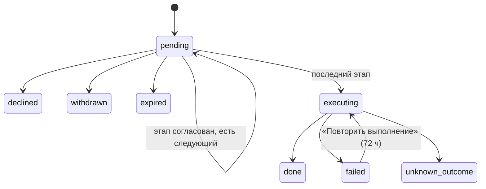

# Согласования в несколько шагов — спецификация

**Статус:** построено 22.11 ночью без владельца (шаги 1–8: тесты сервера `core/approvals/chains.test.ts` и интерфейса проходят; сценарий e2e `tests/e2e/approval-chains.spec.ts` написан, прогон — в общем `pnpm test:e2e`). Задача GitHub не заводилась (режим без владельца); отличия и решения по ходу — раздел 15. Коммиты `dfd2314`, `d009778`, `67b8601`
**Дата:** 2026-11-20 · **Проект:** basic business agent · **Тип фичи:** смешанный (правила в админке, карточки у согласующих + механизм заявок и выполнения) · **Где работает:** админка (раздел «Согласования», поле «Руководители» у отделов), «Ждёт подтверждения», чат, сервер (выполнение после согласия)
**Не применяется:** —

## Для новой сессии: как начать

**Где этот план.** Один из семи планов (было восемь; «Итоги совещаний» владелец исключил 21.11: «у меня для этого и так есть скилл, я сам сделаю»), составленных 20.11.2026 по просьбе владельца: «составь пачку планов на каждую из фичей, все хорошенько поресерчи, изучи лучшие плагины на рынке». Порядок постройки по зависимостям — рекомендация агента, владелец его не подтверждал:
1. `[20.11.2026]-mcp-connections.md` — свои подключения MCP
2. `[20.11.2026]-notifications.md` — уведомления в браузере
3. `[20.11.2026]-knowledge-base.md` — база знаний организации
4. `[20.11.2026]-org-letterhead.md` — бланк организации, печать и подпись
5. `[20.11.2026]-event-tasks.md` — фоновые задачи по событию
6. `[20.11.2026]-multi-step-approvals.md` — согласования в несколько шагов ← этот план
7. `[20.11.2026]-feedback-and-value.md` — жалобы, образцы документов и отчёт о пользе

Этот план — №6. Строить после «Своих подключений MCP» (список действий — из снимка действий) и «Уведомлений» (согласующий узнаёт о заявке). Отделы получат поле «Руководители» (F1) — его же может использовать «Оценка и польза».

**Состояние на 21.11.2026.** Черновик. Исследование сделано (опоры — раздел 3: Microsoft Copilot Studio (многоэтапные согласования), Power Automate («любой из согласующих»), книга «AI-агенты изнутри» гл. 5 (неизвестный исход)). Независимая проверка свежим агентом проведена 20.11 и учтена — что она поменяла, ниже. Ответ владельца на F1 получен 21.11: согласующие — названные люди и «руководитель отдела сотрудника», у отдела появляется поле «Руководители». F2 (21.11): правило — на действие целиком, без порога. F3: агент продолжает работу после выполнения. F4: этап самого согласующего пройден с записью в журнал. Задача GitHub не заведена: по правилу скилла `feature-blueprint` её заводят после ответов. Код не писался.

**Как стартовать в новой сессии.**
1. Прочитать `AGENTS.md`, этот план целиком и разделы спецификации базы `docs/specs/[12.11.2026]-agent-base-architecture.md`: 8.4 (подтверждения), 8.5 (журнал), 8.6 (фоновые задачи и продолжение после «Да»), 8.20 (проект хода), 9.1 («Ответить заново»).
2. Загрузить скиллы: `feature-blueprint` (работа продолжается с его шага 13 — «после ответов владельца»), `owner-decisions` (сверить вопросы с базой решений владельца и записать его ответы, если они годятся и для других проектов), `mastra-core` (обязательно: `requireApproval`, `approveToolCall`, проверка `outputSchema`, продолжение хода), `developing-ai-agents` (неизвестный исход, без слепого повтора, ключ выполнения), `supabase-postgres-best-practices` (до миграции).
3. Если владелец ещё не ответил — задать вопросы раздела 6 одним сообщением в формате раздела 6 (ситуация, почему решать ему, варианты, рекомендация; в чате каждый вопрос — строкой с ❓). Молчание и «ок» — не согласие: рекомендованный вариант без слова владельца не строится. Ответы — в «Принято» с датой; обновить все задетые разделы и «Коротко»; статус — «согласовано».
4. Завести задачу GitHub (`gh`, правило проекта): что и зачем со ссылкой на этот файл, решения владельца с датами, шаги раздела 22 чек-листом, критерии готовности, зависимости. Ссылку вписать строкой «**Задача:**» в шапку этого файла.
5. Шаг 0 раздела 22 — проверки и замеры. Если они меняют решения владельца или устройство — показать владельцу, что изменилось, и ждать.
6. Дальше шаги по порядку: сначала падающий тест, потом код; после шага — `pnpm typecheck && pnpm lint` и тесты затронутого; коммит; итог шага — комментарием в задаче. В конце сессии — самопроверка и независимая проверка изменений отдельным агентом (глобальные правила владельца).

**Где смотреть код.** `core/approvals/` (`policy.ts:19,39`, `requests.ts:104` — `summariseArgs`, `describe.ts`), `core/loader/registry.ts:145,153,164` (отметка «только чтение» в паспорте агента), `core/connections/manager.ts:200,246`, `core/mail/tools.ts:335`, `core/background/service.ts` (продолжение после «Да», `closeRun`), `core/chat/connect.ts:132` (прерывание для карточки), `core/chat/history.ts:76`, `core/chat/retry.ts:68`, `core/history/transcript.ts` (`GENUI_TOOL_IDS`), `web/src/chat/ApprovalCard.tsx`, `web/src/approvals/*`, `web/src/admin/DepartmentsSection.tsx`, `core/background/routes.ts:69`.

**Правила, которые легко нарушить** (из `AGENTS.md`, памяти агента и базы решений владельца `~/.agents/decisions/`):
- Правила проекта (`AGENTS.md`, правила работы в спецификации базы) не править без прямого слова владельца — даже чтобы записать его же указание.
- В спецификации — устройство и решения, без журнала работ: ход и итоги — комментариями в задаче GitHub.
- На http://localhost:8080 работает `pnpm dev` владельца: не останавливать и не перезапускать; `git stash` не использовать (ломает слежение за файлами); `pnpm test:e2e` и `pnpm stand` — во временной копии на портах 3100/8180 (раздел 22 спецификации базы).
- После шага — только `pnpm typecheck && pnpm lint` и тесты затронутого; полный `pnpm test`, `pnpm test:e2e`, `pnpm smoke` — один раз перед слиянием (решение владельца 20.11).
- Влить в `main`, создать PR, удалить тома и данные, подключить внешний сервис, который получит данные проекта, отправить что-либо за пределы машины — только с разрешения владельца.
- Сбой поведения модели чинить сначала тем, что советует документация фреймворка, а не своими ограничениями в цикле агента; число шагов агента кодом не ограничивать (решения владельца 15.11).
- Prettier не запускать; файл кода — до 800 строк; только стираемый синтаксис TypeScript.
- Владельцу — по-русски: сначала последствие, потом механизм; термины объяснять при первом упоминании.
- Поведение Mastra, LiteLLM, MCP-библиотек проверять по установленным исходникам и скиллам `mastra-*`, не по памяти.

**Открыто для всех семи планов** (спросить владельца при первом случае):
- В правилах проекта записано «спецификация одна, отдельных файлов не заводить» (`AGENTS.md`, «Источники правды»). Эти файлы сделаны по прямому слову владельца 20.11 («планируй фичу в общем в отдельном файле только»), правила не правились. Не решено: после сдачи фичи переносить ли её устройство в разделы 8–17 спецификации базы (как требует её правило) или оставлять здесь, и вписать ли исключение в `AGENTS.md`.
- Формат сообщений коммитов: правило проекта — «Шаг N: что сделано», а шаги здесь нумеруются внутри плана. Предложение агента (не подтверждено): «{Фича}, шаг N: что сделано».
- Чек-лист шагов в задаче #2 — для этапа 2; для этих фич чек-лист — в своей задаче GitHub.
- На 21.11 файлы планов не закоммичены (ветка `stage-2-new-interface`, `main` с ней совпадает после слияния 20.11).

**Что поменяла независимая проверка 20.11** (не возвращать прежние решения):
- Правило важнее отметки «только чтение»: сейчас действие «только чтение» обёртку не получает (`policy.ts:19`), а отметка своя у каждого агента — без этого правило обходилось другим агентом.
- Совпадение с правилом считает сервер по конкретному вызову; карточка спрашивает сервер (`preview`), а не держит «нужно согласование» в описании инструмента.
- 21.11 по ответу владельца (F2) порог убран: правило — на действие целиком. Разбор чисел, путей полей и форма условия не нужны; не возвращать без его слова.
- Перед вызовом пишется `call_started_at`: после падения — «итог неизвестен», без повтора (прежняя версия выполняла бы дважды).
- Одна ожидающая заявка на (сотрудник, действие, параметры); «Отозвать»; «Повторить выполнение» после `failed` 72 часа.
- Полные параметры — зашифрованно (в `approval_requests` они урезаны и для выполнения не годятся); вложения письма — копией на момент заявки.
- Обёртка снимает `outputSchema` у действий под правилами: иначе Mastra отдаст модели ошибку вместо «отправлено».
- Перед выполнением лимит на модели не проверяется — только перед продолжением агента (F3).
- Строка итога не вставляется посреди идущего хода; «Ответить заново» не предлагается в ходе с заявкой.
- Запасной план «выполнять заявку ходом агента» убран: модель заново сочиняла бы параметры.

## Коротко

**Что строим и зачем.** Сейчас любое действие агента подтверждает только сам сотрудник своим «Да». В компаниях часть действий требует ещё чьего-то согласия: скидку больше 10 % — руководителя отдела, оплату больше 100 000 ₽ — финансового директора. Строим правила согласования. Администратор задаёт, какие действия агентов идут дальше по цепочке согласующих — правило ставится на действие целиком (решение владельца 21.11). После «Да» сотрудника действие становится заявкой. Оно выполняется само, когда согласятся все этапы, а агент продолжает работу (F3). Успех: ни одно действие из правила не выполнено без всех согласий и не выполнено дважды, а согласующий решает за минуту по карточке, не читая чужую переписку.

**Как будет работать.**
1. Администратор в «Согласованиях» создаёт правило: «Битрикс24 · Изменить сделку → этап 1: руководитель отдела сотрудника → этап 2: Иванов (финансовый директор)». Правило — на действие целиком: под него попадает каждый вызов этого действия.
2. Ольга просит агента дать клиенту скидку 15 %. Сервер видит, что этот вызов попадает под правило. Карточка «Подтвердите действие» показывает: «Нужно согласование: руководитель отдела «Продажи» → Сергей Иванов». Поле «Зачем — увидят согласующие» обязательно. Кнопка — «Отправить на согласование».
3. Агент получает «отправлено на согласование №12» и говорит об этом Ольге. Ольга работает дальше: новое сообщение заявку не отменяет. Отозвать заявку можно в «Ждёт подтверждения» → «Мои заявки».
4. Руководитель получает уведомление и видит на «Ждёт подтверждения» карточку:
   - действие, параметры, кто просит и через какого агента;
   - «Зачем», вложения письма, если есть;
   - этап «1 из 2».
   Кнопки «Согласовать» и «Отклонить» (с причиной).
5. После последнего согласия сервер выполняет ровно согласованное действие доступом Ольги. Агент в её разговоре продолжает работу (F3): например, отправляет клиенту счёт, если ради скидки всё и делалось. Отказ, истечение или сбой — строка в разговоре и уведомление.
6. Журнал действий хранит, кто и когда согласовал каждый этап и что выполнено.

**Как построим.**
1. Правила — новые таблицы. Проверка правила стоит в общей обёртке действий, через которую идёт «Да». Срабатывает и для действий, которые в паспорте агента или администратором отмечены «только чтение»: правило важнее отметки. Обойти его другим агентом нельзя.
2. Совпадение с правилом считает сервер по конкретному вызову и параметрам. Карточка «Да» спрашивает у сервера, нужно ли согласование и кто согласует.
3. Заявка живёт вне хода агента: ход сразу получает ответ «отправлено». Заявка переживает перезапуск сервера. Параметры хранятся полностью и зашифрованно, вложения письма — копией на момент заявки.
4. После последнего согласия сервер вызывает исходное действие (без обёртки «Да») с параметрами заявки, от имени сотрудника. Перед вызовом пишется отметка «вызов начат»: после падения сервера действие не повторяется, а помечается «итог неизвестен».
5. Без кубиков и конструктора процессов (ваше решение 13.11). Правило — одна строка: какое действие и кто согласует по очереди.

**На что смотреть.**
- **Параметры устаревают.** Согласование идёт часами и днями. Согласующий видит параметры на момент заявки, выполняются ровно они. Срок этапа — 72 часа.
- **Правило — на всё действие, без порога** (решение владельца 21.11). Под правило «Изменить сделку» попадает и смена стадии, и переименование, а не только скидка. Поэтому правило стоит ставить на узкие действия: если у системы есть отдельное «Изменить скидку» или «Создать платёж» — на них, а не на общее «Изменить сделку». Подсказка об этом — в форме правила.
- **Что правило не ловит.** Оно висит на названном действии. Если у системы есть общее действие «вызвать любой метод», им можно сделать то же в обход — такие действия администратору стоит выключить в настройках подключения. Дробление (два платежа по 60 000 вместо 120 000) правило тоже не ловит.
- **Порядок постройки:** после «Своих подключений MCP» (список действий) и «Уведомлений» (без них согласующий узнаёт о заявке, только открыв приложение).
- Отложено: заместители на время отпуска, «все согласующие этапа», пороги и условия (решение владельца 21.11 — правило на действие целиком).

**На что опирается.**
- Microsoft Copilot Studio, многоэтапные согласования: этапы по очереди, на этапе — один или несколько согласующих; решение этапа ведёт дальше или останавливает процесс.
- Power Automate: «любой из согласующих» на этапе.
- Спецификация базы, 8.4: «Да» перед каждым изменением, вопрос живёт 72 часа, повторное решение отклоняется.
- Книга «AI-агенты изнутри» (гл. 5): неизвестный итог после обрыва — не неудача; сначала сверка, без слепого повтора.

**Ждёт вашего решения.**
1. ~~Кто может быть согласующим?~~ Решено 21.11: названные люди и «руководитель отдела сотрудника», поле «Руководители» у отдела (F1, «Принято»).
2. ~~Нужен ли порог?~~ Решено 21.11: нет, правило на действие целиком (F2, «Принято»).
3. ~~Что после выполнения?~~ Решено 21.11: агент продолжает работу (F3, «Принято»).
4. ~~Если просит сам согласующий?~~ Решено 21.11: его этап пройден с записью в журнал (F4, «Принято»).

**Выкладка:** выкладки нет. Работа заканчивается `pnpm typecheck && pnpm lint`, тестами затронутого и сценарием e2e; полный прогон — перед слиянием.

**Объём:** 9 шагов, около 7,5 ч работы агента. Дольше всего — выполнение вне хода и продолжение агента. От вас — ничего.

**Не проверено:** что инструменты с описанной формой ответа примут «отправлено» после снятия этой формы (шаг 0).

---

# Часть 1. Для владельца: как это устроено

## 1. Что известно и что добавлено

- **Владелец сказал (20.11):** «тоже планируй, как это реализовывать» — о пункте «согласования в несколько шагов: расход больше 50 тыс. — одобряет руководитель, договор — юрист, потом директор».
- **Найдено в проекте:**
  - «Да» — `core/approvals/policy.ts` (`applyApprovalPolicy`); действие «только чтение» обёртку не получает вовсе (`policy.ts:19`), а «только чтение» задаётся паспортом каждого агента (`core/loader/registry.ts:145,153,164`) — одно действие у разных агентов может идти и через «Да», и без;
  - вопросы — `app.approval_requests`, параметры там урезаны и замаскированы (`summariseArgs`, `requests.ts:104`) — выполнять по ним нельзя;
  - карточка «Да» в чате рисуется браузером из `toolName` и `args` прерывания (`web/src/chat/ApprovalCard.tsx`, `core/chat/connect.ts:132`);
  - инструмент MCP вне хода уже вызывается при проверке ключа (`saveStatic`, `core/connections/manager.ts:246`); `@mastra/mcp` 2.9.0 берёт `requestContext` из контекста;
  - Mastra сверяет ответ инструмента с его `outputSchema` и при несовпадении отдаёт модели ошибку (`@mastra/core` 1.83);
  - журнал пишется после ответа системы (`policy.ts:39`), очередь фоновых запусков перезапускает прерванное (`queue.ts:68`);
  - счётчик «Ждёт подтверждения» считает только вопросы фоновых задач (`core/background/routes.ts:69`);
  - отделы без руководителя: `app.departments`, `app.department_members`;
  - «лимит» перед продолжением — расход сотрудника на модели (`assertWithinBudget`).
- **Добавлено:** [ДОПУЩЕНИЕ] правил у заказчика — до 20, этапов — до 3.

## 2. Цели, не-цели, анти-цели

- **Цели:**
  1. Действие из правила выполняется только после «Да» сотрудника и согласия каждого этапа, ровно один раз.
  2. Согласующий решает по карточке: что, с какими параметрами, кто просит, зачем.
  3. Сотрудник узнаёт итог в разговоре и уведомлением, а работа, которая от действия зависела, продолжается (F3).
  4. Журнал хранит всю цепочку.
- **Не-цели:** конструктор процессов (решение 13.11); заместители; согласование произвольных файлов вне действий.
- **Анти-цели:**
  - согласующий читает переписку сотрудника;
  - действие выполнено дважды: двойное нажатие, два согласующих, перезапуск сервера, повторная заявка;
  - действие выполнено после отклонения, отзыва или истечения;
  - правило обходится другим агентом, фоновой задачей или отметкой «только чтение»;
  - согласовали одно вложение, а ушло другое.
- **Сейчас:** такие вещи согласуют в мессенджере или устно, а агент выполняет то, на что сотрудник сказал «Да».

## 3. На что опирается

| Практика | Кто делает | Масштаб | Берём? | Почему | Источник, дата |
|---|---|---|---|---|---|
| Этапы по очереди, решение этапа ведёт дальше или останавливает | Copilot Studio | от 2 уровней подписи | да | понятно бизнесу | learn.microsoft.com/microsoft-copilot-studio/flows-advanced-approvals, 2026 |
| «Любой из» на этапе | Power Automate | — | да | нет ожидания всех | там же |
| Решение ИИ как этап | Copilot Studio | — | нет | права исполняет код | ваше правило (граница принципа 28.10) |
| Неизвестный итог — без слепого повтора | книга, гл. 5 | любой | да | двойная оплата хуже, чем «проверьте в системе» | `.agents/skills/developing-ai-agents/SKILL.md` |

## 4. Варианты и масштаб

| | А. Заявка вне хода, сервер выполняет сам (выбрано) | Б. Ход ждёт внутри разговора, как сейчас «Да» |
|---|---|---|
| Что видит сотрудник | «Отправлено на согласование» — и работает дальше | разговор стоит, пока не согласуют |
| Цена | выполнение вне хода, продолжение отдельным ходом (F3) | новое сообщение отменяет ожидающее действие (8.4) — согласование не переживёт обычной работы |

**Выбрано А.**

## 5. Как это работает

**Точки входа:** «Согласования» → 1; карточка «Да» с этапами → 2; уведомление согласующему → 3; «Ждёт подтверждения» → 3, 5; итог в разговоре → 4.

**Сценарий 1 — правило.** Игорь, «Согласования» → «Новое правило».
1. «Действие» — из действий подключённых систем, почты и плагинов (кроме чтения) → «Битрикс24 · Изменить сделку».
2. Подсказка формы: «Правило сработает на каждый вызов этого действия. Если у системы есть более узкое действие (например, «Изменить скидку»), выберите его».
3. «Этапы»: 1 — «Руководитель отдела сотрудника»; 2 — «Иванов Сергей». «Сохранить».

**Сценарий 2 — сотрудник отправляет.** Ольга: «Дай Вектору скидку 15 % по сделке 1532».
1. Карточка «Подтвердите действие · Битрикс24 · Изменить сделку …», полоса «Нужно согласование: руководитель отдела «Продажи» → Сергей Иванов», поле «Зачем — увидят согласующие» («Клиент берёт 3 вагона, конкурент дал 14 %»). «Отправить на согласование».
2. Агент получает `{ status: 'sent_for_approval', id: 12, stages, note }` и пишет: «Отправил на согласование (№12)…». Строка вызова в чате показывает текущее состояние заявки: «На согласовании: этап 1 из 2 — руководитель отдела».
3. Агент вызвал то же действие с теми же параметрами ещё раз — получает «уже на согласовании (№12)», новой заявки нет.
4. «Нет» на карточке — как сейчас: отменено.

**Сценарий 3 — согласующий.** Пётр Сидоров, руководитель «Продаж», телефон.
1. Уведомление «Ждёт вашего согласования · Изменить сделку · Ольга Смирнова» → карточка «Согласование №12 · этап 1 из 2». На ней действие, параметры, «Просит: Ольга Смирнова, агент «Продажи», 20.11 14:05», «Зачем».
2. «Согласовать» → этап 2 у Иванова. «Отклонить» → «Причина» (обязательно) → «Отклонено: Пётр Сидоров — «Максимум 12 %»».

**Сценарий 4 — итог.** Иванов согласовал.
1. Сервер проверяет: Ольга активна, агент ей открыт, доступ к Битрикс24 работает. Пишет «вызов начат», выполняет действие, пишет журнал.
2. Строка заявки в разговоре Ольги: «✓ Согласовано (Пётр Сидоров, Сергей Иванов) и выполнено». Уведомление.
3. По F3 агент продолжает в этом разговоре новым ходом: «Согласование №12 выполнено: {итог}. Если работа от этого зависела — продолжи, иначе коротко сообщи итог». Если идёт другой ход, продолжение ждёт его конца.
- **Не выполнено** (доступ сломан) — «Согласовано, но не выполнено: доступ к Битрикс24 не работает. Подключитесь заново и нажмите «Повторить выполнение»». Кнопка есть 72 часа, новое согласование не нужно.
- **Сервер упал во время вызова** — «Неизвестно, выполнено ли действие. Проверьте в Битрикс24». Повтора нет.
- **72 часа на этапе** — «Согласование №12 истекло: Сергей Иванов не ответил».

**Сценарий 5 — отзыв.** Клиент передумал. Ольга: «Ждёт подтверждения» → «Мои заявки» → №12 → «Отозвать» → согласующим — «Заявка отозвана».

```mermaid
flowchart TD
  A[Агент вызывает действие] --> R{Сервер: вызов под правилом? (даже «только чтение»)}
  R -->|нет| Y[Как сейчас]
  R -->|та же заявка уже ждёт| W[«Уже на согласовании №N»]
  R -->|да| C[Карточка: этапы, «Зачем», «Отправить на согласование»]
  C -->|Нет| X[Отменено]
  C -->|Отправить| Q[Заявка №N: параметры зашифрованы, вложения скопированы; ход получает «отправлено»]
  Q --> S1[Этап 1] -->|Согласовать| S2[Этап 2]
  S1 -->|Отклонить| D[Отклонено]
  Q -->|Отозвать| WD[Отозвано]
  S2 -->|Согласовать| E{Сотрудник, агент, доступ}
  E -->|нет| G[Не выполнено: причина, «Повторить выполнение»]
  E -->|да| M[«Вызов начат» → действие → журнал]
  M -->|обрыв| U[Итог неизвестен]
  M --> P[Строка в разговоре; продолжение агента по F3]
```

## 6. Решения владельца

### Принято
- **Заявка вне хода** (раздел 4, А) — решение агента: новое сообщение не должно отменять согласование.
- **F1 — согласующие: названные люди и «руководитель отдела сотрудника»** (владелец 21.11: «вариант А»). У отдела в «Отделах» — поле «Руководители» (один или несколько); таблица `app.department_heads`.
- **F2 — правило на действие целиком, без порога** (владелец 21.11: «целиком»; рекомендация агента «порог по числовому полю» отклонена). Под правило попадает каждый вызов действия; форма советует выбирать узкие действия.
- **F3 — после выполнения агент продолжает работу в том же разговоре** (владелец 21.11: «продолжение работы»). Новый ход на лимите сотрудника; лимит исчерпан — только строка итога.
- **F4 — если просит сам согласующий этапа, его этап пройден с записью в журнал** (владелец 21.11: «вариант А»). Если в этапе есть другие согласующие — решают они; следующие этапы остаются.

---

# Часть 2. Для исполнителя: поведение подробно

## 7. Точки контакта и состояния

| Точка | Пусто | Загрузка | Есть данные | Ошибка | Нет прав | Успех |
|---|---|---|---|---|---|---|
| «Согласования» (админка) | «Правил пока нет. Добавьте правило — и выбранные действия агентов будут выполняться только после согласования.» | `DelayedBar` | список: действие, условие, этапы, выключатель; «Поле условия пропало из описания действия» | `ErrorBanner` | право `agents` | «Правило сохранено» |
| Карточка «Да» под правилом | — | «Проверяю правила…» | этапы, «Зачем» (обязательно, от 5 знаков), «Отправить на согласование» | «Не удалось проверить правила. Попробуйте ещё раз» | — | агент получает «отправлено» |
| Строка заявки в разговоре | — | — | состояние берётся с сервера по номеру: «На согласовании: этап K из M — {кто}», итоги | — | — | — |
| «Ждёт подтверждения» | как сейчас | — | + карточки согласований мне; вкладка «Мои заявки» с «Отозвать» и «Повторить выполнение» | — | чужие не видны | «Согласовано» / «Отклонено» / «Отозвано» |
| Строка запуска фоновой задачи | — | — | «Отправлено на согласование №N» | — | — | — |

Ответ инструмента модели: `{ status: 'sent_for_approval', id, stages, note: 'Действие не выполнено, пока не согласуют. Скажи сотруднику номер и кто согласует; итог придёт в разговор, и ты сможешь продолжить работу.' }`.

## 8. Внутренний механизм: гарантии, данные, сбои

**Гарантии:**
- выполнение не больше одного раза: переход в `executing` — одной строкой с условием на состояние; перед вызовом — отметка `call_started_at`; после падения с отметкой и без итога — `unknown_outcome`, без повтора;
- решение этапа — один раз: второе нажатие получает «Заявка уже решена»;
- одна ожидающая заявка на (сотрудник, действие, параметры).

| Что ломается | Как предотвращаем | Как узнаём | Как восстанавливаемся | Что теряется | Чем закрыто |
|---|---|---|---|---|---|
| Падение после «согласовано», до вызова | `executing` без `call_started_at` | — | при старте — выполнить | — | шаг 6 |
| Падение во время вызова | `call_started_at` без итога | — | `unknown_outcome` | — | шаг 6 |
| Согласующего удалили или заблокировали | — | этап без активных согласующих | этап переходит к администраторам с правом `agents` | время | шаг 5 |
| Правило удалили или изменили, пока заявка ждёт | снимок этапов в заявке | — | доживает по снимку | — | шаг 3 |
| Инструмент описывает форму ответа | обёртка снимает `outputSchema` у действий под правилами | — | — | — | шаг 3 |
| Разговор удалён | итог — в уведомлении и «Моих заявках»; запись строки — после итога, отдельно, сбой пишется в журнал сервера | — | — | строка | шаг 7 |

**Данные:**
- `app.approval_rules`: `id`, `target` (постоянный ключ действия: `mcp:<serverId>:<исходное имя>`, `plugin:<name>:<tool>`, `core:mailbox_send`), `stages` (jsonb), `enabled`, `created_by`, `updated_at`.
- `app.department_heads` (`department_id`, `user_id`) — по F1.
- `app.approval_chains`: `id`, `rule_ids`, `stages_snapshot`, `user_id`, `agent_id`, `thread_id`, `project_id`, `task_run_id`, `target`, `args_sealed` (полные параметры, `SecretBox`), `args_hash`, `summary`, `labels`, `comment`, `stage`, `status` (`pending`, `executing`, `done`, `failed`, `declined`, `expired`, `withdrawn`, `unknown_outcome`), `call_started_at`, `result`, `created_at`, `stage_expires_at`, `retry_until`.
- `app.approval_chain_files`: `chain_id`, `name`, `content` (bytea, до 25 МБ на заявку) — вложения письма на момент заявки.
- `app.approval_chain_decisions`: `chain_id`, `stage`, `user_id`, `decision`, `reason`, `at`.
- Журнал: `approval_chain_created`, `approval_stage`, выполнение — `tool_call` с `chain_id`, `approved_by` — сотрудник.

## 9. Ошибки и восстановление

| Ситуация | Что видит человек |
|---|---|
| Пустой этап в правиле | «Укажите хотя бы одного согласующего в каждом этапе. Код: APP_VALIDATION_FAILED» |
| У отдела нет руководителя | заявка — администраторам; в карточке «У отдела «{отдел}» не указан руководитель — согласует администратор» |
| Отклонить без причины | «Напишите причину — её увидит сотрудник» |
| Решение по решённой или отозванной | «Заявка уже решена: {итог}» |
| Действия больше нет у системы | «Согласовано, но не выполнено: в {система} больше нет этого действия. Код: APP_CHAIN_TOOL_GONE» |

## 10. Крайние случаи и стыки

| Случай | Что происходит |
|---|---|
| Сотрудник в двух отделах, этап «руководитель отдела» | руководители обоих, любой |
| Просит сам согласующий | по F4 |
| Два правила подходят | этапы обоих по порядку, повторяющийся согласующий — один раз |
| Фоновая задача | «Да» — на «Ждёт подтверждения», дальше так же; запуск получает итог «Отправлено на согласование» |
| Правило на действие, отмеченное «только чтение» | правило важнее: карточка и заявка |
| Вложение письма изменили после заявки | уходит копия на момент заявки |

| Соседняя функция | Где встречаются | Что происходит |
|---|---|---|
| «Да» (8.4) | карточка | та же карточка, этапы — с сервера |
| Новое сообщение | после отправки | заявку не отменяет |
| «Ответить заново» (9.1) | ход с отправленной заявкой | не предлагается |
| Уведомления | этапы, итоги | виды «ждёт согласования», «итог заявки» |
| Подключения MCP | действия и поля с типами | из снимка действий |
| Журнал | цепочка | строки этапов и выполнения |

## 11. Скорость

Выполнение после последнего согласия — до 10 с. Продолжение агента — обычный ход.

## 12. Тексты интерфейса

| Где | Текст |
|---|---|
| Меню | «Согласования» |
| Правило | «Действие», «Правило сработает на каждый вызов этого действия. Если у системы есть более узкое действие (например, «Изменить скидку»), выберите его.», «Этапы», «Добавить этап», «Руководитель отдела сотрудника», «Сотрудник» |
| Отделы | «Руководители» |
| Карточка сотрудника | «Нужно согласование: {этапы через →}», «Зачем — увидят согласующие», «Отправить на согласование» |
| Карточка согласующего | «Согласование №{N} · этап {K} из {M}», «Просит: {имя}, агент «{агент}», {дата}», «Зачем», «Согласовать», «Отклонить», «Причина» |
| «Мои заявки» | «Отозвать», «Повторить выполнение» |

## 13. Данные

Согласующий видит действие, параметры (настоящие значения: он коллега, маскирование — для модели), имя, агента, «Зачем» и вложения. Переписку — никогда. Параметры хранятся зашифрованно.

## 14. Что сознательно не делаем

- **Заместители** — когда заявки начнут истекать из-за отпусков.
- **«Все согласующие этапа»** — по запросу.
- **Сложные условия, защита от дробления** — по запросу.
- **Сводка объекта для согласующего** (клиент, сумма сделки чтением из системы) — P1.

## 15. Решения агента — на проверку

**Сделано 22.11 (ночью, без владельца) — отличия от плана и решения по ходу:**
- Цель правила — имя действия у агента (`tool.id`: `mail_send`, `b24_crm_deal_update`), а не `mcp:<serverId>:<имя>`: правило ловит то, что вызывает агент, одной строкой; переименование подключения правило не переносит.
- «Зачем» карточка «Да» отправляет отдельным запросом до ответа (`POST /app/api/approval-chains/reason` по номеру вызова), а обёртка берёт его при создании заявки; без «Зачем» заявка не создаётся (`APP_CHAIN_REASON_REQUIRED`). То же — у вопросов фоновых задач на «Ждёт подтверждения».
- Выполнение: исполнитель раз в 10 с и по сигналу решения берёт согласованные заявки, строит инструменты агента сотрудника (`agent.listTools` с контекстом его хода) и вызывает тот же инструмент с отметкой заявки (`REQUEST_KEYS.chainExecution`) — обёртка «Да» тогда выполняет, а не делает заявку снова.
- Обёртка «Да» снимает описание формы ответа (`outputSchema`) у всех действий: правило может появиться у любого, а Mastra иначе дала бы модели ошибку вместо «отправлено». Проверка формы ответа инструментов (в установке — у примера плагина заметок) больше не делается.
- Действие «только чтение» спрашивает «Да», только пока на нём правило (`requireApproval` функцией); в описании для чата оно остаётся «только чтение».
- Продолжение агента после выполнения (F3) — обычный ход с сообщением «[Итог согласования №N] …»: оно видно в разговоре как сообщение сотрудника. Перед ним — строка итога от агента. Отказ, истечение, сбой и «итог неизвестен» — только строка. Ход ждёт конца идущего ответа в разговоре до 30 минут.
- Строка вызова в чате — «Отправлено на согласование №N» (без живого состояния этапов); итог приходит строкой в разговор и уведомлением.
- Нет ни одного активного согласующего у этапа (и среди администраторов, кроме самого сотрудника) — этап считается пройденным самим сотрудником, как F4.
- «Руководители» отдела меняет право «Отделы» (`PUT /app/api/admin/departments/:id/heads`), не «Агенты».
- По независимой проверке 22.11: обход исполнителя берёт каждую согласованную заявку отдельно — заявка, которую нельзя выполнить совсем (агента нет, настройки сломаны), получает «не выполнено» и не держит остальных; вызов дольше 5 минут — «итог неизвестен» без «Повторить»; ответ-ошибка инструмента (Mastra так отвечает на параметры, которые не подходят изменившемуся действию) — «не выполнено»; сбой записи журнала после выполненного действия не делает его «не выполненным» (иначе «Повторить» отправило бы второй раз); итог пишется только поверх «выполняется», а заявки, оставшиеся от остановленного сервера, разбираются до приёма запросов; продолжение агента держит рабочую папку, снимок проекта и метку работы, как любой ход; разговор с идущим ответом, чей браузер ушёл, тоже ждут; занятый дольше 30 минут — только строка; истёкшая заявка пишет строку; повторяющийся согласующий спрашивается один раз (этап пройден, а не отдан администраторам); в списке действий для правила — только собственные действия агентов (не подагентов), действия подключений — из сохранённого каталога с названием системы; решение, отзыв и повтор — только тем, кто видит заявку; повтор при такой же ожидающей заявке — понятный отказ.
- **Не сделано, известно:** номер заявки в записи журнала о выполнении и шифрование ответа системы (`result` хранится открытым); копия вложений письма на момент заявки (`approval_chain_files`) — при выполнении `mailbox_send` берёт вложения из рабочей папки как они есть тогда; живой показ этапа заявки в строке вызова в чате.

**Решения из плана, сохранённые как есть:**

- Правила — под правом `agents`.
- «Зачем» обязательно: без него согласующему нечего решать.
- Правило важнее отметки «только чтение».
- Нет поля — не подходит, не число — подходит.
- Перед выполнением лимит на модели не проверяется (выполнение моделей не тратит); проверяется перед продолжением.

---

# Часть 3. Для исполнителя: как строить

## 16. Что есть и что берём

- **Берём:** `applyApprovalPolicy` (место проверки), `describeTool`, `ApprovalCard.tsx`, `ApprovalsPage.tsx`, очередь по образцу `core/background/queue.ts`, продолжение хода по образцу фоновой задачи (`core/background/service.ts`), журнал, `SecretBox`.
- **Добавляем:** исходные (без обёртки) инструменты в реестре и менеджере подключений — `rawToolsFor(userId, target)`; маршрут проверки вызова для карточки.

## 17. Устройство

- **Модуль:** `core/approvals/rules.ts`, `chains.ts`, `execute.ts`, `chain-routes.ts`; продолжение по F3 — `core/chat/chain-continuation.ts` (с 23.11, задача #33: это поведение разговора).
- **Маршруты:** админка `…/approval-rules` (право `agents`); `POST /app/api/approval-chains/preview` (`{ tool, args }` → этапы или null — для карточки); `GET /app/api/me/approval-chains`; `GET /app/api/approval-chains/:id` (состояние для строки и карточки); `POST /app/api/approval-chains/:id/decision`; `POST …/:id/withdraw`; `POST …/:id/retry`.
- **Счётчик:** `/app/api/me/notifications` добавляет заявки, ждущие моего решения.
- **Строка итога в разговоре:** запись в историю Mastra после конца текущего хода в этом разговоре (если он идёт); блок «Согласование» — в `core/history/transcript.ts`.



- **Наблюдение:** `approval_chain_created`, `approval_stage_decided`, `approval_chain_executed`, `approval_chain_unknown`.

## 18. Ловушки платформы

- `outputSchema` у инструмента: Mastra отдаст модели ошибку вместо «отправлено» — обёртка снимает схему у действий под правилами. [ПРОВЕРИТЬ в шаге 0.]
- Инструменты MCP с долгими задачами или запросом данных у человека ищут хозяина хода — вне хода их нет. Такие действия правилу недоступны (форма не даёт их выбрать). [ПРОВЕРИТЬ, как это видно в описании действия.]

## 19. Сбои на новых путях

| Путь | Сбой | Чем закрыто |
|---|---|---|
| Повтор агента | две заявки | уникальность ожидающей по `args_hash`; шаг 3 |
| Двойное «Согласовать» | — | шаг 4 |

## 20. Обслуживание

- Сигнал: `unknown_outcome` и `failed` в журнале.
- Когда ломается: не приходит согласующему — руководители отдела и уведомления; «не выполнено» — доступ сотрудника.

## 21. Приоритеты и объём

- **P0:** всё из сценариев 1–5, F1–F4.
- **P1:** заместители, сводка объекта.
- **P2:** параллельные этапы.

**Объём:** шаг 0 — 0,5 ч; шаги 1–8 — около 7 ч; итого около 7,5 ч работы агента.

## 22. Шаги

**Правила каждого шага:** TypeScript только стираемый, импорты `.ts`, до 800 строк; `AppError` из `core/errors/catalog.ts`; тексты — `web/src/i18n/ru.ts`; миграция `NNNN_approval_chains.sql`; права — кодом; сначала падающий тест.

### Шаг 0: проверки
| Что | Как | Что меняется |
|---|---|---|
| [ПРОВЕРИТЬ] Снятие `outputSchema` в обёртке даёт модели «отправлено» | тест на инструменте плагина со схемой ответа | нет — ответ через `note` в схеме |
| [ПРОВЕРИТЬ] Исходный инструмент MCP вне хода с `requestContext` сотрудника | тест на заглушке `core/connections/test/servers.ts` | — |

### Шаг 1: правила и руководители
**Файлы:** миграция, `rules.ts`, маршруты; тест `rules.test.ts`
**Тест:** правило без согласующих не сохраняется; правило на действие ловит любой его вызов; правило на другое действие того же сервера — нет
**Готово, когда:** тест проходит

### Шаг 2: проверка вызова
**Файлы:** `policy.ts` (правило и для «только чтение»), `chain-routes.ts` (`preview`); тест `policy.test.ts`
**Тест:** действие, отмеченное «только чтение» у агента Б, всё равно попадает под правило
**Готово, когда:** тест проходит

### Шаг 3: заявка
**Файлы:** `chains.ts`, `policy.ts`; тест `chains.test.ts`
**Тест:** после «Отправить» действие не выполнено, параметры зашифрованы, вложения скопированы; повтор тех же параметров — «уже на согласовании»; модель получает «отправлено» и у инструмента со схемой ответа; новое сообщение не отменяет
**Готово, когда:** тест проходит

### Шаг 4: решения, отзыв, срок
**Файлы:** `chains.ts`, `chain-routes.ts`; тест
**Тест:** чужой этап — нельзя; второе решение — «уже решена»; отзыв — согласующим «отозвана»; 72 ч — `expired`
**Готово, когда:** тест проходит

### Шаг 5: кто согласует
**Тест:** руководитель отдела; два отдела — любой; нет руководителя или все заблокированы — администраторы; F4
**Готово, когда:** тест проходит

### Шаг 6: выполнение
**Файлы:** `execute.ts`, `rawToolsFor`; тест `execute.test.ts`
**Тест:** выполнение доступом сотрудника с копией вложения; падение до `call_started_at` → выполняется один раз; после — `unknown_outcome`; «Повторить выполнение» после `failed`
**Готово, когда:** тест проходит

### Шаг 7: строка итога и продолжение
**Файлы:** `core/chat/chain-continuation.ts`, `core/history/transcript.ts`, `web/src/chat/ApprovalChainRow.tsx`; тесты
**Тест:** строка не вставляется посреди идущего хода; продолжение — новым ходом; лимит исчерпан — только строка; тест `GENUI_TOOL_IDS` проходит
**Готово, когда:** тесты проходят

### Шаг 8: экраны и e2e
**Файлы:** `ApprovalRules.tsx`, `DepartmentsSection.tsx`, `web/src/approvals/*`, `ru.ts`; `tests/e2e/approval-chains.spec.ts`
**Готово, когда:** правило → Ольга отправляет → Пётр согласует → Иванов согласует → строка «выполнено» и продолжение агента

## 23. Критерии приёмки

1. Дано: правило «скидка > 10 → руководитель → Иванов». Когда: 15 %. То: выполнено один раз после двух согласий.
2. Дано: вызов другого действия того же сервера (нет правила). То: обычное «Да».
3. Дано: тот же вызов у агента, где действие отмечено «только чтение». То: тоже заявка.
4. Дано: сервер упал во время вызова. То: «итог неизвестен», повтора нет.
5. Дано: Ольга отозвала. То: согласующим «отозвана», действие не выполнено.

## 24. Что посмотреть на ревью

1. Переход в `executing` и `call_started_at` (шаг 6).
2. Правило важнее «только чтение» (шаг 2).
3. Согласующий не получает текста разговора (шаг 4).
4. Вложение — копия на момент заявки (шаг 3).
5. Журнал не выглядит как два выполнения (шаг 6).

## 25. Открытые вопросы

| Вопрос | Кто | Блокирует? |
|---|---|---|
