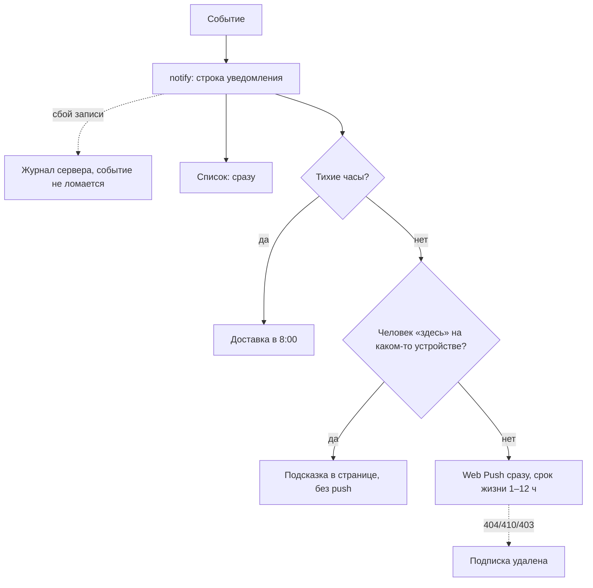
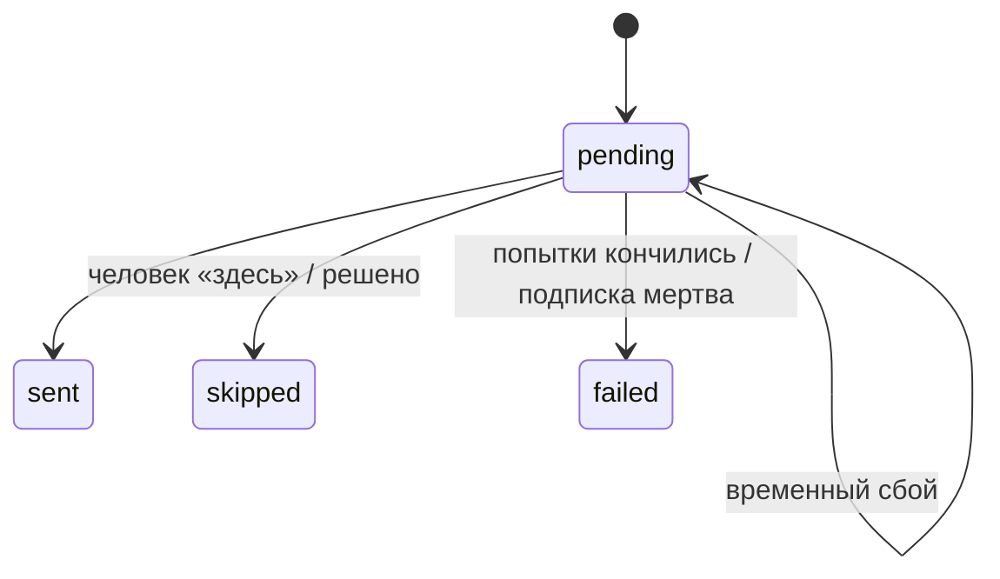

# Уведомления в браузере — спецификация

**Статус:** построено 22.11 (шаги 1–8; тесты сервера и интерфейса, сценарии e2e, проверка в браузере); не сделано — шаг 0 «доставка из России без VPN» и проверка на iPhone: нужен https (после первой установки или туннель с разрешения владельца). Ход и итоги — задача #31
**Задача:** [#31](https://github.com/nyxandro/basic-business-agent/issues/31)
**Дата:** 2026-11-20, переписано без писем 2026-11-21 · **Проект:** basic business agent · **Тип фичи:** смешанный (список и настройки + механизм доставки в браузер) · **Где работает:** браузер сотрудника (уведомления системы, список уведомлений), сервер (очередь доставки)
**Не применяется:** —

## Для новой сессии: как начать

**Где этот план.** Один из семи планов (было восемь; «Итоги совещаний» владелец исключил 21.11: «у меня для этого и так есть скилл, я сам сделаю»), составленных 20.11.2026 по просьбе владельца: «составь пачку планов на каждую из фичей, все хорошенько поресерчи, изучи лучшие плагины на рынке». Порядок постройки по зависимостям — рекомендация агента, владелец его не подтверждал:
1. `[20.11.2026]-mcp-connections.md` — свои подключения MCP
2. `[20.11.2026]-notifications.md` — уведомления в браузере ← этот план
3. `[20.11.2026]-knowledge-base.md` — база знаний организации
4. `[20.11.2026]-org-letterhead.md` — бланк организации, печать и подпись
5. `[20.11.2026]-event-tasks.md` — фоновые задачи по событию
6. `[20.11.2026]-multi-step-approvals.md` — согласования в несколько шагов
7. `[20.11.2026]-feedback-and-value.md` — жалобы, образцы документов и отчёт о пользе

Этот план — №2. Ни от чего не зависит. Нужен фичам «Задачи по событию» (уведомления администраторам о лавине и заблокированном исполнителе, вопросы «Да»), «Согласования» (заявка ждёт согласующего, итог заявки). Виды уведомлений этих фич уже перечислены в разделе 8.

**Состояние на 21.11.2026.** Черновик. Исследование сделано (опоры — раздел 3: Apple (Web Push для сайтов на экране «Домой»), WebKit (отзыв подписки), Chrome (FCM), сообщения 2026 о сбоях доставки через сервисы Google в России, практика Slack/Linear). Независимая проверка свежим агентом проведена 20.11 и учтена — что она поменяла, ниже. Ответы владельца 21.11 на все вопросы: писем нет совсем (F1), выключатель писем снят (F2), список уведомлений под колокольчиком в шапке справа на компьютере и телефоне (F3), вопросы чата — на «Ждёт подтверждения» со сроком, который задаёт администратор, сначала сутки (F4). План переписан под одни уведомления браузера. Построено 21–22.11 по слову владельца «реализуй под ключ» (задача #31); устройство по факту — раздел 17, отступления при сверке с кодом — разделы 8 и 15.

**Как стартовать в новой сессии.**
1. Прочитать `AGENTS.md`, этот план целиком и разделы спецификации базы `docs/specs/[12.11.2026]-agent-base-architecture.md`: 8.4 (подтверждения, 72 часа), 8.6 (фоновые задачи, отметка «новое»), 8.20 (общий доступ к проекту), 8.24 (почта: поиск настроек, SMTP, вход через сайт), сценарий 4.
2. Загрузить скиллы: `feature-blueprint` (работа продолжается с его шага 13 — «после ответов владельца»), `owner-decisions` (сверить вопросы с базой решений владельца и записать его ответы, если они годятся и для других проектов), `find-docs` (Web Push, `web-push`, service worker, Vite — версии), `vercel-react-best-practices`, `supabase-postgres-best-practices` (до миграции), `agent-browser` (проверка в браузере, потом закрыть сессию и удалить снимки).
3. Если владелец ещё не ответил — задать вопросы раздела 6 одним сообщением в формате раздела 6 (ситуация, почему решать ему, варианты, рекомендация; в чате каждый вопрос — строкой с ❓). Молчание и «ок» — не согласие: рекомендованный вариант без слова владельца не строится. Ответы — в «Принято» с датой; обновить все задетые разделы и «Коротко»; статус — «согласовано».
4. Завести задачу GitHub (`gh`, правило проекта): что и зачем со ссылкой на этот файл, решения владельца с датами, шаги раздела 22 чек-листом, критерии готовности, зависимости. Ссылку вписать строкой «**Задача:**» в шапку этого файла.
5. Шаг 0 раздела 22 — проверки и замеры. Если они меняют решения владельца или устройство — показать владельцу, что изменилось, и ждать.
6. Дальше шаги по порядку: сначала падающий тест, потом код; после шага — `pnpm typecheck && pnpm lint` и тесты затронутого; коммит; итог шага — комментарием в задаче. В конце сессии — самопроверка и независимая проверка изменений отдельным агентом (глобальные правила владельца).

**Где смотреть код.** `web/src/layout/notifications.tsx`, `web/src/layout/ChatHeader.tsx:16-27`, `web/src/layout/Sidebar.tsx:56-59`, `web/src/approvals/*`, `core/background/routes.ts:60-75`, `core/approvals/requests.ts:84-162`, `core/background/queue.ts:58-68`, `core/background/service.ts` (истечение, `finishRun`, `closeRun`), `core/chat/run.ts:105,118` (`settleRun`, `endRun`), `core/models/usage.ts`, `core/models/limits.ts`, `core/connections/credentials.ts` (`setCredentialStatus`), `core/mail/`, `web/src/auth/session.tsx`.

**Правила, которые легко нарушить** (из `AGENTS.md`, памяти агента и базы решений владельца `~/.agents/decisions/`):
- Правила проекта (`AGENTS.md`, правила работы в спецификации базы) не править без прямого слова владельца — даже чтобы записать его же указание.
- В спецификации — устройство и решения, без журнала работ: ход и итоги — комментариями в задаче GitHub.
- На http://localhost:8080 работает `pnpm dev` владельца: не останавливать и не перезапускать; `git stash` не использовать (ломает слежение за файлами); `pnpm test:e2e` и `pnpm stand` — во временной копии на портах 3100/8180 (раздел 22 спецификации базы).
- После шага — только `pnpm typecheck && pnpm lint` и тесты затронутого; полный `pnpm test`, `pnpm test:e2e`, `pnpm smoke` — один раз перед слиянием (решение владельца 20.11).
- Влить в `main`, создать PR, удалить тома и данные, подключить внешний сервис, который получит данные проекта, отправить что-либо за пределы машины — только с разрешения владельца.
- Сбой поведения модели чинить сначала тем, что советует документация фреймворка, а не своими ограничениями в цикле агента; число шагов агента кодом не ограничивать (решения владельца 15.11).
- Prettier не запускать; файл кода — до 800 строк; только стираемый синтаксис TypeScript.
- Владельцу — по-русски: сначала последствие, потом механизм; термины объяснять при первом упоминании.
- Поведение Mastra, LiteLLM, MCP-библиотек проверять по установленным исходникам и скиллам `mastra-*`, не по памяти.

**Открыто для всех семи планов** (спросить владельца при первом случае):
- В правилах проекта записано «спецификация одна, отдельных файлов не заводить» (`AGENTS.md`, «Источники правды»). Эти файлы сделаны по прямому слову владельца 20.11 («планируй фичу в общем в отдельном файле только»), правила не правились. Не решено: после сдачи фичи переносить ли её устройство в разделы 8–17 спецификации базы (как требует её правило) или оставлять здесь, и вписать ли исключение в `AGENTS.md`.
- Формат сообщений коммитов: правило проекта — «Шаг N: что сделано», а шаги здесь нумеруются внутри плана. Предложение агента (не подтверждено): «{Фича}, шаг N: что сделано».
- Чек-лист шагов в задаче #2 — для этапа 2; для этих фич чек-лист — в своей задаче GitHub.
- На 21.11 файлы планов не закоммичены (ветка `stage-2-new-interface`, `main` с ней совпадает после слияния 20.11).

**Что поменяла независимая проверка 20.11** (не возвращать прежние решения):
- Не показывать push при активном окне решает сервер по отметке присутствия (видимая вкладка раз в 30 с), а не обработчик браузера: Safari отзывает подписку после трёх push без уведомления, Chrome показывает своё «сайт обновлён в фоне».
- Тихие часы 21:00–8:00 по часовому поясу установки для push.
- Уведомление пишется отдельной записью после события; сбой записи не ломает событие (у вызывающих мест нет общих транзакций).
- Ключ повтора — на случай (`connection_broken:<подключение>:<время поломки>`), а не на объект.
- Обработчик браузера собирается Vite отдельной точкой входа (`/sw.js`), а не лежит в `public`.
- При выходе из приложения браузер отписывается (общий компьютер).
- Вопросы «Да» обычного чата при ушедшем браузере тоже уведомляются; показ на «Ждёт подтверждения» и срок — F4.
- На компьютере колокольчика сейчас нет — место по F3 (пункт «Уведомления» в боковой панели).
- Ссылка на решённый вопрос показывает «Вопрос уже решён», а не пустой экран (нужен `GET /app/api/approvals/:id`).
- `web-push` 3.6.7, а не вышедшая 06.11.2026 4.0.0; `subject` VAPID — `mailto:` суперадминистратора.
- 21.11 по ответу владельца убраны письма: ящик организации, выключатель писем, окно 10 минут, сводка писем, предел 20 писем в минуту, карточка «Почта для уведомлений». Не возвращать без его слова; условие возврата — раздел 14.
- Проверка доставки — с телефона без VPN (VPN машины разработки подменяет адреса), на https.

## Коротко

**Что строим и зачем.** Сейчас агент молчит, пока сотрудник сам не откроет приложение. Пример: в 9:00 фоновая задача нашла просроченный платёж и ждёт «Да», а сотрудник увидит это в 15:00 или не увидит вовсе, и через 72 часа вопрос сгорит. Строим уведомления в браузере: всплывающее уведомление на компьютере и телефоне и список в приложении. Сообщаем о том, что ждёт человека или готово для него. Писем не будет (решение владельца 21.11). Успех: вопрос «Да» замечен в течение часа, а не к концу дня; доля истёкших вопросов падает [ИЗМЕРИТЬ до и после].

**Как будет работать.**
1. Сотрудник один раз включает уведомления браузера — под колокольчиком или в «Настройках → Уведомления». Браузер спрашивает разрешение. На iPhone сначала нужно добавить сайт на экран «Домой» — так устроен Safari, и экран это объясняет.
2. О чём сообщаем сотруднику:
   - вопрос ждёт «Да» — фоновой задачи, а также вопрос обычного чата, если человек ушёл со страницы;
   - вопрос сгорит через 12 часов;
   - результат фоновой задачи готов или задача не выполнилась;
   - доступ к системе или почте сломался;
   - вам открыли проект (лично или вашему отделу);
   - израсходовано 80 % личного лимита и лимит исчерпан;
   - готов ответ агента, если вы ушли со страницы;
   - заявка ждёт вашего согласования и итог вашей заявки (фича «Согласования»).

   Администраторам с правом «Агенты» — о сбоях фоновых задач: лавина событий, исполнитель заблокирован (фича «Задачи по событию»).
3. Уведомление браузера приходит сразу. Если окно приложения открыто и видно на любом устройстве человека, всплывающего нет — вместо него подсказка внутри страницы.
4. С 21:00 до 8:00 по времени установки всплывающие уведомления ждут утра. В списке всё видно сразу.
5. Каждое уведомление ведёт прямо к делу. Если вопрос уже решён, страница так и скажет, а не покажет пустой экран.
6. Колокольчик — в шапке справа и на компьютере, и на телефоне (решение владельца 21.11). Он виден всегда, счётчик — ждущие решения вопросы плюс непрочитанные уведомления. Под ним панель с двумя вкладками: «Ждут решения» и «Уведомления» (список за 30 дней). Это единственная страховка, если браузер не доставил уведомление: писем нет.
7. Вопросы «Да» из обычного разговора, оставшиеся без ответа, тоже попадают на «Ждут решения» и сгорают по сроку. Срок задаёт администратор в «Режимах работы» → «Подтверждения»: сначала сутки для вопросов из разговора и 72 часа для вопросов фоновых задач (решение владельца 21.11).

**Как построим.**
1. Одна таблица уведомлений — источник правды; отдельная очередь доставки в браузер. Уведомление создаётся сразу после события отдельной записью. Сбой записи не ломает само событие и пишется в журнал сервера: событие важнее уведомления.
2. Уведомления браузера — стандарт Web Push. Нужны:
   - обработчик браузера (service worker), собранный Vite отдельным файлом `/sw.js`;
   - описание приложения (manifest) — для iPhone;
   - библиотека `web-push` на сервере.

   Ключи подписи создаются при первом запуске и хранятся зашифрованными.
3. «Человек в приложении» — отметка присутствия: видимая вкладка раз в 30 с сообщает серверу «я здесь»; пропала на 60 с — «не здесь».
4. События дают модули, где они происходят: они вызывают одну функцию `notify(...)`, каждая фича добавляет свои виды.

**На что смотреть.**
- **Писем нет — значит, нет страховки вне приложения.** Если браузер не доставил уведомление, человек узнает о нём, только открыв приложение. Именно поэтому важен список (F3). Вернуться к письмам: если после выпуска больше 20 % вопросов «Да» истекают неувиденными или шаг 0 покажет, что уведомления Chrome из России не доходят.
- **Россия и Chrome.** Уведомления Chrome идут через сервис Google (FCM), и в 2026 году доставку через сервисы Google в России задерживали. Сервис может принять уведомление и не доставить, а мы об этом не узнаем. Проверка в шаге 0 — с телефона без VPN, на мобильном интернете, несколько дней.
- **iPhone.** Работает только у сайта, добавленного на экран «Домой» (iOS 16.4+), и только по https. В таком режиме вход в приложение отдельный от Safari: нужно войти заново. Работают ли там вход через сайт сервиса и «Скачать», не проверено.
- **Без https уведомлений браузера нет.** Установка, открытая по http (кроме localhost), показывает «Уведомления браузера работают только по https». Проверка на телефоне до первой настоящей установки требует https-туннеля — это внешний сервис, только с разрешения владельца.
- **Общий компьютер.** При выходе из приложения браузер отписывается: уведомления Ольги не приходят Петру, который вошёл после неё.
- Отложено: письма (решение владельца 21.11), Telegram и мессенджеры, уведомления о сбоях шлюза.

**На что опирается.**
- Apple: Web Push — только для сайта на экране «Домой», iOS 16.4+, после нажатия человека. Safari отзывает подписку, если сайт трижды получил push и не показал уведомление. Сервис Apple отвечает «успех» даже на мёртвую подписку.
- Chrome: подписка идёт через FCM. Если сайт не показал уведомление, Chrome показывает своё «сайт обновлён в фоне».
- Slack, Linear: не показывать уведомление, если человек сейчас в приложении.
- Спецификация базы: вопрос фоновой задачи ждёт 72 часа; счётчики — раз в минуту.

**Найдено по пути.**
- Вопрос «Да» в обычном чате, оставшийся без ответа (человек закрыл вкладку), не попадает ни в «Ждёт подтверждения», ни в счётчик и не истекает (`core/approvals/requests.ts:162`, `core/background/routes.ts:69`). Уведомление о нём делаем в этой работе; показ и срок — F4.
- Счётчик «новых результатов» фоновых задач (`unreadResults`) сервер отдаёт, но интерфейс его не показывает, а `POST /app/api/tasks/:id/read` никто не вызывает. Эта работа заменяет его уведомлением «Готово: задача» и снимает отметку при открытии.
- Колокольчик сейчас есть только на телефоне и прячется, когда вопросов нет (`web/src/layout/ChatHeader.tsx:16-27`).

**Ждёт вашего решения.**
1. ~~С какого ящика уходят письма?~~ Решено 21.11: писем пока нет совсем (F1, «Принято»).
2. ~~Выключатель писем?~~ Снят вместе с письмами (F2, «Принято»).
3. ~~Список уведомлений и колокольчик на компьютере?~~ Решено 21.11: список есть, колокольчик в шапке справа, как на телефоне (F3, «Принято»).
4. ~~Вопросы «Да» обычного чата без ответа?~~ Решено 21.11: показывать, срок — сутки, настраивается в админке (F4, «Принято»).

**Выкладка:** выкладки нет. Работа заканчивается `pnpm typecheck && pnpm lint`, тестами затронутого и сценарием e2e; полный прогон — перед слиянием.

**Объём:** 9 шагов, около 7 ч работы агента. Дольше всего — проверка в настоящих браузерах. От вас — 5 минут на iPhone по https (после первой установки или через туннель — с вашего разрешения).

**Не проверено:** доставка в Chrome и Яндекс Браузере из России без VPN; iPhone — вход и скачивание в режиме экрана «Домой».

---

# Часть 1. Для владельца: как это устроено

## 1. Что известно и что добавлено

- **Владелец сказал (20.11):** «доведи систему уведомлений, тоже планируем фичу, на почту, в браузере, больше пока нигде не надо».
- **Владелец сказал (21.11), отвечая на вопрос о ящике для писем:** «пока это не настраиваем вообще, пусть пока что просто уведомления в браузере будут, я не уверен, что нужны будут почтовые уведомления: если сам же агент будет пользоваться почтой сотрудников, то это нелогично, люди не будут в почте сидеть особо».
- **Найдено в проекте:**
  - счётчики: раз в минуту `GET /app/api/me/notifications` (`core/background/routes.ts:66-75`), показывается только число вопросов;
  - обработчика браузера и описания приложения нет;
  - вопрос фоновой задачи истекает через 72 часа (`APPROVAL_TTL_MS`);
  - у вызывающих мест нет общих транзакций: вопрос — одиночный запрос в обработчике потока (`requests.ts:89`), `finishRun` — одиночный UPDATE (`queue.ts:58-60`), `setCredentialStatus` — тоже;
  - месячные бюджеты держит LiteLLM, расход приходит от шлюза в `core/models/usage.ts` — там можно сравнить с лимитом; места, где считается порог, нет;
  - конец хода — `settleRun`, уход браузера — `endRun` (`core/chat/run.ts:105,118`);
  - вход возвращает по `next` (`web/src/auth/session.tsx:105`); страницы отдельного вопроса нет, только `approvals` (`web/src/app/App.tsx:62`).
- **Добавлено:** [ДОПУЩЕНИЕ] до 200 сотрудников, сотни уведомлений в день.

## 2. Цели, не-цели, анти-цели

- **Цели:**
  1. Вопрос «Да» и заявка на согласование доходят до человека, когда приложение закрыто, — уведомлением браузера сразу.
  2. Результат фоновой работы и долгий ответ не остаются незамеченными, неудача — тоже.
  3. Любое уведомление открывает то, о чём оно, или честно говорит, что дело уже решено.
  4. Ни одно уведомление не теряется молча: оно есть в списке, даже если браузер не доставил (F3).
- **Не-цели:** письма (решение владельца 21.11); Telegram и мессенджеры; SMS; уведомления о сбоях шлюза.
- **Анти-цели:**
  - уведомление с текстом переписки, документа или параметрами действия;
  - всплывающие тому, кто сейчас в приложении;
  - уведомление чужого человека в этом браузере;
  - звонок телефона в 3 часа ночи;
  - уведомление ведёт на «нет доступа» или на пустую страницу.
- **Сейчас:** о вопросах узнают, только открыв приложение.

## 3. На что опирается

| Практика | Кто делает | Масштаб | Берём? | Почему | Источник, дата |
|---|---|---|---|---|---|
| Web Push, ключи VAPID | все браузеры | любой | да | единственный способ при закрытой вкладке | developer.apple.com (Web Push); webkit.org |
| Не показывать push при активном окне — решать на сервере, а не в обработчике браузера | — | — | да | Safari отзывает подписку после трёх push без уведомления | коммит WebKit 108ccb44; webkit.org «Meet Web Push» |
| Тихие часы | мессенджеры, Slack | любой | да | ночные задачи не будят людей | — |
| Письма «если не увидел в приложении» | Slack, Linear | — | нет, пока | решение владельца 21.11 | — |

## 4. Варианты и масштаб

Путь один: уведомления браузера + список в приложении. Развилки — список и место колокольчика (F3), вопросы чата (F4).

## 5. Как это работает

**Точки входа:** список уведомлений → 1, 3; «Настройки → Уведомления» → 1; событие → 2; уведомление браузера → 2.

**Сценарий 1 — включить уведомления.** Ольга, компьютер, Chrome.
1. Список уведомлений → внизу «Включите уведомления, чтобы не пропускать вопросы агента» → «Включить» → разрешение браузера → «Уведомления включены» и пробное «Уведомления работают».
2. iPhone в Safari: «На iPhone уведомления работают, только если добавить приложение на экран «Домой»: «Поделиться» → «На экран «Домой»», затем откройте его оттуда и войдите».
3. Запрещено в браузере: «Уведомления запрещены в настройках браузера. Разрешите их для этого сайта (значок замка у адреса)».
4. Сайт открыт по http: «Уведомления браузера работают, только когда приложение открыто по https. Список уведомлений работает и так».

**Сценарий 2 — вопрос ждёт «Да».** Утренняя сводка у Ольги хочет отправить письмо клиенту.
1. Сразу — «Ждёт вашего решения · Утренняя сводка · Отправить письмо». Щелчок открывает «Ждёт подтверждения» на этом вопросе.
2. За 12 часов до истечения — напоминание. Если это ночью — в 8:00.
3. Вопрос уже решён на другом устройстве, а Ольга щёлкнула старое уведомление — «Вопрос уже решён: выполнено 9:14».

**Сценарий 3 — список.** Счётчик, список неразобранного: вид, заголовок, строка, время. Щелчок — переход, и уведомление уходит из списка; открыл разговор сам или решил вопрос — тоже уходит. «Отметить все прочитанными» очищает список (решение владельца 22.11: «туда сыпется только то, на что я не отреагировал»). Строки хранятся 30 дней для доставки, историю список не показывает.

**Сценарий 4 — долгий ответ.** Ольга попросила КП и ушла — закрыла вкладку, свернула её или перешла в другой разговор или на другой экран приложения (решение владельца 22.11: «в другом чате я что-то писал, мне ничего не пришло»). Вкладка сообщает серверу, какой разговор у неё на экране; ответ, закончившийся без смотрящей вкладки, даёт «Ответ готов».
1. Вкладка открыта, но скрыта — уведомление от страницы («Ответ готов · {разговор}»).
2. Вкладку закрыли или телефон заблокирован — сервер шлёт push: страница перестала отмечать присутствие.
3. Ответ закончился вопросом «Да» — уведомление «Ждёт вашего решения», а не «Ответ готов».

## 6. Решения владельца

### Принято
- **F1 — писем нет совсем** (владелец 21.11: «пока это не настраиваем вообще, пусть пока что просто уведомления в браузере будут… если сам же агент будет пользоваться почтой сотрудников, то это нелогично, люди не будут в почте сидеть особо»). Было на выбор: ящик организации (рекомендация агента), сервис рассылок, без писем. Вернуться — по условию раздела 14.
- **F2 — выключатель писем** — снят вместе с письмами.
- **F3 — список уведомлений есть; колокольчик в шапке справа, как на телефоне** (владелец 21.11: «да, давай там же колокольчик, где и на телефоне, в шапке справа»). Было на выбор: пункт «Уведомления» в боковой панели (рекомендация агента), без списка. Прочтение агента, на проверку: колокольчик виден всегда (сейчас на телефоне прячется, когда вопросов нет), счётчик — вопросы, ждущие решения, плюс непрочитанные уведомления; панель под ним — две вкладки «Ждут решения» и «Уведомления».
- **22.11, по ходу постройки** (слова владельца):
  - «блок ждут решения не показывать, если там ничего нет — лишняя вёрстка» — вкладка «Ждут решения» только при ждущих вопросах;
  - «должен краснеть со счётчиком и дребезжать влево-вправо изредка, привлекая внимание» — колокольчик с новым красный, раз в 9 с качается;
  - «после перехода по уведомлению в чат оно всё равно висит в уведомлениях, а должно исчезать; туда сыпется только то, на что я не отреагировал» — список показывает только неразобранное;
  - «в другом чате я что-то писал — мне ничего не пришло» — «Ответ готов» и при уходе в другой разговор, не только при закрытой вкладке.
- **F4 — вопросы «Да» обычного разговора показываются на «Ждёт подтверждения» и сгорают по сроку; срок задаёт администратор, сначала сутки** (владелец 21.11: «да, показывать, срок сутки, но эта настройка должна регулироваться через админку где-то в подходящем разделе»). Прочтение агента, на проверку: место — «Режимы работы» → блок «Подтверждения» (там же, где фоновые задачи, чьи вопросы тоже ждут «Да»); два значения — «Вопрос из разговора: 1 сутки» и «Вопрос фоновой задачи: 72 часа» (прежний срок фоновых не меняется без слова владельца); стартовые значения — в `config/app.ts`, дальше — в базе; напоминание «сгорит через …» — когда осталась четверть срока (при сутках — за 6 часов).

---

# Часть 2. Для исполнителя: поведение подробно

## 7. Точки контакта и состояния

| Точка | Пусто | Загрузка | Есть данные | Ошибка | Нет прав | Успех |
|---|---|---|---|---|---|---|
| Колокольчик в шапке справа (компьютер и телефон) | без счётчика, цвета текста | — | красный, красный счётчик (ждут решения + непрочитанные), раз в 9 с коротко качается (владелец 22.11) | счётчик не обновился — прежний | — | панель |
| Панель: вкладка «Ждут решения» | вкладки нет — панель сразу показывает уведомления (владелец 22.11: «лишняя вёрстка»); появившись, вкладка остаётся, пока панель открыта, чтобы «Выполнено» последнего вопроса не пропало | `DelayedBar` | вопросы фоновых задач, разговоров (с пометкой «Из разговора «…»») и заявки на согласование | «Не удалось загрузить» и «Повторить» | — | переход к вопросу |
| Панель: вкладка «Уведомления» | «Новых уведомлений нет» и блок «Включите уведомления…» | `DelayedBar` | список неразобранного; без заголовка, в самом верху по центру мелко «✓ Пометить как прочитанные» (владелец 22.11) | «Не удалось загрузить уведомления» и «Повторить» | — | переход |
| «Режимы работы» → «Подтверждения» (админка) | — | — | «Вопрос из разговора ждёт ответа: {N} ч», «Вопрос фоновой задачи ждёт ответа: {N} ч» | «Срок — от 1 до 720 часов» | право `agents` | «Сохранено» |
| «Настройки → Уведомления» | состояния браузера ниже | — | «Включены в этом браузере», «Проверить» | состояния ниже | — | «Пробное уведомление отправлено» |
| Состояния браузера | «Не поддерживается этим браузером» / «Только по https» / «На iPhone — сначала на экран «Домой»…» / «Запрещены в настройках браузера…» / «Выключены» / «Включены» (по подписке на сервере) | | | | | |
| «Ждёт подтверждения» по ссылке | — | — | вопрос выделен | «Вопрос уже решён: {итог, время}» | — | — |

## 8. Внутренний механизм: гарантии, данные, сбои

**Гарантии:**
- уведомление пишется сразу после события; сбой записи не ломает событие и попадает в журнал сервера (`notification_failed`);
- ключ повтора — на случай, а не на объект: `approval:<id>`, `connection_broken:<подключение>:<время поломки>`, `task_result:<запуск>`;
- `notify` в одной транзакции пишет строку уведомления и строку доставки; доставку берёт обходчик сервера раз в 2 с (`FOR UPDATE SKIP LOCKED`). Так `notify` нужна только база (её зовут восемь мест, у которых нет ничего другого), а доставка, не успевшая уйти до остановки сервера, уходит после запуска (сверка с кодом 21.11; было «push уходит сразу из `notify`»);
- тихие часы, присутствие и «уже решено» проверяются в момент доставки, а не записи: напоминание, отложенное до 8:00, не уходит, если вопрос за ночь решён или сгорел;
- один повтор через 1 мин при временном сбое (сеть, 429, 5xx); срок жизни у сервиса — 12 ч для вопросов, 1 ч для «ответ готов»;
- запрос к сервису push собирает `web-push` (`generateRequestDetails`: шифрование и подпись VAPID), отправляет встроенный `fetch` с пределом 10 с: так сбой виден кодом, а в тестах сервис push — простая заглушка по http;
- повторная доставка одного уведомления показывает одно (тег = id).

| Что ломается | Как предотвращаем | Как узнаём | Как восстанавливаемся | Что теряется | Чем закрыто |
|---|---|---|---|---|---|
| Сервис push не отвечает | один повтор | `push_failed` | — | всплывающее; список есть | шаг 5 |
| Подписка мертва (404/410), ключи сменились (403) | — | ответ сервиса | подписка удаляется | — | шаг 5 |
| Apple «успех» на мёртвую подписку | — | — | подписка обновляется по `pushsubscriptionchange` | всплывающие на этот iPhone | шаг 6 |

**Данные:**
- `app.notifications`: `id`, `user_id`, `kind`, `title`, `body`, `link`, `subject_ref` (вопрос, заявка, запуск — чтобы знать «решено»), `thread_id` (разговор, о котором уведомление: его открытие отмечает уведомление прочитанным), `dedup_key` (уникален с `user_id`), `created_at`, `read_at`. 30 дней.
- `app.notification_deliveries`: `notification_id`, `status` (`pending`, `sent`, `skipped`, `failed`), `attempts`, `send_after`, `error_code`, `sent_at` — канал один, браузер; поле `channel` с одним значением `push` оставить, чтобы письма можно было добавить без переделки таблицы.
- `app.push_subscriptions`: `id`, `user_id`, `endpoint` (уникален: при включении другим человеком в том же браузере — переходит к нему), `p256dh`, `auth`, `user_agent`, `created_at`, `last_ok_at`.
- Присутствие — в памяти процесса сервера, по вкладкам: видимая вкладка отмечается раз в 30 с и сразу при смене экрана, называя разговор на своём экране (`threadId`), скрытая сообщает «скрыта» сразу; человек «здесь», если хоть одна его вкладка отметилась видимой меньше 60 с назад; разговор «смотрят», если он на экране такой вкладки (`isWatching`, конец хода в `settleRun`). Таблицы `app.presence` нет (сверка с кодом 21.11): отметка живёт минуту, а сервер установки один — так же, как удержания хранилища (раздел 8.23 спецификации базы). После перезапуска сервера первые 30 с человек считается «не здесь» — в худшем случае придёт лишнее всплывающее.
- Уведомления от самой страницы (скрытая вкладка) не делаем: скрытая вкладка сразу сообщает «скрыта», сервер шлёт push, и обработчик браузера показывает его и при открытой вкладке. Иначе одно событие давало бы два уведомления.
- Ключи VAPID — `app.notification_keys` (закрытый зашифрован); `subject` — `mailto:` адрес суперадминистратора.
- У вопроса «Да» (`app.approval_requests`) — `run_kind` (`chat`, `background`, `draft`: срок и место показа) и `closed_at` (сгоревший вопрос разговора: когда ожидавший ход получил отказ).

**Виды:**

| Вид | Кому |
|---|---|
| `approval_waiting` (фоновая задача; чат — если браузер ушёл) | сотрудник |
| `approval_expiring` (когда осталась четверть срока) | сотрудник |
| `chain_waiting` (фича 7) | согласующий |
| `chain_result` (фича 7) | сотрудник |
| `connection_broken` | сотрудник |
| `task_result`, `task_failed` | сотрудник |
| `project_shared` (лично или отделу — в момент открытия; «всей организации» — без уведомления) | сотрудник |
| `limit_near`, `limit_exhausted` (личный месячный) | сотрудник |
| `answer_ready` (браузер ушёл до конца хода) | сотрудник |
| `answer_failed` (браузер ушёл, ответ оборвался ошибкой — цель 2: «неудача — тоже»; добавлено при сверке 21.11) | сотрудник |
| `task_problem` (фича 4: лавина, исполнитель) | администраторы с правом `agents` |
| `support_new` (план №7: новая жалоба) | люди с правом «Поддержка» |
| `support_reply` (план №7: ответ на обращение) | сотрудник |

## 9. Ошибки и восстановление

| Ситуация | Что видит человек |
|---|---|
| Браузер не умеет push (проверка `PushManager`; iPad определяется по «Mac + касание») | «Этот браузер не умеет уведомления. Подойдут Chrome, Яндекс Браузер, Firefox, Edge, Safari 16.4+» |
| Подписка не сохранилась | «Не удалось включить уведомления. Попробуйте ещё раз. Код: APP_PUSH_SUBSCRIBE_FAILED» |

## 10. Крайние случаи и стыки

| Случай | Что происходит |
|---|---|
| Выход из приложения | браузер отписывается, подписка удаляется |
| Два браузера у человека | push на оба; если видно хоть одно окно — ни на один |
| Сотрудник заблокирован или удалён | уведомления не создаются, подписки удаляются |
| Задача ночью задала вопрос | список — сразу, push — в 8:00 |
| Уведомление прочитано на компьютере | на телефоне всплывающее остаётся в шторке |
| Лимит 80 % несколько раз за месяц | `limit_near:<месяц>` |
| Вопрос из разговора сгорел | в разговоре строка «Вопрос истёк: вы не ответили за {срок}»; действие не выполняется |
| Администратор сократил срок | действует для новых вопросов; заданные раньше живут по сроку, с которым были заданы (`expires_at` пишется при вопросе) |

| Соседняя функция | Где встречаются | Что происходит |
|---|---|---|
| Счётчики (сейчас) | `GET /app/api/me/notifications` | + непрочитанные уведомления, + заявки на согласование |
| Отметка «новое» у результата задачи | открытие разговора | снимает и её, и «прочитано» у уведомления |
| Почта сотрудника 8.24 | — | не используется: писем нет |

## 11. Скорость

Push после события — до 5 с [ИЗМЕРИТЬ].

## 12. Тексты интерфейса

| Где | Текст |
|---|---|
| Заголовки | «Ждёт вашего решения», «Вопрос сгорит через 12 часов», «Ждёт вашего согласования», «Согласование №{N}: {итог}», «Готово: {задача}», «Задача не выполнена: {задача}», «Не работает доступ к {система}», «Вам открыли проект «{название}»», «Израсходовано {N} % лимита на {месяц}», «Лимит на {месяц} исчерпан», «Ответ готов», «Задача «{название}» не работает: {причина}» |
| Настройки | «Уведомления», «В этом браузере», «Включить», «Проверить», «С 21:00 до 8:00 — не беспокоим» |
| Панель колокольчика | «Ждут решения», «Уведомления», «Из разговора «{название}»», «Отметить все прочитанными» |
| «Режимы работы» → «Подтверждения» | «Подтверждения», «Сколько вопрос «Да» ждёт ответа, прежде чем сгореть. Сгоревшее действие не выполняется.», «Вопрос из разговора», «Вопрос фоновой задачи», «часов» |

## 13. Данные

- В уведомлении — только название действия, задачи, системы или проекта.
- Содержимое push шифруется для браузера: сервис Google, Apple или Mozilla видит только зашифрованное.

## 14. Что сознательно не делаем

- **Письма** — решение владельца 21.11. Вернёмся, если после выпуска больше 20 % вопросов «Да» истекают неувиденными или шаг 0 покажет, что уведомления Chrome из России не доходят. Таблица доставки к этому готова (поле `channel`); почтовый код есть (`core/mail`).
- **Telegram, мессенджеры, SMS** — слово владельца 20.11.
- **Уведомления о сбоях шлюза и аккаунтов ChatGPT** — с первым заказчиком и мониторингом.
- **Тихие часы на человека** — общие для установки; вернёмся, если попросят.

## 15. Решения агента — на проверку

- Набор видов уведомлений.
- Напоминание — когда осталась четверть срока; тихие часы 21:00–8:00.
- Место настройки срока — «Режимы работы» → «Подтверждения»; срок вопросов фоновых задач остаётся 72 часа, но становится настраиваемым там же.
- Отметка присутствия вместо подавления в обработчике браузера.
- «Вам открыли проект» — не для «всей организации».
- `web-push` 3.6.7, а не вышедшая 06.11.2026 4.0.0 (проверено 21.11 на Node 24.16: шифрование `aes128gcm` и подпись VAPID расшифрованы заглушкой).
- Сверка с кодом 21.11:
  - **Вопрос из разговора в «Ждут решения» ведёт в разговор**, отвечают на него там, на карточке «Да». Ответ с экрана «Ждёт подтверждения» продолжил бы ход агента без открытого чата: ход разговора идёт через поток браузера (снимок проекта, корзина, название, повтор при обрыве), фоновый путь его не повторяет.
  - **Сгоревший вопрос разговора закрывается при следующем сообщении в этом разговоре**, а не в обходе истечения: отказ ходу Mastra — это обращение к модели («хорошо, не отправляю»), в обходе оно стоило бы денег за ответ, которого никто не ждёт, и требовало бы держать разговор занятым. В обходе вопрос только помечается `expired`; карточка «Да» больше ничего не выполняет («Вопрос истёк»); строка «Вопрос истёк: вы не ответили за N ч» видна в разговоре сразу.
  - **Срок по виду хода**: фоновые запуски (и по расписанию, и запуски плагинов `ev:`) — срок фоновых, разговор и черновик промпта — срок разговоров. Вопросы черновика промпта на «Ждёт подтверждения» не показываются: их разговор не открывается из чата.
  - **Шапка на компьютере у всех экранов рамки** (название экрана слева, колокольчик справа), как в макете: там шапка 60 px стоит над любым экраном, а сейчас на компьютере она есть только у чата — колокольчику «в шапке справа» (F3) было бы негде стоять. Админка — своя рамка, колокольчика там нет.
  - **Счётчик «новых результатов» убран целиком**: поле `unreadResults`, `POST /app/api/tasks/:id/read` (его никто не вызывал) и флаг `unread` у запусков задач — их заменило уведомление «Готово: задача».
  - **Ошибка ответа при ушедшем браузере** — уведомление «Ответ не получился» (`answer_failed`), а не «Ответ готов».

---

# Часть 3. Для исполнителя: как строить

## 16. Что есть и что берём

- **Берём:** `NotificationsProvider` (`web/src/layout/notifications.tsx`); `ApprovalsSheet.tsx`, `ApprovalsPage.tsx`; очередь по образцу `core/background/queue.ts`.
- **Зависимость:** `web-push` 3.6.7.

## 17. Устройство

- **Модуль:** `core/notifications/`:
  - `kinds.ts` — виды, их тексты и срок жизни push;
  - `notify.ts` — запись уведомления с доставкой одним запросом, сбой — в журнал;
  - `delivery.ts` — обходчик раз в 2 с, решение «слать ли» в момент доставки, уборка старше 30 дней раз в час;
  - `push.ts` — ключи VAPID и одна отправка (`web-push` собирает запрос, `node:https` с `publicLookup` отправляет);
  - `presence.ts` — присутствие вкладок в памяти;
  - `quiet-hours.ts` — 21:00–8:00 по часовому поясу установки;
  - `list.ts` — список, счётчики, «прочитано»;
  - `routes.ts`, `service.ts` — маршруты и сборка при запуске;
  - `fake-push.ts` — заглушка сервиса push для тестов и стенда e2e: свою расшифровку RFC 8291 делает на `node:crypto`, независимо от `web-push`.

  Интерфейс:
  - `web/src/notifications/` — `NotificationsPanel.tsx` (вкладки «Ждут решения» и «Уведомления»), `PushControls.tsx` (состояния браузера, «Включить», «Проверить»), `push.ts` (подписка браузера), `presence.ts` (отметка присутствия — в рамке приложения и в рамке админки);
  - `web/src/layout/notifications.tsx` — счётчики, подсказка внутри страницы, лист на телефоне;
  - `web/src/layout/ChatHeader.tsx` — колокольчик;
  - `web/src/settings/NotificationsPage.tsx`, `web/src/admin/ApprovalTerms.tsx`;
  - `web/src/sw/sw.ts` → `/sw.js` (в разработке его отдаёт `web/vite.config.ts` из исходника, при сборке — отдельный вход без хэша);
  - `web/public/manifest.webmanifest` и `web/public/icons/` (из фирменной искры);
  - тексты — `web/src/i18n/notifications.ts`.
- **Сроки вопросов (F4):** `app.approval_settings` — одна строка: `chat_ttl_hours`, `background_ttl_hours`; стартовые значения — `config/app.ts` (`approvals.initialChatTtlHours = 24`, `approvals.initialBackgroundTtlHours = 72`, как `limits.initial*`), без них сервер не стартует (`APP_CONFIG_INVALID`); строку ведут `core/approvals/settings.ts` и маршрут `GET/PUT /app/api/admin/approval-settings` (право `agents`, запись в аудит). Срок — по виду хода (`app.approval_requests.run_kind`), `expires_at` считает база при вопросе (`now() + make_interval(hours => …)`). Обход истечения раз в 5 мин (`core/background/service.ts`) гасит вопросы фоновых задач как раньше и помечает `expired` вопросы разговоров (`expireChatQuestions`, без обращения к модели); ожидающий ход разговора получает отказ «Истекло: сотрудник не ответил за N ч.» при следующем сообщении (`cancelPending`, `closed_at`), прежняя карточка «Да» отвечает «Вопрос истёк…» (`APP_APPROVAL_EXPIRED`), в разговоре — строка «Вопрос истёк: вы не ответили за N ч» (`DeclinedToolResult.expiredHours`). Там же — напоминание при четверти срока (`core/approvals/reminders.ts`). Список «Ждёт подтверждения» — `listPending`: вопросы задач и разговоров, кроме черновиков промпта. Отпечатки документов для подписи (`core/org-docs/sign-document.ts`) живут 31 день — дольше самого длинного срока вопроса.
- **Точки событий:**
  - новый вопрос фонового запуска — сразу (`createApprovalRecorder`, `core/approvals/requests.ts`);
  - вопрос и ответ разговора — в `settleRun`, если поток браузера закрылся раньше конца хода (`core/chat/after-leaving.ts`; ошибку хода отмечает прослойка в `core/chat/copilot.ts`);
  - результат и сбой фонового запуска — после `finishRun` (`core/background/service.ts`; запуск, ждущий «Да», сообщает вопросом);
  - сломанный доступ — `markCredentialBroken` (`core/connections/credentials.ts`: вызовы агента в `manager.ts`, `mcp-tools.ts`, `mcp-auth.ts`) и `markMailboxBroken` (`core/mail/accounts.ts`) — только при переходе из рабочего состояния в ошибку; проверка ключа, которую человек запускает сам при сохранении, не уведомляет;
  - открытие проекта — `notifyProjectShared` (`core/projects/sharing.ts`): новые люди списка и его отделов, кроме создателя; «всей организации» и переход с «всей организации» — без уведомлений;
  - лимит — `noticeLimits` (`core/models/limit-notices.ts`) после каждого платного отчёта шлюза.
- **Маршруты:** `GET /app/api/me/notifications` (счётчики), `GET /app/api/me/notifications/list`, `POST /app/api/me/notifications/read` (`{ id }` или `{ all: true }`), `POST /app/api/me/presence` (отвечает счётчиками), `GET /app/api/push/key`, `POST/DELETE /app/api/me/push-subscriptions`, `POST /app/api/me/push-subscriptions/status`, `POST /app/api/me/push-test`, `GET /app/api/approvals/:id`, `GET/PUT /app/api/admin/approval-settings`. Блокировка сотрудника и начало его удаления удаляют его подписки.

- **Что поменяла независимая проверка 22.11** (не возвращать):
  - не больше 10 подписок браузеров на человека, при переполнении уходит самая старая; браузеры человека и уведомления пачки отправляются параллельно (у каждой отправки свой предел 10 с) — одна медленная подписка или сбой сервиса push не держат уведомления остальных;
  - подписка, ключами которой нельзя зашифровать push, не принимается (`APP_PUSH_SUBSCRIBE_FAILED`), сохранённая раньше удаляется при первой отправке;
  - браузер при старте приложения отписывается от подписки, которую сервер держит за другим человеком (общий компьютер, сессия кончилась без «Выйти»);
  - «Стоп» сотрудника: CopilotKit сначала закрывает поток, потом просит остановить — ход помечается остановленным (`noteStopped`), «Ответ готов» не пишется;
  - подсказка внутри страницы — только для уведомления новее последнего показанного (по времени, не по номеру);
  - название разговора в уведомлении проходит распознавание персональных данных всех видов (`withoutPersonalData`), независимо от настроек маскирования;
  - прочитанное уведомление не уходит после тихих часов; щелчок по уведомлению при открытой вкладке просит её перейти самой (`postMessage`), без перезагрузки;
  - сгоревший вопрос запуска плагина (`ev:`, фоновый, без задачи) закрывает обход фоновых вопросов с отказом агенту сразу; вопросы разговоров — при следующем сообщении;
  - присутствие: не больше 20 вкладок на человека, выход из приложения сразу сообщает «скрыта».
- **Права:** уведомления читает и отмечает только адресат.
- **Наблюдение:** `notification_created`, `notification_failed`, `push_failed`.

## 18. Ловушки платформы

- Обработчик браузера — в корне (`/sw.js`), без кэша у Caddy; собирается Vite отдельной точкой входа.
- Chrome требует показывать уведомление на каждый push, Safari отзывает подписку после трёх «тихих» — подавление решает сервер.
- Уведомлений от самой страницы нет (раздел 8): показывает только обработчик браузера, `registration.showNotification`.
- Содержимое push — до ~4 КБ.
- `pushsubscriptionchange` — пересоздать подписку и сообщить серверу.
- Обработчик `web/src/sw/sw.ts` — без импортов: в разработке Vite отдаёт его из исходника как он есть, при сборке он — один простой скрипт. Импорт в нём сломает регистрацию в браузере без единой ошибки в тестах.
- Сервис push принимает адрес подписки только https на стандартном порту и только публичный (`checkEndpoint`, `publicLookup` на самом соединении): адрес присылает браузер, иначе сотрудник подсунул бы внутренний адрес сервера. VPN машины разработки подменяет адреса части сайтов на 198.18.x.x — если под подмену попадёт сервис push Google, на этой машине уведомления не дойдут (`APP_PUSH_FAILED` в журнале); проверять с выключенным VPN.
- Вкладка, которая скрывается или закрывается, сообщает «скрыта» запросом `keepalive` — иначе после закрытия вкладки сервер ещё минуту считал бы человека «здесь» и не слал push.
- Время уведомления пишет база (`now()`), тесты с подменёнными часами переставляют его на свои (`core/notifications/delivery.test.ts`).
- Стенд e2e без тихих часов (`createTestApp({ quietHours: false })`), иначе сценарий push ночью ждал бы утра; «телефон» Ольги — подписка на заглушке push на порту 39990 (`tests/e2e/stand-push.ts`).

## 19. Сбои на новых путях

| Путь | Сбой | Что видит человек | Чем закрыто |
|---|---|---|---|
| Ссылка при закрытом приложении | сессия кончилась | вход, затем ссылка (`next`) | шаг 8 |
| Ссылка на решённый вопрос | — | «Вопрос уже решён…» | шаг 8 |
| Старый `sw.js` после обновления | старая логика | `skipWaiting`, `clients.claim` | шаг 6 |

## 20. Обслуживание

- Сигнал: `push_failed` больше 20 % за сутки.
- Когда ломается: у всех в Chrome — сбой FCM, ждать (список работает); у одного — «Проверить» в его настройках.

## 21. Приоритеты и объём

- **P0:** сценарии 1–4, виды из раздела 8, колокольчик в шапке (F3), сроки и вопросы разговоров (F4).
- **P1:** уведомления о сбоях шлюза.
- **P2:** письма (по условию раздела 14), мессенджеры.

**Объём:** шаг 0 — 1 ч; шаги 1–8 — около 6 ч; итого около 7 ч работы агента.

## 22. Шаги

**Правила каждого шага:** TypeScript только стираемый, импорты `.ts`, до 800 строк; `AppError` из `core/errors/catalog.ts`; тексты — `web/src/i18n/ru.ts`; миграция `NNNN_notifications.sql`; секреты — `SecretBox`; `web/` — только `@bba/contracts`; сначала падающий тест; время в тестах — подменяемые часы.

### Шаг 0: проверки
| Что | Как | Что меняется |
|---|---|---|
| [ПРОВЕРИТЬ] Доставка в Chrome и Яндекс Браузере из России | телефон без VPN, мобильный интернет, 3 дня (нужен https — после первой установки или туннель с разрешения владельца) | не доходит — сказать владельцу: условие возврата к письмам (раздел 14) |
| [ПРОВЕРИТЬ] `web-push` 3.6.7 на Node 24 | тест | — |

### Шаг 1: таблицы, виды, `notify`
**Тест:** повтор ключа — без второй строки; разные поломки одного подключения — два уведомления; сбой записи не роняет вызывающий код
**Готово, когда:** `core/notifications/notify.test.ts` проходит

### Шаг 2: точки событий
**Тест:** вопрос фоновой задачи — уведомление; вопрос чата при живом браузере — нет, при ушедшем — да; `finishRun` на вопросе — без «Готово»; 80 % — одно в месяц
**Готово, когда:** тесты рядом с точками проходят

### Шаг 3: список, счётчики, состояние вопроса
**Тест:** чужие не видны; «все прочитаны»; `GET /app/api/approvals/:id` решённого — итог
**Готово, когда:** тест проходит

### Шаг 4: присутствие и тихие часы
**Тест:** видимое окно 30 с назад — push нет; 70 с — есть; 23:00 — доставка в 8:00 по часовому поясу установки
**Готово, когда:** тест проходит

### Шаг 5: Web Push
**Тест:** заглушка сервиса расшифровывает; 410 и 403 удаляют подписку; один повтор; срок жизни 12 ч / 1 ч; включение другим человеком переносит подписку
**Готово, когда:** тест проходит

### Шаг 6: обработчик браузера и описание приложения
**Файлы:** `web/src/sw/sw.ts`, `vite.config.ts`, manifest, `deploy/Caddyfile`
**Готово, когда:** тест модуля проходит, `pnpm smoke` отдаёт `sw.js` без кэша

### Шаг 7: сроки вопросов и вопросы разговоров на «Ждёт подтверждения» (F4)
**Файлы:** миграция (`app.approval_settings`), `config/app.ts` и проверка настроек, `core/approvals/requests.ts`, `core/background/service.ts` (обход истечения), `core/background/routes.ts`, маршрут админки, `web/src/admin/ModesSection.tsx` (блок «Подтверждения»), `web/src/approvals/*`; тесты `core/approvals/expiry.test.ts`, `web/src/admin/modes.test.tsx`
**Тест:** вопрос разговора виден на «Ждёт подтверждения» с пометкой; через сутки (часы подменены) — истёк, действие не выполнено, строка в разговоре; сокращение срока не трогает уже заданные вопросы; без настроек в `config/app.ts` сервер не стартует
**Готово, когда:** тесты проходят

### Шаг 8: колокольчик в шапке, панель, настройки, выход, e2e
**Файлы:** `notifications.tsx`, `ChatHeader.tsx` (колокольчик всегда и на компьютере), шапки остальных экранов, `NotificationsPanel.tsx` (вкладки), `NotificationsPage.tsx`, `ApprovalsPage.tsx` (выделение и «уже решён»), `session.tsx` (отписка при выходе), `ru.ts`; `tests/e2e/notifications.spec.ts`
**Тест:** все состояния раздела 7; колокольчик есть на компьютере в шапке справа; выход отписывает; e2e — вопрос задачи → колокольчик и вкладка «Ждут решения» показывают его → заглушка push получила уведомление
**Готово, когда:** тесты и e2e проходят; вид — по стилю макета в обеих темах и на телефоне (браузер)

## 23. Критерии приёмки

1. Дано: Ольга разрешила уведомления и не в приложении. Когда: задача задаёт вопрос днём. То: push за 5 с; щелчок открывает вопрос.
2. Дано: Пётр весь день в приложении. То: всплывающих нет, подсказки в странице и список — есть.
3. Дано: вопрос в 23:00. То: push в 8:00, в списке — сразу.
4. Дано: Ольга вышла, Пётр вошёл в том же браузере. То: уведомления Ольги сюда не приходят.
5. Дано: щелчок по уведомлению о решённом вопросе. То: «Вопрос уже решён: …».
6. Дано: вопрос разговора, срок — сутки. Когда: прошли сутки. То: вопрос сгорел, действие не выполнено, в разговоре — строка об этом.
7. Дано: компьютер. То: колокольчик в шапке справа, панель с вкладками «Ждут решения» и «Уведомления».

## 24. Что посмотреть на ревью

1. Сбой уведомления не ломает событие (шаг 1).
2. В уведомлении нет параметров действия и текста переписки (шаг 1).
3. Чужое уведомление нельзя прочитать (шаг 3).
4. Подавление push — на сервере, обработчик всегда показывает уведомление (шаг 6).
5. Отписка при выходе (шаг 8).
6. Вопрос разговора после истечения не выполняется даже по старой карточке «Да» (шаг 7).

## 25. Открытые вопросы

| Вопрос | Кто | Блокирует? |
|---|---|---|
| https для проверки на телефоне: доставка в Chrome и Яндекс Браузере из России без VPN несколько дней, iPhone с экрана «Домой» (вход, скачивание) | владелец — после первой установки или туннель с его разрешения | нет |
